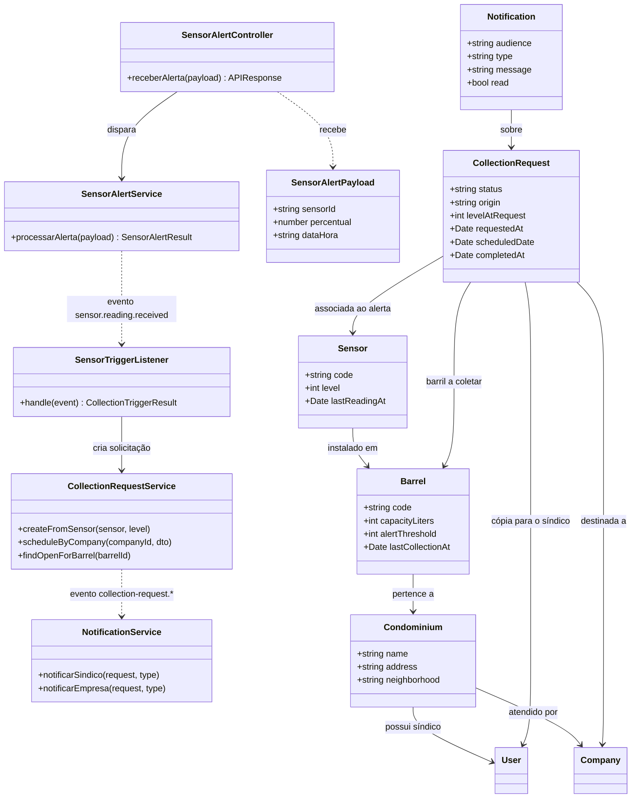

# Diagramas de classes × código

Os dois diagramas mínimos do projeto ("Diagramas de classes mínimos — Coillect") descrevem o software do sensor e o trigger da API. Este documento mostra onde cada classe está no código e o que foi decidido onde o código difere do diagrama.

## Diagrama 1 — software do sensor

Implementado em [`sensor-esp32/coillect_sensor/coillect_sensor.ino`](../sensor-esp32/coillect_sensor/coillect_sensor.ino): o mesmo firmware roda no ESP32 virtual do Wokwi e na placa física. O sensor virtual do PC ([`sensor-esp32/simulador-pc/sensor-virtual.mjs`](../sensor-esp32/simulador-pc/sensor-virtual.mjs)) repete as mesmas classes em JavaScript. Passo a passo em [sensor-esp32/README.md](../sensor-esp32/README.md).

| Classe do diagrama | Firmware (ESP32 / Wokwi) | Onde a API recebe o resultado |
|---|---|---|
| `SensorController.monitorarBarril()` | Chamado no `loop()`: mede a cada 1 s, decide e envia | — |
| `UltrasonicSensor.medirDistanciaCm()` | HC-SR04 nos pinos 5 (TRIG) e 18 (ECHO); mediana de 5 ecos | — |
| `FillLevelCalculator.calcularPercentual()` / `atingiuLimite()` | `(alturaBarrilCm - distanciaCm) / alturaBarrilCm`, de 0 a 100; limite de 80% | `percentual` do payload |
| `SensorConfig` (`sensorId`, `apiUrl`, `roteadorId`, `alturaBarrilCm`, `limiteAlerta`) | `struct SensorConfig`, preenchida pelas constantes do começo do arquivo (+ senha do Wi-Fi) | `sensorId` cadastrado em `POST /api/admin/sensors` |
| `RouterClient.enviarAlerta(payload)` | Wi-Fi (`roteadorId` = SSID) + `HTTPClient`; HTTPS com `setInsecure()` | `POST /api/sensor-alert` |
| `AlertPayload` (`sensorId`, `percentual`, `dataHora`) | JSON montado com `snprintf`; `dataHora` do NTP em `-03:00` | `SensorAlertPayload` (`backend/src/sensor/dto/sensor-alert.payload.ts`) |

**Decisão:** o diagrama envia só ao atingir 80%. O projeto adotou **envio periódico + alerta imediato** (mais envio quando o nível muda 5 pontos), para os apps mostrarem o nível real. A API decide a coleta em todos os casos, então um firmware que só envie no alerta também funciona.

## Diagrama 2 — trigger da API

| Classe do diagrama | Implementação | Arquivo |
|---|---|---|
| `SensorAlertController.receberAlerta(payload)` | `POST /api/sensor-alert` (e o mesmo em `POST /api/sensor/readings`) | `src/sensor/sensor-alert.controller.ts` |
| `SensorAlertService.processarAlerta(payload)` | Atualiza o sensor, grava a leitura e publica o evento para o listener | `src/sensor/sensor-alert.service.ts` |
| `SensorAlertPayload` | Validação do contrato (`sensorId`, `percentual`, `dataHora`) | `src/sensor/dto/sensor-alert.payload.ts` |
| `SensorRepository.buscarPorId()` / `salvar()` | `SensorService.findByCode()` + repositório TypeORM | `src/sensor/sensor.service.ts` |
| `UserRepository.buscarSindicoPorSensor()` | Relação sensor → barril → condomínio → síndico | `src/sensor/sensor-links.ts` (`SENSOR_RELATIONS`) |
| `CompanyRepository.buscarEmpresaPorSensor()` | Relação sensor → barril → condomínio → empresa | `src/sensor/sensor-links.ts` |
| `CollectionRequestRepository.salvar()` | `CollectionRequestService.createFromSensor()` | `src/collection-request/collection-request.service.ts` |
| Regra de disparo (limite atingido e nenhuma coleta aberta) | `evaluateCollectionTrigger()`, chamada pelo listener; após uma coleta concluída, espera o sensor ler o barril vazio (`AWAITING_EMPTY_READING`) | `src/collection-request/collection-trigger.rule.ts`, `sensor-trigger.listener.ts` |
| `CollectionRequest.criarComoPendente()` | Criação com `status: PENDING`, `origin: SENSOR` | idem |
| `NotificationService.notificarSindico()` / `notificarEmpresa()` | Mesmos nomes; notificações gravadas no banco | `src/notification/notification.service.ts` |
| `Sensor` (`codigo`, `percentualAtual`, `ultimaLeitura`, `atualizarLeitura()`) | `code`, `level`, `lastReadingAt` | `src/sensor/entities/sensor.entity.ts` |
| `Barrel` (`codigo`, `capacidadeLitros`, `limiteAlerta`) | `code`, `capacityLiters`, `alertThreshold` (+ `lastCollectionAt`, `awaitingEmptyReading`) | `src/sensor/entities/barrel.entity.ts` |
| `Condominium` (`nome`, `endereco`) | `name`, `address` (+ `neighborhood`, síndico e empresa) | `src/sensor/entities/condominium.entity.ts` |
| `User` (`name`, `email`, `perfil`) | Entidade existente; o perfil volta no login (`role`) | `src/user/entities/user/user.entity.ts` |
| `Company` (`name`, `email`, `cnpj`) | Entidade existente | `src/company/entities/company/company.entity.ts` |
| `CollectionRequest` (`status`, `requestedAt`, `scheduledDate`) | Entidade existente + barril, sensor, `origin`, `levelAtRequest`, `completedAt` | `src/collection-request/collection-request.entity.ts` |

Os passos 1–11 do documento ("Trigger principal da API") estão comentados em `SensorAlertService`.

**Decisões onde o código difere do diagrama:**
- **Listener por evento.** Em vez de o `SensorAlertService` chamar tudo direto, ele publica `sensor.reading.received`; o `SensorTriggerListener` aplica a regra e cria a solicitação; o `NotificationListener` avisa síndico e empresa. É o "listener que dispara o trigger" do escopo, e uma falha ao notificar não desfaz a solicitação.
- **Uma coleta aberta por barril.** Leituras seguidas acima do limite não duplicam a solicitação.
- **Síndico só é notificado.** Ele não altera coletas geradas pelo sensor ou pela empresa.
- **A empresa pode agendar antes do alerta** (`origin: COMPANY`), como pede o documento de funcionalidades do app.
- Os atributos usam nomes em inglês no código; a tabela acima faz a correspondência.

## Diagrama da API como implementado

