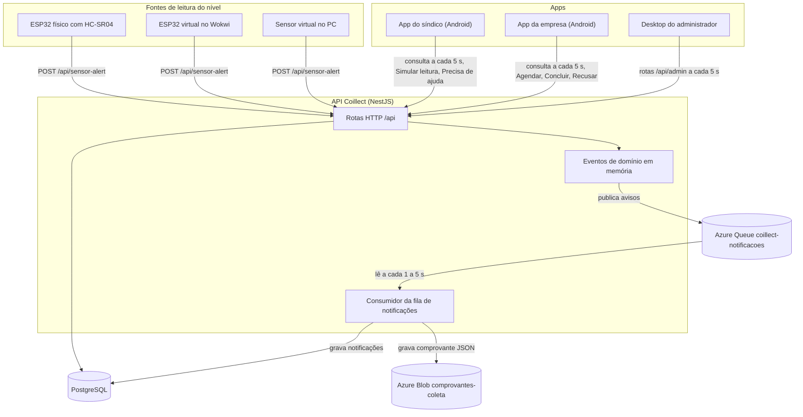

# Visão geral e arquitetura

Parte da [documentação do Coillect](README.md).

Este documento explica o que é o Coillect, quem faz o quê no sistema, quais componentes existem, em
que repositório está cada um e como eles se conectam. Os detalhes de cada parte estão nos documentos
seguintes; os links aparecem em cada seção.

## Sumário

- [O que é o Coillect](#o-que-é-o-coillect)
- [Perfis e responsabilidades](#perfis-e-responsabilidades)
- [Componentes e repositórios](#componentes-e-repositórios)
- [Arquitetura](#arquitetura)
- [O ciclo principal em 10 passos](#o-ciclo-principal-em-10-passos)
- [Decisões de projeto](#decisões-de-projeto)
- [Tecnologias por componente](#tecnologias-por-componente)
- [Ambientes de execução](#ambientes-de-execução)
- [Escopo do MVP](#escopo-do-mvp)
- [O que foi verificado e o que não foi](#o-que-foi-verificado-e-o-que-não-foi)

## O que é o Coillect

O Coillect é um projeto universitário (TCC) de coleta de óleo de cozinha usado em condomínios. Cada
condomínio tem um barril de óleo com um sensor de nível. Quando o barril enche, o sistema pede a
coleta à empresa coletora responsável pelo condomínio, sem que ninguém precise ligar ou mandar
mensagem.

O objetivo do MVP é demonstrar, ao vivo e quantas vezes for preciso, a cadeia completa de
comunicação: sensor → API → solicitação de coleta → app da empresa, com o síndico notificado e o
administrador acompanhando tudo.

## Perfis e responsabilidades

| Perfil ou dispositivo | Onde atua | O que faz | O que não faz |
|---|---|---|---|
| Sensor do barril | ESP32 físico, ESP32 virtual no Wokwi ou sensor virtual no PC | Mede o nível e envia `POST /api/sensor-alert` periodicamente e na hora em que atinge o limite | Não decide se haverá coleta; quem decide é a API |
| API Coillect | `CoillectApp/backend` (NestJS) | Registra leituras, aplica a regra de disparo, cria e controla as solicitações de coleta, gera notificações e comprovantes | Não envia push para os celulares; os apps consultam a API |
| Síndico | App Android `app-mobile-sindico` | Acompanha o nível do barril do seu condomínio, recebe notificações, vê o histórico e os comprovantes, pede ajuda, simula leituras na demonstração | Não aceita, não conclui e não cancela coletas geradas pelo sensor ou pela empresa (a API responde 403) |
| Empresa coletora | App Android `app-mobile-empresa` | Recebe a solicitação de coleta do barril específico, agenda, conclui ou recusa, vê avisos, histórico e comprovantes | Não cadastra condomínios nem sensores |
| Administrador | App desktop `interface-desktop-adm-coillect` | Cadastra síndicos, empresas, condomínios, barris e sensores; acompanha leituras e solicitações; vê o estado do Azure Storage; reinicia a demonstração | Não tem login (a API não tem perfil de administrador) |

## Componentes e repositórios

Todos os repositórios estão na organização GitHub `CoillectADM`.

| Componente | Repositório e pasta | Tecnologia | Documento |
|---|---|---|---|
| API | [CoillectApp](https://github.com/CoillectADM/CoillectApp) → `backend/` | Node.js 24, NestJS 10, TypeORM, PostgreSQL | [02-api-backend.md](02-api-backend.md), [03-referencia-de-rotas.md](03-referencia-de-rotas.md) |
| Firmware do sensor | CoillectApp → `sensor-esp32/coillect_sensor/` | C++ (Arduino) para ESP32 + HC-SR04; roda no Wokwi e na placa | [04-sensor-esp32-e-simulador.md](04-sensor-esp32-e-simulador.md) |
| Sensor virtual no PC | CoillectApp → `sensor-esp32/simulador-pc/` | Node.js, sem dependências externas, com painel web | [04-sensor-esp32-e-simulador.md](04-sensor-esp32-e-simulador.md) |
| App do síndico | [app-mobile-sindico](https://github.com/CoillectADM/app-mobile-sindico) (privado) | Android, Kotlin, Jetpack Compose, Material 3 | [05-app-sindico.md](05-app-sindico.md) |
| App da empresa | [app-mobile-empresa](https://github.com/CoillectADM/app-mobile-empresa) (privado) | Android, Kotlin, Jetpack Compose, Material 3 | [06-app-empresa.md](06-app-empresa.md) |
| Desktop do administrador | [interface-desktop-adm-coillect](https://github.com/CoillectADM/interface-desktop-adm-coillect) (privado) | Kotlin, Compose Multiplatform Desktop (JVM) | [07-desktop-admin.md](07-desktop-admin.md) |
| Armazenamento em nuvem (A02) | CoillectApp → `backend/src/cloud/` | Azure Blob Storage + Azure Queue Storage pela API REST; Azurite localmente | [08-azure-storage-e-nuvem.md](08-azure-storage-e-nuvem.md) |
| Infraestrutura local e deploy | CoillectApp → `docker-compose.yaml`, `backend/Dockerfile`, `render.yaml`, `.github/workflows/` | Docker Compose, GitHub Actions, GHCR, Azure App Service, Render | [12-execucao-local-e-deploy.md](12-execucao-local-e-deploy.md), [11-testes-e-ci.md](11-testes-e-ci.md) |
| Frontend web antigo | CoillectApp → `frontend/` | React 19 + Vite, servido por nginx | Pré-existente, não foi alterado nem faz parte do MVP |

O repositório CoillectApp é público; os três repositórios de app são privados. Para abrir os links
dos apps é preciso estar logado no GitHub com acesso à organização.

## Arquitetura

Todos os clientes conversam apenas com a API, por HTTP e JSON, no prefixo `/api`. Os apps não
conversam entre si: cada um consulta a API a cada 5 segundos e mostra o que mudou.

Sem Azure configurado (variável `AZURE_STORAGE_CONNECTION_STRING` ausente), a fila vira um
processamento em memória e os comprovantes vão para a pasta `storage-local/` no diretório de trabalho
da API (variável `STORAGE_LOCAL_DIR`). O resto do fluxo não muda. Ver [08-azure-storage-e-nuvem.md](08-azure-storage-e-nuvem.md).

### Camadas dentro da API

| Camada | Arquivos principais | Papel |
|---|---|---|
| Entrada do sensor | [sensor-alert.controller.ts](../backend/src/sensor/sensor-alert.controller.ts), [sensor-alert.service.ts](../backend/src/sensor/sensor-alert.service.ts) | Valida o corpo, atualiza o nível do sensor, grava a leitura e publica o evento `sensor.reading.received` |
| Regra de disparo | [sensor-trigger.listener.ts](../backend/src/collection-request/sensor-trigger.listener.ts), [collection-trigger.rule.ts](../backend/src/collection-request/collection-trigger.rule.ts), [barrel-lock.ts](../backend/src/collection-request/barrel-lock.ts) | Decide se a leitura abre uma solicitação, uma por barril de cada vez |
| Solicitações de coleta | [collection-request.service.ts](../backend/src/collection-request/collection-request.service.ts), [collection-request.controller.ts](../backend/src/collection-request/collection-request.controller.ts) | Cria, agenda, conclui, recusa; publica `collection-request.created` e `collection-request.status-changed` |
| Eventos de domínio | [domain-events.service.ts](../backend/src/events/domain-events.service.ts), [domain-events.ts](../backend/src/events/domain-events.ts) | Barramento em memória: cada `emit` espera os ouvintes terminarem |
| Notificações e comprovantes | [notification.listener.ts](../backend/src/notification/notification.listener.ts), [notification.service.ts](../backend/src/notification/notification.service.ts), [receipt.service.ts](../backend/src/collection-request/receipt.service.ts) | Publicam na fila e, ao consumir, gravam avisos para empresa e síndico e o comprovante da coleta |
| Nuvem | [message-queue.service.ts](../backend/src/cloud/message-queue.service.ts), [blob-storage.service.ts](../backend/src/cloud/blob-storage.service.ts), [azure-storage.client.ts](../backend/src/cloud/azure-storage.client.ts) | Fila e Blob no Azure Storage (ou Azurite), com modo local de reserva |
| Administração | [admin.controller.ts](../backend/src/admin/admin.controller.ts), [admin.service.ts](../backend/src/admin/admin.service.ts), [cloud.controller.ts](../backend/src/cloud/cloud.controller.ts) | Rotas do desktop: visão geral, cadastros, leituras, nuvem e reinício da demonstração |

## O ciclo principal em 10 passos

Os diagramas de sequência de cada passo estão em [09-interacoes-e-fluxos.md](09-interacoes-e-fluxos.md).

1. O sensor mede o nível e envia `POST /api/sensor-alert` com `{ sensorId, percentual, dataHora }`:
   a cada 15 segundos, quando o nível varia 5 pontos e na hora em que atinge o limite.
2. A API grava a leitura, atualiza o nível do sensor e publica o evento `sensor.reading.received`.
3. O listener do sensor avalia a regra de disparo dentro da trava do barril: nível ≥ limite do barril
   (80% por padrão), sensor instalado num barril, nenhuma solicitação aberta para o barril,
   barril não está aguardando leitura de vazio e o condomínio tem empresa coletora.
4. Se a regra for atendida, a API cria uma solicitação `PENDING` de origem `SENSOR`, ligada ao barril,
   ao sensor, ao condomínio, ao síndico e à empresa. A resposta ao sensor sai com `triggered: true`.
5. A criação publica a mensagem `coleta.criada` na fila `coillect-notificacoes`. O consumidor gera o
   aviso da empresa ("Residencial Aurora chegou a 86% de capacidade. Barril BRL-8472.") e a cópia
   informativa do síndico.
6. Na atualização seguinte (os apps consultam a API a cada 5 segundos) o app da empresa mostra a faixa
   laranja com o aviso e a coleta pendente; o app do síndico mostra "Coleta solicitada à empresa" e a
   notificação.
7. A empresa toca em "Agendar coleta": a solicitação passa a `SCHEDULED` e o síndico é notificado da
   data.
8. A empresa toca em "Concluir coleta": a solicitação passa a `COMPLETED`, o barril volta a 0%, o
   comprovante JSON é gravado no Blob Storage e o síndico é notificado.
9. Enquanto o sensor ainda ler o barril cheio, a API responde `AWAITING_EMPTY_READING` e não abre
   outra solicitação. O sensor virtual do PC esvazia o barril sozinho quando vê a coleta concluída.
10. A primeira leitura abaixo do limite libera o barril. O ciclo pode recomeçar.

## Decisões de projeto

| Decisão | Motivo | Onde está |
|---|---|---|
| Um único contrato HTTP para sensor físico e virtual | O fluxo depois da API é idêntico para os dois, como pede o escopo | [contrato-sensor.md](../docs/contrato-sensor.md), [sensor-alert.payload.ts](../backend/src/sensor/dto/sensor-alert.payload.ts) |
| O sensor envia periódico + alerta imediato; a API decide a coleta | O sensor não precisa conhecer o estado das solicitações | Firmware e [collection-trigger.rule.ts](../backend/src/collection-request/collection-trigger.rule.ts) |
| No máximo uma solicitação aberta por barril | Evita duas coletas para o mesmo barril quando várias leituras chegam juntas | [barrel-lock.ts](../backend/src/collection-request/barrel-lock.ts) |
| Síndico só é notificado | A coleta é operada pela empresa; o síndico acompanha | `assertSindicoCanChange` em [collection-request.service.ts](../backend/src/collection-request/collection-request.service.ts) |
| Barril aguarda leitura de vazio depois da coleta | Sem isso, um sensor simulado ainda "cheio" abriria outra solicitação logo após a conclusão | [sensor.service.ts](../backend/src/sensor/sensor.service.ts), [sensor-trigger.listener.ts](../backend/src/collection-request/sensor-trigger.listener.ts) |
| Apps consultam a API a cada 5 s, sem push | Simples de demonstrar e funciona em qualquer rede onde o celular alcance a API | `AUTO_REFRESH_MS` nos três apps |
| Azure Storage opcional | A API roda igual sem Azure (modo local) e com o emulador Azurite | [cloud.config.ts](../backend/src/cloud/cloud.config.ts) |
| Cliente do Azure pela API REST, sem SDK | Nenhuma dependência npm nova; o `package-lock.json` não mudou | [azure-storage.client.ts](../backend/src/cloud/azure-storage.client.ts) |
| Dados de demonstração automáticos e "Reiniciar demonstração" | O ciclo pode ser repetido do zero, sem operações manuais escondidas | [demo-seed.service.ts](../backend/src/demo/demo-seed.service.ts), `POST /api/admin/demo/reset` |
| Desktop sem login | A API não tem perfil de administrador; o escopo é uma demonstração | [admin.controller.ts](../backend/src/admin/admin.controller.ts) |
| Endereço do servidor simplificado nos apps | Em celular de verdade basta digitar o IP do PC ou o domínio da nuvem | `domain/ServerAddress.kt` dos três apps |

## Tecnologias por componente

A lista completa, com versões e onde cada biblioteca é usada, está em
[10-bibliotecas-e-ferramentas.md](10-bibliotecas-e-ferramentas.md).

| Componente | Linguagem e runtime | Principais bibliotecas e ferramentas |
|---|---|---|
| API | TypeScript, Node.js 24 (imagem `node:24-alpine`) | NestJS 10, TypeORM, `pg`, Passport JWT, bcrypt, class-validator, Swagger; Jest e supertest nos testes |
| Banco | PostgreSQL 17 (`postgres:17.5-alpine` no Compose, `postgres:17-alpine` no CI) | Tabelas criadas pelo `synchronize` do TypeORM |
| Armazenamento em nuvem | Azure Storage (Blob e Queue) | API REST com assinatura Shared Key ou SAS, módulo `crypto` do Node; Azurite como emulador |
| Firmware | C++ (Arduino) para ESP32 Dev Module | Core Arduino-ESP32 (`WiFi`, `HTTPClient`, `WiFiClientSecure`), HC-SR04; testado no PC com g++ e mocks |
| Sensor virtual | JavaScript (Node.js 18+) | Só módulos nativos (`node:http`, `node:util`, `node:url`) |
| Apps Android | Kotlin 2.2.10, minSdk 26, targetSdk 36 | Jetpack Compose (BOM 2024.12.01), Material 3, Lifecycle ViewModel, `org.json`; JUnit 4 e coroutines-test |
| Desktop | Kotlin 2.2.20 na JVM | Compose Multiplatform 1.9.3, coroutines, `org.json`; JUnit 4 |
| CI e entrega | GitHub Actions | Workflows de backend, sensor, imagem da API (GHCR), Android (APK na release `demo`) e desktop |

## Ambientes de execução

| Ambiente | Onde roda a API | Quem alcança a API | Como subir |
|---|---|---|---|
| Local no PC | Docker Compose: `db` (PostgreSQL), `azurite`, `backend` na porta 3000 | Sensor virtual do PC, desktop, emulador Android (`10.0.2.2`) | `docker compose up -d --build db azurite backend` |
| Rede local com celulares | O mesmo PC, escutando em `0.0.0.0:3000` | Celulares na mesma Wi-Fi (IP do PC), ESP32 físico na mesma rede | `node backend/scripts/endereco-celular.mjs` mostra o endereço e o comando do firewall |
| Internet por túnel | O mesmo PC + `cloudflared tunnel --url http://localhost:3000` | Wokwi, celulares em qualquer rede | Endereço `https://...trycloudflare.com` |
| Nuvem | Azure App Service (imagem `ghcr.io/coillectadm/coillect-api`) com PostgreSQL Flexible e Storage Account; ou Render (`render.yaml`) | Todos os clientes, por HTTPS | [12-execucao-local-e-deploy.md](12-execucao-local-e-deploy.md) e [azure-a02.md](../docs/azure-a02.md) |

## Escopo do MVP

O escopo foi definido pelo autor no documento "Contexto mestre" (versão 1.0, 09/11/2026).

**Dentro do escopo e entregue**

- Endpoint que recebe a leitura do sensor (`POST /api/sensor-alert`).
- Listener e regra de disparo que criam a solicitação de coleta.
- Solicitação principal para o app da empresa e notificação vinculada à mesma solicitação para o app
  do síndico, sem duplicar a coleta.
- Sensor virtual que envia exatamente a mesma requisição do sensor físico, e o firmware do ESP32 que
  roda no Wokwi e na placa.
- Apps da empresa e do síndico e desktop do administrador com o necessário para a demonstração.
- Dados de demonstração e reinício simples para repetir o ciclo.

**Fora do escopo por decisão do autor**

- Preparação para produção, escalabilidade e segurança avançada.
- Cobertura de testes abrangente (os testes cobrem o caminho principal e as falhas que podem parar a
  apresentação).

**Acrescentado para a Atividade A02 de Computação em Nuvem II** (entrega em 16/11/2026): Blob
Storage, Queue Storage, monitoramento por eventos JSON no log e documentação de backup e alta
disponibilidade. O escopo do TCC listava filas e observabilidade como fora do escopo; por isso tudo
isso é opcional e a API funciona sem Azure.

## O que foi verificado e o que não foi

| Verificado no GitHub Actions | Não verificado em ambiente real |
|---|---|
| Build e testes unitários da API; fluxo e2e completo contra PostgreSQL real; e2e da fila e do Blob contra o Azurite; imagem Docker rodando o roteiro com e sem Azurite | Deploy real na Azure (App Service, PostgreSQL Flexible, Storage Account, Log Analytics) |
| Firmware compilado para ESP32 com o core oficial e testado no PC com hardware simulado; requisições do firmware e do sensor virtual contra a API real | Execução no wokwi.com e na placa ESP32 física |
| Build e testes unitários dos dois apps Android e do desktop; APKs publicados na release `demo` | Apps abertos em celular, emulador ou janela desktop; uso simultâneo em celulares reais na Wi-Fi da faculdade |

Os detalhes de cada suíte estão em [11-testes-e-ci.md](11-testes-e-ci.md).
