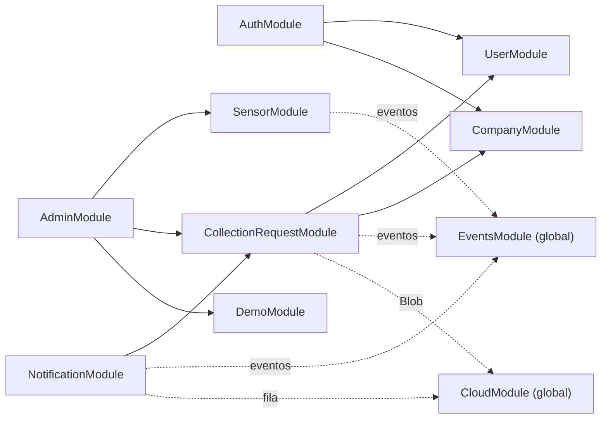
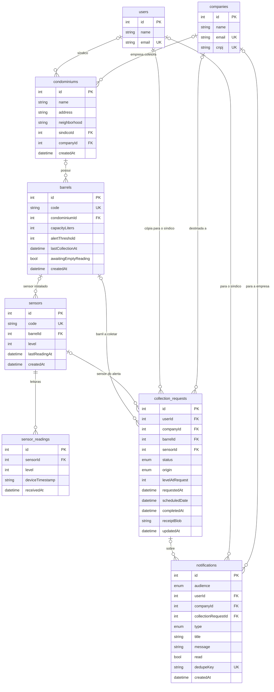
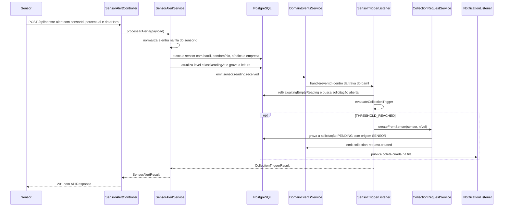
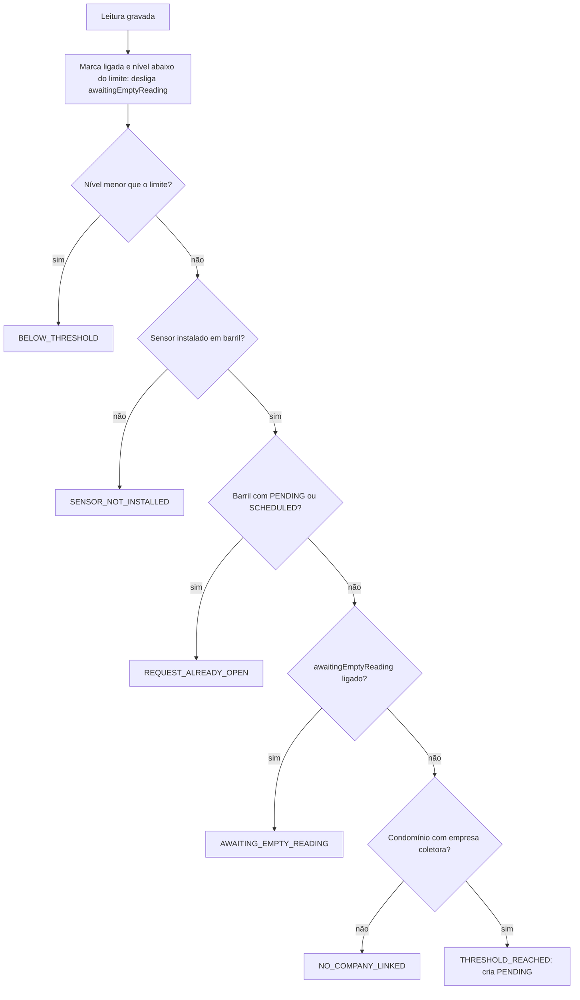
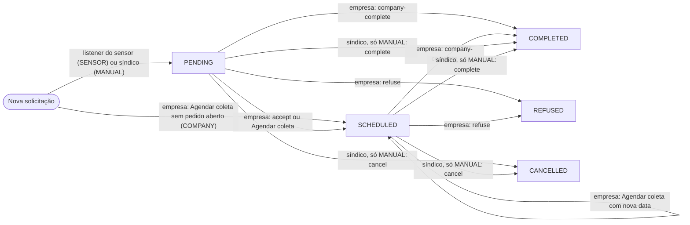

# API do backend (NestJS)

Parte da [documentação do Coillect](README.md).

Este documento explica como a API do Coillect (`CoillectApp/backend/`) está organizada e como ela
funciona por dentro: pastas e arquivos, inicialização, configuração, modelo de dados, regras de
negócio, eventos internos, notificações, autenticação, administração, formato das respostas, saúde,
código legado, o que mudou nos PRs de 10/11/2026 e limitações conhecidas. Tudo foi conferido no
código da `main` (commit `e5c4253d`). A lista rota a rota fica em
[Referência de rotas](03-referencia-de-rotas.md); Blob, Queue, Azurite e monitoramento ficam em
[Azure Storage e nuvem](08-azure-storage-e-nuvem.md). Aqui as rotas aparecem só quando explicam uma
regra.

## Sumário

1. [Visão rápida](#visão-rápida)
2. [Estrutura do backend](#estrutura-do-backend)
3. [Inicialização](#inicialização)
4. [Configuração](#configuração)
5. [Modelo de dados](#modelo-de-dados)
6. [Recebimento da leitura do sensor](#recebimento-da-leitura-do-sensor)
7. [Regra de disparo e listener](#regra-de-disparo-e-listener)
8. [Solicitação de coleta](#solicitação-de-coleta)
9. [Comprovante da coleta](#comprovante-da-coleta)
10. ["Precisa de ajuda?"](#precisa-de-ajuda)
11. [Eventos de domínio](#eventos-de-domínio)
12. [Notificações](#notificações)
13. [Autenticação](#autenticação)
14. [Administração](#administração)
15. [Dados de demonstração](#dados-de-demonstração)
16. [Formato das respostas](#formato-das-respostas)
17. [Saúde e observabilidade](#saúde-e-observabilidade)
18. [Código legado mantido](#código-legado-mantido)
19. [O que mudou em relação ao código anterior](#o-que-mudou-em-relação-ao-código-anterior)
20. [Limitações conhecidas](#limitações-conhecidas)
21. [O que não foi verificado](#o-que-não-foi-verificado)

## Visão rápida

| Item | Valor | Onde está |
|---|---|---|
| Framework | NestJS 10 (`@nestjs/core ^10.0.0`), TypeORM (`typeorm ^0.3.27`), PostgreSQL (driver `pg`) | [package.json](../backend/package.json) |
| Prefixo das rotas | `/api` | [app.setup.ts](../backend/src/app.setup.ts) |
| Porta | `PORT` ou 3000; escuta em `0.0.0.0` | [main.ts](../backend/src/main.ts), [config/env.ts](../backend/src/config/env.ts) |
| Documentação interativa | Swagger em `/api/docs` | [app.setup.ts](../backend/src/app.setup.ts) |
| Rotas | 72 nos controllers: 20 do desktop (17 em `admin` + 3 do painel Nuvem), 13 de solicitações, 7 de notificações e ajuda, 5 do sensor, 2 de login, 1 de saúde, 1 de teste (`AppController`) e 23 legadas (`user` e `company`) | [Referência de rotas](03-referencia-de-rotas.md) |
| Banco | Tabelas criadas e alteradas pelo `synchronize` do TypeORM (ligado por padrão) | [config/database.config.ts](../backend/src/config/database.config.ts) |
| Eventos internos | Barramento em memória (`DomainEventsService`) | [domain-events.service.ts](../backend/src/events/domain-events.service.ts) |
| Notificações e comprovantes | Gravados pelo consumidor da fila (Azure Queue Storage ou memória); comprovante JSON no Blob `comprovantes-coleta` (ou disco) | [notification.listener.ts](../backend/src/notification/notification.listener.ts), [cloud.module.ts](../backend/src/cloud/cloud.module.ts) |
| Login | JWT de 1 dia para síndico e empresa; o desktop não tem login | [auth.module.ts](../backend/src/auth/auth.module.ts) |
| Imagem Docker | `node:24-alpine`, comando `node dist/main.js` | [Dockerfile](../backend/Dockerfile) |

Fluxo principal em uma frase: o sensor faz `POST /api/sensor-alert`; a API grava a leitura; o
listener decide se abre uma solicitação de coleta para o barril; a solicitação gera mensagens na fila;
o consumidor da fila grava os avisos da empresa e do síndico e, na conclusão, o comprovante. O fluxo
completo entre apps está em [Interações e fluxos](09-interacoes-e-fluxos.md).

## Estrutura do backend

Legenda da coluna "Situação": **Novo** = criado nos PRs de 10/11/2026; **Alterado** = existia e foi
modificado; **Legado** = pré-existente e sem mudança; **Gerado** = criado em tempo de execução ou de
build.

### Raiz de `backend/`

| Item | Situação | O que é |
|---|---|---|
| `src/` | — | Código da API (detalhado a seguir). |
| `scripts/` | Novo | Scripts Node sem dependências (ver [scripts/](#scripts)). |
| `test/` | Alterado | Testes e2e com Jest e Supertest (ver [test/](#test)). |
| [Dockerfile](../backend/Dockerfile) | Alterado | Dois estágios sobre `node:24-alpine`. Build: `npm ci`, `npm run build`, `npm prune --omit=dev`. Final: copia `dist/`, `node_modules/` e `package*.json`; `NODE_ENV=production`, `PORT=3000`, `EXPOSE 3000`, `CMD ["node", "dist/main.js"]`. Não copia `uploads/`. |
| [.dockerignore](../backend/.dockerignore) | Alterado | Fora da imagem: `node_modules`, logs, `dist`, `coverage`, `.env`, pastas de IDE, `test`, `*.spec.ts` e `storage-local`. |
| [.env.example](../backend/.env.example) | Novo | Modelo comentado das variáveis de ambiente (ver [Configuração](#configuração)). |
| [.gitignore](../backend/.gitignore) | Alterado | Ganhou `/storage-local` (comprovantes do modo local). |
| [nest-cli.json](../backend/nest-cli.json) | Legado | `sourceRoot: "src"`, coleção `@nestjs/schematics`, `deleteOutDir: true` (apaga `dist/` antes de cada build). |
| [tsconfig.json](../backend/tsconfig.json) | Legado | `target` ES2021, `module` commonjs, decorators (`experimentalDecorators`, `emitDecoratorMetadata`), `outDir ./dist`, `baseUrl ./` (permite importar `src/...`), `strictNullChecks` e `noImplicitAny` desligados. |
| [tsconfig.build.json](../backend/tsconfig.build.json) | Legado | Compila só `src/**/*`; exclui `node_modules`, `test`, `dist` e `**/*.spec.ts`. |
| [package.json](../backend/package.json) | Alterado | Dependências, scripts (`build`, `start`, `start:dev`, `start:prod`, `lint`, `test`, `test:mvp`, `test:e2e:mvp`, `test:e2e:azure`, `smoke` e outros) e configuração do Jest. |
| `package-lock.json`, `yarn.lock` | Legado | Dois arquivos de trava de versões. O Dockerfile e o CI usam `npm ci` (lê o `package-lock.json`). |
| [ormconfig.ts](../backend/ormconfig.ts), [ormconfig.local.ts](../backend/ormconfig.local.ts) | Legado | `DataSource` para a CLI do TypeORM rodar migrations. A API não usa (ver [Código legado mantido](#código-legado-mantido)). |
| [wait-for-it.sh](../backend/wait-for-it.sh) | Legado | Esperava `db:5432` antes de iniciar a API. Sem uso desde o PR #1. |
| [README.md](../backend/README.md) | Alterado | Guia curto do backend (rodar, contas, sensor, testes). |
| [.eslintrc.js](../backend/.eslintrc.js), [.prettierrc](../backend/.prettierrc) | Legado | Lint (`@typescript-eslint` + Prettier) e formatação (aspas simples, vírgula final). |
| `src.zip`, `src/company.zip` | Legado | Arquivos compactados versionados (54.481 e 24.351 bytes). Nenhum código, script ou build os referencia. |
| `uploads/company-icons/` | Legado | 10 imagens PNG enviadas pelo upload de ícone de empresa (rota legada). |
| `storage-local/` | Gerado | Comprovantes gravados em disco no modo local (sem Azure). Ignorada pelo Git e pelo Docker. |
| `dist/` | Gerado | Saída do `nest build`. |

### `src/` (raiz)

| Arquivo | Situação | Responsabilidade |
|---|---|---|
| [main.ts](../backend/src/main.ts) | Alterado | Cria o app, aplica `configureApp`, liga os ganchos de encerramento, lê a porta e escuta em `0.0.0.0`. |
| [app.setup.ts](../backend/src/app.setup.ts) | Novo | `configureApp(app)`: prefixo `/api`, `ValidationPipe`, CORS, `/uploads` e Swagger. Usado pelo `main.ts` e pelos testes e2e. |
| [app.module.ts](../backend/src/app.module.ts) | Alterado | Módulo raiz: conexão com o banco e todos os módulos. |
| [app.controller.ts](../backend/src/app.controller.ts), [app.service.ts](../backend/src/app.service.ts) | Legado | `@Get('api')` com o prefixo global vira `GET /api/api` e responde o texto `Hello World!`. |
| [app.controller.spec.ts](../backend/src/app.controller.spec.ts) | Legado | 1 caso; chama `getHello()`, método que não existe no controller. |

### `admin/`

Rotas do app desktop do administrador. Detalhes em [Administração](#administração).

| Arquivo | Situação | Responsabilidade |
|---|---|---|
| [admin.module.ts](../backend/src/admin/admin.module.ts) | Novo | Registra os repositórios de `Condominium`, `Barrel`, `Sensor`, `SensorReading`, `CollectionRequest`, `User` e `Company`; importa `SensorModule`, `CollectionRequestModule` e `DemoModule`. |
| [admin.controller.ts](../backend/src/admin/admin.controller.ts) | Novo | 17 rotas `/api/admin/*`, sem guard. As respostas de sucesso trazem `requester: "admin"`. |
| [admin.service.ts](../backend/src/admin/admin.service.ts) | Novo | Visão geral, cadastros (síndico, empresa, condomínio, barril, sensor), vínculos, leituras e reinício da demonstração; erros 404 e 409; monta `AdminOverview`, `PersonView`, `CompanyView`, `BarrelView` e `CondominiumView`. |
| [dto/condominium.dto.ts](../backend/src/admin/dto/condominium.dto.ts) | Novo | `CreateCondominiumDto` e `UpdateCondominiumDto`. |
| [dto/people.dto.ts](../backend/src/admin/dto/people.dto.ts) | Novo | `CreateSindicoDto` e `AdminCreateCompanyDto`. |
| [dto/sensor-admin.dto.ts](../backend/src/admin/dto/sensor-admin.dto.ts) | Novo | `CreateSensorDto`, `UpdateSensorDto`, `CreateBarrelDto` e `UpdateBarrelDto`. Códigos aceitam só letras, números, ponto, hífen e sublinhado (`^[A-Za-z0-9._-]+$`). |

### `auth/`

Login e proteção das rotas. Detalhes em [Autenticação](#autenticação).

| Arquivo | Situação | Responsabilidade |
|---|---|---|
| [auth.module.ts](../backend/src/auth/auth.module.ts) | Legado | `JwtModule.register` (segredo de `JWT_SECRET`, `expiresIn: '1d'`), `PassportModule` e as duas estratégias; importa `UserModule` e `CompanyModule`. |
| [auth.controller.ts](../backend/src/auth/auth.controller.ts) | Legado | `POST /api/auth/login` (síndico) e `POST /api/auth/company/login` (empresa). |
| [auth.service.ts](../backend/src/auth/auth.service.ts) | Alterado | Confere e-mail e senha (bcrypt) e assina o token. A resposta ganhou `role` e `profile`. |
| [dto/login.dto.ts](../backend/src/auth/dto/login.dto.ts), [dto/company-login.dto.ts](../backend/src/auth/dto/company-login.dto.ts) | Legado | `email` (`@IsEmail`) e `password` (texto não vazio). |
| [guards/jwt-user.guard.ts](../backend/src/auth/guards/jwt-user.guard.ts) | Legado | `JwtUserAuthGuard` = `AuthGuard('jwt')`. |
| [guards/jwt-company.guard.ts](../backend/src/auth/guards/jwt-company.guard.ts) | Legado | `JwtCompanyAuthGuard` = `AuthGuard('company-jwt')`. |
| [strategies/jwt.strategy.ts](../backend/src/auth/strategies/jwt.strategy.ts) | Legado | Estratégia `jwt`: token Bearer, expiração conferida, devolve `{ sub, email, role }`. |
| [strategies/company-jwt.strategy.ts](../backend/src/auth/strategies/company-jwt.strategy.ts) | Legado | Estratégia `company-jwt`: igual à anterior, com o mesmo segredo. |

### `cloud/`

Azure Storage (Atividade A02). Aqui vai só o papel de cada arquivo; o funcionamento está em
[Azure Storage e nuvem](08-azure-storage-e-nuvem.md).

| Arquivo | Situação | Responsabilidade |
|---|---|---|
| [cloud.module.ts](../backend/src/cloud/cloud.module.ts) | Novo | Módulo global. Fornece `BlobStorageService` e `MessageQueueService`; em `onApplicationBootstrap` inicia o Blob e depois a fila. |
| [cloud.config.ts](../backend/src/cloud/cloud.config.ts) | Novo | `cloudConfigFromEnv()`: modo `azure` ou `local`, nomes do container e das filas, intervalos de leitura, tentativas e pasta local. |
| [azure-storage.client.ts](../backend/src/cloud/azure-storage.client.ts) | Novo | Cliente REST mínimo do Azure Storage (Blob e Queue) com Shared Key (HMAC-SHA256), SAS ou Azurite. Sem SDK. |
| [blob-storage.service.ts](../backend/src/cloud/blob-storage.service.ts) | Novo | Grava, lê e lista comprovantes no Blob Storage ou em disco (modo local). |
| [message-queue.service.ts](../backend/src/cloud/message-queue.service.ts) | Novo | Fila `coillect-notificacoes`: publica, consome, apaga depois de processar, poison queue, fallback local e pausa. |
| [cloud.controller.ts](../backend/src/cloud/cloud.controller.ts) | Novo | `GET /api/admin/cloud` e `POST /api/admin/cloud/queue/pause` e `/resume` (painel Nuvem do desktop, sem login). |
| [telemetry.ts](../backend/src/cloud/telemetry.ts) | Novo | `logEvent()`: uma linha JSON por evento de negócio na saída padrão. |
| [azure-storage.client.spec.ts](../backend/src/cloud/azure-storage.client.spec.ts) | Novo | 10 casos. |
| [cloud.config.spec.ts](../backend/src/cloud/cloud.config.spec.ts) | Novo | 3 casos. |
| [message-queue.service.spec.ts](../backend/src/cloud/message-queue.service.spec.ts) | Novo | 7 casos. |
| [telemetry.spec.ts](../backend/src/cloud/telemetry.spec.ts) | Novo | 2 casos. |

### `collection-request/`

Solicitações de coleta: criação, regra de disparo, ações da empresa e do síndico e comprovante.

| Arquivo | Situação | Responsabilidade |
|---|---|---|
| [collection-request.entity.ts](../backend/src/collection-request/collection-request.entity.ts) | Alterado | Entidade `CollectionRequest` (tabela `collection_requests`), tipos `CollectionRequestStatus` e `CollectionRequestOrigin` e a constante `OPEN_REQUEST_STATUSES` (`PENDING`, `SCHEDULED`). |
| [collection-request.module.ts](../backend/src/collection-request/collection-request.module.ts) | Alterado | Registra `CollectionRequest`, `Barrel` e `Sensor`; fornece o serviço, o repositório, `SensorTriggerListener` e `ReceiptService`; exporta o serviço e `ReceiptService`. |
| [collection-request.service.ts](../backend/src/collection-request/collection-request.service.ts) | Alterado | Cria solicitações (sensor, empresa, manual), consulta, executa as ações da empresa e do síndico, valida estado e dono, emite os eventos. |
| [collection-request.controller.ts](../backend/src/collection-request/collection-request.controller.ts) | Alterado | 13 rotas `/api/collection-request/*`; respostas pela view; `ParseIntPipe` no `:id`; leitura do comprovante. |
| [collection-request.view.ts](../backend/src/collection-request/collection-request.view.ts) | Novo | `toRequestView()`: JSON da solicitação para os apps, sem hashes de senha. |
| [collection-trigger.rule.ts](../backend/src/collection-request/collection-trigger.rule.ts) | Novo | `evaluateCollectionTrigger()`: a regra de disparo, como função pura. |
| [sensor-trigger.listener.ts](../backend/src/collection-request/sensor-trigger.listener.ts) | Novo | Ouve `sensor.reading.received`, aplica a regra dentro da trava do barril e cria a solicitação. |
| [barrel-lock.ts](../backend/src/collection-request/barrel-lock.ts) | Novo | `KeyedLock` (uma tarefa por vez por chave), a instância compartilhada `barrelLock` e `barrelKey(id)` = `barril:<id>`. |
| [receipt.ts](../backend/src/collection-request/receipt.ts) | Novo | Formato do comprovante (`CollectionReceipt`), `receiptProtocol()`, `receiptBlobName()` e `buildReceipt()`. |
| [receipt.service.ts](../backend/src/collection-request/receipt.service.ts) | Novo | `generate()` grava o comprovante no Blob; `read()` lê de volta (`ReceiptView`). |
| [dto/accept-collection-request.dto.ts](../backend/src/collection-request/dto/accept-collection-request.dto.ts) | Novo | `scheduledDate` opcional (ISO 8601). |
| [dto/schedule-collection.dto.ts](../backend/src/collection-request/dto/schedule-collection.dto.ts) | Novo | `sensorId` ou `barrelId`, e `scheduledDate` opcional ("Agendar coleta"). |
| [dto/create-collection-request.dto.ts](../backend/src/collection-request/dto/create-collection-request.dto.ts) | Legado | `companyId` do fluxo manual antigo. |
| [repository/collection-request.repository.ts](../backend/src/collection-request/repository/collection-request.repository.ts) | Legado | Repositório com `findActiveByUser()`. |
| [repository/collection-request.repository.spec.ts](../backend/src/collection-request/repository/collection-request.repository.spec.ts) | Legado | Arquivo vazio (0 bytes). |
| [barrel-lock.spec.ts](../backend/src/collection-request/barrel-lock.spec.ts) | Novo | 4 casos. |
| [collection-request.view.spec.ts](../backend/src/collection-request/collection-request.view.spec.ts) | Novo | 4 casos. |
| [collection-trigger.rule.spec.ts](../backend/src/collection-request/collection-trigger.rule.spec.ts) | Novo | 10 casos. |
| [receipt.spec.ts](../backend/src/collection-request/receipt.spec.ts) | Novo | 3 casos. |

### `company/`

Módulo legado da empresa coletora, sem mudanças. A entidade `Company` é a conta usada no app da
empresa.

| Arquivo | Situação | Responsabilidade |
|---|---|---|
| [company.module.ts](../backend/src/company/company.module.ts) | Legado | Registra `Company`, `CompanyAddress`, `CompanyContact` e `CompanyRepresentative`; exporta `CompanyService` (usado no login e nas solicitações). |
| [company.controller.ts](../backend/src/company/company.controller.ts) | Legado | 9 rotas `/api/company/*`, sem guard: cadastro completo e em etapas, checagem de e-mail e CNPJ, listagem, busca por CNPJ e upload de ícone. |
| [company.service.ts](../backend/src/company/company.service.ts) | Legado | Cadastro em etapas, unicidade de e-mail e CNPJ (409), hash bcrypt, `findByEmail` e `findById`. |
| `entities/` (4 arquivos) | Legado | Tabelas `companies`, `company_addresses`, `company_contacts` e `company_representatives`. |
| `dto/` (4 arquivos) | Legado | DTOs do cadastro. |
| `repository/` (4 arquivos) | Legado | Um repositório por entidade. |
| `*.spec.ts` (14 arquivos) | Legado | Testes antigos; não rodam no CI. |

### `config/`

| Arquivo | Situação | Responsabilidade |
|---|---|---|
| [env.ts](../backend/src/config/env.ts) | Novo | `envFlag(valor, padrão)` (lê variáveis booleanas) e `resolvePort()`. |
| [database.config.ts](../backend/src/config/database.config.ts) | Novo | `buildDatabaseOptions()`: opções do TypeORM a partir do ambiente. |
| [database.config.spec.ts](../backend/src/config/database.config.spec.ts) | Novo | 4 casos. |

### `demo/`

| Arquivo | Situação | Responsabilidade |
|---|---|---|
| [demo-data.ts](../backend/src/demo/demo-data.ts) | Novo | Constantes da demonstração: senha padrão, síndico, empresa, limite (80), capacidade (200 L), três locais (`DEMO_SITES`) e o sensor principal (`DEMO_MAIN_SENSOR`). |
| [demo-seed.service.ts](../backend/src/demo/demo-seed.service.ts) | Novo | Cria os dados na subida (`SEED_DEMO`) e reinicia a demonstração; exporta `demoPassword()` e `DEFAULT_BIRTH_DATE`. |
| [demo.module.ts](../backend/src/demo/demo.module.ts) | Novo | Registra `User`, `Company`, `Condominium`, `Barrel` e `Sensor`; exporta `DemoSeedService`. |

### `events/`

| Arquivo | Situação | Responsabilidade |
|---|---|---|
| [domain-events.ts](../backend/src/events/domain-events.ts) | Novo | Nomes dos eventos, tipos dos dados, `CollectionTriggerReason`, `CollectionTriggerResult` e `isCollectionTriggerResult()`. |
| [domain-events.service.ts](../backend/src/events/domain-events.service.ts) | Novo | Barramento de eventos em memória (`on`, `emit`, `listenerCount`). |
| [events.module.ts](../backend/src/events/events.module.ts) | Novo | Módulo global que fornece `DomainEventsService`. |
| [domain-events.service.spec.ts](../backend/src/events/domain-events.service.spec.ts) | Novo | 3 casos. |

### `health/`

| Arquivo | Situação | Responsabilidade |
|---|---|---|
| [health.controller.ts](../backend/src/health/health.controller.ts) | Novo | `GET /api/health`: testa o banco com `SELECT 1` e responde 200 ou 503. Registrado direto no `AppModule`. |

### `notification/`

| Arquivo | Situação | Responsabilidade |
|---|---|---|
| [notification.entity.ts](../backend/src/notification/notification.entity.ts) | Novo | Entidade `Notification` (tabela `notifications`), tipos `NotificationType` e `NotificationAudience`. |
| [notification.service.ts](../backend/src/notification/notification.service.ts) | Novo | `notificarSindico`, `notificarEmpresa` e `notificarAjuda` (gravação idempotente por `dedupeKey`), `list`, `markRead` e `markAllRead`. |
| [notification.listener.ts](../backend/src/notification/notification.listener.ts) | Novo | Publica na fila quando uma solicitação é criada ou muda de status; consome a fila e grava avisos e o comprovante. |
| [notification.text.ts](../backend/src/notification/notification.text.ts) | Novo | Títulos e mensagens (síndico, empresa, pedido de ajuda), formato de data e assuntos do "Precisa de ajuda?". |
| [notification.view.ts](../backend/src/notification/notification.view.ts) | Novo | `toNotificationView()`. |
| [notification.controller.ts](../backend/src/notification/notification.controller.ts) | Novo | Rotas do síndico: `GET /api/notifications/mine`, `POST /api/notifications/read-all` e `POST /api/notifications/:id/read`. |
| [company-notification.controller.ts](../backend/src/notification/company-notification.controller.ts) | Novo | Rotas da empresa: `GET /api/notifications/company`, `POST /api/notifications/company/read-all` e `POST /api/notifications/company/:id/read`. |
| [help-request.controller.ts](../backend/src/notification/help-request.controller.ts) | Novo | `POST /api/help-request` ("Precisa de ajuda?"). |
| [help-request.dto.ts](../backend/src/notification/help-request.dto.ts) | Novo | `message` (até 500 caracteres) e `topic` opcional. |
| [notification.module.ts](../backend/src/notification/notification.module.ts) | Novo | Registra `Notification`, `CollectionRequest` e `Condominium`; importa `CollectionRequestModule` (por causa do `ReceiptService`). |
| [notification.text.spec.ts](../backend/src/notification/notification.text.spec.ts) | Novo | 7 casos. |

### `sensor/`

| Arquivo | Situação | Responsabilidade |
|---|---|---|
| [entities/condominium.entity.ts](../backend/src/sensor/entities/condominium.entity.ts) | Novo | Condomínio (tabela `condominiums`). |
| [entities/barrel.entity.ts](../backend/src/sensor/entities/barrel.entity.ts) | Novo | Barril (tabela `barrels`) e `DEFAULT_ALERT_THRESHOLD = 80`. |
| [entities/sensor.entity.ts](../backend/src/sensor/entities/sensor.entity.ts) | Novo | Sensor (tabela `sensors`). |
| [entities/sensor-reading.entity.ts](../backend/src/sensor/entities/sensor-reading.entity.ts) | Novo | Histórico de leituras (tabela `sensor_readings`). |
| [dto/sensor-alert.payload.ts](../backend/src/sensor/dto/sensor-alert.payload.ts) | Novo | Contrato do sensor (`SensorAlertPayload`), a leitura normalizada (`SensorAlert`) e `normalizeSensorAlert()`. |
| [sensor-alert.controller.ts](../backend/src/sensor/sensor-alert.controller.ts) | Novo | `POST /api/sensor-alert` e `toAlertResponse()`, que monta a resposta ao sensor. |
| [sensor-alert.service.ts](../backend/src/sensor/sensor-alert.service.ts) | Novo | `processarAlerta()`: fila por sensor, atualização do sensor, gravação da leitura, evento e telemetria. |
| [sensor.controller.ts](../backend/src/sensor/sensor.controller.ts) | Novo | `POST /api/sensor/readings` (igual ao `sensor-alert`), `GET /api/sensor/mine`, `GET /api/sensor/company` e `GET /api/sensor/:sensorId/status`. |
| [sensor.service.ts](../backend/src/sensor/sensor.service.ts) | Novo | Consultas de sensores e barris para os apps, `toViews()` com a solicitação aberta, e o barril a 0% quando a coleta é concluída. |
| [sensor-links.ts](../backend/src/sensor/sensor-links.ts) | Novo | Relações carregadas (`SENSOR_RELATIONS`) e auxiliares `condominiumOf`, `thresholdOf`, `onlineWindowMinutes` e `isOnline`. |
| [sensor.view.ts](../backend/src/sensor/sensor.view.ts) | Novo | `toSensorView()`: JSON do barril e do sensor para os três apps. |
| [sensor.module.ts](../backend/src/sensor/sensor.module.ts) | Novo | Registra `Condominium`, `Barrel`, `Sensor`, `SensorReading` e `CollectionRequest`; exporta `SensorService` e `SensorAlertService`. |
| [dto/sensor-alert.payload.spec.ts](../backend/src/sensor/dto/sensor-alert.payload.spec.ts) | Novo | 10 casos. |
| [sensor.view.spec.ts](../backend/src/sensor/sensor.view.spec.ts) | Novo | 3 casos. |

### `user/`

Módulo legado de usuários, sem mudanças. Todo registro da tabela `users` pode entrar como síndico.

| Arquivo | Situação | Responsabilidade |
|---|---|---|
| [user.module.ts](../backend/src/user/user.module.ts) | Legado | Registra `User`, `UserAddress` e `UserPhoneNumber`; exporta `UserService` (usado no login e no fluxo manual). |
| [user.controller.ts](../backend/src/user/user.controller.ts) | Legado | 14 rotas `/api/user/*`, sem guard: CRUD de usuário, endereço e telefone. |
| [user.service.ts](../backend/src/user/user.service.ts) | Legado | Regras do CRUD; hash bcrypt na criação; conversão de `data_nascimento` com `process_data_nasc`. |
| `entities/` (3 arquivos) | Legado | Tabelas `users`, `usuario_endereco` e `usuario_telefone`. |
| `repositories/` (3 arquivos) | Legado | Um repositório por entidade. |
| `dto/` (6 arquivos) | Legado | DTOs de criação e alteração. |
| `*.spec.ts` (14 arquivos) | Legado | Testes antigos; não rodam no CI. |

### `utils/`

| Arquivo | Situação | Responsabilidade |
|---|---|---|
| [response/response.ts](../backend/src/utils/response/response.ts) | Legado | `APIResponse`, o envelope das respostas (ver [Formato das respostas](#formato-das-respostas)). |
| [data_transform/data_transform.ts](../backend/src/utils/data_transform/data_transform.ts) | Legado | `process_data_nasc()`: converte `DD/MM/YYYY` em `Date` no cadastro legado de usuário. |
| `response/response.spec.ts`, `data_transform/data_transform.spec.ts` | Legado | 1 caso cada. |

### `migrations/`

| Arquivo | Situação | Responsabilidade |
|---|---|---|
| [1762511457092-InitCompaniesSchema.ts](../backend/src/migrations/1762511457092-InitCompaniesSchema.ts) | Legado | Cria `companies`, `company_addresses`, `company_contacts` e `company_representatives`. |
| [1764197724946-addIconeUrlToCompanies.ts](../backend/src/migrations/1764197724946-addIconeUrlToCompanies.ts) | Legado | Adiciona `iconeUrl` em `companies`. |

A API não executa migrations: as opções do TypeORM não têm `migrations` nem `migrationsRun`; as
tabelas vêm do `synchronize`.

### `scripts/`

| Arquivo | Situação | Responsabilidade |
|---|---|---|
| [smoke-flow.mjs](../backend/scripts/smoke-flow.mjs) | Novo (PR #1) | Roteiro HTTP de ponta a ponta contra uma API no ar: `node scripts/smoke-flow.mjs <URL>/api --reset` (ou `npm run smoke -- <URL>/api --reset`). Sem `--reset` ele recusa rodar, porque reinicia a demonstração no começo e no fim. Lê `DEMO_PASSWORD` e `SENSOR_ID`. Espera até 30 s (tentando a cada 0,5 s) pelos avisos que passam pela fila; cada chamada tem tempo limite de 90 s. |
| [endereco-celular.mjs](../backend/scripts/endereco-celular.mjs) | Novo (PR #6) | Mostra o endereço `http://<IP>:<porta>/api` para os apps nos celulares, deixando por último adaptadores virtuais (WSL, Docker, VirtualBox...), testa `/api/health` em cada IP (tempo limite de 4 s) e mostra o comando do firewall do Windows. Opção `--porta` (padrão 3000). |
| [endereco-celular.test.mjs](../backend/scripts/endereco-celular.test.mjs) | Novo (PR #6) | 4 casos (`node --test`). |

### `test/`

| Arquivo | Situação | Responsabilidade |
|---|---|---|
| [jest-e2e.json](../backend/test/jest-e2e.json) | Alterado | Configuração dos e2e: `testTimeout: 60000` e mapeamento de `src/...`. |
| [mvp-flow.e2e-spec.ts](../backend/test/mvp-flow.e2e-spec.ts) | Novo | 22 casos: fluxo completo contra PostgreSQL real. Reinicia a demonstração antes e depois. |
| [azure-storage.e2e-spec.ts](../backend/test/azure-storage.e2e-spec.ts) | Novo | 7 casos: fila e Blob no Azure Storage (Azurite no CI). Pulado sem `AZURE_STORAGE_CONNECTION_STRING`. |
| [app.e2e-spec.ts](../backend/test/app.e2e-spec.ts) | Legado | 1 caso (`GET /` → `Hello World!`). Não roda no CI. |

Comandos, contagens e o que o CI executa: [Testes e CI](11-testes-e-ci.md).

## Inicialização

### `main.ts`

[main.ts](../backend/src/main.ts) faz, nesta ordem:

1. `NestFactory.create(AppModule)` monta o app e os módulos.
2. `configureApp(app)` aplica a configuração HTTP (próxima seção).
3. `app.enableShutdownHooks()` liga os ganchos de encerramento: num sinal de término, o Nest chama
   `onApplicationShutdown`, e o `MessageQueueService` para o consumidor da fila.
4. `resolvePort()` lê `PORT`; se não for um inteiro positivo, usa 3000.
5. `app.listen(port, '0.0.0.0')` escuta em todas as interfaces IPv4 (necessário no container e para
   celulares na mesma rede).
6. Registra no log, contexto `Bootstrap`: `Coillect API na porta <porta> — rotas em /api, Swagger em /api/docs`.

### `app.setup.ts`

`configureApp(app)` em [app.setup.ts](../backend/src/app.setup.ts) é usado pelo `main.ts` e pelos
testes e2e, para o teste exercitar o mesmo app que roda na cloud.

| Configuração | Código | Efeito |
|---|---|---|
| Prefixo global | `app.setGlobalPrefix('api')` | Toda rota de controller fica sob `/api`. |
| Validação | `new ValidationPipe({ whitelist: true, forbidNonWhitelisted: true, transform: true })` | `whitelist`: só passam os campos declarados no DTO. `forbidNonWhitelisted`: campo a mais gera 400. `transform`: o corpo vira instância do DTO, com as conversões `@Type`/`@Transform`, e parâmetros são convertidos para o tipo declarado. |
| CORS | `app.enableCors({ origin: true })` | Aceita qualquer origem (apps mobile, desktop e navegador). |
| Arquivos estáticos | `app.use('/uploads', express.static(join(__dirname, '..', 'uploads')))` | Serve `backend/uploads/` em `/uploads/...`, fora do prefixo `/api`. São os ícones do upload legado. |
| Swagger | `DocumentBuilder` com título `Coillect API`, versão `2.0` e `addBearerAuth()`; `SwaggerModule.setup('api/docs', ...)` | Documentação interativa em `/api/docs`, com campo para colar o token Bearer. |

### `app.module.ts`

[app.module.ts](../backend/src/app.module.ts) importa, nesta ordem:

| Ordem | Módulo | Papel |
|---|---|---|
| 1 | `TypeOrmModule.forRootAsync({ useFactory: () => buildDatabaseOptions() })` | Conexão com o PostgreSQL a partir do ambiente. |
| 2 | `EventsModule` (global) | Barramento de eventos em memória. |
| 3 | `CloudModule` (global) | Blob e Queue (Azure ou local) e rotas do painel Nuvem. |
| 4 | `UserModule` | Usuários (síndicos). Legado. |
| 5 | `AuthModule` | Login e estratégias JWT. |
| 6 | `CompanyModule` | Empresas coletoras. Legado. |
| 7 | `CollectionRequestModule` | Solicitações, listener do sensor e comprovante. |
| 8 | `SensorModule` | Condomínio, barril, sensor, leituras e rotas do sensor. |
| 9 | `NotificationModule` | Notificações, consumidor da fila e "Precisa de ajuda?". |
| 10 | `DemoModule` | Dados de demonstração. |
| 11 | `AdminModule` | Rotas do desktop. |

Controllers registrados direto no módulo raiz: `AppController` e `HealthController`. Provider:
`AppService`.

Dependências entre os módulos (setas cheias = `imports`; tracejadas = uso dos serviços globais):



O `HealthController`, no módulo raiz, também usa a fila do `CloudModule` (para informar o modo).

### Ciclo de vida

| Fase | Quem | O que faz |
|---|---|---|
| `onModuleInit` | `SensorTriggerListener` | Registra o ouvinte de `sensor.reading.received`. |
| `onModuleInit` | `SensorService` | Registra o ouvinte de `collection-request.status-changed` (barril a 0% na conclusão). |
| `onModuleInit` | `NotificationListener` | Registra os ouvintes de `collection-request.created` e `collection-request.status-changed` e se inscreve como consumidor da fila. |
| `onApplicationBootstrap` | `CloudModule` | `BlobStorageService.start()` (cria o container ou a pasta local) e depois `MessageQueueService.start()` (no modo azure, cria a fila e liga o consumidor). |
| `onApplicationBootstrap` | `DemoSeedService` | Cria os dados de demonstração que faltarem, se `SEED_DEMO` estiver ligado. |
| `onApplicationShutdown` | `MessageQueueService` | Para o consumidor da fila. |

## Configuração

### Variáveis de ambiente

Todas as variáveis lidas por `src/` e `scripts/` (busca por `process.env` e `env.`). Coluna
"Quando": em que momento o valor é lido.

| Variável | Padrão | Lida em | Quando | Efeito |
|---|---|---|---|---|
| `PORT` | `3000` | [config/env.ts](../backend/src/config/env.ts) | na subida | Porta HTTP. Valor que não seja inteiro positivo vira 3000. |
| `DATABASE_URL` | — | [config/database.config.ts](../backend/src/config/database.config.ts) | na subida | URL do PostgreSQL. Se existir, `DATABASE_HOST/PORT/USER/PASSWORD/NAME` são ignoradas. |
| `DATABASE_HOST` | `localhost` | idem | na subida | Host do banco sem `DATABASE_URL`. |
| `DATABASE_PORT` | `5432` | idem | na subida | Porta do banco. O banco do Docker Compose fica em `5482` no PC. |
| `DATABASE_USER` | `postgres` | idem | na subida | Usuário do banco. |
| `DATABASE_PASSWORD` | `postgres` | idem | na subida | Senha do banco. Usa `??`: valor vazio é respeitado. |
| `DATABASE_NAME` | `app_db` | idem | na subida | Nome do banco. |
| `DATABASE_SSL` | `false` | idem | na subida | `true` liga SSL sem validar o certificado (`rejectUnauthorized: false`). Vale também com `DATABASE_URL`. |
| `DATABASE_SYNC` | `true` | idem | na subida | `synchronize` do TypeORM: cria e altera tabelas e colunas sozinho. |
| `DATABASE_RETRY_ATTEMPTS` | `10` | idem | na subida | Tentativas de conexão; o intervalo é fixo em 3000 ms (cerca de 30 s no total). |
| `JWT_SECRET` | valor fixo no código (não reproduzido aqui) | [auth.module.ts](../backend/src/auth/auth.module.ts), [jwt.strategy.ts](../backend/src/auth/strategies/jwt.strategy.ts), [company-jwt.strategy.ts](../backend/src/auth/strategies/company-jwt.strategy.ts) | na carga dos módulos | Segredo que assina e valida os tokens dos dois logins. |
| `SEED_DEMO` | `true` | [demo-seed.service.ts](../backend/src/demo/demo-seed.service.ts) | na subida | Cria os dados de demonstração que faltarem. |
| `DEMO_PASSWORD` | `Coillect@2025` | idem (`demoPassword()`) | a cada uso | Senha das contas de demonstração criadas e dos síndicos e empresas cadastrados pelo admin sem senha. Contas que já existem não mudam. |
| `SENSOR_ONLINE_MINUTES` | `30` | [sensor-links.ts](../backend/src/sensor/sensor-links.ts) | a cada visão montada | Minutos desde a última leitura em que o sensor aparece com `online: true`. Valor não positivo ou inválido vira 30. |
| `APP_TIMEZONE` | `America/Sao_Paulo` | [notification.text.ts](../backend/src/notification/notification.text.ts) | na carga do módulo | Fuso das datas escritas nos textos das notificações. |
| `AZURE_STORAGE_CONNECTION_STRING` | — | [cloud.config.ts](../backend/src/cloud/cloud.config.ts) | na subida | Definida: modo `azure` (Storage Account ou Azurite com `UseDevelopmentStorage=true`). Ausente: modo `local` (disco + memória). |
| `CLOUD_STORAGE` | — | idem | na subida | `local` força o modo local mesmo com a connection string. |
| `AZURE_STORAGE_CONTAINER` | `comprovantes-coleta` | idem | na subida | Container dos comprovantes. O valor é aparado e passado para minúsculas; se não seguir a regra do Azure (letras, números e hífen, 3 a 63 caracteres, sem hífen nas pontas), volta ao padrão. |
| `AZURE_STORAGE_QUEUE` | `coillect-notificacoes` | idem | na subida | Fila das notificações, com a mesma regra de nome. A poison queue é `<fila>-poison`. |
| `QUEUE_POLL_MS` | `1000` | idem | na subida | Intervalo de leitura da fila quando há mensagens. |
| `QUEUE_POLL_MAX_MS` | `5000` | idem | na subida | Intervalo máximo quando a fila está vazia (nunca menor que `QUEUE_POLL_MS`). |
| `QUEUE_MAX_DEQUEUE` | `5` | idem | na subida | Máximo de entregas processadas de uma mensagem; na entrega seguinte ela vai para a poison queue sem ser processada. |
| `STORAGE_LOCAL_DIR` | `<diretório de trabalho>/storage-local` | idem | na subida | Pasta dos comprovantes no modo local. |
| `LOG_EVENTS` | ligado | [telemetry.ts](../backend/src/cloud/telemetry.ts) | a cada evento | `false`, `0`, `no`, `off`, `nao` ou `não` desligam; `true`, `1`, `yes`, `on` ou `sim` ligam. Sem valor: ligado, exceto com `NODE_ENV=test`. |
| `NODE_ENV` | — (`production` na imagem Docker) | idem | a cada evento | `test` desliga a telemetria quando `LOG_EVENTS` não foi informado. |

Fora da API:

| Variável | Padrão | Lida em | Efeito |
|---|---|---|---|
| `DEMO_PASSWORD` | `Coillect@2025` | [smoke-flow.mjs](../backend/scripts/smoke-flow.mjs) e os dois e2e | Senha usada para logar como síndico e empresa. |
| `SENSOR_ID` | `CLT-8472-A` | [smoke-flow.mjs](../backend/scripts/smoke-flow.mjs) | Sensor usado no roteiro. |
| `AZURE_STORAGE_CONNECTION_STRING` | — | [azure-storage.e2e-spec.ts](../backend/test/azure-storage.e2e-spec.ts) | Sem ela, a suíte é pulada (`describe.skip`). |
| `TIMEOUT` | `30` | [wait-for-it.sh](../backend/wait-for-it.sh) (legado, sem uso) | Segundos de espera pela porta do banco. |

As variáveis booleanas da API usam `envFlag` (ver abaixo), exceto `LOG_EVENTS`, que tem lista
própria em [telemetry.ts](../backend/src/cloud/telemetry.ts).

### Onde as variáveis são definidas

- [.env.example](../backend/.env.example) é o modelo comentado. Ele não traz
  `DATABASE_RETRY_ATTEMPTS`, `CLOUD_STORAGE`, `QUEUE_MAX_DEQUEUE` nem `STORAGE_LOCAL_DIR`.
- O código da API não lê o arquivo `backend/.env`: não há `dotenv` nem `ConfigModule` em `src/`
  (o pacote `@nestjs/config` está no `package.json`, mas não é importado). No Docker Compose, o
  `.env` entra pelo `env_file` (opcional) do serviço `backend`, e o bloco `environment:` desse
  serviço define `NODE_ENV`, `PORT`, `SEED_DEMO`, `DATABASE_*`, `JWT_SECRET` e
  `AZURE_STORAGE_CONNECTION_STRING` (padrão: o Azurite do próprio compose). Fora do Docker, as
  variáveis precisam estar no ambiente do processo: o comentário de
  [mvp-flow.e2e-spec.ts](../backend/test/mvp-flow.e2e-spec.ts) e o
  [LEIA-PRIMEIRO-CODEX.txt](../LEIA-PRIMEIRO-CODEX.txt) mandam exportar, por exemplo,
  `DATABASE_PORT=5482`.
- [render.yaml](../render.yaml) define `DATABASE_URL` (do banco do Render), `JWT_SECRET` (gerado) e
  `SEED_DEMO`.
- Execução local e deploy: [Execução local e deploy](12-execucao-local-e-deploy.md).

### `config/env.ts`

| Função | Comportamento |
|---|---|
| `envFlag(valor, padrão)` | Valor ausente ou em branco devolve o padrão. Senão, é `true` só para `1`, `true`, `yes`, `on` ou `sim` (sem diferenciar maiúsculas); qualquer outro texto é `false`. |
| `resolvePort(env)` | `Number(env.PORT)`; se for inteiro positivo, usa; senão, 3000. |

### `config/database.config.ts`

`buildDatabaseOptions()` monta as opções do `TypeOrmModule`:

| Opção | Valor |
|---|---|
| `type` | `postgres` |
| `autoLoadEntities` | `true`: carrega as entidades registradas com `TypeOrmModule.forFeature` nos módulos (todas estão registradas). |
| `synchronize` | `envFlag(DATABASE_SYNC, true)` |
| `ssl` | `{ rejectUnauthorized: false }` com `DATABASE_SSL` ligado; senão `false`. |
| `retryAttempts` | `Number(DATABASE_RETRY_ATTEMPTS \|\| 10)` |
| `retryDelay` | `3000` ms |
| `url` | `DATABASE_URL`, quando existe (tem prioridade). |
| `host`, `port`, `username`, `password`, `database` | `DATABASE_HOST`, `DATABASE_PORT`, `DATABASE_USER`, `DATABASE_PASSWORD`, `DATABASE_NAME`, com os padrões da tabela de variáveis. |

Não há `migrations` nem `migrationsRun`: com `DATABASE_SYNC=false`, nada cria as tabelas do MVP.
A função é coberta por 4 casos em
[database.config.spec.ts](../backend/src/config/database.config.spec.ts).

## Modelo de dados

As tabelas são criadas pelo `synchronize`. Os "enums" são tipos TypeScript gravados como `varchar`
(sem `enum` nem `CHECK` no banco). As colunas de relação seguem o nome padrão do TypeORM,
`<propriedade>Id` (ex.: `sindicoId`), exceto nas tabelas legadas de usuário (`id_usuario`). Em
relações `ManyToOne` sem a opção `nullable`, a coluna aceita nulo (padrão do TypeORM). Além das
chaves primárias, os únicos índices são os das colunas únicas.

### Diagrama das entidades do MVP



### Entidades do MVP

**`condominiums`** — `Condominium`, em
[condominium.entity.ts](../backend/src/sensor/entities/condominium.entity.ts) (novo).

| Coluna | Tipo | Nulo | Padrão | Observação |
|---|---|---|---|---|
| `id` | `serial` | não | automático | Chave primária. |
| `name` | `varchar(120)` | não | — | Não é único. |
| `address` | `varchar(200)` | sim | — | Endereço. |
| `neighborhood` | `varchar(80)` | sim | — | Bairro (mostrado no app da empresa). |
| `sindicoId` | `int` → `users.id` | sim | — | `ON DELETE SET NULL`. |
| `companyId` | `int` → `companies.id` | sim | — | `ON DELETE SET NULL`. Empresa que recebe as solicitações. |
| `createdAt` | `timestamptz` | não | `now()` | `CreateDateColumn`. |

Relações: `sindico` (`ManyToOne User`), `company` (`ManyToOne Company`), `barrels`
(`OneToMany Barrel`). Nenhuma é carregada automaticamente.

**`barrels`** — `Barrel`, em [barrel.entity.ts](../backend/src/sensor/entities/barrel.entity.ts) (novo).

| Coluna | Tipo | Nulo | Padrão | Observação |
|---|---|---|---|---|
| `id` | `serial` | não | automático | Chave primária. |
| `code` | `varchar(60)` | não | — | Único (ex.: `BRL-8472`). |
| `condominiumId` | `int` → `condominiums.id` | sim | — | `ON DELETE SET NULL`; relação carregada sempre (`eager`). |
| `capacityLiters` | `int` | sim | — | Capacidade em litros (informativa). |
| `alertThreshold` | `int` | não | `80` | Limite (%) que dispara a solicitação (`DEFAULT_ALERT_THRESHOLD`). |
| `lastCollectionAt` | `timestamptz` | sim | — | Última coleta concluída. |
| `awaitingEmptyReading` | `boolean` | não | `false` | Ligado depois de uma coleta concluída até chegar leitura abaixo do limite. |
| `createdAt` | `timestamptz` | não | `now()` | — |

Relações: `condominium` (`ManyToOne`, `eager`), `sensors` (`OneToMany Sensor`).

**`sensors`** — `Sensor`, em [sensor.entity.ts](../backend/src/sensor/entities/sensor.entity.ts) (novo).

| Coluna | Tipo | Nulo | Padrão | Observação |
|---|---|---|---|---|
| `id` | `serial` | não | automático | Chave primária. |
| `code` | `varchar(60)` | não | — | Único. É o `sensorId` que o dispositivo envia (ex.: `CLT-8472-A`). |
| `barrelId` | `int` → `barrels.id` | sim | — | `ON DELETE SET NULL`; `eager`. Nulo = sensor não instalado. |
| `level` | `int` | não | `0` | Último nível recebido (%). |
| `lastReadingAt` | `timestamptz` | sim | — | Momento da última leitura, pelo relógio da API. |
| `createdAt` | `timestamptz` | não | `now()` | — |

**`sensor_readings`** — `SensorReading`, em
[sensor-reading.entity.ts](../backend/src/sensor/entities/sensor-reading.entity.ts) (novo).

| Coluna | Tipo | Nulo | Padrão | Observação |
|---|---|---|---|---|
| `id` | `serial` | não | automático | Chave primária. |
| `sensorId` | `int` → `sensors.id` | sim (padrão do TypeORM) | — | `ON DELETE CASCADE`. A API sempre preenche. |
| `level` | `int` | não | — | Nível normalizado (0–100). |
| `deviceTimestamp` | `varchar(40)` | sim | — | `dataHora` enviada pelo dispositivo, como veio. |
| `receivedAt` | `timestamptz` | não | `now()` | Momento do recebimento (referência oficial). |

**`collection_requests`** — `CollectionRequest`, em
[collection-request.entity.ts](../backend/src/collection-request/collection-request.entity.ts)
(pré-existente, ampliada).

| Coluna | Tipo | Nulo | Padrão | Observação |
|---|---|---|---|---|
| `id` | `serial` | não | automático | Pré-existente. |
| `userId` | `int` → `users.id` | sim (padrão) | — | Síndico que recebe a cópia; `eager`. Pré-existente. |
| `companyId` | `int` → `companies.id` | sim (padrão) | — | Empresa coletora; `eager`. Pré-existente. |
| `barrelId` | `int` → `barrels.id` | sim | — | Barril a coletar; `eager`; `ON DELETE SET NULL`. Nova. |
| `sensorId` | `int` → `sensors.id` | sim | — | Sensor do alerta; `eager`; `ON DELETE SET NULL`. Nova. |
| `status` | `varchar(20)` | não | — | `CollectionRequestStatus`. Pré-existente. |
| `origin` | `varchar(10)` | não | `'MANUAL'` | `CollectionRequestOrigin`. Nova; linhas antigas ficam `MANUAL`. |
| `levelAtRequest` | `int` | sim | — | Nível (%) quando a solicitação foi criada. Nova. |
| `requestedAt` | `timestamp` (sem fuso) | não | `now()` | `CreateDateColumn`. Pré-existente. |
| `scheduledDate` | `timestamp` (sem fuso) | sim | — | Quando a empresa iniciou ou agendou a coleta. Pré-existente. |
| `completedAt` | `timestamptz` | sim | — | Conclusão. Nova. |
| `receiptBlob` | `varchar(200)` | sim | — | Nome do comprovante no Blob. Nova (PR #4). |
| `updatedAt` | `timestamptz` | não | `now()` | `UpdateDateColumn`; muda a cada gravação. Nova. |
| `userCpfSnapshot` | `varchar` | sim | — | Pré-existente. Sempre `null` no código atual. |
| `companyCnpjSnapshot` | `varchar` | sim | — | Pré-existente. CNPJ da empresa na criação. |
| `userAddressSnapshot` | `varchar` | sim | — | Pré-existente. Endereço do condomínio (sensor e empresa) ou `null` (manual). |

**`notifications`** — `Notification`, em
[notification.entity.ts](../backend/src/notification/notification.entity.ts) (novo).

| Coluna | Tipo | Nulo | Padrão | Observação |
|---|---|---|---|---|
| `id` | `serial` | não | automático | Chave primária. |
| `audience` | `varchar(10)` | não | `'SINDICO'` | `NotificationAudience`. |
| `userId` | `int` → `users.id` | sim | — | Destinatário quando `SINDICO`; `ON DELETE CASCADE`. |
| `companyId` | `int` → `companies.id` | sim | — | Destinatário quando `EMPRESA`; `ON DELETE CASCADE`. |
| `collectionRequestId` | `int` → `collection_requests.id` | sim | — | `eager`; `ON DELETE CASCADE`. Nulo no pedido de ajuda. |
| `type` | `varchar(30)` | não | — | `NotificationType`. |
| `title` | `varchar(120)` | não | — | Título. |
| `message` | `varchar(300)` | não | — | Texto. |
| `read` | `boolean` | não | `false` | Lida ou não. |
| `dedupeKey` | `varchar(80)` | sim | — | Único. Chave de idempotência (ver [Notificações](#notificações)). |
| `createdAt` | `timestamptz` | não | `now()` | — |

Relações carregadas automaticamente (`eager`): `Barrel.condominium`, `Sensor.barrel`,
`CollectionRequest.user`, `.company`, `.barrel` e `.sensor`, e `Notification.collectionRequest`. Por
isso, ao buscar uma notificação vem junto a solicitação com barril, condomínio e sensor.
`Condominium.sindico` e `Condominium.company` não são `eager`: os serviços pedem essas relações
explicitamente (ex.: `SENSOR_RELATIONS`).

### Entidades legadas

Pré-existentes e sem mudança. `users` e `companies` são as contas do síndico e da empresa no MVP.

| Tabela (classe) | Colunas | Relações |
|---|---|---|
| `users` (`User`, [user.entity.ts](../backend/src/user/entities/user/user.entity.ts)) | `id` serial; `name` varchar(100); `email` varchar único; `password` varchar (hash bcrypt); `status_email` boolean; `data_nascimento` timestamp; `created_at` timestamp `now()` (propriedade `data_cadastro`). Todas obrigatórias. | — |
| `usuario_endereco` (`UserAddress`, [user_address.ts](../backend/src/user/entities/user_address/user_address.ts)) | `id`; `rua`, `cidade`, `estado`, `cep` (varchar) | `id_usuario` → `users`, `ON DELETE CASCADE` |
| `usuario_telefone` (`UserPhoneNumber`, [user_phone_number.ts](../backend/src/user/entities/user_phone_number/user_phone_number.ts)) | `id`; `telefone` varchar | `id_usuario` → `users`, `ON DELETE CASCADE` |
| `companies` (`Company`, [company.entity.ts](../backend/src/company/entities/company/company.entity.ts)) | `id`; `name` varchar(100); `email` único; `password` (hash bcrypt); `cnpj` único; `role` padrão `'company'`; `iconeUrl` nulo; `registrationStage` varchar(12) padrão `'STEP_1'`; `created_at` | `addresses` (1:N), `contacts` (1:N), `representative` (1:1) |
| `company_addresses` (`CompanyAddress`) | `id`; `cep`, `street`, `number`, `neighborhood`, `city`, `state`; `complement` nulo | `companyId` → `companies` |
| `company_contacts` (`CompanyContact`) | `id`; `receptionPhone`, `adminPhone`, `extension`, `email`, todos nulos | `companyId` → `companies` |
| `company_representatives` (`CompanyRepresentative`) | `id`; `name`; `cpf` único; `position`; `commercialPhone`; `email`; `address` | `companyId` → `companies` (1:1, lado dono) |

### Valores fixos (enums)

**Status da solicitação** (`CollectionRequestStatus`):

| Valor | Significado | Aberta? |
|---|---|---|
| `PENDING` | Criada; aguardando a empresa iniciar ou agendar. | sim |
| `SCHEDULED` | Empresa iniciou ou agendou a coleta (em andamento). | sim |
| `COMPLETED` | Coleta concluída; barril volta a 0%; comprovante gerado. | não |
| `REFUSED` | Empresa recusou. | não |
| `CANCELLED` | Síndico cancelou (só pedidos `MANUAL`). | não |

"Aberta" = está em `OPEN_REQUEST_STATUSES` e impede outra solicitação para o mesmo barril.

**Origem da solicitação** (`CollectionRequestOrigin`):

| Valor | Significado |
|---|---|
| `SENSOR` | Criada pelo listener quando a leitura atingiu o limite do barril. |
| `COMPANY` | A empresa usou "Agendar coleta" num barril sem solicitação aberta. |
| `MANUAL` | Fluxo antigo: o usuário escolheu a empresa em `POST /api/collection-request` (frontend web). Também é o padrão da coluna. |

**Motivo da regra de disparo** (`CollectionTriggerReason`, devolvido em `collection.reason`):

| Valor | Significado |
|---|---|
| `THRESHOLD_REACHED` | Atingiu o limite; esta leitura criou a solicitação. |
| `BELOW_THRESHOLD` | Nível abaixo do limite; só registrou a leitura. |
| `SENSOR_NOT_INSTALLED` | O sensor não está instalado em um barril. |
| `REQUEST_ALREADY_OPEN` | O barril já tem solicitação `PENDING` ou `SCHEDULED`. |
| `AWAITING_EMPTY_READING` | Houve coleta concluída e o sensor ainda não leu o barril abaixo do limite. |
| `NO_COMPANY_LINKED` | O condomínio do barril não tem empresa coletora. |

**Tipo de notificação** (`NotificationType`):

| Valor | Quando |
|---|---|
| `COLLECTION_REQUESTED` | Solicitação criada pelo sensor ou pelo fluxo manual. |
| `COLLECTION_SCHEDULED` | Empresa iniciou ou agendou (inclusive a solicitação criada já agendada). |
| `COLLECTION_COMPLETED` | Coleta concluída. |
| `COLLECTION_REFUSED` | Empresa recusou. |
| `COLLECTION_CANCELLED` | Síndico cancelou um pedido manual. |
| `HELP_REQUESTED` | "Precisa de ajuda?" do síndico (sem solicitação vinculada). |

**Destinatário** (`NotificationAudience`): `SINDICO` (app do síndico) ou `EMPRESA` (app da empresa).

**Assunto do pedido de ajuda** (`HELP_TOPICS`): `COLETA` ("Coleta"), `SENSOR` ("Sensor"),
`CADASTRO` ("Cadastro"), `OUTRO` ("Outro assunto"; também usado para valor desconhecido).

**Etapa do cadastro da empresa** (`Company.registrationStage`, legado): `STEP_1`, `STEP_2`,
`STEP_3`, `STEP_4`, `COMPLETED`. O código só grava `STEP_1`, `STEP_3` e `COMPLETED`; os cadastros
feitos pelo admin e pelo seed já nascem `COMPLETED`.

Outros valores fixos: perfil no token (`user` ou `company`), modo de armazenamento (`azure` ou
`local`) e tipo da mensagem da fila (`coleta.criada`, `coleta.status`, `ajuda.solicitada`; ver
[Eventos de domínio](#eventos-de-domínio)).

## Recebimento da leitura do sensor

### Rotas e payload

Duas rotas, sem login, chamam o mesmo serviço e a mesma montagem de resposta (`toAlertResponse`):

- `POST /api/sensor-alert` — `SensorAlertController.receberAlerta`
  ([sensor-alert.controller.ts](../backend/src/sensor/sensor-alert.controller.ts)), a rota dos
  diagramas.
- `POST /api/sensor/readings` — `SensorController.receiveReading`
  ([sensor.controller.ts](../backend/src/sensor/sensor.controller.ts)), mantida por compatibilidade.

```http
POST /api/sensor-alert
Content-Type: application/json

{ "sensorId": "CLT-8472-A", "percentual": 86, "dataHora": "2026-11-10T14:32:05-03:00" }
```

Campos aceitos (`SensorAlertPayload`, em
[sensor-alert.payload.ts](../backend/src/sensor/dto/sensor-alert.payload.ts)):

| Campo | Aceita | Obrigatório | Validação (400 se falhar) | Normalização (`normalizeSensorAlert`) |
|---|---|---|---|---|
| `sensorId` | texto | sim | `@IsString`, não vazio, até 60 caracteres | Espaços nas pontas removidos. |
| `percentual` | número ou texto numérico (`"86"`, `"72.5"`) | sim, exceto quando vem `level` | número finito (sem `NaN`/`Infinity`), de 0 a 100 | Limitado a 0–100 e arredondado (`Math.round`): 85,6 vira 86. |
| `dataHora` | texto ou número (ex.: `millis()` do ESP32) | não | convertido para texto; até 40 caracteres | Espaços removidos; vazio vira `null`. Guardado como veio, sem interpretar. |
| `level` | número | não | de 0 a 100 | Alias antigo de `percentual` (marcado como obsoleto no Swagger). Só é usado se `percentual` não vier. |
| qualquer outro | — | — | sempre 400 (`forbidNonWhitelisted`) | — |

A regra "obrigatório, exceto quando vem `level`" é um `@ValidateIf`: `percentual` é validado quando
`level` não veio ou quando o próprio `percentual` veio. Se os dois vierem, os dois são validados e
`percentual` prevalece. O contrato visto pelo dispositivo está em
[Sensor ESP32 e simulador](04-sensor-esp32-e-simulador.md) e em
[docs/contrato-sensor.md](../docs/contrato-sensor.md).

### Passo a passo



`SensorAlertService.processarAlerta` em
[sensor-alert.service.ts](../backend/src/sensor/sensor-alert.service.ts):

1. `normalizeSensorAlert(payload)` produz `{ sensorId, percentual, dataHora }`.
2. `enqueue(sensorId, ...)`: leituras do mesmo `sensorId` são processadas uma de cada vez, na ordem
   de chegada. É uma fila em memória (um `Map` de promessas) desta instância; erro numa leitura não
   trava as seguintes.
3. `SensorService.findByCode(sensorId)` busca o sensor com `SENSOR_RELATIONS` (barril → condomínio
   → síndico e empresa). Se não existir: 404.
4. `sensors.update(id, { level, lastReadingAt })`, com `lastReadingAt` = agora pelo relógio da API.
5. `readings.save(...)` grava `sensor_readings` com `level` e `deviceTimestamp` (= `dataHora`);
   `receivedAt` é preenchido na inserção.
6. `events.emit('sensor.reading.received', { sensor, reading })`. O `emit` espera o
   `SensorTriggerListener` decidir e, se for o caso, criar a solicitação (ver
   [Regra de disparo e listener](#regra-de-disparo-e-listener)).
7. Separa o `CollectionTriggerResult` dos resultados (`isCollectionTriggerResult`).
8. `logEvent('leitura_sensor', { sensorId, percentual, limite, condominio, barril, disparouColeta, motivo, solicitacaoId })`.
9. Devolve `SensorAlertResult`; o controller embrulha em `APIResponse` (`toAlertResponse`).

### Respostas

| HTTP | Quando | Corpo |
|---|---|---|
| 201 | Leitura registrada, com ou sem nova solicitação | `APIResponse` com `statusCode: 201`, `requester: "sensor:<sensorId>"`, `message` = `Leitura registrada.` ou `Leitura registrada. Solicitação de coleta #<id> criada.` |
| 400 | Payload fora do contrato (ex.: `percentual: 150`, falta `sensorId`, campo extra) | Erro padrão do Nest com a lista de violações. |
| 404 | `sensorId` não cadastrado | `Sensor "<id>" não cadastrado. Cadastre-o em POST /api/admin/sensors.` |
| 500 | Erro inesperado (ex.: banco fora) | Erro padrão do Nest. |

Campos de `data` (`SensorAlertResult`):

| Campo | Conteúdo |
|---|---|
| `reading.id` | Id da linha em `sensor_readings`. |
| `reading.sensorId` | Código do sensor. |
| `reading.percentual` e `reading.level` | O percentual normalizado (o mesmo valor; `level` existe por compatibilidade). |
| `reading.dataHora` | `dataHora` como veio, ou `null`. |
| `reading.receivedAt` | Data de recebimento gravada. |
| `sensor` | `SensorView` com o nível novo e a solicitação aberta (ver [Views](#views)). |
| `collection.triggered` | `true` só quando ESTA leitura criou a solicitação. |
| `collection.reason` | Motivo da regra (tabela de motivos acima). |
| `collection.request` | A solicitação criada agora ou a que já está aberta para o barril, em qualquer motivo; `null` se não houver (ou se o sensor não tiver barril). |

Exemplo (resumido; `sensor` e `request` têm mais campos):

```json
{
  "error": false,
  "data": {
    "reading": { "id": 345, "sensorId": "CLT-8472-A", "percentual": 86, "level": 86, "dataHora": "2026-11-10T14:32:05-03:00", "receivedAt": "2026-11-10T17:32:06.120Z" },
    "sensor": { "sensorId": "CLT-8472-A", "barrelCode": "BRL-8472", "level": 86, "threshold": 80, "needsCollection": true, "online": true, "openRequest": { "id": 12, "status": "PENDING", "requestedAt": "2026-11-10T17:32:06.300Z" } },
    "collection": { "triggered": true, "reason": "THRESHOLD_REACHED", "request": { "id": 12, "status": "PENDING", "origin": "SENSOR", "levelAtRequest": 86 } }
  },
  "statusCode": 201,
  "timestamp": "2026-11-10T17:32:06.350Z",
  "requester": "sensor:CLT-8472-A",
  "message": "Leitura registrada. Solicitação de coleta #12 criada."
}
```

### Nível do barril e sensor online

- O barril não tem coluna de nível: o nível do barril é o `level` do sensor instalado nele.
- `level` muda em três situações: a cada leitura (valor normalizado); na conclusão de uma coleta
  (todos os sensores do barril vão a 0, em `SensorService.onRequestStatusChanged`); e no seed ou no
  reinício da demonstração.
- `lastReadingAt` só muda com leitura (e no seed/reinício). A conclusão da coleta não mexe nele.
- Campos calculados em `toSensorView` ([sensor.view.ts](../backend/src/sensor/sensor.view.ts)) a
  cada consulta:

| Campo | Cálculo |
|---|---|
| `threshold` | `barrel.alertThreshold`; 80 se o sensor não tiver barril. |
| `needsCollection` | `level >= threshold`. |
| `estimatedLiters` | `round(capacityLiters × level / 100)`; `null` sem capacidade. |
| `online` | `lastReadingAt` existe e tem no máximo `SENSOR_ONLINE_MINUTES` minutos (padrão 30). |
| `lastCollectionAt` | `barrel.lastCollectionAt`. |
| `openRequest` | Solicitação `PENDING` ou `SCHEDULED` mais recente do barril (`{ id, status, requestedAt }`) ou `null`. |

### `sensor-links.ts`

[sensor-links.ts](../backend/src/sensor/sensor-links.ts) concentra os caminhos de relação usados na
regra e nas views:

| Exportação | O que faz |
|---|---|
| `SENSOR_RELATIONS` | `{ barrel: { condominium: { company: true, sindico: true } } }`: relações carregadas junto com o sensor. |
| `condominiumOf(sensor)` | Condomínio do barril do sensor, ou `null`. |
| `thresholdOf(sensor)` | `alertThreshold` do barril, ou 80 (`DEFAULT_ALERT_THRESHOLD`) se não houver barril. |
| `onlineWindowMinutes()` | `SENSOR_ONLINE_MINUTES` se for número positivo; senão 30. Lido a cada chamada. |
| `isOnline(sensor, agora)` | `false` sem `lastReadingAt`; senão, idade da leitura ≤ janela. |

## Regra de disparo e listener

### Regra (`collection-trigger.rule.ts`)

`evaluateCollectionTrigger(input)` em
[collection-trigger.rule.ts](../backend/src/collection-request/collection-trigger.rule.ts) é uma
função pura, igual para sensor físico e virtual. Avalia nesta ordem e para na primeira condição
verdadeira:

| Ordem | Condição | `reason` | Cria solicitação? |
|---|---|---|---|
| 1 | `level < threshold` | `BELOW_THRESHOLD` | não |
| 2 | sensor sem barril | `SENSOR_NOT_INSTALLED` | não (log de aviso) |
| 3 | barril já tem `PENDING` ou `SCHEDULED` | `REQUEST_ALREADY_OPEN` | não; devolve a aberta |
| 4 | `awaitingEmptyReading` do barril ligado | `AWAITING_EMPTY_READING` | não (log) |
| 5 | condomínio do barril sem empresa (ou barril sem condomínio) | `NO_COMPANY_LINKED` | não (log de aviso) |
| 6 | nenhuma das anteriores | `THRESHOLD_REACHED` | sim: uma `PENDING` de origem `SENSOR` |

Consequências da ordem: o limite é inclusivo (80% dispara com limite 80); solicitação aberta tem
prioridade sobre a espera do barril vazio; leitura abaixo do limite nunca gera aviso, nem para sensor
sem barril. Condomínio sem síndico não impede a criação: a solicitação fica com `user = null` e
ninguém recebe a cópia. A regra tem 10 casos em
[collection-trigger.rule.spec.ts](../backend/src/collection-request/collection-trigger.rule.spec.ts).



### Listener (`sensor-trigger.listener.ts`)

`SensorTriggerListener` em
[sensor-trigger.listener.ts](../backend/src/collection-request/sensor-trigger.listener.ts):

1. `onModuleInit` registra `handle` no evento `sensor.reading.received`.
2. `handle(evento)`: se o sensor tem barril, roda `evaluate` dentro de
   `barrelLock.run('barril:<id>', ...)`; sem barril, roda direto.
3. `evaluate`:
   1. `threshold = thresholdOf(sensor)`.
   2. Relê `awaitingEmptyReading` do banco, já dentro da trava (outra leitura pode tê-lo mudado).
   3. Se a marca está ligada e `level < threshold`, desliga a marca no banco: o barril foi esvaziado
      de fato.
   4. `findOpenForBarrel(barrelId)`: a `PENDING`/`SCHEDULED` mais recente do barril.
   5. `evaluateCollectionTrigger(...)`.
   6. Sem criação: registra no log (`warn` para `NO_COMPANY_LINKED` e `SENSOR_NOT_INSTALLED`; `log`
      para `AWAITING_EMPTY_READING`) e devolve
      `{ kind: 'collection-trigger', triggered: false, reason, request: aberta ou null }`.
   7. Com criação: `CollectionRequestService.createFromSensor(sensor, level)`, log
      `Sensor <código> atingiu <n>% (limite <l>% do barril <código>): solicitação #<id> criada.` e
      devolve `{ triggered: true, reason: 'THRESHOLD_REACHED', request }`.

### Trava por barril (`barrel-lock.ts`)

| Aspecto | Detalhe |
|---|---|
| Mecanismo | `KeyedLock.run(chave, tarefa)` guarda em um `Map` a "cauda" de cada chave; a tarefa nova espera a anterior terminar. As promessas guardadas nunca rejeitam: erro numa tarefa não trava a próxima. A chave sai do `Map` quando a fila esvazia. `pending` conta as chaves em uso (para testes). |
| Chave | `barrelKey(id)` = `barril:<id>`. |
| Quem usa | O listener do sensor (cada leitura de sensor instalado) e o "Agendar coleta" da empresa (`scheduleByCompany`), com a mesma chave. |
| O que garante | Na mesma instância da API, "existe solicitação aberta? se não, cria" roda um por vez por barril: no máximo uma solicitação aberta por barril, mesmo com leituras simultâneas de várias fontes e "Agendar coleta" chegando junto. O e2e manda 5 leituras e 1 "Agendar coleta" ao mesmo tempo e confere que sai uma única solicitação. |
| Limite | A trava vive na memória de um processo. Com 2 ou mais instâncias, cada uma tem a sua, e o banco não tem restrição que impeça duas solicitações abertas no mesmo barril. O comentário do arquivo diz que, nesse caso, a garantia teria de vir do banco (índice único parcial); isso não foi implementado. |
| Testes | 4 casos em [barrel-lock.spec.ts](../backend/src/collection-request/barrel-lock.spec.ts). |

A fila por `sensorId` do `SensorAlertService` (passo 2 do recebimento) é outra serialização em
memória, por sensor, com o mesmo limite de uma instância.

### Espera da leitura do barril vazio

`barrels.awaitingEmptyReading` evita uma segunda coleta logo depois da conclusão, quando o sensor
ainda lê o barril cheio (por exemplo, no Wokwi o barril simulado continua cheio). Criado no PR #3.

| Momento | Efeito na marca | Código |
|---|---|---|
| Qualquer transição para `COMPLETED` (empresa ou síndico em pedido manual), se a solicitação tem barril | ligada; também `lastCollectionAt` e sensores a 0% | `SensorService.onRequestStatusChanged` |
| Leitura no limite com a marca ligada | continua ligada; resposta `AWAITING_EMPTY_READING`, sem solicitação | regra |
| Leitura abaixo do limite | desligada; resposta `BELOW_THRESHOLD` | `SensorTriggerListener.evaluate` |
| Reinício da demonstração | desligada nos três barris de demonstração | `DemoSeedService.ensureDemoData({ resetLevels: true })` |

Não é afetado pela marca: o "Agendar coleta" da empresa (não consulta `awaitingEmptyReading`; a
empresa pode agendar logo depois de concluir). Recusa e cancelamento não ligam a marca.

## Solicitação de coleta

### Estados e transições



| De | Para | Quem | Rota (`/api/collection-request/...`) | Método do serviço | Efeitos |
|---|---|---|---|---|---|
| (nova) | `PENDING` | listener do sensor | (`POST /api/sensor-alert`) | `createFromSensor` | Evento de criação: empresa e síndico avisados (`COLLECTION_REQUESTED`). |
| (nova) | `PENDING` | síndico, fluxo antigo | `POST /` | `createForUser` | Origem `MANUAL`; empresa e síndico avisados. |
| (nova) | `SCHEDULED` | empresa | `POST company/schedule` | `scheduleBarrel` | Origem `COMPANY`; só o síndico é avisado (`COLLECTION_SCHEDULED`). |
| `PENDING` | `SCHEDULED` | empresa | `POST :id/accept` ou `POST company/schedule` | `acceptRequest`, `scheduleBarrel` | `scheduledDate` = data enviada ou agora; síndico avisado. |
| `SCHEDULED` | `SCHEDULED` | empresa | `POST company/schedule` com `scheduledDate` | `scheduleBarrel` | Só troca a data; sem evento e sem aviso. |
| `PENDING` ou `SCHEDULED` | `COMPLETED` | empresa | `POST :id/company-complete` | `completeByCompany` | `completedAt` = agora; `scheduledDate` preenchida se vazia; barril a 0%; síndico avisado; comprovante. |
| `PENDING` ou `SCHEDULED` | `REFUSED` | empresa | `POST :id/refuse` | `refuseRequest` | `scheduledDate` = `null`; síndico avisado. |
| `PENDING` ou `SCHEDULED` | `CANCELLED` | síndico, só `MANUAL` | `POST :id/cancel` | `cancelForUser` | `scheduledDate` = `null`; síndico e empresa avisados. |
| `PENDING` ou `SCHEDULED` | `COMPLETED` | síndico, só `MANUAL` | `POST :id/complete` | `completeForUser` | `completedAt` = agora; síndico avisado; comprovante; barril só muda se a solicitação tiver barril. |

`COMPLETED`, `REFUSED` e `CANCELLED` são finais: nenhuma ação sai deles.

Verificações comuns em
[collection-request.service.ts](../backend/src/collection-request/collection-request.service.ts),
nesta ordem:

| Verificação | Função | Erro |
|---|---|---|
| `:id` inteiro | `ParseIntPipe` (controller) | 400 |
| A solicitação é da empresa do token | `findForCompany` | 404 `Solicitação não encontrada para esta empresa` |
| A solicitação é do síndico do token | `findForUser` | 404 `Solicitação não encontrada para este usuário` |
| Origem `MANUAL` (só ações do síndico) | `assertSindicoCanChange` | 403 `Não é possível <ação>: a solicitação #<id> foi gerada pelo sensor. O síndico apenas acompanha; quem altera é a empresa coletora.` (com "pela empresa coletora" no lugar de "pelo sensor" quando a origem é `COMPANY`) |
| Status permitido | `assertStatus` | 409 `Não é possível <ação>: a solicitação #<id> está <STATUS>.` |

Repetir uma ação já feita não dá erro e não muda nada: `accept` numa `SCHEDULED`,
`company-complete` numa `COMPLETED` e `refuse` numa `REFUSED` devolvem a solicitação como está.

Toda mudança passa por `transition(req, status, mudanças)`: aplica as mudanças e o status, grava,
relê a solicitação (`findById`) e emite `collection-request.status-changed` só se o status mudou.

### Criação

Os três caminhos terminam em `createRequest`: grava, relê com as relações e emite
`collection-request.created`.

| Campo | `SENSOR` (`createFromSensor`) | `COMPANY` (`scheduleBarrel`) | `MANUAL` (`createForUser`) |
|---|---|---|---|
| `user` | síndico do condomínio (ou `null`) | síndico do condomínio (ou `null`) | usuário do token |
| `company` | empresa do condomínio | empresa do condomínio (é a do token) | `companyId` do corpo |
| `barrel` | barril do sensor | barril escolhido | `null` |
| `sensor` | sensor da leitura | primeiro sensor do barril (menor id) ou `null` | `null` |
| `status` | `PENDING` | `SCHEDULED` | `PENDING` |
| `levelAtRequest` | nível da leitura | nível atual desse sensor ou `null` | `null` |
| `scheduledDate` | `null` | data enviada ou agora | `null` |
| `companyCnpjSnapshot` | CNPJ da empresa | CNPJ da empresa | CNPJ da empresa |
| `userAddressSnapshot` | endereço do condomínio | endereço do condomínio | `null` |
| `userCpfSnapshot` | `null` | `null` | `null` |

O `user` da solicitação fica fixo na criação: se o admin trocar o síndico do condomínio depois, as
solicitações antigas continuam com o síndico anterior.

### "Agendar coleta" da empresa

`POST /api/collection-request/company/schedule` com token de empresa →
`scheduleByCompany(companyId, dto)`.

Corpo (`ScheduleCollectionDto`, em
[schedule-collection.dto.ts](../backend/src/collection-request/dto/schedule-collection.dto.ts)):

| Campo | Regra |
|---|---|
| `sensorId` | Texto não vazio, até 60 caracteres. Obrigatório se `barrelId` não vier (corpo `{}` dá 400). Tem prioridade quando os dois vêm. |
| `barrelId` | Inteiro ≥ 1. |
| `scheduledDate` | Opcional, ISO 8601 (`@IsDateString`). Sem ela, vale "agora". |

Passos:

1. `findBarrelForCompany`: acha o barril pelo sensor (`sensorId` sem espaços nas pontas) ou pelo id,
   recarrega com condomínio, empresa e síndico e confere se o condomínio é cliente da empresa do
   token. Se não: 404 `Barril não encontrado entre os condomínios clientes desta empresa` (inclui
   sensor inexistente ou sem barril).
2. Entra na trava do barril (`barrelLock`, a mesma do listener).
3. `scheduleBarrel` decide:

| Situação do barril | Resultado |
|---|---|
| Solicitação aberta de outra empresa | 409 `O barril <código> já tem a solicitação #<id> aberta com outra empresa.` |
| `PENDING` desta empresa | Vira `SCHEDULED` com a data enviada ou agora; evento de status (síndico recebe "Coleta agendada"). |
| `SCHEDULED` desta empresa, com `scheduledDate` | Só a data muda; sem evento. |
| `SCHEDULED` desta empresa, sem `scheduledDate` | Devolvida sem mudança. |
| Nenhuma aberta | Cria uma `COMPANY` já `SCHEDULED` (tabela de criação); evento de criação: só o síndico recebe aviso. |

Resposta: HTTP 201, `message` `Coleta agendada`, `data` = a solicitação.

### Aceitar ("Iniciar etapa de coleta")

`POST /api/collection-request/:id/accept` com `{}` ou `{ "scheduledDate": "<ISO 8601>" }` →
`acceptRequest`. Se a solicitação já está `SCHEDULED`, volta como está (a data nova é ignorada);
fora isso, só aceita `PENDING` (409 nos outros) e grava `scheduledDate` = data enviada ou agora.
Antes dos PRs, a data era sempre `requestedAt` + 5 dias.

### Concluir

`POST /api/collection-request/:id/company-complete` → `completeByCompany` (o corpo não é lido).
Aceita `PENDING` e `SCHEDULED`. Depois da mudança de status:

1. `SensorService.onRequestStatusChanged`: no barril da solicitação (ou do sensor dela), grava
   `lastCollectionAt` = `completedAt` e liga `awaitingEmptyReading`; põe `level = 0` em todos os
   sensores do barril; log `Coleta #<id> concluída: barril <código> voltou a 0%.`
2. `NotificationListener`: `logEvent('solicitacao_status')` e publica `coleta.status` na fila.
3. Consumidor da fila: notificação `COLLECTION_COMPLETED` ao síndico e
   `ReceiptService.generate(id)` (comprovante).

### Recusar

`POST /api/collection-request/:id/refuse` → `refuseRequest`: `REFUSED`, `scheduledDate = null`,
síndico avisado ("Solicitação recusada"). O barril não muda: como não fica solicitação aberta nem a
marca de barril vazio, a próxima leitura no limite abre uma solicitação nova.

### Cancelar ou concluir pelo síndico

Fluxo antigo do frontend web, mantido. O síndico cria o pedido com
`POST /api/collection-request` `{ "companyId": <id> }` (404 se o usuário ou a empresa não existem)
e só pode alterar pedidos `MANUAL` dele:

- `POST /api/collection-request/:id/cancel` → `cancelForUser` → `CANCELLED`.
- `POST /api/collection-request/:id/complete` → `completeForUser` → `COMPLETED`.

Ordem dos erros: 404 (não é dele), 403 (origem `SENSOR` ou `COMPANY`), 409 (já encerrada). O
síndico apenas acompanha as solicitações do sensor e da empresa. Os apps novos não usam essas rotas
(ver [App do síndico](05-app-sindico.md)).

### Consultas e histórico

| Rota | Quem | Método | Filtro | Ordem |
|---|---|---|---|---|
| `GET /api/collection-request/my-active` | síndico | `findActiveByUser` (repositório legado) | `user` = token; status `PENDING`, `SCHEDULED` ou `REFUSED` | a mais recente por `requestedAt`; `data: null` se nenhuma |
| `GET /api/collection-request/my-history` | síndico | `getUserHistory` | `user`; `COMPLETED`, `CANCELLED` ou `REFUSED` | `requestedAt` decrescente |
| `GET /api/collection-request/company/active` | empresa | `getCompanyActiveRequests` | `company`; `PENDING` ou `SCHEDULED` | `requestedAt` crescente (a mais antiga primeiro) |
| `GET /api/collection-request/company/history` | empresa | `getCompanyHistory` | `company`; `COMPLETED`, `CANCELLED` ou `REFUSED` | `requestedAt` decrescente |
| `GET /api/admin/overview` (`requests`) | desktop | `findRecent(50)` | todas | decrescente, 50 |
| `openRequest` das visões de sensor | todos | `SensorService.toViews` | barril; `PENDING` ou `SCHEDULED` | a mais recente |

`my-active` considera `REFUSED` como ativa (regra do repositório antigo, não alterada): uma
solicitação recusada aparece ali enquanto não houver outra mais recente com status `PENDING`,
`SCHEDULED` ou `REFUSED`, e também aparece no histórico.

## Comprovante da coleta

O comprovante é um JSON gravado no Blob Storage (container `comprovantes-coleta`) ou em disco, um
por coleta concluída. Detalhes do armazenamento: [Azure Storage e nuvem](08-azure-storage-e-nuvem.md).

**Quando é gerado.** O consumidor da fila, ao processar `coleta.status` com status `COMPLETED`,
chama `ReceiptService.generate(requestId)` ([receipt.service.ts](../backend/src/collection-request/receipt.service.ts)).
Vale para a conclusão pela empresa e pelo síndico (pedido manual). No modo local isso acontece
dentro da própria requisição de conclusão; no modo azure, quando o consumidor lê a fila.

**Passos de `generate`:** relê a solicitação; sai se ela não existe ou não está `COMPLETED`; calcula
o nome do blob; monta o JSON (`buildReceipt`); grava com `application/json; charset=utf-8` (JSON
indentado com 2 espaços); atualiza `receiptBlob` se mudou; `logEvent('comprovante_gerado')`; log.

**Nome do blob** (`receiptBlobName`, em [receipt.ts](../backend/src/collection-request/receipt.ts)):
`AAAA/MM/DD/coleta-<id>-<AAAAMMDD>T<hhmmss>Z.json`, com a data de `completedAt` em UTC. Exemplo:
`2026/11/10/coleta-12-20261110T061500Z.json`. No modo local o arquivo fica em
`<STORAGE_LOCAL_DIR>/<container>/AAAA/MM/DD/...`.

**Conteúdo** (`CollectionReceipt`):

| Campo | Conteúdo |
|---|---|
| `tipo` | `comprovante-de-coleta` |
| `versao` | `1` |
| `protocolo` | `COL-` + id com 6 dígitos (ex.: `COL-000012`) |
| `solicitacaoId` | id da solicitação |
| `origem` | `SENSOR`, `COMPANY` ou `MANUAL` |
| `condominio` | `{ nome, endereco, bairro }` ou `null` |
| `sindico` | `{ nome, email }` ou `null` |
| `empresaColetora` | `{ nome, cnpj }` (CNPJ da empresa ou do snapshot) ou `null` |
| `barril` | `{ codigo, capacidadeLitros, limiteAlertaPercentual }` ou `null` |
| `sensor` | código do sensor ou `null` |
| `nivelNoAlertaPercentual` | `levelAtRequest` |
| `volumeEstimadoLitros` | `round(capacidade × nível no alerta / 100)`; `null` sem um dos dois |
| `solicitadaEm`, `agendadaPara`, `concluidaEm` | datas ISO 8601 ou `null` |
| `emitidoEm` | momento da geração |
| `armazenamento` | `{ provedor, container, blob }` |

**Leitura.** `GET /api/collection-request/:id/receipt` (síndico, só solicitação dele) e
`GET /api/collection-request/company/:id/receipt` (empresa). A resposta é
`{ requestId, receipt, storage: { mode, provider, container, blob } }`. Erros 404:

- `A solicitação #<id> ainda não foi concluída; o comprovante é gerado na conclusão.`
- `O comprovante da solicitação #<id> ainda está sendo gerado. Tente de novo em instantes.` (concluída,
  mas `receiptBlob` ainda vazio ou arquivo não encontrado).

**Idempotência.** O nome depende só do id e de `completedAt`; reprocessar a mesma mensagem da fila
sobrescreve o mesmo arquivo. Na view da solicitação, `receiptAvailable` é `true` quando `receiptBlob`
está preenchido.

## "Precisa de ajuda?"

`POST /api/help-request` com token de síndico
([help-request.controller.ts](../backend/src/notification/help-request.controller.ts)). Não cria
solicitação de coleta.

| Campo | Regra |
|---|---|
| `message` | Texto não vazio, até 500 caracteres. |
| `topic` | Opcional: `COLETA`, `SENSOR`, `CADASTRO` ou `OUTRO` (padrão `OUTRO`). |

1. Busca o primeiro condomínio (menor id) cujo síndico é o usuário do token. Sem condomínio: 404
   `Nenhum condomínio vinculado a este síndico.`
2. Sem empresa coletora no condomínio: 409
   `<condomínio> ainda não tem empresa coletora vinculada. Peça ao administrador para vincular.`
3. Publica `ajuda.solicitada` na fila com `sindicoId`, `companyId`, `sindico` (nome),
   `condominio`, `empresa`, `assunto` e `mensagem` (sem espaços nas pontas).
4. `logEvent('ajuda_solicitada', { condominio, empresa, assunto })` (sem o texto da mensagem).
5. Responde HTTP 201 com `{ sent: true, company, condominium, topic, delivery }`, onde `delivery` é
   `azure-queue` ou `local`, e `message` `Pedido de ajuda enviado para <empresa>`.

O consumidor da fila chama `notificarAjuda`, que grava duas notificações `HELP_REQUESTED` sem
solicitação: uma para a empresa (`Pedido de ajuda • <condomínio>`) e uma confirmação para o síndico
(`Pedido de ajuda enviado`). Não existe rota de resposta da empresa. Erros: 400 (mensagem vazia,
`topic` inválido, campo extra), 401 (sem token).

## Eventos de domínio

### Barramento

`DomainEventsService` ([domain-events.service.ts](../backend/src/events/domain-events.service.ts)) é
um barramento em memória, sem fila e sem dependência externa, fornecido pelo `EventsModule` global.

| Método | Comportamento |
|---|---|
| `on(evento, ouvinte)` | Acrescenta o ouvinte à lista do evento. |
| `emit(evento, dados)` | Executa os ouvintes em sequência, na ordem em que se registraram, esperando cada um, e devolve a lista de resultados. Evento sem ouvintes devolve `[]`. Erro num ouvinte sobe para quem emitiu, e os ouvintes seguintes não rodam. Registra em nível debug `<evento> → N listener(s)`. |
| `listenerCount(evento)` | Quantidade de ouvintes. |

Como `emit` espera os ouvintes, a requisição HTTP que emitiu só responde depois deles: o sensor
recebe a resposta já com a decisão sobre a solicitação. 3 casos em
[domain-events.service.spec.ts](../backend/src/events/domain-events.service.spec.ts).

### Eventos

Definidos em [domain-events.ts](../backend/src/events/domain-events.ts):

| Constante → nome | Emitido por | Dados | Quem ouve | O que o ouvinte faz |
|---|---|---|---|---|
| `SENSOR_READING_RECEIVED` → `sensor.reading.received` | `SensorAlertService.processarAlerta`, depois de gravar a leitura | `{ sensor, reading }` (sensor com barril, condomínio, síndico e empresa) | `SensorTriggerListener.handle` | Aplica a regra na trava do barril, cria a solicitação se for o caso e devolve `CollectionTriggerResult` (`{ kind: 'collection-trigger', triggered, reason, request }`). |
| `COLLECTION_REQUEST_CREATED` → `collection-request.created` | `CollectionRequestService.createRequest` (sensor, empresa e manual) | `{ request }` (relida com as relações) | `NotificationListener` | `logEvent('solicitacao_criada')` e publica `coleta.criada`. |
| `COLLECTION_REQUEST_STATUS_CHANGED` → `collection-request.status-changed` | `CollectionRequestService.transition`, só quando o status muda | `{ request, previousStatus }` | `SensorService.onRequestStatusChanged` e `NotificationListener` | `SensorService`: em `COMPLETED`, barril a 0%. `NotificationListener`: `logEvent('solicitacao_status')` e publica `coleta.status`. |

### Mensagens da fila (resumo)

`NotificationListener` ([notification.listener.ts](../backend/src/notification/notification.listener.ts))
transforma eventos em mensagens. Uma falha ao publicar só vai para o log: nunca desfaz a solicitação.

| `tipo` | Publicada por | Campos | Consumo (`NotificationListener.handle`) |
|---|---|---|---|
| `coleta.criada` | ouvinte de `collection-request.created` | `requestId`, `status`, `origem` | `onCreated` |
| `coleta.status` | ouvinte de `collection-request.status-changed` | `requestId`, `status`, `statusAnterior` | `onStatusChanged` |
| `ajuda.solicitada` | `HelpRequestController` | `sindicoId`, `companyId`, `sindico`, `condominio`, `empresa`, `assunto`, `mensagem` | `notificarAjuda` |

O `MessageQueueService` acrescenta `id` (UUID), `versao: 1` e `enviadaEm`. Tipo desconhecido gera
só um aviso no log. Modo azure, modo local, poison queue, fallback e pausa:
[Azure Storage e nuvem](08-azure-storage-e-nuvem.md).

## Notificações

### Quem recebe o quê

| Situação | Mensagem | Síndico (`SINDICO`) | Empresa (`EMPRESA`) | Extra |
|---|---|---|---|---|
| Solicitação criada pelo sensor | `coleta.criada`, origem `SENSOR` | `COLLECTION_REQUESTED` | `COLLECTION_REQUESTED` | — |
| Pedido manual criado | `coleta.criada`, origem `MANUAL` | `COLLECTION_REQUESTED` | `COLLECTION_REQUESTED` | — |
| Empresa agendou sem pedido aberto | `coleta.criada`, origem `COMPANY` | `COLLECTION_SCHEDULED` | — | — |
| Para `SCHEDULED` | `coleta.status` | `COLLECTION_SCHEDULED` | — | — |
| Para `COMPLETED` | `coleta.status` | `COLLECTION_COMPLETED` | — | comprovante |
| Para `REFUSED` | `coleta.status` | `COLLECTION_REFUSED` | — | — |
| Para `CANCELLED` | `coleta.status` | `COLLECTION_CANCELLED` | `COLLECTION_CANCELLED` | — |
| "Precisa de ajuda?" | `ajuda.solicitada` | `HELP_REQUESTED` | `HELP_REQUESTED` | — |

Regras do consumidor e do `NotificationService`
([notification.service.ts](../backend/src/notification/notification.service.ts)):

- `notificarSindico(request, tipo, chave)` não grava nada se a solicitação não tem `user`;
  `notificarEmpresa` não grava se não tem `company`.
- `load(id)`: se a solicitação não existe mais (ex.: depois de "Reiniciar demonstração"), a mensagem
  é ignorada com aviso no log.
- `all(passos)`: executa todos os passos mesmo que um falhe e lança o erro no fim. No modo azure, a
  mensagem volta para a fila e é tentada de novo; a idempotência evita aviso duplicado.

### Textos

Gerados em [notification.text.ts](../backend/src/notification/notification.text.ts):

| Tipo | Para | Título | Mensagem |
|---|---|---|---|
| `COLLECTION_REQUESTED` | síndico | `Coleta solicitada automaticamente` | `O barril <código> de <condomínio> atingiu <nível>%. A solicitação #<id> foi enviada para <empresa>.` Sem nível: `A solicitação #<id> foi enviada para <empresa>.` |
| `COLLECTION_SCHEDULED` | síndico | `Coleta agendada` | `<empresa> agendou a coleta do barril <código> para <data> (solicitação #<id>).` (barril e data só se existirem) |
| `COLLECTION_COMPLETED` | síndico | `Coleta concluída` | `<empresa> concluiu a coleta da solicitação #<id>. O barril está disponível novamente.` |
| `COLLECTION_REFUSED` | síndico | `Solicitação recusada` | `<empresa> recusou a solicitação #<id>.` |
| `COLLECTION_CANCELLED` | síndico | `Solicitação cancelada` | `A solicitação #<id> foi cancelada.` |
| `COLLECTION_REQUESTED` | empresa | `Nova solicitação de coleta` | Origem `SENSOR`: `<condomínio> chegou a <nível>% de capacidade. Barril <código>.` Origem `MANUAL`: `<nome do usuário> pediu uma coleta (solicitação #<id>).` |
| `COLLECTION_CANCELLED` | empresa | `Solicitação cancelada` | `A solicitação #<id> de <condomínio> foi cancelada pelo síndico.` |
| `HELP_REQUESTED` | empresa | `Pedido de ajuda • <condomínio>` | `<síndico> (<assunto>): <mensagem>` |
| `HELP_REQUESTED` | síndico | `Pedido de ajuda enviado` | `Sua mensagem foi enviada para <empresa> (assunto: <assunto>). Acompanhe a resposta com a empresa coletora.` |

Substituições: sem condomínio, o texto do síndico usa "do seu condomínio" e o da empresa "Um
condomínio cliente"; sem empresa, "a empresa coletora"; o nível é `levelAtRequest` ou, sem ele, o
nível atual do sensor (na empresa, `?` se faltar). A data usa `Intl.DateTimeFormat('pt-BR')` no fuso
`APP_TIMEZONE`, com dia/mês e hora:minuto (o teste aceita `12/11, 14:00` ou `12/11 14:00`). Os textos
do pedido de ajuda são cortados em 120 caracteres (título) e 300 (mensagem), terminando em `…`. 7
casos em [notification.text.spec.ts](../backend/src/notification/notification.text.spec.ts).

### Idempotência (`dedupeKey`)

- Toda notificação gravada pelo consumidor recebe `dedupeKey = <id da mensagem>:<SINDICO|EMPRESA>`.
  O id é o UUID que a API gera ao publicar; ele se repete se a fila entregar a mesma mensagem de novo.
- `saveOnce`: procura a chave; se já existe, devolve a notificação existente; senão, insere. Se o
  PostgreSQL responder `23505` (violação de unicidade: outra instância gravou ao mesmo tempo), devolve
  a existente.
- A coluna `dedupeKey` é única e aceita nulo.

### Lido e não lido

| Ação | Síndico | Empresa | Regra |
|---|---|---|---|
| Listar | `GET /api/notifications/mine` | `GET /api/notifications/company` | `?unread=true` (ou `1`) traz só as não lidas; `?limit` padrão 50, entre 1 e 200; ordem `createdAt` e `id` decrescentes. |
| Marcar uma | `POST /api/notifications/:id/read` | `POST /api/notifications/company/:id/read` | 404 `Notificação não encontrada` se não for do destinatário; repetir não muda nada. |
| Marcar todas | `POST /api/notifications/read-all` | `POST /api/notifications/company/read-all` | Devolve `{ updated: <quantidade> }`. |

O filtro do destinatário é `audience = SINDICO` e `user = sub` do token, ou `audience = EMPRESA` e
`company = sub`. A view (`NotificationView`) tem `id`, `audience`, `type`, `title`, `message`,
`read`, `createdAt`, `requestId` e `request` (a solicitação no formato `CollectionRequestView`, ou
`null` no pedido de ajuda).

### Relação com a fila

- Avisos e comprovantes são gravados só pelo consumidor (`NotificationListener.handle`). A requisição
  que cria ou muda a solicitação apenas publica a mensagem.
- Modo local: `publish` processa a mensagem na hora, em memória, dentro da mesma requisição. Falha no
  processamento fica no log, sem nova tentativa.
- Modo azure: o consumidor dentro da API lê a fila (a cada 1 s, até 5 s com a fila vazia), processa e
  só então apaga a mensagem; se falhar, ela volta e é tentada de novo; depois de 5 entregas vai para
  `coillect-notificacoes-poison`. Se a fila estiver fora no momento de publicar, a API processa
  localmente (fallback). Detalhes: [Azure Storage e nuvem](08-azure-storage-e-nuvem.md).

## Autenticação

### Login

| | Síndico | Empresa |
|---|---|---|
| Rota | `POST /api/auth/login` | `POST /api/auth/company/login` |
| Corpo | `{ email, password }` | `{ email, password }` |
| Validação (400) | `email` com formato de e-mail; `password` texto não vazio | igual |
| Busca | `UserService.findOneByEmail` na tabela `users` | `CompanyService.findByEmail` na tabela `companies` |
| Senha | `bcrypt.compare` com o hash gravado | igual |
| Erro | 401 `Email ou senha inválidos` (e-mail inexistente ou senha errada) | igual |
| Payload do token | `{ sub: <id do usuário>, email, role: 'user' }` | `{ sub: <id da empresa>, email, role: 'company' }` |
| Resposta (HTTP 201) | `{ access_token, role: 'user', profile: { id, name, email } }` | `{ access_token, role: 'company', profile: { id, name, email } }` |

```json
{
  "access_token": "<token JWT>",
  "role": "user",
  "profile": { "id": 1, "name": "Leonardo Costa", "email": "sindico@coillect.com" }
}
```

- A resposta do login não usa o envelope `APIResponse`.
- O token expira 1 dia depois de emitido (`signOptions: { expiresIn: '1d' }` em
  [auth.module.ts](../backend/src/auth/auth.module.ts)).
- O e-mail é comparado exatamente como enviado. O admin grava os e-mails em minúsculas.
- Contas de demonstração: `sindico@coillect.com` e `empresa@coillect.com`, senha `Coillect@2025`
  (ou `DEMO_PASSWORD`).

### Estratégias e guards

| Guard | Estratégia | Extração | Segredo | `req.user` | Rotas |
|---|---|---|---|---|---|
| `JwtUserAuthGuard` | `jwt` ([jwt.strategy.ts](../backend/src/auth/strategies/jwt.strategy.ts)) | cabeçalho `Authorization: Bearer <token>` | `JWT_SECRET` | `{ sub, email, role }` | 11 do síndico: `sensor/mine`; `collection-request` (`my-active`, `my-history`, `:id/receipt`, `POST /`, `:id/cancel`, `:id/complete`); `notifications` (`mine`, `read-all`, `:id/read`); `help-request` |
| `JwtCompanyAuthGuard` | `company-jwt` ([company-jwt.strategy.ts](../backend/src/auth/strategies/company-jwt.strategy.ts)) | igual | `JWT_SECRET` | `{ sub, email, role }` | 11 da empresa: `sensor/company`; `collection-request` (`company/active`, `company/history`, `company/:id/receipt`, `company/schedule`, `:id/accept`, `:id/company-complete`, `:id/refuse`); `notifications/company` (lista, `read-all`, `:id/read`) |

- As duas estratégias conferem assinatura e expiração (`ignoreExpiration: false`). Os controllers
  usam `req.user.sub` como id do síndico ou da empresa.
- Sem token, com token inválido ou expirado: 401 com corpo `{ "message": "Unauthorized", "statusCode": 401 }`.
- As duas estratégias usam o mesmo segredo e não conferem `role`. Um token de empresa passa no guard
  do síndico (e vice-versa), e o `sub` passa a ser lido como id do outro tipo de conta.
- O Swagger tem o botão de autorização Bearer (`addBearerAuth()` e `@ApiBearerAuth()`).

### Rotas sem login

- **Desktop administrativo:** não tem login. As rotas `/api/admin/*` (inclusive o painel Nuvem)
  não têm guard ("Sem login no MVP, como a interface desktop atual espera").
- **Sensor:** `POST /api/sensor-alert`, `POST /api/sensor/readings` e
  `GET /api/sensor/:sensorId/status`. O dispositivo só precisa da URL e do próprio `sensorId`.
- **Outras:** `GET /api/health`, os dois logins, `GET /api/api` e as rotas legadas `/api/user/*` e
  `/api/company/*`.

## Administração

Rotas em [admin.controller.ts](../backend/src/admin/admin.controller.ts), regras em
[admin.service.ts](../backend/src/admin/admin.service.ts). Usadas pelo
[Desktop do administrador](07-desktop-admin.md). Não há rotas de exclusão.

### Visão geral

`GET /api/admin/overview` devolve `AdminOverview`:

| Campo | Conteúdo |
|---|---|
| `generatedAt` | Momento da consulta. |
| `counts.condominiums` | Total de condomínios. |
| `counts.barrels` | Total de barris. |
| `counts.sensors` | Total de sensores. |
| `counts.sensorsOnline` | Sensores com `online: true`. |
| `counts.sensorsAtThreshold` | Sensores com `needsCollection: true`. |
| `counts.openRequests` | Solicitações `PENDING` ou `SCHEDULED`. |
| `counts.completedRequests` | Solicitações `COMPLETED`. |
| `sensors` | Todos os sensores como `SensorView`, por código. |
| `requests` | As 50 solicitações mais recentes como `CollectionRequestView`. |

### Cadastros e validações

Todas as rotas recusam campos fora do DTO (400) e devolvem a entidade no formato de view.

| Rota | Corpo | 400 (validação) | 404 | 409 | Observações |
|---|---|---|---|---|---|
| `POST /api/admin/sindicos` | `name`, `email`, `password?` | `name` vazio ou com mais de 100; e-mail inválido ou com mais de 120; senha com menos de 6 ou mais de 60 | — | `Já existe um usuário com o e-mail <e-mail>` | E-mail em minúsculas; senha = `password` ou `DEMO_PASSWORD`; hash bcrypt (10 rodadas); `status_email = true`; `data_nascimento` = 1980-01-01 (a tabela antiga exige). |
| `POST /api/admin/companies` | `name`, `email`, `cnpj`, `password?` | `cnpj deve ter 14 dígitos (somente números)`; demais como acima | — | `Já existe uma empresa com o CNPJ <cnpj>` ou `... com o e-mail <e-mail>` | `role = 'company'`; `registrationStage = 'COMPLETED'`. |
| `POST /api/admin/condominiums` | `name`, `address?`, `neighborhood?`, `sindicoId?`, `companyId?` | `name` vazio ou com mais de 120; `address` > 200; `neighborhood` > 80; ids não inteiros | `Síndico <id> não encontrado`, `Empresa <id> não encontrada` | — | Textos aparados; vazios viram `null`. |
| `PATCH /api/admin/condominiums/:id` | os mesmos, todos opcionais | idem; `:id` não inteiro | `Condomínio <id> não encontrado` e os anteriores | — | Campo ausente não muda; `null` desvincula. |
| `POST /api/admin/barrels` | `code`, `condominiumId?`, `capacityLiters?`, `alertThreshold?` | `code` fora do padrão ou > 60; capacidade < 1; limite fora de 1–100 | condomínio inexistente | `Barril "<código>" já cadastrado` | Limite padrão 80. |
| `PATCH /api/admin/barrels/:id` | `condominiumId?`, `capacityLiters?`, `alertThreshold?` | idem; `:id` não inteiro | `Barril <id> não encontrado`, condomínio inexistente | — | `condominiumId: null` desvincula. |
| `POST /api/admin/sensors` | `sensorId`, `barrelId?`, `condominiumId?`, `threshold?`, `capacityLiters?` | `sensorId` fora do padrão ou > 60; limite e capacidade como acima | barril ou condomínio inexistente | `Sensor "<código>" já cadastrado`; `O barril <código> já tem o sensor <código> instalado`; `Barril "BRL-<sensorId>" já cadastrado` | Com `barrelId`: instala e aplica limite e capacidade ao barril. Sem `barrelId` e com `condominiumId`: cria o barril `BRL-<sensorId>` no condomínio (atalho antigo). Sem os dois: sensor sem barril. Nível inicial 0. |
| `PATCH /api/admin/sensors/:sensorId` | `barrelId?`, `threshold?`, `capacityLiters?` | limite e capacidade como acima | `Sensor "<código>" não cadastrado`, barril inexistente | barril com outro sensor; `Sensor "<código>" não está instalado em um barril: informe barrelId antes de definir limite ou capacidade.` | `:sensorId` é o código, não o id numérico. `barrelId: null` retira o sensor do barril. `threshold` e `capacityLiters` alteram o barril. |

### Vínculos

| Vínculo | Como criar ou alterar | Regras |
|---|---|---|
| Condomínio ↔ síndico | `sindicoId` em `POST`/`PATCH /api/admin/condominiums` | Opcional; `null` desvincula. Um síndico pode estar em vários condomínios; `sensor/mine` e "Precisa de ajuda?" usam o primeiro encontrado. |
| Condomínio ↔ empresa | `companyId` nas mesmas rotas | Opcional. Sem empresa, leituras no limite respondem `NO_COMPANY_LINKED` e "Precisa de ajuda?" dá 409. Uma empresa pode atender vários condomínios. |
| Barril ↔ condomínio | `condominiumId` em `POST`/`PATCH /api/admin/barrels` (ou o atalho de sensores) | Opcional. Barril sem condomínio não gera solicitação (`NO_COMPANY_LINKED`). |
| Sensor ↔ barril | `barrelId` em `POST`/`PATCH /api/admin/sensors` | Um sensor por barril, conferido no serviço (`assertBarrelFree`), não no banco. Sensor sem barril: `SENSOR_NOT_INSTALLED`. |

As visões dos apps são por sensor: barril sem sensor não aparece em `sensor/mine` nem em
`sensor/company`, só em `GET /api/admin/barrels`.

### Leituras

`GET /api/admin/readings?sensorId=<código>&limit=<n>` lista `sensor_readings` como
`{ id, sensorId, level, dataHora, receivedAt }`, da mais recente para a mais antiga (`receivedAt` e
`id`). `limit` padrão 50, entre 1 e 500 (valor não numérico vira 50). Sem `sensorId`, traz todos;
código inexistente devolve lista vazia.

### Reinício da demonstração

`POST /api/admin/demo/reset` (HTTP 200) chama `DemoSeedService.resetDemoData()` e devolve a visão
geral atualizada.

| Ação | Alcance |
|---|---|
| Apaga (numa transação) | Todas as `notifications`, todas as `collection_requests` e todas as `sensor_readings`, de qualquer condomínio. |
| Zera (na mesma transação) | `level = 0` e `lastReadingAt = null` em todos os sensores; `lastCollectionAt = null` em todos os barris. |
| Restaura (`ensureDemoData({ resetLevels: true })`) | Recria o que faltar dos dados de demonstração; nos três barris de demonstração, `awaitingEmptyReading = false`; nos três sensores, o nível inicial (0, 62 e 31) e `lastReadingAt` = agora quando o nível é maior que 0. |
| Mantém | Síndicos, empresas, condomínios, barris e sensores cadastrados (inclusive fora da demonstração), vínculos alterados, limites e capacidades alterados e senhas. |
| Não zera | `awaitingEmptyReading` de barris fora da demonstração. |

Mensagens que ainda estavam na fila do Azure sobre solicitações apagadas são ignoradas pelo
consumidor (aviso no log). O `smoke-flow.mjs` e os dois e2e chamam essa rota.

### Painel Nuvem

`GET /api/admin/cloud` (estado do Blob e da fila) e `POST /api/admin/cloud/queue/pause` e
`/resume` (409 no modo local) ficam no `CloudController`, também sem login. Ver
[Azure Storage e nuvem](08-azure-storage-e-nuvem.md).

## Dados de demonstração

`DemoSeedService` ([demo-seed.service.ts](../backend/src/demo/demo-seed.service.ts)), com as
constantes de [demo-data.ts](../backend/src/demo/demo-data.ts):

- **Quando roda:** em `onApplicationBootstrap`, se `envFlag(SEED_DEMO, true)` (ligado por padrão;
  o compose e o `render.yaml` também definem `SEED_DEMO=true`). Uma falha vai para o log
  (`Falha ao criar dados de demonstração: ...`) e a API continua.
- **O que faz:** só cria o que falta. Procura o síndico pelo e-mail, a empresa pelo e-mail ou pelo
  CNPJ, o condomínio pelo nome e o barril e o sensor pelo código. Dados existentes não são alterados
  (só no reinício).
- **O que cria:** o síndico Leonardo Costa (`sindico@coillect.com`), a empresa EcoColeta Ambiental
  (`empresa@coillect.com`), senha `DEMO_PASSWORD` ou `Coillect@2025`, e três locais:

| Condomínio | Barril | Sensor | Nível inicial | Síndico de demonstração? |
|---|---|---|---|---|
| Residencial Aurora | `BRL-8472` | `CLT-8472-A` | 0% | sim |
| Condomínio Bosque | `BRL-1264` | `CLT-1264-B` | 62% | não |
| Edifício Átria | `BRL-9801` | `CLT-9801-C` | 31% | não |

Os três condomínios ficam ligados à empresa de demonstração; os barris têm 200 L e limite de 80%.
Sensores com nível maior que 0 recebem `lastReadingAt` = agora e aparecem `online` pela janela de
`SENSOR_ONLINE_MINUTES`. Lista completa (endereços, bairros, CNPJ): [Dados de demonstração e
glossário](14-dados-de-demonstracao-e-glossario.md).

## Formato das respostas

### Envelope `APIResponse`

[response.ts](../backend/src/utils/response/response.ts) (legado) é montado com encadeamento:
`new APIResponse().setData(...).setError(false).setStatusCode(...).setRequester(...).setMessage(...).build()`.

| Campo | Tipo | Conteúdo |
|---|---|---|
| `error` | booleano | `false` nas respostas de sucesso; `true` só no health com banco fora. |
| `data` | qualquer | O resultado: view, lista, objeto ou `null`. |
| `statusCode` | número | Código informado pelo controller (pode diferir do status HTTP; ver abaixo). |
| `timestamp` | texto ISO 8601 | Gerado no `build()`. |
| `requester` | texto, opcional | `admin` nas rotas do desktop, `sensor:<sensorId>` na leitura, `root` nas rotas legadas de usuário; ausente nas demais. |
| `message` | texto | Descrição curta em português. |

No JSON, as chaves saem nesta ordem: `error`, `data`, `statusCode`, `timestamp`, `requester`,
`message`. Fora do envelope: as respostas dos dois logins, o texto `Hello World!` de `GET /api/api`
e os erros.

### Erros

Os erros seguem o formato padrão do NestJS:

```json
{ "message": "Solicitação 99 não encontrada", "error": "Not Found", "statusCode": 404 }
```

Na validação de DTO, `message` é uma lista:

```json
{ "message": ["percentual must not be greater than 100"], "error": "Bad Request", "statusCode": 400 }
```

| Código | Origem |
|---|---|
| 400 | `ValidationPipe` (DTO) e `ParseIntPipe` (`:id` não inteiro). |
| 401 | Guards JWT (`{ "message": "Unauthorized", "statusCode": 401 }`) e login inválido. |
| 403 | Síndico tentando alterar solicitação que não é `MANUAL`. |
| 404 | `NotFoundException`: sensor, solicitação, barril, condomínio, síndico, empresa, notificação, comprovante. |
| 409 | `ConflictException`: estado inválido, duplicidade, sensor já instalado, agendamento com outra empresa, pausa da fila no modo local, ajuda sem empresa. |
| 500 | Erro não tratado (`{ "statusCode": 500, "message": "Internal server error" }`). |
| 503 | `GET /api/health` com o banco fora. |

### Status HTTP e `statusCode` do corpo

No NestJS, `GET` e `PATCH` respondem 200 e `POST` responde 201, salvo `@HttpCode`. Só quatro rotas
usam `@HttpCode`: `POST /api/sensor-alert`, `POST /api/sensor/readings` e `POST /api/help-request`
(201) e `POST /api/admin/demo/reset` (200). Por isso várias ações `POST` respondem HTTP 201 com
`statusCode: 200` no corpo: `:id/accept`, `:id/company-complete`, `:id/refuse`, `:id/cancel`,
`:id/complete` e as quatro rotas de marcar notificação como lida (os e2e conferem 201 em
`company-complete` e nas de notificação). Há divergências também em rotas legadas (ex.: o upload de
ícone responde HTTP 201 com `statusCode: 200`; `PATCH` e `DELETE /api/user/:id` respondem HTTP 200
com `statusCode: 201`). O health usa o mesmo código nos dois (200 ou 503). Status por rota:
[Referência de rotas](03-referencia-de-rotas.md).

### Views

As views escolhem os campos enviados aos apps e nunca incluem hashes de senha (o e2e confere que a
resposta de `company/active` não contém `password`).

| View | Arquivo | Usada em | Campos |
|---|---|---|---|
| `SensorView` (`toSensorView`) | [sensor.view.ts](../backend/src/sensor/sensor.view.ts) | `sensor/mine`, `sensor/company`, `sensor/:sensorId/status`, `admin/sensors`, `admin/overview.sensors`, resposta da leitura | `id`, `sensorId`, `barrelId`, `barrelCode`, `condominiumId`, `condominiumName`, `condominiumAddress`, `condominiumNeighborhood`, `companyId`, `companyName`, `sindicoName`, `level`, `threshold`, `capacityLiters`, `estimatedLiters`, `needsCollection`, `online`, `lastReadingAt`, `lastCollectionAt`, `openRequest` |
| `CollectionRequestView` (`toRequestView`) | [collection-request.view.ts](../backend/src/collection-request/collection-request.view.ts) | rotas de `collection-request`, `admin/overview.requests`, notificações, resposta da leitura | `id`, `status`, `origin` (`MANUAL` se nulo), `levelAtRequest`, `requestedAt`, `scheduledDate`, `completedAt`, `updatedAt`, `receiptAvailable`, `receiptBlob`, `condominiumName`, `condominiumNeighborhood`, `barrel` (`id`, `code`, `capacityLiters`, `threshold`), `sensor` (`id`, `sensorId`, `condominiumId`, `condominiumName`, `level`, `threshold`), `user` (`id`, `name`, `email`), `company` (`id`, `name`, `iconeUrl`) e os três `*Snapshot` |
| `NotificationView` (`toNotificationView`) | [notification.view.ts](../backend/src/notification/notification.view.ts) | rotas de `notifications` | `id`, `audience`, `type`, `title`, `message`, `read`, `createdAt`, `requestId`, `request` |
| `ReceiptView` | [receipt.service.ts](../backend/src/collection-request/receipt.service.ts) | rotas `.../receipt` | `requestId`, `receipt`, `storage` (`mode`, `provider`, `container`, `blob`) |
| `SensorAlertResult` | [sensor-alert.service.ts](../backend/src/sensor/sensor-alert.service.ts) | `sensor-alert`, `sensor/readings` | `reading`, `sensor`, `collection` |
| `AdminOverview`, `PersonView`, `CompanyView`, `BarrelView`, `CondominiumView` | [admin.service.ts](../backend/src/admin/admin.service.ts) | rotas `admin/*` | ver [Administração](#administração); `CompanyView` = `id`, `name`, `email`, `cnpj`, `iconeUrl`; `BarrelView` inclui os sensores do barril; `CondominiumView` inclui síndico, empresa, barris e sensores |

Na `CollectionRequestView`, o barril é `request.barrel` ou, sem ele, o barril do sensor; o limite cai
para 80 sem barril; `sensor.level` é o nível atual do sensor (o da criação está em `levelAtRequest`).
Formatos completos com exemplos: [Referência de rotas](03-referencia-de-rotas.md) e
[docs/api-apps.md](../docs/api-apps.md).

## Saúde e observabilidade

### `GET /api/health`

[health.controller.ts](../backend/src/health/health.controller.ts), sem login. Executa `SELECT 1`
no banco.

| Campo de `data` | Valores |
|---|---|
| `status` | `ok` (banco respondeu) ou `degraded` |
| `database` | `up` ou `down` |
| `storage` | `azure` ou `local` (modo da fila) |
| `queuePaused` | `true` se o consumidor da fila foi pausado pelo desktop |
| `uptimeSeconds` | Segundos desde o início do processo |

Banco no ar: HTTP 200, `error: false`. Banco fora: HTTP 503, `error: true`, `statusCode: 503` (a
plataforma tira a instância do balanceador). `message` é sempre `Coillect API`. A rota não testa o
Azure Storage, só informa o modo. Usada pelo health check da cloud, pelo botão "Testar conexão" dos
apps, pelo `smoke-flow.mjs` e pelo `endereco-celular.mjs`.

### Telemetria

[telemetry.ts](../backend/src/cloud/telemetry.ts) escreve uma linha JSON por evento de negócio na
saída padrão: `{"app":"coillect-api","evento":"<nome>", ...dados, "em":"<ISO 8601>"}`. Ligada por
padrão; desligada com `LOG_EVENTS` falso ou com `NODE_ENV=test` sem `LOG_EVENTS`. O código emite 11
eventos: `leitura_sensor`, `solicitacao_criada`, `solicitacao_status`, `fila_mensagem_enviada`,
`fila_mensagem_processada`, `fila_mensagem_erro`, `fila_mensagem_descartada`, `fila_indisponivel`,
`comprovante_gerado`, `ajuda_solicitada` e `armazenamento_iniciado`. O tipo também declara
`comprovante_erro`, que nenhum trecho emite. Consultas KQL e dashboards:
[Azure Storage e nuvem](08-azure-storage-e-nuvem.md).

Além disso, o `Logger` do Nest registra a subida, os avisos do listener (`NO_COMPANY_LINKED`,
`SENSOR_NOT_INSTALLED`, `AWAITING_EMPTY_READING`), a criação de solicitações, a conclusão com barril
a 0%, a criação dos dados de demonstração e o estado do Blob e da fila.

## Código legado mantido

| Item | O que é | Usado no MVP? |
|---|---|---|
| Módulo `user` | 14 rotas `/api/user/*` sem guard (CRUD de usuário, endereço e telefone). Rotas como `GET /api/user/:id` devolvem a entidade inteira, inclusive o hash da senha. | A entidade `User` sim (conta do síndico, login, solicitações). As rotas só pelo frontend web antigo. |
| Módulo `company` | 9 rotas `/api/company/*` sem guard (cadastro completo e em etapas, checagem, listagem, busca por CNPJ que devolve a entidade inteira, upload de ícone). | A entidade `Company` sim (conta da empresa). As rotas só pelo frontend web antigo. |
| Fluxo `MANUAL` | `POST /api/collection-request`, `:id/cancel` e `:id/complete` com token de síndico; campos `*Snapshot`. | Não pelos apps novos. Mantido para o `frontend/` antigo (não alterado), com as travas de origem e estado. |
| `findActiveByUser` | Repositório antigo; considera `REFUSED` como ativa. | Sim, em `GET .../my-active`. |
| `app.controller.ts`, `app.service.ts` | `GET /api/api` → `Hello World!`. | Não. |
| Migrations e `ormconfig*.ts` | Duas migrations das tabelas de empresa; `DataSource` para a CLI do TypeORM, sem script no `package.json`. | Não. A API usa `synchronize`; as migrations não cobrem as tabelas do MVP. |
| `wait-for-it.sh` | Esperava a porta `db:5432` (variável `TIMEOUT`, padrão 30 s) e era o `ENTRYPOINT` do Dockerfile. | Não, desde o PR #1. O TypeORM reconecta sozinho (`retryAttempts`). |
| `src.zip` e `src/company.zip` | Arquivos compactados versionados (54.481 e 24.351 bytes), sem mudança nos PRs. | Não. Nada os referencia. O conteúdo não foi inspecionado. |
| `uploads/company-icons/` | 10 PNG gravados pelo upload legado `POST /api/company/icon/upload/:companyId` (`multer`, só imagens, até 2 MB, nome `company-<id>-<tempo>-<aleatório>.<ext>`); `iconeUrl` guarda `/uploads/company-icons/<arquivo>`. | Só pelo frontend antigo; `iconeUrl` aparece na `CollectionRequestView`. Servido em `/uploads`. O compose monta `./backend/uploads` no container; a imagem Docker não inclui a pasta. |
| `utils/data_transform` | Converte `DD/MM/YYYY` no cadastro legado. | Só nas rotas de usuário. |
| Testes antigos | 32 arquivos `*.spec.ts` antigos em `src/` (14 de `company`, 14 de `user`, 2 de `utils`, `app.controller.spec.ts` e o spec do repositório de solicitações) e `test/app.e2e-spec.ts`. `app.controller.spec.ts` chama um método inexistente e o spec do repositório de solicitações está vazio. | Não rodam no CI, que executa `test:mvp`, `test:e2e:mvp` e `test:e2e:azure`. Segundo o PR #1 e [docs/estado-atual.md](../docs/estado-atual.md), `npm test` já falhava antes. |
| Dependências sem uso | `@nestjs/config` e `postgres` estão em `dependencies`, mas não são importados em `src/`. | Não. |

## O que mudou em relação ao código anterior

Comparação entre a base (commit `76f12374`, 30/11/2025) e a `main` atual: lista de arquivos
adicionados e modificados, diff de cada arquivo modificado e lista de arquivos de cada PR. Histórico
completo dos PRs: [Histórico de mudanças](13-historico-de-mudancas.md).

### Por PR (backend)

| PR | Título | O que mudou no backend |
|---|---|---|
| #1 | API do MVP | Condomínio, sensor e leituras; listener e regra de disparo; notificações do síndico; rotas do admin; health; seed; configuração por ambiente (`PORT`, `DATABASE_URL`, SSL, sync); Dockerfile sem `wait-for-it.sh`; `app.setup.ts`; login com `role` e `profile`; `company/active` com `SCHEDULED`; `company-complete`; `accept` com data; views sem hashes; e2e e `smoke-flow.mjs`. |
| #2 | API alinhada aos diagramas | `POST /api/sensor-alert` com `{ sensorId, percentual, dataHora }` (substitui o DTO `sensor-reading.dto.ts` do PR #1); entidade `Barrel` e uma coleta aberta por barril; avisos da empresa; "Agendar coleta" e origem `COMPANY`; síndico só altera pedidos `MANUAL` (403); cadastros de síndico, empresa e barril; dados com os nomes dos mockups; `SENSOR_ONLINE_MINUTES` e `APP_TIMEZONE`. |
| #3 | Sensor ESP32 virtual | `awaitingEmptyReading` e o motivo `AWAITING_EMPTY_READING`. |
| #4 | Azure Storage (A02) | Módulo `cloud/` (Blob, Queue, telemetria, painel Nuvem); notificações pela fila com `dedupeKey`; comprovante (`receipt*.ts`, `receiptBlob`); "Precisa de ajuda?"; health com 503 e `storage`; e2e do Azure; `storage-local` no `.gitignore` e no `.dockerignore`. |
| #5 | Guia LEIA-PRIMEIRO-CODEX.txt | Nada no backend. |
| #6 | Celulares e vários clientes | `barrel-lock.ts` (listener e "Agendar coleta"), releitura de `awaitingEmptyReading` dentro da trava, e2e de concorrência e `endereco-celular.mjs`. |

### Arquivos modificados (14)

| Arquivo | PRs | O que mudou |
|---|---|---|
| `backend/.dockerignore` | #4 | Acrescentou `storage-local`. |
| `backend/.gitignore` | #4 | Acrescentou `/storage-local`. |
| `backend/Dockerfile` | #1 | Removeu `apk add bash`, a cópia de `wait-for-it.sh` e o `ENTRYPOINT ["/bin/bash", "./wait-for-it.sh", "db:5432", "--", "node", "dist/main.js"]`; acrescentou `ENV PORT=3000` e `CMD ["node", "dist/main.js"]`, com comentários sobre `PORT`, `DATABASE_URL` e a reconexão de ~30 s. |
| `backend/README.md` | #1 a #4 | O texto padrão do NestJS virou o guia do backend: rodar com e sem Docker, contas, sensor, testes e links. |
| `backend/package.json` | #1, #2, #4, #6 | Scripts `test:mvp`, `test:e2e:mvp`, `test:e2e:azure` e `smoke`; `moduleNameMapper` do Jest para `src/...`. Nenhuma dependência nova. |
| `backend/src/app.module.ts` | #1, #4 | `TypeOrmModule.forRoot` com `process.env` sem padrões, lista fixa de entidades e `synchronize: true` virou `forRootAsync(buildDatabaseOptions)` com `autoLoadEntities`; entraram `EventsModule`, `CloudModule`, `SensorModule`, `NotificationModule`, `DemoModule`, `AdminModule` e o `HealthController`. |
| `backend/src/auth/auth.service.ts` | #1 | As respostas de login ganharam `role` e `profile`; o `access_token` não mudou. |
| `backend/src/collection-request/collection-request.controller.ts` | #1, #2, #4 | De 9 para 13 rotas (novas: `:id/receipt`, `company/:id/receipt`, `company/schedule`, `:id/company-complete`); `ParseIntPipe` no lugar de `Number(id)`; respostas pela `toRequestView` (antes ia a entidade, com usuário e empresa completos, inclusive hashes de senha); `accept` recebe `scheduledDate`. |
| `backend/src/collection-request/collection-request.entity.ts` | #1, #2, #4 | Novas colunas `barrel`, `sensor`, `origin`, `levelAtRequest`, `completedAt`, `receiptBlob` e `updatedAt`; tipo `CollectionRequestOrigin`; `OPEN_REQUEST_STATUSES`. |
| `backend/src/collection-request/collection-request.module.ts` | #1, #2, #4 | Registra `Barrel` e `Sensor`; fornece `SensorTriggerListener` e `ReceiptService`; exporta `ReceiptService`. |
| `backend/src/collection-request/collection-request.service.ts` | #1, #2, #4, #6 | Antes: criação manual; cancelar e concluir sem checar status nem origem; `company/active` só `PENDING`; `accept` com `requestedAt` + 5 dias. Depois: `createFromSensor`, `scheduleByCompany` com trava, `completeByCompany`, validação de estado (409) e de origem (403), eventos de domínio, `findOpenForBarrel`, `findRecent`, `findForCompany` e `findForUser`. |
| `backend/src/main.ts` | #1 | Configuração HTTP movida para `app.setup.ts` (Swagger passou da versão `1.0` para `2.0`, com descrição nova); `enableShutdownHooks`; porta de `PORT`; `listen` em `0.0.0.0`; log de subida. Antes: `app.listen(3000)`. |
| `backend/test/jest-e2e.json` | #1 | `testTimeout: 60000` e `moduleNameMapper` para `src/...`. |
| `docker-compose.yaml` | #1, #4 | Serviço `azurite` (portas 10000–10002); `backend` depende dele; `env_file` opcional (`required: false`); novas variáveis `PORT`, `SEED_DEMO` e `AZURE_STORAGE_CONNECTION_STRING` (padrão: Azurite do compose). |

### Arquivos novos por área (72 no backend)

| Área | Arquivos | PR em que surgiu |
|---|---|---|
| Raiz | `.env.example` | #1 |
| `src/` | `app.setup.ts` | #1 |
| `src/admin/` | `admin.controller.ts`, `admin.module.ts`, `admin.service.ts`, `dto/condominium.dto.ts`, `dto/sensor-admin.dto.ts`; `dto/people.dto.ts` | #1; #2 |
| `src/cloud/` | 11 arquivos (7 de código e 4 specs) | #4 |
| `src/collection-request/` | `collection-request.view.ts` e spec, `collection-trigger.rule.ts` e spec, `dto/accept-collection-request.dto.ts`, `sensor-trigger.listener.ts`; `dto/schedule-collection.dto.ts`; `receipt.ts`, `receipt.service.ts`, `receipt.spec.ts`; `barrel-lock.ts` e spec | #1; #2; #4; #6 |
| `src/config/` | `env.ts`, `database.config.ts` e spec | #1 |
| `src/demo/` | `demo-data.ts`, `demo-seed.service.ts`, `demo.module.ts` | #1 |
| `src/events/` | `domain-events.ts`, `domain-events.service.ts` e spec, `events.module.ts` | #1 |
| `src/health/` | `health.controller.ts` | #1 |
| `src/notification/` | `notification.entity.ts`, `.service.ts`, `.listener.ts`, `.view.ts`, `.controller.ts`, `.module.ts`; `company-notification.controller.ts`, `notification.text.ts` e spec; `help-request.controller.ts`, `help-request.dto.ts` | #1; #2; #4 |
| `src/sensor/` | `entities/condominium.entity.ts`, `entities/sensor.entity.ts`, `entities/sensor-reading.entity.ts`, `sensor.controller.ts`, `sensor.module.ts`, `sensor.service.ts`, `sensor.view.ts` e spec; `entities/barrel.entity.ts`, `dto/sensor-alert.payload.ts` e spec, `sensor-alert.controller.ts`, `sensor-alert.service.ts`, `sensor-links.ts` | #1; #2 |
| `scripts/` | `smoke-flow.mjs`; `endereco-celular.mjs` e teste | #1; #6 |
| `test/` | `mvp-flow.e2e-spec.ts`; `azure-storage.e2e-spec.ts` | #1; #4 |

Fora de `backend/`, os PRs criaram `.github/` (workflows `backend.yml`, `imagem-api.yml`,
`sensor-esp32.yml` e `scripts/report_errors.py`), `docs/` (seis documentos), `sensor-esp32/`,
`render.yaml`, `README.md`, `AGENTS.md` e `LEIA-PRIMEIRO-CODEX.txt`. Ver
[Sensor ESP32 e simulador](04-sensor-esp32-e-simulador.md), [Testes e CI](11-testes-e-ci.md) e
[Execução local e deploy](12-execucao-local-e-deploy.md).

## Limitações conhecidas

Só o que o código ou os documentos do projeto confirmam. Segurança e otimização estão fora do escopo
do MVP por decisão do autor.

- **Trava em memória.** `barrel-lock.ts` e a fila por sensor do `SensorAlertService` valem para uma
  instância. Com 2 ou mais instâncias, nada no banco impede duas solicitações abertas para o mesmo
  barril. O [docs/azure-a02.md](../docs/azure-a02.md) (§6) diz que dá para rodar 2+ instâncias "sem
  mudar nada", o que não vale para essa garantia.
- **Estado por instância.** Os contadores da fila, a pausa do consumidor e o barramento de eventos
  ficam na memória de cada processo.
- **`synchronize` ligado por padrão**, inclusive na imagem usada na cloud. As tabelas do MVP não têm
  migrations; com `DATABASE_SYNC=false`, nada as cria.
- **Sem login de administrador.** As rotas `/api/admin/*` (inclusive o reinício da demonstração e a
  pausa da fila), as do sensor e as legadas não exigem token.
- **Tokens não diferenciados.** As duas estratégias JWT usam o mesmo segredo e não conferem `role`.
  Sem `JWT_SECRET`, vale um valor fixo do código.
- **`.env` não é lido pela API.** Fora do Docker, as variáveis precisam estar no ambiente do
  processo.
- **Reagendar não avisa.** Mudar a data de uma solicitação já `SCHEDULED` não gera evento nem
  notificação ao síndico.
- **"Agendar coleta" ignora `AWAITING_EMPTY_READING`.**
- **`my-active` inclui `REFUSED`** (repositório legado).
- **Um síndico, um condomínio nos apps.** `sensor/mine` e "Precisa de ajuda?" usam só o primeiro
  condomínio (e o primeiro sensor) do síndico.
- **Restrições só no serviço.** "Um sensor por barril" é conferido pelo admin, não pelo banco; o
  nome do condomínio não é único (o seed procura por nome).
- **Notificações no modo local** são processadas uma vez, sem nova tentativa em caso de falha.
- **Health parcial.** `GET /api/health` testa só o banco; não verifica o Azure Storage.
- **Reinício amplo.** "Reiniciar demonstração" apaga solicitações, notificações e leituras de todos
  os condomínios e zera todos os sensores, não só os da demonstração.
- **Status HTTP × corpo.** Várias ações `POST` respondem 201 com `statusCode: 200` no corpo.
- **Datas mistas.** `requestedAt` e `scheduledDate` são `timestamp` sem fuso; as demais datas novas
  são `timestamptz`.
- **Uploads fora da imagem.** A pasta `uploads/` não entra na imagem Docker; o
  [docs/deploy-cloud.md](../docs/deploy-cloud.md) avisa que, no Render, arquivos gravados em disco se
  perdem a cada reinício.
- **Rotas legadas** devolvem entidades inteiras, com hash de senha (`GET /api/user/:id`,
  `GET /api/company/:cnpj`).

## O que não foi verificado

- A API, os testes e os scripts não foram executados para escrever este documento (sem dependências
  instaladas e sem rede). Tudo vem da leitura do código. Comportamentos do framework (status 201 em
  `POST`, formato dos erros do NestJS, efeito do prefixo global em `GET /api/api`, não leitura do
  `.env`) foram deduzidos das regras do NestJS e, quando existe teste, confirmados pelos e2e.
- Segundo os PRs, o CI (GitHub Actions) verificou build, testes unitários, e2e contra PostgreSQL e
  Azurite e a imagem Docker com o `smoke-flow.mjs`. Nada rodou em celular real, no Wokwi pelo
  navegador, numa placa ESP32 física nem numa Storage Account, App Service ou PostgreSQL reais na
  Azure.
- O conteúdo de `src.zip`, `src/company.zip`, `package-lock.json`, `yarn.lock` e das imagens de
  `uploads/` não foi inspecionado (arquivos não copiados para a cópia local).
