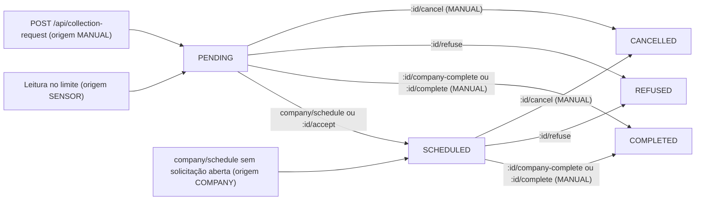
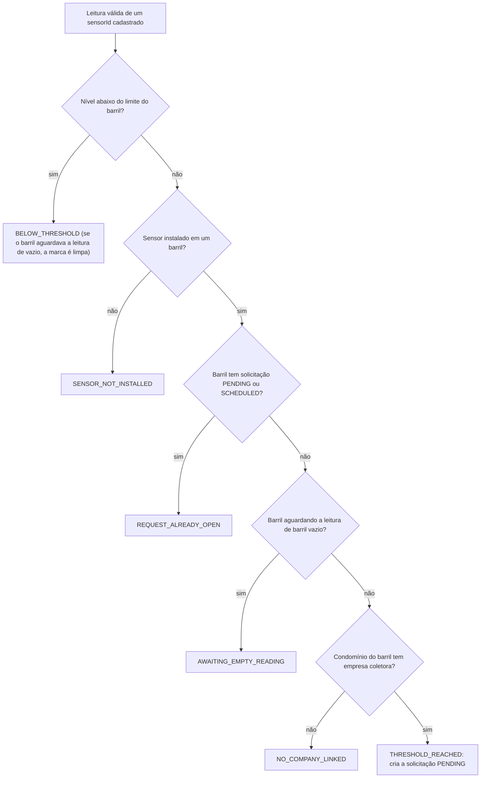

# Referência de rotas da API

Parte da [documentação do Coillect](README.md).

Este documento descreve as 72 rotas HTTP da API do Coillect (pasta `backend/`, NestJS): as convenções comuns (URL, Swagger, autenticação, envelope, erros, validação e códigos de status), os formatos de resposta compartilhados, cada rota nova ou alterada do MVP (corpo, validações, resposta com exemplo, erros e quem chama), todos os resultados possíveis de uma leitura do sensor, as rotas legadas do frontend web antigo, a matriz de uso por cliente e exemplos de `curl` para o roteiro da demonstração. Tudo foi conferido nos controllers, DTOs, services e views de [`backend/src/`](../backend/src/); onde um documento antigo diverge do código, vale o código. A organização interna da API (módulos, eventos, banco) está em [API e backend](02-api-backend.md) e a fila e o Blob em [Azure Storage e nuvem](08-azure-storage-e-nuvem.md).

## Sumário

- [Índice das rotas](#índice-das-rotas)
- [Convenções](#convenções)
- [Formatos comuns](#formatos-comuns)
- [Saúde e autenticação](#saúde-e-autenticação)
- [Sensor e barris](#sensor-e-barris)
- [Resultados da leitura do sensor](#resultados-da-leitura-do-sensor)
- [Solicitações de coleta do síndico](#solicitações-de-coleta-do-síndico)
- [Solicitações de coleta da empresa](#solicitações-de-coleta-da-empresa)
- [Notificações do síndico e pedido de ajuda](#notificações-do-síndico-e-pedido-de-ajuda)
- [Avisos da empresa](#avisos-da-empresa)
- [Administração (desktop)](#administração-desktop)
- [Nuvem (desktop)](#nuvem-desktop)
- [Rotas legadas](#rotas-legadas)
- [Matriz de rotas por cliente](#matriz-de-rotas-por-cliente)
- [Exemplos com curl](#exemplos-com-curl)
- [Limitações e pontos não verificados](#limitações-e-pontos-não-verificados)

## Índice das rotas

Situação: **nova** = criada nos PRs de 10/11/2026; **alterada** = já existia na base (commit 76f12374) e mudou de comportamento ou de formato; **legada** = já existia e hoje só serve ao frontend web antigo. Autenticação: **—** = sem login; **Síndico** = token de `POST /api/auth/login`; **Empresa** = token de `POST /api/auth/company/login`.

### Saúde e autenticação (3)

| Método | Caminho | Autenticação | Situação | Para quê |
|---|---|---|---|---|
| GET | [`/api/health`](#get-apihealth) | — | nova | API e banco no ar? Modo do armazenamento |
| POST | [`/api/auth/login`](#post-apiauthlogin) | — | alterada | Login do síndico |
| POST | [`/api/auth/company/login`](#post-apiauthcompanylogin) | — | alterada | Login da empresa coletora |

### Sensor e barris (5)

| Método | Caminho | Autenticação | Situação | Para quê |
|---|---|---|---|---|
| POST | [`/api/sensor-alert`](#post-apisensor-alert) | — | nova | Leitura do sensor; pode abrir a solicitação de coleta |
| POST | [`/api/sensor/readings`](#post-apisensorreadings) | — | nova | O mesmo que `sensor-alert`, com o nome antigo |
| GET | [`/api/sensor/mine`](#get-apisensormine) | Síndico | nova | Barril e sensor do condomínio do síndico |
| GET | [`/api/sensor/company`](#get-apisensorcompany) | Empresa | nova | Barris dos condomínios clientes |
| GET | [`/api/sensor/:sensorId/status`](#get-apisensorsensoridstatus) | — | nova | Estado atual de um sensor |

### Solicitações de coleta (10)

| Método | Caminho | Autenticação | Situação | Para quê |
|---|---|---|---|---|
| GET | [`/api/collection-request/my-active`](#get-apicollection-requestmy-active) | Síndico | alterada | Cópia da solicitação em aberto do condomínio |
| GET | [`/api/collection-request/my-history`](#get-apicollection-requestmy-history) | Síndico | alterada | Solicitações encerradas do síndico |
| GET | [`/api/collection-request/:id/receipt`](#get-apicollection-requestidreceipt) | Síndico | nova | Comprovante da coleta concluída |
| GET | [`/api/collection-request/company/active`](#get-apicollection-requestcompanyactive) | Empresa | alterada | Solicitações `PENDING` e `SCHEDULED` da empresa |
| GET | [`/api/collection-request/company/history`](#get-apicollection-requestcompanyhistory) | Empresa | alterada | Solicitações encerradas da empresa |
| GET | [`/api/collection-request/company/:id/receipt`](#get-apicollection-requestcompanyidreceipt) | Empresa | nova | Comprovante da coleta concluída |
| POST | [`/api/collection-request/company/schedule`](#post-apicollection-requestcompanyschedule) | Empresa | nova | "Agendar coleta" de um barril |
| POST | [`/api/collection-request/:id/accept`](#post-apicollection-requestidaccept) | Empresa | alterada | "Iniciar etapa de coleta" (`PENDING` → `SCHEDULED`) |
| POST | [`/api/collection-request/:id/company-complete`](#post-apicollection-requestidcompany-complete) | Empresa | nova | Conclui a coleta; barril volta a 0% |
| POST | [`/api/collection-request/:id/refuse`](#post-apicollection-requestidrefuse) | Empresa | alterada | Recusa a solicitação |

### Notificações e pedido de ajuda (7)

| Método | Caminho | Autenticação | Situação | Para quê |
|---|---|---|---|---|
| GET | [`/api/notifications/mine`](#get-apinotificationsmine) | Síndico | nova | Notificações do síndico |
| POST | [`/api/notifications/read-all`](#post-apinotificationsread-all) | Síndico | nova | Marca todas como lidas |
| POST | [`/api/notifications/:id/read`](#post-apinotificationsidread) | Síndico | nova | Marca uma como lida |
| POST | [`/api/help-request`](#post-apihelp-request) | Síndico | nova | "Precisa de ajuda?": mensagem para a empresa |
| GET | [`/api/notifications/company`](#get-apinotificationscompany) | Empresa | nova | Avisos da empresa |
| POST | [`/api/notifications/company/read-all`](#post-apinotificationscompanyread-all) | Empresa | nova | Marca todos como lidos |
| POST | [`/api/notifications/company/:id/read`](#post-apinotificationscompanyidread) | Empresa | nova | Marca um como lido |

### Administração e nuvem, usadas pelo desktop (20)

| Método | Caminho | Autenticação | Situação | Para quê |
|---|---|---|---|---|
| GET | [`/api/admin/overview`](#get-apiadminoverview) | — | nova | Contadores, sensores e últimas 50 solicitações |
| GET | [`/api/admin/condominiums`](#get-apiadmincondominiums) | — | nova | Lista condomínios com vínculos, barris e sensores |
| POST | [`/api/admin/condominiums`](#post-apiadmincondominiums) | — | nova | Cadastra condomínio e vincula síndico e empresa |
| PATCH | [`/api/admin/condominiums/:id`](#patch-apiadmincondominiumsid) | — | nova | Altera condomínio ou vínculos |
| GET | [`/api/admin/barrels`](#get-apiadminbarrels) | — | nova | Lista barris |
| POST | [`/api/admin/barrels`](#post-apiadminbarrels) | — | nova | Cadastra barril |
| PATCH | [`/api/admin/barrels/:id`](#patch-apiadminbarrelsid) | — | nova | Altera condomínio, capacidade ou limite do barril |
| GET | [`/api/admin/sensors`](#get-apiadminsensors) | — | nova | Lista sensores |
| POST | [`/api/admin/sensors`](#post-apiadminsensors) | — | nova | Cadastra sensor e instala no barril |
| PATCH | [`/api/admin/sensors/:sensorId`](#patch-apiadminsensorssensorid) | — | nova | Troca o barril do sensor ou ajusta limite e capacidade |
| GET | [`/api/admin/readings`](#get-apiadminreadings) | — | nova | Últimas leituras recebidas |
| GET | [`/api/admin/sindicos`](#get-apiadminsindicos) | — | nova | Lista síndicos (tabela `users`) |
| POST | [`/api/admin/sindicos`](#post-apiadminsindicos) | — | nova | Cadastra síndico |
| GET | [`/api/admin/users`](#get-apiadminusers) | — | nova | O mesmo que `GET /api/admin/sindicos` |
| GET | [`/api/admin/companies`](#get-apiadmincompanies) | — | nova | Lista empresas coletoras |
| POST | [`/api/admin/companies`](#post-apiadmincompanies) | — | nova | Cadastra empresa coletora |
| POST | [`/api/admin/demo/reset`](#post-apiadmindemoreset) | — | nova | Reinicia a demonstração |
| GET | [`/api/admin/cloud`](#get-apiadmincloud) | — | nova | Estado do Blob (comprovantes) e da fila |
| POST | [`/api/admin/cloud/queue/pause`](#post-apiadmincloudqueuepause) | — | nova | Pausa o consumidor da fila (só modo azure) |
| POST | [`/api/admin/cloud/queue/resume`](#post-apiadmincloudqueueresume) | — | nova | Retoma o consumidor da fila |

### Legadas (27)

Detalhes em [Rotas legadas](#rotas-legadas).

| Método | Caminho | Autenticação | Situação |
|---|---|---|---|
| GET | [`/api/api`](#rotas-legadas) (em `routes.json` aparece como `GET /api`) | — | legada, inalterada |
| POST | [`/api/collection-request`](#rotas-legadas) | Síndico | legada, alterada |
| POST | [`/api/collection-request/:id/cancel`](#rotas-legadas) | Síndico | legada, alterada |
| POST | [`/api/collection-request/:id/complete`](#rotas-legadas) | Síndico | legada, alterada |
| POST | [`/api/user`](#rotas-legadas) | — | legada, inalterada |
| GET · PATCH · DELETE | [`/api/user/:id`](#rotas-legadas) (3 rotas) | — | legada, inalterada |
| GET | [`/api/user/:id/addresses`](#rotas-legadas) | — | legada, inalterada |
| GET · PATCH · DELETE | [`/api/user/address/:id`](#rotas-legadas) (3 rotas) | — | legada, inalterada |
| POST | [`/api/user/address/:user_id`](#rotas-legadas) | — | legada, inalterada |
| GET | [`/api/user/:id/phone_numbers`](#rotas-legadas) | — | legada, inalterada |
| GET · PATCH · DELETE | [`/api/user/phone_number/:id`](#rotas-legadas) (3 rotas) | — | legada, inalterada |
| POST | [`/api/user/phone_number/:user_id`](#rotas-legadas) | — | legada, inalterada |
| POST | [`/api/company/register`](#rotas-legadas) | — | legada, inalterada |
| GET | [`/api/company/check`](#rotas-legadas) | — | legada, inalterada |
| POST | [`/api/company/register/step1`](#rotas-legadas) | — | legada, inalterada |
| POST | [`/api/company/register/address/:companyId`](#rotas-legadas) | — | legada, inalterada |
| POST | [`/api/company/register/contact/:companyId`](#rotas-legadas) | — | legada, inalterada |
| POST | [`/api/company/register/representative/:companyId`](#rotas-legadas) | — | legada, inalterada |
| GET | [`/api/company`](#rotas-legadas) | — | legada, inalterada |
| GET | [`/api/company/:cnpj`](#rotas-legadas) | — | legada, inalterada |
| POST | [`/api/company/icon/upload/:companyId`](#rotas-legadas) | — | legada, inalterada |

Total: 3 + 5 + 10 + 7 + 20 + 27 = 72 rotas, as mesmas de `routes.json` (lá, `/api/user//address/...` corresponde a `/api/user/address/...`).

## Convenções

### URL base e Swagger

- Prefixo global `api` ([app.setup.ts](../backend/src/app.setup.ts)): toda rota começa com `/api`. A API escuta em `0.0.0.0`, na porta da variável `PORT` ou 3000 ([main.ts](../backend/src/main.ts), [config/env.ts](../backend/src/config/env.ts)).
- URL base: `http://<host>:3000/api`. Local: `http://localhost:3000/api`; emulador Android: `http://10.0.2.2:3000/api`; nuvem: `https://<domínio>/api` (a plataforma define `PORT`).
- Swagger (documentação interativa com "Try it out"): `/api/docs`. Título "Coillect API", versão 2.0, com o botão **Authorize** para colar o token (`addBearerAuth`).
- CORS liberado para qualquer origem (`enableCors({ origin: true })`).
- Fora do prefixo, `/uploads/...` serve os ícones de empresa enviados pelo frontend web antigo (pré-existente).
- Os testes e2e montam a aplicação com a mesma função `configureApp` de `app.setup.ts`.
- Os três apps (síndico, empresa e desktop) usam caminhos relativos a `<servidor>/api/` e atualizam a tela a cada 5 s (`AUTO_REFRESH_MS = 5_000L`); esperam até 15 s para conectar e 60 s pela resposta (`CoillectHttp.kt`).

### Tokens e guards

- `POST /api/auth/login` (síndico) e `POST /api/auth/company/login` (empresa) devolvem `access_token`. Nas rotas protegidas, envie `Authorization: Bearer <access_token>`.
- O token é um JWT assinado com a variável `JWT_SECRET` ([auth.module.ts](../backend/src/auth/auth.module.ts)) e vale 1 dia (`expiresIn: '1d'`). Leva `sub` (id do usuário ou da empresa), `email` e `role` (`user` ou `company`). Não há renovação: vencido, faça login de novo.
- Guards (Passport):

| Guard | Estratégia | Rotas | `sub` do token é usado como |
|---|---|---|---|
| `JwtUserAuthGuard` ([jwt-user.guard.ts](../backend/src/auth/guards/jwt-user.guard.ts)) | `jwt` ([jwt.strategy.ts](../backend/src/auth/strategies/jwt.strategy.ts)) | Síndico: `sensor/mine`, `collection-request/my-active`, `my-history`, `:id/receipt`, `notifications/mine`, `notifications/read-all`, `notifications/:id/read`, `help-request` e as legadas `POST collection-request`, `:id/cancel`, `:id/complete` | id do usuário (tabela `users`) |
| `JwtCompanyAuthGuard` ([jwt-company.guard.ts](../backend/src/auth/guards/jwt-company.guard.ts)) | `company-jwt` ([company-jwt.strategy.ts](../backend/src/auth/strategies/company-jwt.strategy.ts)) | Empresa: `sensor/company`, `collection-request/company/*`, `:id/accept`, `:id/company-complete`, `:id/refuse`, `notifications/company/*` | id da empresa (tabela `companies`) |

- Sem guard: `health`, `auth/*`, `sensor-alert`, `sensor/readings`, `sensor/:sensorId/status`, todas as `admin/*` (inclusive `admin/cloud/*`: "sem login no MVP, como a interface desktop atual espera", diz o controller) e as legadas `user/*`, `company/*` e `GET /api/api`.
- Sem token, com token inválido ou vencido, o guard responde HTTP 401: `{"message":"Unauthorized","statusCode":401}`.
- As duas estratégias conferem só a assinatura e a validade; nenhuma confere `role` (ver [Limitações](#limitações-e-pontos-não-verificados)).

### Envelope de resposta

As respostas de sucesso usam a classe `APIResponse` ([utils/response/response.ts](../backend/src/utils/response/response.ts)):

| Campo | Tipo | Conteúdo |
|---|---|---|
| `error` | boolean | `false` no sucesso; `true` só no `GET /api/health` com o banco fora |
| `data` | qualquer | O resultado. É o único campo que os apps leem (função `dataOf` nos três `CoillectHttp.kt`) |
| `statusCode` | number | Código gravado pelo controller. Pode diferir do status HTTP (ver abaixo) |
| `timestamp` | string ISO 8601 | Hora em que a resposta foi montada |
| `requester` | string | Só em algumas rotas: `admin` (administração e nuvem), `sensor:<sensorId>` (leitura do sensor) e `root` (legadas de `user`). Nas demais o campo não aparece |
| `message` | string | Texto curto em português, indicado em cada rota |

Exemplo (`GET /api/health`):

```json
{
  "error": false,
  "data": { "status": "ok", "database": "up", "storage": "azure", "queuePaused": false, "uptimeSeconds": 754 },
  "statusCode": 200,
  "timestamp": "2026-11-10T17:30:00.512Z",
  "message": "Coillect API"
}
```

Fora do envelope ficam os dois logins (devolvem `{ access_token, role, profile }` direto), o `GET /api/api` (texto puro) e os erros.

Status HTTP × `statusCode` do envelope: um `POST` sem `@HttpCode` responde HTTP 201 no NestJS. Em `:id/accept`, `:id/company-complete`, `:id/refuse`, `notifications/read-all`, `notifications/:id/read`, `notifications/company/read-all`, `notifications/company/:id/read` e nas legadas `:id/cancel` e `:id/complete`, o envelope traz `statusCode: 200`, mas o HTTP é 201 (os testes e2e esperam 201). Vale o status HTTP; os apps aceitam qualquer 2xx.

### Formato dos erros

Os erros são exceções do NestJS e saem sem envelope, com `message`, `error` e `statusCode`:

```json
{ "message": "Solicitação não encontrada para esta empresa", "error": "Not Found", "statusCode": 404 }
```

- Erro de validação: `message` é uma lista, com as mensagens padrão (em inglês) do class-validator:

```json
{ "message": ["percentual must not be greater than 100"], "error": "Bad Request", "statusCode": 400 }
```

- 401 do guard: `{"message":"Unauthorized","statusCode":401}` (sem `error`). O 401 do login traz `error`: `{"message":"Email ou senha inválidos","error":"Unauthorized","statusCode":401}`.
- Rota inexistente: `{"message":"Cannot GET /api/xyz","error":"Not Found","statusCode":404}`.
- Erro não tratado (ex.: banco fora do ar numa rota comum): `{"statusCode":500,"message":"Internal server error"}`.
- As mensagens de negócio estão em português e aparecem em cada rota. Duas validações têm mensagem própria: `cnpj deve ter 14 dígitos (somente números)` e `<campo> deve conter apenas letras, números, ponto, hífen ou sublinhado` (códigos de sensor e de barril).

### Validação do corpo

`ValidationPipe({ whitelist: true, forbidNonWhitelisted: true, transform: true })` global ([app.setup.ts](../backend/src/app.setup.ts)):

- Corpos declarados com uma classe DTO são validados pelos decoradores do class-validator. Campo fora do DTO → HTTP 400 `property <campo> should not exist`.
- `transform: true` transforma o corpo na classe do DTO. Texto numérico só vira número onde há `@Type(() => Number)`: `percentual` e `level` da leitura do sensor e `barrelId` do "Agendar coleta". Nos demais campos inteiros (ex.: `barrelId` do admin) mande número JSON; `"1"` falha em `@IsInt`.
- `@IsOptional` aceita o campo ausente ou `null`. É o que permite `"sindicoId": null` para desvincular no admin.
- Rotas sem DTO de corpo (`:id/company-complete`, `:id/refuse`, `read`, `read-all`, `demo/reset`, `queue/pause`, `queue/resume`) ignoram o que for enviado.
- Parâmetros de consulta (`unread`, `limit`, `sensorId`) não são validados: valor inválido cai no padrão da rota.
- O `:id` numérico das rotas `collection-request/*` e `notifications/*` passa por `ParseIntPipe`: texto → HTTP 400 `Validation failed (numeric string is expected)`.

### Códigos de status

| Código | Quando aparece |
|---|---|
| 200 | `GET`, `PATCH` e `DELETE` com sucesso; `POST /api/admin/demo/reset` (único `POST` com `@HttpCode(200)`) |
| 201 | Todos os outros `POST`, inclusive os logins e os que só mudam estado (`accept`, `company-complete`, `refuse`, `read`, `read-all`, `queue/pause`, `queue/resume`) |
| 400 | Corpo fora do DTO (campo extra, tipo ou faixa inválidos, obrigatório ausente); `:id` não numérico |
| 401 | Rota de síndico ou de empresa sem token, com token inválido ou vencido; login com e-mail ou senha errados |
| 403 | Síndico tentando cancelar ou concluir solicitação que não é `MANUAL` (rotas legadas `:id/cancel` e `:id/complete`) |
| 404 | `sensorId` não cadastrado; solicitação, notificação, barril, condomínio, síndico ou empresa inexistente ou de outro dono; comprovante ainda não disponível; síndico sem condomínio no "Precisa de ajuda?"; rota inexistente |
| 409 | Estado não permite a ação (ex.: aceitar uma solicitação `COMPLETED`); cadastro duplicado (e-mail, CNPJ, código de barril ou de sensor); barril já com sensor; barril com coleta aberta de outra empresa; condomínio sem empresa no "Precisa de ajuda?"; limite ou capacidade num sensor sem barril; pausar a fila no modo local |
| 503 | `GET /api/health` quando o banco não responde |
| 500 | Não é usado de propósito: aparece em erro não tratado (banco fora numa rota comum, Storage do Azure sem resposta ao ler um comprovante) |

### Efeitos que passam pela fila

- As rotas que criam ou mudam solicitações respondem com a solicitação já gravada. Os avisos (notificações do síndico e da empresa) e o comprovante seguem pela fila `coillect-notificacoes` ([message-queue.service.ts](../backend/src/cloud/message-queue.service.ts), [notification.listener.ts](../backend/src/notification/notification.listener.ts)).
- Modo local (sem `AZURE_STORAGE_CONNECTION_STRING`): a mensagem é processada em memória antes de a resposta sair; avisos e comprovante já existem quando o cliente consulta.
- Modo azure (Storage Account ou Azurite): o consumidor lê a fila 50 ms depois de cada publicação e, sem mensagens, espaça as leituras de 1 s até 5 s (`QUEUE_POLL_MS`, `QUEUE_POLL_MAX_MS`). Nesse intervalo `.../receipt` ainda responde 404 e a notificação ainda não aparece. Com o consumidor pausado, nada é entregue até `queue/resume`.
- Se a fila do Azure não responder na publicação, a API processa a mensagem ali mesmo (fallback) e não devolve erro.
- Concorrência: leituras do mesmo `sensorId` são tratadas uma de cada vez; leituras do mesmo barril e o "Agendar coleta" passam pela trava por barril ([barrel-lock.ts](../backend/src/collection-request/barrel-lock.ts)). Resultado: no máximo uma solicitação aberta por barril, garantido dentro de uma instância da API.

## Formatos comuns

Quatro formatos se repetem em várias rotas. As seções das rotas apontam para eles.

### Barril e sensor (`SensorView`)

Montado por `toSensorView` ([sensor.view.ts](../backend/src/sensor/sensor.view.ts)). Aparece em `sensor/mine`, `sensor/company`, `sensor/:sensorId/status`, `data.sensor` da leitura do sensor, `admin/overview` (`sensors`) e `admin/sensors`.

| Campo | Tipo | Conteúdo |
|---|---|---|
| `id` | number | Id interno do sensor |
| `sensorId` | string | Código do sensor (`sensors.code`), o mesmo que o dispositivo envia |
| `barrelId`, `barrelCode` | number, string ou `null` | Barril em que o sensor está instalado |
| `condominiumId`, `condominiumName`, `condominiumAddress`, `condominiumNeighborhood` | number, string ou `null` | Condomínio do barril |
| `companyId`, `companyName` | number, string ou `null` | Empresa coletora do condomínio |
| `sindicoName` | string ou `null` | Síndico do condomínio |
| `level` | number | Último percentual recebido; vai a 0 quando a coleta é concluída (o reset da demonstração volta aos níveis iniciais) |
| `threshold` | number | Limite de alerta do barril (`alertThreshold`); 80 se o sensor não estiver instalado |
| `capacityLiters` | number ou `null` | Capacidade do barril |
| `estimatedLiters` | number ou `null` | `round(capacityLiters × level / 100)` |
| `needsCollection` | boolean | `level >= threshold` |
| `online` | boolean | Recebeu leitura nos últimos `SENSOR_ONLINE_MINUTES` minutos (padrão 30) |
| `lastReadingAt` | data ISO ou `null` | Recebimento da última leitura |
| `lastCollectionAt` | data ISO ou `null` | Última coleta concluída do barril |
| `openRequest` | objeto ou `null` | `{ id, status, requestedAt }` da solicitação `PENDING` ou `SCHEDULED` do barril |

Exemplo (sensor do Residencial Aurora com a solicitação #12 aberta):

```json
{
  "id": 1, "sensorId": "CLT-8472-A", "barrelId": 1, "barrelCode": "BRL-8472",
  "condominiumId": 1, "condominiumName": "Residencial Aurora",
  "condominiumAddress": "Rua das Acácias, 120 - São Paulo/SP", "condominiumNeighborhood": "Jardim Paulista",
  "companyId": 1, "companyName": "EcoColeta Ambiental", "sindicoName": "Leonardo Costa",
  "level": 86, "threshold": 80, "capacityLiters": 200, "estimatedLiters": 172,
  "needsCollection": true, "online": true,
  "lastReadingAt": "2026-11-10T17:32:06.098Z", "lastCollectionAt": null,
  "openRequest": { "id": 12, "status": "PENDING", "requestedAt": "2026-11-10T17:32:06.161Z" }
}
```

### Solicitação de coleta (`CollectionRequestView`)

Montada por `toRequestView` ([collection-request.view.ts](../backend/src/collection-request/collection-request.view.ts)). Aparece em todas as rotas `collection-request/*` (menos os comprovantes), em `data.collection.request` da leitura do sensor, em `admin/overview` (`requests`) e dentro das notificações (`request`). Não traz senhas nem hashes: do síndico vão só id, nome e e-mail; da empresa, id, nome e ícone.

| Campo | Tipo | Conteúdo |
|---|---|---|
| `id` | number | Id da solicitação |
| `status` | string | `PENDING` (aguardando a empresa), `SCHEDULED` (agendada ou em andamento), `COMPLETED`, `REFUSED` ou `CANCELLED` |
| `origin` | string | `SENSOR` (criada pela leitura no limite), `COMPANY` (empresa agendou antes do alerta) ou `MANUAL` (fluxo antigo do frontend web) |
| `levelAtRequest` | number ou `null` | Nível (%) quando a solicitação nasceu; `null` nas `MANUAL` |
| `requestedAt` | data ISO | Criação |
| `scheduledDate` | data ISO ou `null` | Quando a empresa iniciou ou agendou a coleta |
| `completedAt` | data ISO ou `null` | Conclusão |
| `updatedAt` | data ISO | Última alteração do registro |
| `receiptAvailable` | boolean | `true` quando o comprovante já está no Blob (`receiptBlob` preenchido) |
| `receiptBlob` | string ou `null` | Nome do comprovante no container `comprovantes-coleta` |
| `condominiumName`, `condominiumNeighborhood` | string ou `null` | Condomínio do barril |
| `barrel` | objeto ou `null` | `{ id, code, capacityLiters, threshold }`; `null` nas `MANUAL` |
| `sensor` | objeto ou `null` | `{ id, sensorId, condominiumId, condominiumName, level, threshold }`. `level` é o nível ATUAL do sensor, não o do alerta |
| `user` | objeto ou `null` | `{ id, name, email }` do síndico do condomínio no momento da criação (nas `MANUAL`, o usuário que pediu); `null` se o condomínio não tinha síndico |
| `company` | objeto ou `null` | `{ id, name, iconeUrl }` da empresa coletora |
| `userCpfSnapshot`, `companyCnpjSnapshot`, `userAddressSnapshot` | string ou `null` | Campos antigos, mantidos para o frontend web. Nas solicitações do sensor e da empresa: CPF `null`, CNPJ da empresa e endereço do condomínio |

Exemplo (solicitação #12, criada pela leitura de 86%):

```json
{
  "id": 12, "status": "PENDING", "origin": "SENSOR", "levelAtRequest": 86,
  "requestedAt": "2026-11-10T17:32:06.161Z", "scheduledDate": null, "completedAt": null,
  "updatedAt": "2026-11-10T17:32:06.161Z", "receiptAvailable": false, "receiptBlob": null,
  "condominiumName": "Residencial Aurora", "condominiumNeighborhood": "Jardim Paulista",
  "barrel": { "id": 1, "code": "BRL-8472", "capacityLiters": 200, "threshold": 80 },
  "sensor": { "id": 1, "sensorId": "CLT-8472-A", "condominiumId": 1, "condominiumName": "Residencial Aurora", "level": 86, "threshold": 80 },
  "user": { "id": 1, "name": "Leonardo Costa", "email": "sindico@coillect.com" },
  "company": { "id": 1, "name": "EcoColeta Ambiental", "iconeUrl": null },
  "userCpfSnapshot": null, "companyCnpjSnapshot": "11222333000181",
  "userAddressSnapshot": "Rua das Acácias, 120 - São Paulo/SP"
}
```

Transições de status e as rotas que as causam ([collection-request.service.ts](../backend/src/collection-request/collection-request.service.ts)):



`PENDING` e `SCHEDULED` são os status "abertos" (`OPEN_REQUEST_STATUSES`): enquanto um deles existir para o barril, nenhuma outra solicitação é aberta para ele.

### Notificação (`NotificationView`)

Montada por `toNotificationView` ([notification.view.ts](../backend/src/notification/notification.view.ts)). Aparece em `notifications/mine`, `notifications/company` e nas rotas `read`.

| Campo | Tipo | Conteúdo |
|---|---|---|
| `id` | number | Id da notificação |
| `audience` | string | `SINDICO` ou `EMPRESA` |
| `type` | string | `COLLECTION_REQUESTED`, `COLLECTION_SCHEDULED`, `COLLECTION_COMPLETED`, `COLLECTION_REFUSED`, `COLLECTION_CANCELLED` ou `HELP_REQUESTED` |
| `title`, `message` | string | Textos prontos para a tela (tabela abaixo) |
| `read` | boolean | Já marcada como lida |
| `createdAt` | data ISO | Criação (feita pelo consumidor da fila) |
| `requestId` | number ou `null` | Solicitação ligada; `null` em `HELP_REQUESTED` |
| `request` | objeto ou `null` | A mesma solicitação no formato [Solicitação](#solicitação-de-coleta-collectionrequestview), com o estado ATUAL (não uma cópia do momento do aviso) |

Exemplo (aviso de pedido de ajuda para a empresa):

```json
{
  "id": 35, "audience": "EMPRESA", "type": "HELP_REQUESTED",
  "title": "Pedido de ajuda • Residencial Aurora",
  "message": "Leonardo Costa (Coleta): O barril está quase transbordando. Conseguem vir hoje?",
  "read": false, "createdAt": "2026-11-10T17:45:20.311Z",
  "requestId": null, "request": null
}
```

Textos gerados ([notification.text.ts](../backend/src/notification/notification.text.ts)). Datas no fuso `APP_TIMEZONE` (padrão `America/Sao_Paulo`), no formato `dd/mm, hh:mm`:

| `type` | Destinatário | Quando | `title` | `message` |
|---|---|---|---|---|
| `COLLECTION_REQUESTED` | Empresa | Solicitação criada pelo sensor | Nova solicitação de coleta | `<condomínio> chegou a <nível>% de capacidade. Barril <código>.` |
| `COLLECTION_REQUESTED` | Empresa | Solicitação `MANUAL` (web antigo) | Nova solicitação de coleta | `<síndico> pediu uma coleta (solicitação #<id>).` |
| `COLLECTION_REQUESTED` | Síndico | Solicitação criada pelo sensor ou `MANUAL` | Coleta solicitada automaticamente | `O barril <código> de <condomínio> atingiu <nível>%. A solicitação #<id> foi enviada para <empresa>.` (sem nível: `A solicitação #<id> foi enviada para <empresa>.`) |
| `COLLECTION_SCHEDULED` | Síndico | `company/schedule` (inclusive a criação com origem `COMPANY`) ou `:id/accept` | Coleta agendada | `<empresa> agendou a coleta do barril <código> para <dd/mm, hh:mm> (solicitação #<id>).` |
| `COLLECTION_COMPLETED` | Síndico | `:id/company-complete` ou `:id/complete` | Coleta concluída | `<empresa> concluiu a coleta da solicitação #<id>. O barril está disponível novamente.` |
| `COLLECTION_REFUSED` | Síndico | `:id/refuse` | Solicitação recusada | `<empresa> recusou a solicitação #<id>.` |
| `COLLECTION_CANCELLED` | Síndico | `:id/cancel` (legada) | Solicitação cancelada | `A solicitação #<id> foi cancelada.` |
| `COLLECTION_CANCELLED` | Empresa | `:id/cancel` (legada) | Solicitação cancelada | `A solicitação #<id> de <condomínio> foi cancelada pelo síndico.` |
| `HELP_REQUESTED` | Empresa | `help-request` | `Pedido de ajuda • <condomínio>` | `<síndico> (<assunto>): <mensagem>` (cortada em 300 caracteres) |
| `HELP_REQUESTED` | Síndico | `help-request` | Pedido de ajuda enviado | `Sua mensagem foi enviada para <empresa> (assunto: <assunto>). Acompanhe a resposta com a empresa coletora.` |

A empresa não recebe aviso de agendamento, conclusão ou recusa (ela mesma fez a ação), nem da solicitação de origem `COMPANY`. Sem síndico no condomínio, não há notificação de síndico. Cada notificação é gravada uma vez por mensagem da fila (coluna única `dedupeKey`).

### Comprovante (`ReceiptView`)

Montado por `ReceiptService.read` ([receipt.service.ts](../backend/src/collection-request/receipt.service.ts)) a partir do JSON gravado no Blob na conclusão ([receipt.ts](../backend/src/collection-request/receipt.ts)). Aparece em `collection-request/:id/receipt` e `collection-request/company/:id/receipt`.

| Campo | Conteúdo |
|---|---|
| `requestId` | Id da solicitação |
| `receipt` | O documento gravado: `tipo` (`comprovante-de-coleta`), `versao` (1), `protocolo` (`COL-` + id com 6 dígitos), `solicitacaoId`, `origem`, `condominio` (`nome`, `endereco`, `bairro`), `sindico` (`nome`, `email`), `empresaColetora` (`nome`, `cnpj`), `barril` (`codigo`, `capacidadeLitros`, `limiteAlertaPercentual`), `sensor`, `nivelNoAlertaPercentual`, `volumeEstimadoLitros` (`round(capacidade × nível / 100)`), `solicitadaEm`, `agendadaPara`, `concluidaEm`, `emitidoEm` e `armazenamento` (`provedor`, `container`, `blob`) |
| `storage` | Onde foi lido: `mode` (`azure` ou `local`), `provider`, `container` e `blob` |

Nome do blob: `AAAA/MM/DD/coleta-<id>-<AAAAMMDD>T<HHMMSS>Z.json`, pela data de conclusão em UTC. Exemplo:

```json
{
  "requestId": 12,
  "receipt": {
    "tipo": "comprovante-de-coleta", "versao": 1, "protocolo": "COL-000012", "solicitacaoId": 12, "origem": "SENSOR",
    "condominio": { "nome": "Residencial Aurora", "endereco": "Rua das Acácias, 120 - São Paulo/SP", "bairro": "Jardim Paulista" },
    "sindico": { "nome": "Leonardo Costa", "email": "sindico@coillect.com" },
    "empresaColetora": { "nome": "EcoColeta Ambiental", "cnpj": "11222333000181" },
    "barril": { "codigo": "BRL-8472", "capacidadeLitros": 200, "limiteAlertaPercentual": 80 },
    "sensor": "CLT-8472-A", "nivelNoAlertaPercentual": 86, "volumeEstimadoLitros": 172,
    "solicitadaEm": "2026-11-10T17:32:06.161Z", "agendadaPara": "2026-11-10T17:38:40.215Z",
    "concluidaEm": "2026-11-10T17:40:12.530Z", "emitidoEm": "2026-11-10T17:40:12.871Z",
    "armazenamento": { "provedor": "Azure Blob Storage (emulador Azurite)", "container": "comprovantes-coleta", "blob": "2026/11/10/coleta-12-20261110T174012Z.json" }
  },
  "storage": { "mode": "azure", "provider": "Azure Blob Storage (emulador Azurite)", "container": "comprovantes-coleta", "blob": "2026/11/10/coleta-12-20261110T174012Z.json" }
}
```

`provider` vale `Azure Blob Storage`, `Azure Blob Storage (emulador Azurite)` ou `Disco local (sem Azure)` (modo local, pasta `storage-local/comprovantes-coleta`).

## Saúde e autenticação

Nas seções de rotas, "Mensagem" é o texto do campo `message` do envelope e os exemplos mostram só `data`, salvo quando o envelope inteiro ajuda.

### `GET /api/health`

**Situação:** nova · **Autenticação:** nenhuma · **Código:** [health.controller.ts](../backend/src/health/health.controller.ts)

Executa `SELECT 1` no PostgreSQL e informa o modo do armazenamento.

**Resposta:** HTTP 200 com o banco no ar; HTTP 503 com o banco fora (mesmo envelope, com `error: true` e `statusCode: 503`). Mensagem: `Coillect API`.

| Campo de `data` | Tipo | Valores |
|---|---|---|
| `status` | string | `ok`, ou `degraded` com o banco fora |
| `database` | string | `up` ou `down` |
| `storage` | string | `azure` (Storage Account ou Azurite) ou `local` (disco e memória) |
| `queuePaused` | boolean | Consumidor da fila pausado pelo desktop |
| `uptimeSeconds` | number | Segundos desde que o processo subiu |

O exemplo com HTTP 200 está em [Envelope de resposta](#envelope-de-resposta). Com o banco fora:

```json
{
  "error": true,
  "data": { "status": "degraded", "database": "down", "storage": "azure", "queuePaused": false, "uptimeSeconds": 3605 },
  "statusCode": 503,
  "timestamp": "2026-11-10T18:30:00.004Z",
  "message": "Coillect API"
}
```

**Erros:** nenhum além do 503 acima.

**Quem chama:** apps do síndico e da empresa (botão **Testar conexão**, antes do login; tratam o corpo do 503 como diagnóstico), [`endereco-celular.mjs`](../backend/scripts/endereco-celular.mjs), [`smoke-flow.mjs`](../backend/scripts/smoke-flow.mjs), os workflows do CI (`curl` em [`backend.yml`](../.github/workflows/backend.yml) e [`sensor-esp32.yml`](../.github/workflows/sensor-esp32.yml)), o health check do Render ([`render.yaml`](../render.yaml)) e os testes e2e. O [guia da Azure](../docs/azure-a02.md) usa a rota no health check do App Service e no teste de disponibilidade do Application Insights (não executados). O desktop não chama.

### `POST /api/auth/login`

**Situação:** alterada: a resposta ganhou `role` e `profile` (o `access_token` não mudou) · **Autenticação:** nenhuma · **Código:** [auth.controller.ts](../backend/src/auth/auth.controller.ts), [auth.service.ts](../backend/src/auth/auth.service.ts), [login.dto.ts](../backend/src/auth/dto/login.dto.ts)

**Corpo:**

| Campo | Tipo | Obrigatório | Validação |
|---|---|---|---|
| `email` | string | sim | `@IsEmail()` |
| `password` | string | sim | `@IsNotEmpty()`, `@IsString()` |

Procura o usuário (tabela `users`) pelo e-mail exatamente como enviado (os cadastros do admin gravam em minúsculas) e compara a senha com o hash bcrypt. Não confere se o usuário é síndico de algum condomínio.

**Resposta:** HTTP 201, sem envelope:

```json
{
  "access_token": "<token JWT>",
  "role": "user",
  "profile": { "id": 1, "name": "Leonardo Costa", "email": "sindico@coillect.com" }
}
```

**Erros:** 400 (e-mail inválido, senha ausente, campo extra); 401 `Email ou senha inválidos` (e-mail não cadastrado ou senha errada).

**Quem chama:** app do síndico (login; guarda o `access_token`), frontend web antigo, `smoke-flow.mjs`, testes e2e e [`reproduzir-na-api.mjs`](../sensor-esp32/testes/reproduzir-na-api.mjs).

### `POST /api/auth/company/login`

**Situação:** alterada, como o login do síndico · **Autenticação:** nenhuma · **Código:** [auth.controller.ts](../backend/src/auth/auth.controller.ts), [company-login.dto.ts](../backend/src/auth/dto/company-login.dto.ts)

**Corpo:** `email` (`@IsEmail()`) e `password` (`@IsNotEmpty()`, `@IsString()`), ambos obrigatórios. Procura a empresa (tabela `companies`) pelo e-mail e compara a senha com o hash bcrypt.

**Resposta:** HTTP 201, sem envelope:

```json
{
  "access_token": "<token JWT>",
  "role": "company",
  "profile": { "id": 1, "name": "EcoColeta Ambiental", "email": "empresa@coillect.com" }
}
```

**Erros:** 400 (validação); 401 `Email ou senha inválidos`.

**Quem chama:** app da empresa (guarda o token e `profile.name`), frontend web antigo, `smoke-flow.mjs`, testes e2e e os dois roteiros de [`sensor-esp32/testes/`](../sensor-esp32/testes/).

## Sensor e barris

### `POST /api/sensor-alert`

**Situação:** nova · **Autenticação:** nenhuma (o dispositivo só conhece a URL da API e o próprio `sensorId`) · **Código:** [sensor-alert.controller.ts](../backend/src/sensor/sensor-alert.controller.ts), [sensor-alert.service.ts](../backend/src/sensor/sensor-alert.service.ts), [sensor-alert.payload.ts](../backend/src/sensor/dto/sensor-alert.payload.ts), [sensor-trigger.listener.ts](../backend/src/collection-request/sensor-trigger.listener.ts), [collection-trigger.rule.ts](../backend/src/collection-request/collection-trigger.rule.ts)

Contrato único do sensor físico (ESP32), do ESP32 virtual no Wokwi, do sensor virtual do PC e do botão "Simular leitura do sensor" do app do síndico. Ver também [Sensor ESP32 e simulador](04-sensor-esp32-e-simulador.md).

**Corpo (`SensorAlertPayload`):**

| Campo | Tipo | Obrigatório | Validação e tratamento |
|---|---|---|---|
| `sensorId` | string | sim | `@IsString()`, `@IsNotEmpty()`, `@MaxLength(60)`. Espaços nas pontas são removidos. Precisa estar cadastrado (`POST /api/admin/sensors`) |
| `percentual` | number | sim, a menos que venha `level` | `@Type(() => Number)` (aceita `"86"`), `@IsNumber()` sem `NaN` nem infinito, `@Min(0)`, `@Max(100)`. Arredondado para inteiro (85,6 → 86) |
| `dataHora` | string | não | Hora da medição no dispositivo. Número vira texto; `@MaxLength(40)`. Guardada como veio (texto vazio vira `null`); a hora oficial é a de recebimento (`receivedAt`) |
| `level` | number | não (obsoleto) | Formato antigo, mesma validação de `percentual`. Se os dois vierem, vale `percentual` |

Qualquer outro campo → 400.

**Processamento** ([sensor-alert.service.ts](../backend/src/sensor/sensor-alert.service.ts)):

1. Normaliza o payload (`normalizeSensorAlert`). Leituras do mesmo `sensorId` entram numa fila em memória e são tratadas uma de cada vez.
2. Busca o sensor com barril, condomínio, síndico e empresa (404 se não existir).
3. Grava `level` e `lastReadingAt` no sensor e a leitura em `sensor_readings`.
4. Publica o evento `sensor.reading.received`. O listener, dentro da trava do barril, aplica a regra de disparo e, se for o caso, cria a solicitação `PENDING` com origem `SENSOR` para a empresa do condomínio.
5. A criação publica `coleta.criada` na fila: o consumidor grava o aviso da empresa e a cópia do síndico ([Efeitos que passam pela fila](#efeitos-que-passam-pela-fila)).
6. Escreve o evento `leitura_sensor` no log (uma linha JSON).

**Resposta:** HTTP 201 (inclusive quando nada é criado). `requester`: `sensor:<sensorId>`. Mensagem: `Leitura registrada. Solicitação de coleta #<id> criada.` quando esta leitura criou a solicitação; `Leitura registrada.` nos demais casos.

| Campo de `data` | Conteúdo |
|---|---|
| `reading` | `{ id, sensorId, percentual, level, dataHora, receivedAt }`; `level` repete `percentual` (compatibilidade) |
| `sensor` | [Barril e sensor](#barril-e-sensor-sensorview) já com o novo nível; `openRequest` é a solicitação criada agora ou a que já estava aberta |
| `collection.triggered` | `true` só quando ESTA leitura criou a solicitação |
| `collection.reason` | Um dos seis motivos de [Resultados da leitura do sensor](#resultados-da-leitura-do-sensor) |
| `collection.request` | [Solicitação](#solicitação-de-coleta-collectionrequestview) criada agora ou a que já estava aberta para o barril; `null` se não houver |

Exemplo completo (leitura de 86% no Residencial Aurora, sem coleta aberta):

```json
{
  "error": false,
  "data": {
    "reading": {
      "id": 345, "sensorId": "CLT-8472-A", "percentual": 86, "level": 86,
      "dataHora": "2026-11-10T14:32:05-03:00", "receivedAt": "2026-11-10T17:32:06.120Z"
    },
    "sensor": {
      "id": 1, "sensorId": "CLT-8472-A", "barrelId": 1, "barrelCode": "BRL-8472",
      "condominiumId": 1, "condominiumName": "Residencial Aurora",
      "condominiumAddress": "Rua das Acácias, 120 - São Paulo/SP", "condominiumNeighborhood": "Jardim Paulista",
      "companyId": 1, "companyName": "EcoColeta Ambiental", "sindicoName": "Leonardo Costa",
      "level": 86, "threshold": 80, "capacityLiters": 200, "estimatedLiters": 172,
      "needsCollection": true, "online": true,
      "lastReadingAt": "2026-11-10T17:32:06.098Z", "lastCollectionAt": null,
      "openRequest": { "id": 12, "status": "PENDING", "requestedAt": "2026-11-10T17:32:06.161Z" }
    },
    "collection": {
      "triggered": true,
      "reason": "THRESHOLD_REACHED",
      "request": {
        "id": 12, "status": "PENDING", "origin": "SENSOR", "levelAtRequest": 86,
        "requestedAt": "2026-11-10T17:32:06.161Z", "scheduledDate": null, "completedAt": null,
        "updatedAt": "2026-11-10T17:32:06.161Z", "receiptAvailable": false, "receiptBlob": null,
        "condominiumName": "Residencial Aurora", "condominiumNeighborhood": "Jardim Paulista",
        "barrel": { "id": 1, "code": "BRL-8472", "capacityLiters": 200, "threshold": 80 },
        "sensor": { "id": 1, "sensorId": "CLT-8472-A", "condominiumId": 1, "condominiumName": "Residencial Aurora", "level": 86, "threshold": 80 },
        "user": { "id": 1, "name": "Leonardo Costa", "email": "sindico@coillect.com" },
        "company": { "id": 1, "name": "EcoColeta Ambiental", "iconeUrl": null },
        "userCpfSnapshot": null, "companyCnpjSnapshot": "11222333000181",
        "userAddressSnapshot": "Rua das Acácias, 120 - São Paulo/SP"
      }
    }
  },
  "statusCode": 201,
  "timestamp": "2026-11-10T17:32:06.233Z",
  "requester": "sensor:CLT-8472-A",
  "message": "Leitura registrada. Solicitação de coleta #12 criada."
}
```

**Erros:** 400 (fora do contrato: ex. `percentual` 150, `sensorId` ausente, campo extra); 404 `Sensor "<sensorId>" não cadastrado. Cadastre-o em POST /api/admin/sensors.`; 500 em falha do banco. Exemplos em [Resultados da leitura do sensor](#resultados-da-leitura-do-sensor).

**Quem chama:** firmware do ESP32 ([coillect_sensor.ino](../sensor-esp32/coillect_sensor/coillect_sensor.ino), na placa e no Wokwi: POST para a URL completa em `COILLECT_API_URL`, `dataHora` só depois do NTP; lê `message`, `collection.reason`, `sensor.openRequest` e `sensor.lastCollectionAt` da resposta e mostra no monitor serial); sensor virtual do PC ([sensor-virtual.mjs](../sensor-esp32/simulador-pc/sensor-virtual.mjs)); app do síndico ("Simular leitura do sensor": envia `{ sensorId, percentual }` com o `sensorId` de `sensor/mine`); `smoke-flow.mjs`; testes e2e; roteiros de `sensor-esp32/testes/`.

### `POST /api/sensor/readings`

**Situação:** nova (nome do primeiro PR do MVP, mantido por compatibilidade) · **Autenticação:** nenhuma · **Código:** [sensor.controller.ts](../backend/src/sensor/sensor.controller.ts)

Mesmo DTO, mesmo processamento e mesma resposta de [`POST /api/sensor-alert`](#post-apisensor-alert) (a função `toAlertResponse` é compartilhada). O formato antigo `{ "sensorId": "...", "level": 92 }` vale nas duas rotas.

```json
{ "sensorId": "CLT-8472-A", "level": 92 }
```

**Erros:** os mesmos de `POST /api/sensor-alert` (400 fora do contrato, 404 `sensorId` não cadastrado).

**Quem chama:** só o teste e2e (`mvp-flow`), que confere `REQUEST_ALREADY_OPEN` por esta rota. Firmware, simulador e apps usam `/api/sensor-alert`.

### `GET /api/sensor/mine`

**Situação:** nova · **Autenticação:** Síndico · **Código:** [sensor.controller.ts](../backend/src/sensor/sensor.controller.ts), [sensor.service.ts](../backend/src/sensor/sensor.service.ts)

Primeiro sensor (menor id) instalado em um barril de condomínio cujo síndico é o usuário do token.

**Resposta:** HTTP 200. `data`: [Barril e sensor](#barril-e-sensor-sensorview) ou `null`. Mensagem: `Barril encontrado` ou `Nenhum barril vinculado a este síndico`. Exemplo logo depois do reset da demonstração:

```json
{
  "id": 1, "sensorId": "CLT-8472-A", "barrelId": 1, "barrelCode": "BRL-8472",
  "condominiumId": 1, "condominiumName": "Residencial Aurora",
  "condominiumAddress": "Rua das Acácias, 120 - São Paulo/SP", "condominiumNeighborhood": "Jardim Paulista",
  "companyId": 1, "companyName": "EcoColeta Ambiental", "sindicoName": "Leonardo Costa",
  "level": 0, "threshold": 80, "capacityLiters": 200, "estimatedLiters": 0,
  "needsCollection": false, "online": false,
  "lastReadingAt": null, "lastCollectionAt": null, "openRequest": null
}
```

**Erros:** 401.

**Quem chama:** app do síndico (a cada 5 s; o `sensorId` daqui é o usado em "Simular leitura do sensor"), `smoke-flow.mjs`, testes e2e.

### `GET /api/sensor/company`

**Situação:** nova · **Autenticação:** Empresa · **Código:** [sensor.controller.ts](../backend/src/sensor/sensor.controller.ts), [sensor.service.ts](../backend/src/sensor/sensor.service.ts)

Sensores instalados em barris de condomínios cuja empresa coletora é a do token, em ordem de código.

**Resposta:** HTTP 200. `data`: lista de [Barril e sensor](#barril-e-sensor-sensorview). Mensagem: `Barris dos condomínios clientes`. Exemplo com um item (Condomínio Bosque, sem síndico vinculado na demonstração):

```json
[
  {
    "id": 2, "sensorId": "CLT-1264-B", "barrelId": 2, "barrelCode": "BRL-1264",
    "condominiumId": 2, "condominiumName": "Condomínio Bosque",
    "condominiumAddress": "Rua dos Ipês, 455 - São Paulo/SP", "condominiumNeighborhood": "Vila Mariana",
    "companyId": 1, "companyName": "EcoColeta Ambiental", "sindicoName": null,
    "level": 62, "threshold": 80, "capacityLiters": 200, "estimatedLiters": 124,
    "needsCollection": false, "online": true,
    "lastReadingAt": "2026-11-10T17:20:00.031Z", "lastCollectionAt": null, "openRequest": null
  }
]
```

**Erros:** 401.

**Quem chama:** app da empresa (lista de reservatórios, a cada 5 s), testes e2e.

### `GET /api/sensor/:sensorId/status`

**Situação:** nova · **Autenticação:** nenhuma · **Código:** [sensor.controller.ts](../backend/src/sensor/sensor.controller.ts)

**Parâmetro de caminho:** `sensorId` = código do sensor (ex.: `CLT-8472-A`).

**Resposta:** HTTP 200. `data`: [Barril e sensor](#barril-e-sensor-sensorview). Mensagem: `Estado do sensor`. Exemplo logo depois de uma coleta concluída (nível zerado, `lastCollectionAt` preenchido):

```json
{
  "id": 1, "sensorId": "CLT-8472-A", "barrelId": 1, "barrelCode": "BRL-8472",
  "condominiumId": 1, "condominiumName": "Residencial Aurora",
  "condominiumAddress": "Rua das Acácias, 120 - São Paulo/SP", "condominiumNeighborhood": "Jardim Paulista",
  "companyId": 1, "companyName": "EcoColeta Ambiental", "sindicoName": "Leonardo Costa",
  "level": 0, "threshold": 80, "capacityLiters": 200, "estimatedLiters": 0,
  "needsCollection": false, "online": true,
  "lastReadingAt": "2026-11-10T17:33:10.004Z", "lastCollectionAt": "2026-11-10T17:40:12.530Z", "openRequest": null
}
```

**Erros:** 404 `Sensor "<sensorId>" não cadastrado. Cadastre-o em POST /api/admin/sensors.`

**Quem chama:** sensor virtual do PC (ao iniciar, para começar no nível que a API conhece, e a cada 5 s; quando `lastCollectionAt` muda, esvazia o barril simulado), [`simulador-na-api.mjs`](../sensor-esp32/testes/simulador-na-api.mjs), testes e2e. O firmware não chama: lê `lastCollectionAt` da resposta do `POST /api/sensor-alert`.

## Resultados da leitura do sensor

Toda leitura válida de um `sensorId` cadastrado responde HTTP 201 com um destes seis valores em `data.collection.reason` (tipo `CollectionTriggerReason` em [domain-events.ts](../backend/src/events/domain-events.ts)). A regra ([collection-trigger.rule.ts](../backend/src/collection-request/collection-trigger.rule.ts)) é avaliada nesta ordem; a primeira condição verdadeira decide:



| `reason` | Condição | `triggered` | `collection.request` | O que mais acontece |
|---|---|---|---|---|
| `THRESHOLD_REACHED` | Nível ≥ limite, sensor instalado, nenhuma solicitação aberta, barril sem a marca de espera e condomínio com empresa | `true` | A solicitação criada (`PENDING`, origem `SENSOR`, `levelAtRequest` = nível lido) | Aviso da empresa e cópia do síndico pela fila; log `solicitação #<id> criada` |
| `REQUEST_ALREADY_OPEN` | Nível ≥ limite e o barril já tem solicitação `PENDING` ou `SCHEDULED` (do sensor ou da empresa) | `false` | A solicitação aberta | Nada novo: não duplica |
| `BELOW_THRESHOLD` | Nível < limite do barril (80% para sensor sem barril) | `false` | A solicitação aberta do barril, se houver; senão `null` | Só registra. Se o barril tinha `awaitingEmptyReading`, a marca é limpa: o ciclo pode recomeçar |
| `SENSOR_NOT_INSTALLED` | Nível ≥ limite e sensor sem barril | `false` | `null` | Log de aviso |
| `AWAITING_EMPTY_READING` | Nível ≥ limite, sem solicitação aberta, e o barril teve coleta concluída sem leitura abaixo do limite depois dela | `false` | `null` | Log informativo. O nível do sensor é atualizado (`needsCollection` fica `true`), mas nenhuma solicitação nasce |
| `NO_COMPANY_LINKED` | Nível ≥ limite, sem solicitação aberta, e o condomínio do barril não tem empresa (ou o barril não tem condomínio) | `false` | `null` | Log de aviso |

A marca `awaitingEmptyReading` do barril é ligada quando a empresa conclui a coleta ([sensor.service.ts](../backend/src/sensor/sensor.service.ts)) e desligada pela primeira leitura abaixo do limite ou pelo reset da demonstração. Ela evita uma segunda coleta logo depois da primeira, quando o barril simulado (ex.: no Wokwi) continua "cheio". O "Agendar coleta" da empresa não olha essa marca.

Exemplos. O primeiro (`THRESHOLD_REACHED`) está completo em [`POST /api/sensor-alert`](#post-apisensor-alert); os demais são trechos com `message`, `data.reading` e `data.collection` (no objeto `request`, só alguns campos do formato [Solicitação](#solicitação-de-coleta-collectionrequestview)).

`REQUEST_ALREADY_OPEN`: nova leitura de 92% com a solicitação #12 aberta.

```json
{
  "message": "Leitura registrada.",
  "data": {
    "reading": { "id": 346, "sensorId": "CLT-8472-A", "percentual": 92, "level": 92, "dataHora": null, "receivedAt": "2026-11-10T17:33:10.004Z" },
    "collection": {
      "triggered": false,
      "reason": "REQUEST_ALREADY_OPEN",
      "request": { "id": 12, "status": "PENDING", "origin": "SENSOR", "levelAtRequest": 86 }
    }
  }
}
```

`BELOW_THRESHOLD`: leitura de 50% sem coleta aberta.

```json
{
  "message": "Leitura registrada.",
  "data": {
    "reading": { "id": 344, "sensorId": "CLT-8472-A", "percentual": 50, "level": 50, "dataHora": "2026-11-10T14:31:10-03:00", "receivedAt": "2026-11-10T17:31:10.502Z" },
    "collection": { "triggered": false, "reason": "BELOW_THRESHOLD", "request": null }
  }
}
```

`AWAITING_EMPTY_READING`: leitura de 85% logo depois de a empresa concluir a coleta #12 (o sensor ainda "vê" o barril cheio).

```json
{
  "message": "Leitura registrada.",
  "data": {
    "reading": { "id": 347, "sensorId": "CLT-8472-A", "percentual": 85, "level": 85, "dataHora": null, "receivedAt": "2026-11-10T17:41:05.330Z" },
    "collection": { "triggered": false, "reason": "AWAITING_EMPTY_READING", "request": null }
  }
}
```

Em seguida, uma leitura de 3% responde `BELOW_THRESHOLD`, limpa a marca, e a próxima leitura no limite volta a criar solicitação.

`SENSOR_NOT_INSTALLED`: sensor cadastrado sem barril (`POST /api/admin/sensors` só com `sensorId`) lendo 95%. Aqui o trecho inclui `data.sensor`, com os campos de barril e condomínio nulos e o limite padrão de 80%:

```json
{
  "message": "Leitura registrada.",
  "data": {
    "reading": { "id": 351, "sensorId": "CLT-TESTE-1", "percentual": 95, "level": 95, "dataHora": null, "receivedAt": "2026-11-10T18:02:11.640Z" },
    "sensor": {
      "id": 7, "sensorId": "CLT-TESTE-1", "barrelId": null, "barrelCode": null,
      "condominiumId": null, "condominiumName": null, "condominiumAddress": null, "condominiumNeighborhood": null,
      "companyId": null, "companyName": null, "sindicoName": null,
      "level": 95, "threshold": 80, "capacityLiters": null, "estimatedLiters": null,
      "needsCollection": true, "online": true,
      "lastReadingAt": "2026-11-10T18:02:11.618Z", "lastCollectionAt": null, "openRequest": null
    },
    "collection": { "triggered": false, "reason": "SENSOR_NOT_INSTALLED", "request": null }
  }
}
```

`NO_COMPANY_LINKED`: sensor instalado em barril de um condomínio cadastrado sem `companyId`, lendo 90%.

```json
{
  "message": "Leitura registrada.",
  "data": {
    "reading": { "id": 352, "sensorId": "CLT-TESTE-2", "percentual": 90, "level": 90, "dataHora": null, "receivedAt": "2026-11-10T18:05:40.077Z" },
    "collection": { "triggered": false, "reason": "NO_COMPANY_LINKED", "request": null }
  }
}
```

Respostas de erro (sem envelope):

| HTTP | Quando | Exemplo de corpo | O dispositivo deve |
|---|---|---|---|
| 400 | Fora do contrato | `{"message":["percentual must not be greater than 100"],"error":"Bad Request","statusCode":400}`; campo extra: `["property extra should not exist"]` | Corrigir o firmware ou o simulador |
| 404 | `sensorId` não cadastrado | `{"message":"Sensor \"NAO-EXISTE\" não cadastrado. Cadastre-o em POST /api/admin/sensors.","error":"Not Found","statusCode":404}` | Cadastrar o sensor no desktop ou ajustar `COILLECT_SENSOR_ID` |
| 500 ou sem resposta | Banco fora, API reiniciando ou "acordando" na nuvem | — | Tentar de novo (o firmware espera 5 s depois de uma falha, `ESPERA_APOS_FALHA_MS`) |

## Solicitações de coleta do síndico

O síndico só acompanha: vê a mesma solicitação enviada à empresa (campo `user` = síndico do condomínio) e não altera solicitações de origem `SENSOR` ou `COMPANY`. Código: [collection-request.controller.ts](../backend/src/collection-request/collection-request.controller.ts) e [collection-request.service.ts](../backend/src/collection-request/collection-request.service.ts).

### `GET /api/collection-request/my-active`

**Situação:** alterada: antes devolvia a entidade do banco, com `user` e `company` completos (inclusive o hash da senha); agora usa o formato [Solicitação](#solicitação-de-coleta-collectionrequestview) · **Autenticação:** Síndico

Devolve a solicitação mais recente (`requestedAt` decrescente) do síndico com status `PENDING`, `SCHEDULED` ou `REFUSED`. O filtro vem do repositório antigo ([collection-request.repository.ts](../backend/src/collection-request/repository/collection-request.repository.ts)) e inclui `REFUSED`: depois de uma recusa, a recusada continua aparecendo aqui até surgir outra solicitação.

**Resposta:** HTTP 200. `data`: Solicitação ou `null`. Mensagem: `Solicitação ativa encontrada` ou `Nenhuma solicitação ativa`. Com solicitação, `data` é o objeto completo do formato [Solicitação](#solicitação-de-coleta-collectionrequestview) (exemplo da #12 lá). O app do síndico usa `id`, `status`, `company.name`, `requestedAt`, `scheduledDate`, `levelAtRequest` e `barrel.code`. Sem solicitação:

```json
{ "error": false, "data": null, "statusCode": 200, "timestamp": "2026-11-10T17:41:00.020Z", "message": "Nenhuma solicitação ativa" }
```

**Erros:** 401.

**Quem chama:** app do síndico (a cada 5 s; mostra a cópia e anuncia "Nova solicitação de coleta gerada para o seu condomínio."), frontend web antigo, `smoke-flow.mjs`, testes e2e.

### `GET /api/collection-request/my-history`

**Situação:** alterada (formato [Solicitação](#solicitação-de-coleta-collectionrequestview)) · **Autenticação:** Síndico

Solicitações do síndico com status `COMPLETED`, `CANCELLED` ou `REFUSED`, da mais recente para a mais antiga.

**Resposta:** HTTP 200. `data`: lista de Solicitação. Mensagem: `Histórico de solicitações do usuário`. Exemplo com a #12 concluída (o `sensor.level` é o nível atual, 3%, lido depois da coleta):

```json
[
  {
    "id": 12, "status": "COMPLETED", "origin": "SENSOR", "levelAtRequest": 86,
    "requestedAt": "2026-11-10T17:32:06.161Z", "scheduledDate": "2026-11-10T17:38:40.215Z",
    "completedAt": "2026-11-10T17:40:12.530Z", "updatedAt": "2026-11-10T17:40:12.902Z",
    "receiptAvailable": true, "receiptBlob": "2026/11/10/coleta-12-20261110T174012Z.json",
    "condominiumName": "Residencial Aurora", "condominiumNeighborhood": "Jardim Paulista",
    "barrel": { "id": 1, "code": "BRL-8472", "capacityLiters": 200, "threshold": 80 },
    "sensor": { "id": 1, "sensorId": "CLT-8472-A", "condominiumId": 1, "condominiumName": "Residencial Aurora", "level": 3, "threshold": 80 },
    "user": { "id": 1, "name": "Leonardo Costa", "email": "sindico@coillect.com" },
    "company": { "id": 1, "name": "EcoColeta Ambiental", "iconeUrl": null },
    "userCpfSnapshot": null, "companyCnpjSnapshot": "11222333000181",
    "userAddressSnapshot": "Rua das Acácias, 120 - São Paulo/SP"
  }
]
```

**Erros:** 401.

**Quem chama:** app do síndico (tela Histórico; recarrega a cada 5 s enquanto aberta; `receiptAvailable` define o texto do botão do comprovante), frontend web antigo.

### `GET /api/collection-request/:id/receipt`

**Situação:** nova · **Autenticação:** Síndico · **Código:** controller acima e [receipt.service.ts](../backend/src/collection-request/receipt.service.ts)

**Parâmetro de caminho:** `id` (inteiro, `ParseIntPipe`).

Confere, nesta ordem: a solicitação é do síndico; está `COMPLETED`; o comprovante já foi gravado e pode ser lido do Blob (ou do disco, no modo local).

**Resposta:** HTTP 200. `data`: [Comprovante](#comprovante-receiptview). Mensagem: `Comprovante da coleta`.

**Erros:**

| HTTP | Mensagem | Por quê |
|---|---|---|
| 400 | `Validation failed (numeric string is expected)` | `id` não numérico |
| 401 | `Unauthorized` | Sem token |
| 404 | `Solicitação não encontrada para este usuário` | Não existe ou é de outro síndico |
| 404 | `A solicitação #<id> ainda não foi concluída; o comprovante é gerado na conclusão.` | Status diferente de `COMPLETED` |
| 404 | `O comprovante da solicitação #<id> ainda está sendo gerado. Tente de novo em instantes.` | Concluída, mas o consumidor da fila ainda não gravou o arquivo (modo azure) ou o arquivo não foi encontrado |
| 500 | `Internal server error` | Storage do Azure sem resposta |

Exemplo de 404 para uma solicitação ainda aberta (o teste e2e faz o mesmo com a nova solicitação do sensor, antes da conclusão):

```json
{ "message": "A solicitação #14 ainda não foi concluída; o comprovante é gerado na conclusão.", "error": "Not Found", "statusCode": 404 }
```

**Quem chama:** app do síndico (Histórico → comprovante; no 404 mostra "O comprovante ainda está sendo gerado. Tente de novo em instantes."), `smoke-flow.mjs` (repete por até 30 s), testes e2e (`mvp-flow` e `azure-storage`).

## Solicitações de coleta da empresa

A empresa recebe a solicitação principal de cada barril, agenda, conclui ou recusa. Código: [collection-request.controller.ts](../backend/src/collection-request/collection-request.controller.ts) e [collection-request.service.ts](../backend/src/collection-request/collection-request.service.ts). Em todas as rotas com `:id`, uma solicitação de outra empresa responde 404 `Solicitação não encontrada para esta empresa`.

### `GET /api/collection-request/company/active`

**Situação:** alterada: antes listava só `PENDING` e devolvia a entidade do banco; agora lista `PENDING` e `SCHEDULED` no formato [Solicitação](#solicitação-de-coleta-collectionrequestview) · **Autenticação:** Empresa

Ordenadas por `requestedAt` crescente (a mais antiga primeiro).

**Resposta:** HTTP 200. `data`: lista de Solicitação (vazia: `[]`). Mensagem: `Solicitações ativas da empresa`. Cada item é o objeto completo do formato [Solicitação](#solicitação-de-coleta-collectionrequestview). Trecho com os campos que o app da empresa usa (`toRequest` em `ApiEmpresaRepository.kt`):

```json
[
  {
    "id": 12, "status": "PENDING", "origin": "SENSOR", "levelAtRequest": 86,
    "requestedAt": "2026-11-10T17:32:06.161Z", "scheduledDate": null, "completedAt": null, "receiptAvailable": false,
    "condominiumName": "Residencial Aurora",
    "barrel": { "id": 1, "code": "BRL-8472", "capacityLiters": 200, "threshold": 80 },
    "sensor": { "id": 1, "sensorId": "CLT-8472-A", "condominiumId": 1, "condominiumName": "Residencial Aurora", "level": 92, "threshold": 80 },
    "user": { "id": 1, "name": "Leonardo Costa", "email": "sindico@coillect.com" }
  }
]
```

**Erros:** 401.

**Quem chama:** app da empresa (a cada 5 s; quando aparece `PENDING` nova, anuncia "Nova solicitação de coleta: <condomínios>."), frontend web antigo, `smoke-flow.mjs`, testes e2e, [`reproduzir-na-api.mjs`](../sensor-esp32/testes/reproduzir-na-api.mjs).

### `GET /api/collection-request/company/history`

**Situação:** alterada (formato [Solicitação](#solicitação-de-coleta-collectionrequestview)) · **Autenticação:** Empresa

Solicitações da empresa com status `COMPLETED`, `CANCELLED` ou `REFUSED`, da mais recente para a mais antiga.

**Resposta:** HTTP 200. `data`: lista de Solicitação (a #12 concluída aparece igual ao exemplo de [`my-history`](#get-apicollection-requestmy-history)). Mensagem: `Histórico de solicitações da empresa`. Trecho de um item recusado (sem data e sem comprovante):

```json
[
  { "id": 15, "status": "REFUSED", "origin": "SENSOR", "levelAtRequest": 83, "scheduledDate": null, "completedAt": null, "receiptAvailable": false, "receiptBlob": null, "condominiumName": "Edifício Átria" }
]
```

**Erros:** 401.

**Quem chama:** app da empresa (tela Histórico; `receiptAvailable` define o texto do botão: "Ver comprovante" ou "Comprovante em geração…"), frontend web antigo, testes e2e.

### `GET /api/collection-request/company/:id/receipt`

**Situação:** nova · **Autenticação:** Empresa

Igual a [`GET /api/collection-request/:id/receipt`](#get-apicollection-requestidreceipt), conferindo que a solicitação é da empresa do token.

**Resposta:** HTTP 200. `data`: [Comprovante](#comprovante-receiptview) (o mesmo arquivo que o síndico lê). Mensagem: `Comprovante da coleta`.

**Erros:** 400 (`id`), 401, 404 `Solicitação não encontrada para esta empresa`, os dois 404 de comprovante ainda indisponível e 500 (Storage sem resposta). Exemplo:

```json
{ "message": "O comprovante da solicitação #12 ainda está sendo gerado. Tente de novo em instantes.", "error": "Not Found", "statusCode": 404 }
```

**Quem chama:** app da empresa (Histórico → comprovante), testes e2e (`mvp-flow` e `azure-storage`).

### `POST /api/collection-request/company/schedule`

**Situação:** nova · **Autenticação:** Empresa · **DTO:** [schedule-collection.dto.ts](../backend/src/collection-request/dto/schedule-collection.dto.ts)

"Agendar coleta" do reservatório selecionado no app da empresa.

**Corpo:**

| Campo | Tipo | Obrigatório | Validação |
|---|---|---|---|
| `sensorId` | string | sim, se `barrelId` não vier | `@IsString()`, `@IsNotEmpty()`, `@MaxLength(60)`. Espaços nas pontas são ignorados na busca. Se vier, tem prioridade sobre `barrelId` |
| `barrelId` | inteiro | não | `@Type(() => Number)`, `@IsInt()`, `@Min(1)` |
| `scheduledDate` | string ISO 8601 | não | `@IsDateString()`. Sem ela, vale a hora atual |

Acha o barril (pelo sensor ou pelo id) e exige que o condomínio do barril seja cliente da empresa do token. Depois, dentro da trava do barril:

| Situação do barril | Resultado | Notificação |
|---|---|---|
| Solicitação aberta de outra empresa | 409 | — |
| `PENDING` desta empresa (ex.: criada pelo sensor) | Passa a `SCHEDULED`; `scheduledDate` = enviada ou agora | Síndico: "Coleta agendada" |
| `SCHEDULED` desta empresa, com `scheduledDate` no corpo | Só a data muda | Nenhuma (o status não mudou) |
| `SCHEDULED` desta empresa, sem `scheduledDate` | Devolvida sem mudança | Nenhuma |
| Nenhuma solicitação aberta | Cria uma nova com origem `COMPANY`, já `SCHEDULED`; `levelAtRequest` = nível atual do sensor do barril | Síndico: "Coleta agendada" (a empresa não recebe aviso) |

A marca `awaitingEmptyReading` não impede o agendamento.

**Resposta:** HTTP 201 (envelope também 201). `data`: [Solicitação](#solicitação-de-coleta-collectionrequestview). Mensagem: `Coleta agendada`. Exemplo: "Agendar coleta" no barril com a #12 `PENDING` (o app envia só `{ "sensorId": "CLT-8472-A" }`):

```json
{
  "id": 12, "status": "SCHEDULED", "origin": "SENSOR", "levelAtRequest": 86,
  "requestedAt": "2026-11-10T17:32:06.161Z", "scheduledDate": "2026-11-10T17:38:40.215Z", "completedAt": null,
  "updatedAt": "2026-11-10T17:38:40.233Z", "receiptAvailable": false, "receiptBlob": null,
  "condominiumName": "Residencial Aurora", "condominiumNeighborhood": "Jardim Paulista",
  "barrel": { "id": 1, "code": "BRL-8472", "capacityLiters": 200, "threshold": 80 },
  "sensor": { "id": 1, "sensorId": "CLT-8472-A", "condominiumId": 1, "condominiumName": "Residencial Aurora", "level": 92, "threshold": 80 },
  "user": { "id": 1, "name": "Leonardo Costa", "email": "sindico@coillect.com" },
  "company": { "id": 1, "name": "EcoColeta Ambiental", "iconeUrl": null },
  "userCpfSnapshot": null, "companyCnpjSnapshot": "11222333000181",
  "userAddressSnapshot": "Rua das Acácias, 120 - São Paulo/SP"
}
```

Trecho de uma criação com origem `COMPANY` (barril do Condomínio Bosque, a 62% e sem síndico vinculado), como no teste e2e:

```json
{ "id": 13, "status": "SCHEDULED", "origin": "COMPANY", "levelAtRequest": 62, "condominiumName": "Condomínio Bosque", "barrel": { "id": 2, "code": "BRL-1264", "capacityLiters": 200, "threshold": 80 }, "user": null }
```

**Erros:**

| HTTP | Mensagem | Por quê |
|---|---|---|
| 400 | Mensagens do class-validator | Nem `sensorId` nem `barrelId` no corpo (o erro aparece em `sensorId`); `scheduledDate` fora do ISO 8601 (`scheduledDate must be a valid ISO 8601 date string`); campo extra |
| 401 | `Unauthorized` | Sem token de empresa |
| 404 | `Barril não encontrado entre os condomínios clientes desta empresa` | Sensor inexistente ou sem barril, barril inexistente, ou condomínio de outra empresa |
| 409 | `O barril <código> já tem a solicitação #<id> aberta com outra empresa.` | Solicitação aberta pertence a outra empresa |

**Quem chama:** app da empresa (botão **Agendar coleta**; envia só `sensorId`), `smoke-flow.mjs`, testes e2e (inclusive o de concorrência: cinco leituras e um agendamento ao mesmo tempo resultam numa única solicitação), roteiros de `sensor-esp32/testes/`.

### `POST /api/collection-request/:id/accept`

**Situação:** alterada: antes marcava `SCHEDULED` com data = `requestedAt` + 5 dias, em qualquer status; agora usa a data enviada ou a atual e só aceita `PENDING` · **Autenticação:** Empresa · **DTO:** [accept-collection-request.dto.ts](../backend/src/collection-request/dto/accept-collection-request.dto.ts)

"Iniciar etapa de coleta" de uma solicitação específica.

**Parâmetro de caminho:** `id` (inteiro). **Corpo (opcional):** `scheduledDate` (string ISO 8601, `@IsOptional()`, `@IsDateString()`); corpo vazio é aceito.

Se a solicitação já está `SCHEDULED`, volta sem mudança (ignora `scheduledDate`). Se está encerrada, 409. Se está `PENDING`, passa a `SCHEDULED` com a data enviada ou a atual, e o síndico recebe "Coleta agendada".

**Resposta:** HTTP 201 (envelope `statusCode: 200`). `data`: [Solicitação](#solicitação-de-coleta-collectionrequestview). Mensagem: `Etapa de coleta iniciada`. Trecho:

```json
{ "id": 12, "status": "SCHEDULED", "origin": "SENSOR", "scheduledDate": "2026-11-12T17:00:00.000Z", "completedAt": null }
```

**Erros:** 400 (`id`, data inválida, campo extra); 401; 404 `Solicitação não encontrada para esta empresa`; 409 `Não é possível iniciar a coleta: a solicitação #<id> está <STATUS>.` (ex.: `COMPLETED`).

**Quem chama:** frontend web antigo (botão de aceitar); teste e2e (caso 409). Os apps novos não chamam: o app da empresa usa [`company/schedule`](#post-apicollection-requestcompanyschedule), que faz o mesmo pelo barril.

### `POST /api/collection-request/:id/company-complete`

**Situação:** nova · **Autenticação:** Empresa

Conclui a coleta. **Parâmetro de caminho:** `id` (inteiro). **Corpo:** nenhum (o que vier é ignorado).

1. Já `COMPLETED`: volta sem mudança. `REFUSED` ou `CANCELLED`: 409.
2. `PENDING` ou `SCHEDULED`: passa a `COMPLETED`, com `completedAt` = agora; `scheduledDate` é mantida (ou vira agora, se estava vazia).
3. Em seguida ([sensor.service.ts](../backend/src/sensor/sensor.service.ts)): o barril recebe `lastCollectionAt` = `completedAt` e `awaitingEmptyReading` = `true`, e os sensores do barril voltam a `level` 0.
4. Pela fila: o síndico recebe "Coleta concluída" e o comprovante é gravado no Blob.

**Resposta:** HTTP 201 (envelope `statusCode: 200`). `data`: [Solicitação](#solicitação-de-coleta-collectionrequestview). Mensagem: `Coleta concluída`. O objeto é lido antes dos passos 3 e 4: na resposta, `receiptAvailable` ainda é `false`, `receiptBlob` é `null` e `sensor.level` mostra o nível anterior. Para ver o barril zerado e o comprovante, consulte depois `sensor/company`, `company/history` ou `company/:id/receipt`.

```json
{
  "id": 12, "status": "COMPLETED", "origin": "SENSOR", "levelAtRequest": 86,
  "requestedAt": "2026-11-10T17:32:06.161Z", "scheduledDate": "2026-11-10T17:38:40.215Z",
  "completedAt": "2026-11-10T17:40:12.530Z", "updatedAt": "2026-11-10T17:40:12.548Z",
  "receiptAvailable": false, "receiptBlob": null,
  "condominiumName": "Residencial Aurora", "condominiumNeighborhood": "Jardim Paulista",
  "barrel": { "id": 1, "code": "BRL-8472", "capacityLiters": 200, "threshold": 80 },
  "sensor": { "id": 1, "sensorId": "CLT-8472-A", "condominiumId": 1, "condominiumName": "Residencial Aurora", "level": 92, "threshold": 80 },
  "user": { "id": 1, "name": "Leonardo Costa", "email": "sindico@coillect.com" },
  "company": { "id": 1, "name": "EcoColeta Ambiental", "iconeUrl": null },
  "userCpfSnapshot": null, "companyCnpjSnapshot": "11222333000181",
  "userAddressSnapshot": "Rua das Acácias, 120 - São Paulo/SP"
}
```

**Erros:** 400 (`id`); 401; 404 `Solicitação não encontrada para esta empresa`; 409 `Não é possível concluir a coleta: a solicitação #<id> está <STATUS>.`

**Quem chama:** app da empresa (botão **Concluir coleta**), `smoke-flow.mjs`, testes e2e (`mvp-flow` e `azure-storage`), roteiros de `sensor-esp32/testes/`.

### `POST /api/collection-request/:id/refuse`

**Situação:** alterada: antes recusava em qualquer status; agora só solicitações abertas · **Autenticação:** Empresa

**Parâmetro de caminho:** `id` (inteiro). **Corpo:** nenhum.

Já `REFUSED`: volta sem mudança. `COMPLETED` ou `CANCELLED`: 409. `PENDING` ou `SCHEDULED`: passa a `REFUSED` e `scheduledDate` vira `null`; o síndico recebe "Solicitação recusada". O barril não muda: como deixa de haver solicitação aberta, a próxima leitura no limite cria outra (se o barril não estiver aguardando a leitura de vazio).

**Resposta:** HTTP 201 (envelope `statusCode: 200`). `data`: [Solicitação](#solicitação-de-coleta-collectionrequestview). Mensagem: `Solicitação recusada`. Trecho:

```json
{ "id": 12, "status": "REFUSED", "origin": "SENSOR", "scheduledDate": null, "completedAt": null, "receiptAvailable": false }
```

**Erros:** 400 (`id`); 401; 404 `Solicitação não encontrada para esta empresa`; 409 `Não é possível recusar: a solicitação #<id> está <STATUS>.`

**Quem chama:** app da empresa (botão **Recusar esta solicitação**), frontend web antigo. Nenhum teste e2e ou roteiro chama.

## Notificações do síndico e pedido de ajuda

As notificações são gravadas pelo consumidor da fila ([notification.listener.ts](../backend/src/notification/notification.listener.ts)); as rotas abaixo só leem e marcam como lidas. Cada destinatário vê apenas as suas (`audience` + id do token). Código: [notification.controller.ts](../backend/src/notification/notification.controller.ts), [notification.service.ts](../backend/src/notification/notification.service.ts).

### `GET /api/notifications/mine`

**Situação:** nova · **Autenticação:** Síndico

**Parâmetros de consulta:**

| Parâmetro | Valores | Padrão |
|---|---|---|
| `unread` | `true` ou `1` = só não lidas; qualquer outro valor = todas | todas |
| `limit` | Quantidade máxima, de 1 a 200 (acima de 200 vira 200; negativo vira 1) | 50 (também quando o valor é `0` ou não numérico) |

Ordem: `createdAt` e `id` decrescentes (a mais nova primeiro).

**Resposta:** HTTP 200. `data`: lista de [Notificação](#notificação-notificationview) (`audience: "SINDICO"`). Mensagem: `Notificações do síndico`. Exemplo com a notificação de conclusão da #12:

```json
[
  {
    "id": 34, "audience": "SINDICO", "type": "COLLECTION_COMPLETED",
    "title": "Coleta concluída",
    "message": "EcoColeta Ambiental concluiu a coleta da solicitação #12. O barril está disponível novamente.",
    "read": false, "createdAt": "2026-11-10T17:40:12.861Z",
    "requestId": 12,
    "request": {
      "id": 12, "status": "COMPLETED", "origin": "SENSOR", "levelAtRequest": 86,
      "requestedAt": "2026-11-10T17:32:06.161Z", "scheduledDate": "2026-11-10T17:38:40.215Z",
      "completedAt": "2026-11-10T17:40:12.530Z", "updatedAt": "2026-11-10T17:40:12.902Z",
      "receiptAvailable": true, "receiptBlob": "2026/11/10/coleta-12-20261110T174012Z.json",
      "condominiumName": "Residencial Aurora", "condominiumNeighborhood": "Jardim Paulista",
      "barrel": { "id": 1, "code": "BRL-8472", "capacityLiters": 200, "threshold": 80 },
      "sensor": { "id": 1, "sensorId": "CLT-8472-A", "condominiumId": 1, "condominiumName": "Residencial Aurora", "level": 0, "threshold": 80 },
      "user": { "id": 1, "name": "Leonardo Costa", "email": "sindico@coillect.com" },
      "company": { "id": 1, "name": "EcoColeta Ambiental", "iconeUrl": null },
      "userCpfSnapshot": null, "companyCnpjSnapshot": "11222333000181",
      "userAddressSnapshot": "Rua das Acácias, 120 - São Paulo/SP"
    }
  }
]
```

No ciclo completo da demonstração, o síndico recebe, da mais nova para a mais antiga: `COLLECTION_COMPLETED`, `COLLECTION_SCHEDULED` e `COLLECTION_REQUESTED` (ordem conferida no teste e2e).

**Erros:** 401.

**Quem chama:** app do síndico (a cada 5 s; anuncia "Nova notificação: <título>."), `smoke-flow.mjs`, testes e2e (`mvp-flow` e `azure-storage`), [`reproduzir-na-api.mjs`](../sensor-esp32/testes/reproduzir-na-api.mjs).

### `POST /api/notifications/read-all`

**Situação:** nova · **Autenticação:** Síndico · **Corpo:** nenhum

Marca como lidas todas as notificações não lidas do síndico.

**Resposta:** HTTP 201 (envelope `statusCode: 200`). Mensagem: `Notificações marcadas como lidas`. `data` traz quantas mudaram (0 se nenhuma):

```json
{ "updated": 3 }
```

**Erros:** 401.

**Quem chama:** app do síndico (botão **Marcar todas como lidas**), teste e2e.

### `POST /api/notifications/:id/read`

**Situação:** nova · **Autenticação:** Síndico · **Corpo:** nenhum

**Parâmetro de caminho:** `id` da notificação (inteiro). Marcar de novo uma notificação já lida não dá erro.

**Resposta:** HTTP 201 (envelope `statusCode: 200`). `data`: [Notificação](#notificação-notificationview) com `read: true`. Mensagem: `Notificação marcada como lida`. Exemplo (confirmação de um pedido de ajuda):

```json
{
  "id": 36, "audience": "SINDICO", "type": "HELP_REQUESTED",
  "title": "Pedido de ajuda enviado",
  "message": "Sua mensagem foi enviada para EcoColeta Ambiental (assunto: Coleta). Acompanhe a resposta com a empresa coletora.",
  "read": true, "createdAt": "2026-11-10T17:45:20.329Z", "requestId": null, "request": null
}
```

**Erros:** 400 (`id`); 401; 404 `Notificação não encontrada` (não existe ou não é do síndico).

**Quem chama:** app do síndico (ao marcar uma notificação como lida). Nenhum teste e2e chama.

### `POST /api/help-request`

**Situação:** nova · **Autenticação:** Síndico · **Código:** [help-request.controller.ts](../backend/src/notification/help-request.controller.ts), [help-request.dto.ts](../backend/src/notification/help-request.dto.ts)

"Precisa de ajuda?" do app do síndico: manda uma mensagem para a empresa coletora do condomínio. Não cria solicitação de coleta.

**Corpo:**

| Campo | Tipo | Obrigatório | Validação |
|---|---|---|---|
| `message` | string | sim | `@IsString()`, `@IsNotEmpty()`, `@MaxLength(500)`; espaços nas pontas são removidos |
| `topic` | string | não | `@IsIn`: `COLETA`, `SENSOR`, `CADASTRO` ou `OUTRO` (padrão `OUTRO`). Rótulos nos textos: Coleta, Sensor, Cadastro, Outro assunto |

Usa o primeiro condomínio (menor id) cujo síndico é o usuário do token e publica a mensagem `ajuda.solicitada` na fila. O consumidor grava duas notificações `HELP_REQUESTED`: o aviso da empresa e a confirmação do síndico (textos em [Notificação](#notificação-notificationview)).

**Resposta:** HTTP 201 (envelope também 201). Mensagem: `Pedido de ajuda enviado para <empresa>`.

```json
{ "sent": true, "company": "EcoColeta Ambiental", "condominium": "Residencial Aurora", "topic": "COLETA", "delivery": "azure-queue" }
```

`delivery` é `azure-queue` no modo azure e `local` sem Azure.

**Erros:**

| HTTP | Mensagem | Por quê |
|---|---|---|
| 400 | Validação | `message` vazia ou com mais de 500 caracteres; `topic` fora da lista (`topic must be one of the following values: COLETA, SENSOR, CADASTRO, OUTRO`); campo extra |
| 401 | `Unauthorized` | Sem token |
| 404 | `Nenhum condomínio vinculado a este síndico.` | Síndico sem condomínio |
| 409 | `<condomínio> ainda não tem empresa coletora vinculada. Peça ao administrador para vincular.` | Condomínio sem empresa |

**Quem chama:** app do síndico (diálogo "Precisa de ajuda?", envia `message` e `topic`; o texto de sucesso usa `data.company`), testes e2e (`mvp-flow` e `azure-storage`).

## Avisos da empresa

Mesmas regras das notificações do síndico, com `audience: "EMPRESA"` e o id da empresa do token. Código: [company-notification.controller.ts](../backend/src/notification/company-notification.controller.ts).

### `GET /api/notifications/company`

**Situação:** nova · **Autenticação:** Empresa

**Parâmetros de consulta:** `unread` e `limit`, como em [`GET /api/notifications/mine`](#get-apinotificationsmine).

A empresa recebe três tipos: `COLLECTION_REQUESTED` (solicitação criada pelo sensor ou `MANUAL`), `COLLECTION_CANCELLED` (cancelamento `MANUAL` pelo síndico) e `HELP_REQUESTED`.

**Resposta:** HTTP 200. `data`: lista de [Notificação](#notificação-notificationview). Mensagem: `Avisos da empresa`. Exemplo com um pedido de ajuda e o aviso da #12, consultados depois da conclusão: o `request` do aviso mostra a #12 já `COMPLETED` (estado atual, não o do momento do aviso):

```json
[
  {
    "id": 35, "audience": "EMPRESA", "type": "HELP_REQUESTED",
    "title": "Pedido de ajuda • Residencial Aurora",
    "message": "Leonardo Costa (Coleta): O barril está quase transbordando. Conseguem vir hoje?",
    "read": false, "createdAt": "2026-11-10T17:45:20.311Z", "requestId": null, "request": null
  },
  {
    "id": 31, "audience": "EMPRESA", "type": "COLLECTION_REQUESTED",
    "title": "Nova solicitação de coleta",
    "message": "Residencial Aurora chegou a 86% de capacidade. Barril BRL-8472.",
    "read": false, "createdAt": "2026-11-10T17:32:06.214Z", "requestId": 12,
    "request": {
      "id": 12, "status": "COMPLETED", "origin": "SENSOR", "levelAtRequest": 86,
      "requestedAt": "2026-11-10T17:32:06.161Z", "scheduledDate": "2026-11-10T17:38:40.215Z",
      "completedAt": "2026-11-10T17:40:12.530Z", "updatedAt": "2026-11-10T17:40:12.902Z",
      "receiptAvailable": true, "receiptBlob": "2026/11/10/coleta-12-20261110T174012Z.json",
      "condominiumName": "Residencial Aurora", "condominiumNeighborhood": "Jardim Paulista",
      "barrel": { "id": 1, "code": "BRL-8472", "capacityLiters": 200, "threshold": 80 },
      "sensor": { "id": 1, "sensorId": "CLT-8472-A", "condominiumId": 1, "condominiumName": "Residencial Aurora", "level": 3, "threshold": 80 },
      "user": { "id": 1, "name": "Leonardo Costa", "email": "sindico@coillect.com" },
      "company": { "id": 1, "name": "EcoColeta Ambiental", "iconeUrl": null },
      "userCpfSnapshot": null, "companyCnpjSnapshot": "11222333000181",
      "userAddressSnapshot": "Rua das Acácias, 120 - São Paulo/SP"
    }
  }
]
```

**Erros:** 401.

**Quem chama:** app da empresa (a cada 5 s; anuncia pedidos de ajuda novos), `smoke-flow.mjs` (espera o aviso por até 30 s), testes e2e (`mvp-flow` e `azure-storage`), roteiros de `sensor-esp32/testes/`.

### `POST /api/notifications/company/read-all`

**Situação:** nova · **Autenticação:** Empresa · **Corpo:** nenhum

**Resposta:** HTTP 201 (envelope `statusCode: 200`). Mensagem: `Avisos marcados como lidos`. `data` traz quantos mudaram:

```json
{ "updated": 2 }
```

**Erros:** 401.

**Quem chama:** app da empresa (botão **Marcar todos como lidos**), teste e2e.

### `POST /api/notifications/company/:id/read`

**Situação:** nova · **Autenticação:** Empresa · **Corpo:** nenhum

**Parâmetro de caminho:** `id` do aviso (inteiro).

**Resposta:** HTTP 201 (envelope `statusCode: 200`). `data`: [Notificação](#notificação-notificationview) com `read: true`. Mensagem: `Aviso marcado como lido`. Exemplo:

```json
{
  "id": 35, "audience": "EMPRESA", "type": "HELP_REQUESTED",
  "title": "Pedido de ajuda • Residencial Aurora",
  "message": "Leonardo Costa (Coleta): O barril está quase transbordando. Conseguem vir hoje?",
  "read": true, "createdAt": "2026-11-10T17:45:20.311Z", "requestId": null, "request": null
}
```

**Erros:** 400 (`id`); 401; 404 `Notificação não encontrada`.

**Quem chama:** app da empresa (ao tocar num aviso: marca como lido e seleciona o reservatório da solicitação), teste e2e.

## Administração (desktop)

Rotas da interface desktop, sem login no MVP. Todas respondem com `requester: "admin"`. Código: [admin.controller.ts](../backend/src/admin/admin.controller.ts), [admin.service.ts](../backend/src/admin/admin.service.ts) e os DTOs de [admin/dto/](../backend/src/admin/dto/). O desktop chama `admin/overview` a cada 5 s e, junto, a rota da aba aberta: **Leituras do sensor** (`admin/readings?limit=50`) ou **Nuvem (Azure)** (`admin/cloud`); a aba **Cadastros** (`admin/sindicos`, `admin/companies`, `admin/condominiums`, `admin/barrels`) só recarrega ao ser aberta, no botão **Atualizar** e depois de cada cadastro.

Os exemplos de cadastro usam os mesmos registros ilustrativos, no padrão do teste e2e: síndica "Marina Alves" (id 2), empresa "Coleta Exemplo" (id 2), "Condomínio Exemplo" (id 4), barril `BRL-0001` (id 4) e sensor `CLT-0001-A` (id 4).

### `GET /api/admin/overview`

**Situação:** nova · **Autenticação:** nenhuma

**Resposta:** HTTP 200. Mensagem: `Visão geral do Coillect`. `data`:

| Campo | Conteúdo |
|---|---|
| `generatedAt` | Hora da consulta |
| `counts` | `condominiums`, `barrels`, `sensors`, `sensorsOnline` (`online: true`), `sensorsAtThreshold` (`needsCollection: true`), `openRequests` (`PENDING` + `SCHEDULED`) e `completedRequests` |
| `sensors` | Todos os sensores no formato [Barril e sensor](#barril-e-sensor-sensorview), em ordem de código |
| `requests` | As 50 solicitações mais recentes no formato [Solicitação](#solicitação-de-coleta-collectionrequestview) |

Exemplo logo depois da leitura de 86% (listas encurtadas a um item):

```json
{
  "generatedAt": "2026-11-10T17:33:00.410Z",
  "counts": { "condominiums": 3, "barrels": 3, "sensors": 3, "sensorsOnline": 3, "sensorsAtThreshold": 1, "openRequests": 1, "completedRequests": 0 },
  "sensors": [
    {
      "id": 1, "sensorId": "CLT-8472-A", "barrelId": 1, "barrelCode": "BRL-8472",
      "condominiumId": 1, "condominiumName": "Residencial Aurora",
      "condominiumAddress": "Rua das Acácias, 120 - São Paulo/SP", "condominiumNeighborhood": "Jardim Paulista",
      "companyId": 1, "companyName": "EcoColeta Ambiental", "sindicoName": "Leonardo Costa",
      "level": 86, "threshold": 80, "capacityLiters": 200, "estimatedLiters": 172,
      "needsCollection": true, "online": true,
      "lastReadingAt": "2026-11-10T17:32:06.098Z", "lastCollectionAt": null,
      "openRequest": { "id": 12, "status": "PENDING", "requestedAt": "2026-11-10T17:32:06.161Z" }
    }
  ],
  "requests": [
    {
      "id": 12, "status": "PENDING", "origin": "SENSOR", "levelAtRequest": 86,
      "requestedAt": "2026-11-10T17:32:06.161Z", "scheduledDate": null, "completedAt": null,
      "updatedAt": "2026-11-10T17:32:06.161Z", "receiptAvailable": false, "receiptBlob": null,
      "condominiumName": "Residencial Aurora", "condominiumNeighborhood": "Jardim Paulista",
      "barrel": { "id": 1, "code": "BRL-8472", "capacityLiters": 200, "threshold": 80 },
      "sensor": { "id": 1, "sensorId": "CLT-8472-A", "condominiumId": 1, "condominiumName": "Residencial Aurora", "level": 86, "threshold": 80 },
      "user": { "id": 1, "name": "Leonardo Costa", "email": "sindico@coillect.com" },
      "company": { "id": 1, "name": "EcoColeta Ambiental", "iconeUrl": null },
      "userCpfSnapshot": null, "companyCnpjSnapshot": "11222333000181",
      "userAddressSnapshot": "Rua das Acácias, 120 - São Paulo/SP"
    }
  ]
}
```

**Erros:** nenhum previsto (500 se o banco cair).

**Quem chama:** desktop (aba **Visão geral**, a cada 5 s em qualquer aba; anuncia "Nova solicitação de coleta: #<id> <condomínio>."), `smoke-flow.mjs`, testes e2e.

### `GET /api/admin/condominiums`

**Situação:** nova · **Autenticação:** nenhuma

**Resposta:** HTTP 200. Mensagem: `Condomínios`. `data`: lista em ordem de nome, cada item com `id`, `name`, `address`, `neighborhood`, `sindico` (`{ id, name, email }` ou `null`), `company` (`{ id, name, email }` ou `null`), `barrels` (`[{ id, code, alertThreshold }]`), `sensors` (sensores instalados nesses barris: `[{ id, sensorId, level, threshold }]`) e `createdAt`. Exemplo com um item da lista:

```json
[
  {
    "id": 1, "name": "Residencial Aurora",
    "address": "Rua das Acácias, 120 - São Paulo/SP", "neighborhood": "Jardim Paulista",
    "sindico": { "id": 1, "name": "Leonardo Costa", "email": "sindico@coillect.com" },
    "company": { "id": 1, "name": "EcoColeta Ambiental", "email": "empresa@coillect.com" },
    "barrels": [ { "id": 1, "code": "BRL-8472", "alertThreshold": 80 } ],
    "sensors": [ { "id": 1, "sensorId": "CLT-8472-A", "level": 0, "threshold": 80 } ],
    "createdAt": "2026-11-10T16:58:02.511Z"
  }
]
```

**Erros:** nenhum previsto.

**Quem chama:** desktop (aba **Cadastros**).

### `POST /api/admin/condominiums`

**Situação:** nova · **Autenticação:** nenhuma · **DTO:** `CreateCondominiumDto` ([condominium.dto.ts](../backend/src/admin/dto/condominium.dto.ts))

**Corpo:**

| Campo | Tipo | Obrigatório | Validação |
|---|---|---|---|
| `name` | string | sim | `@IsString()`, `@IsNotEmpty()`, `@MaxLength(120)` |
| `address` | string | não | `@MaxLength(200)`; texto vazio vira `null` |
| `neighborhood` | string | não | Bairro; `@MaxLength(80)`; texto vazio vira `null` |
| `sindicoId` | inteiro ou `null` | não | `@IsInt()`; id de `GET /api/admin/sindicos` |
| `companyId` | inteiro ou `null` | não | `@IsInt()`; id de `GET /api/admin/companies` |

Textos são gravados sem espaços nas pontas. Não há checagem de nome repetido.

```json
{ "name": "Condomínio Exemplo", "address": "Rua Exemplo, 10 - São Paulo/SP", "neighborhood": "Moema", "sindicoId": 2, "companyId": 2 }
```

**Resposta:** HTTP 201. Mensagem: `Condomínio cadastrado`. `data`: o condomínio no formato de `GET /api/admin/condominiums`:

```json
{
  "id": 4, "name": "Condomínio Exemplo",
  "address": "Rua Exemplo, 10 - São Paulo/SP", "neighborhood": "Moema",
  "sindico": { "id": 2, "name": "Marina Alves", "email": "marina@exemplo.com" },
  "company": { "id": 2, "name": "Coleta Exemplo", "email": "contato@coletaexemplo.com" },
  "barrels": [], "sensors": [],
  "createdAt": "2026-11-10T18:10:05.120Z"
}
```

**Erros:** 400 (validação); 404 `Síndico <id> não encontrado` ou `Empresa <id> não encontrada`.

**Quem chama:** desktop (aba **Cadastros**; envia só os campos preenchidos), teste e2e.

### `PATCH /api/admin/condominiums/:id`

**Situação:** nova · **Autenticação:** nenhuma · **DTO:** `UpdateCondominiumDto`

**Parâmetro de caminho:** `id` do condomínio (inteiro). **Corpo:** os mesmos campos do cadastro, todos opcionais (`name`, se vier, não pode ser vazio). Só os campos enviados mudam; `"sindicoId": null` ou `"companyId": null` desvincula.

```json
{ "address": "Rua Exemplo, 20 - São Paulo/SP" }
```

**Resposta:** HTTP 200. Mensagem: `Condomínio atualizado`. `data`: o condomínio atualizado, no mesmo formato do cadastro. Exemplo (`PATCH /api/admin/condominiums/4` com o corpo acima, depois do cadastro do barril e do sensor):

```json
{
  "id": 4, "name": "Condomínio Exemplo",
  "address": "Rua Exemplo, 20 - São Paulo/SP", "neighborhood": "Moema",
  "sindico": { "id": 2, "name": "Marina Alves", "email": "marina@exemplo.com" },
  "company": { "id": 2, "name": "Coleta Exemplo", "email": "contato@coletaexemplo.com" },
  "barrels": [ { "id": 4, "code": "BRL-0001", "alertThreshold": 75 } ],
  "sensors": [ { "id": 4, "sensorId": "CLT-0001-A", "level": 0, "threshold": 75 } ],
  "createdAt": "2026-11-10T18:10:05.120Z"
}
```

**Erros:** 400 (validação, `id` não numérico); 404 `Condomínio <id> não encontrado`, `Síndico <id> não encontrado` ou `Empresa <id> não encontrada`.

**Quem chama:** nenhum app (o desktop não tem edição); use o Swagger ou `curl`.

### `GET /api/admin/barrels`

**Situação:** nova · **Autenticação:** nenhuma

**Resposta:** HTTP 200. Mensagem: `Barris`. `data`: lista em ordem de código, cada item com `id`, `code`, `capacityLiters`, `alertThreshold`, `lastCollectionAt`, `condominium` (`{ id, name }` ou `null`) e `sensors` (`[{ id, sensorId, level, lastReadingAt }]`). Exemplo com um item da lista:

```json
[
  {
    "id": 1, "code": "BRL-8472", "capacityLiters": 200, "alertThreshold": 80, "lastCollectionAt": null,
    "condominium": { "id": 1, "name": "Residencial Aurora" },
    "sensors": [ { "id": 1, "sensorId": "CLT-8472-A", "level": 0, "lastReadingAt": null } ]
  }
]
```

**Erros:** nenhum previsto.

**Quem chama:** desktop (aba **Cadastros**).

### `POST /api/admin/barrels`

**Situação:** nova · **Autenticação:** nenhuma · **DTO:** `CreateBarrelDto` ([sensor-admin.dto.ts](../backend/src/admin/dto/sensor-admin.dto.ts))

**Corpo:**

| Campo | Tipo | Obrigatório | Validação |
|---|---|---|---|
| `code` | string | sim | `@IsString()`, `@IsNotEmpty()`, `@MaxLength(60)`, só letras, números, ponto, hífen e sublinhado (`^[A-Za-z0-9._-]+$`) |
| `condominiumId` | inteiro ou `null` | não | `@IsInt()` |
| `capacityLiters` | inteiro ou `null` | não | `@IsInt()`, `@Min(1)` |
| `alertThreshold` | inteiro | não | `@IsInt()`, de 1 a 100; padrão 80 |

```json
{ "code": "BRL-0001", "condominiumId": 4, "capacityLiters": 100, "alertThreshold": 75 }
```

**Resposta:** HTTP 201. Mensagem: `Barril cadastrado`. `data`: o barril no formato de `GET /api/admin/barrels`:

```json
{
  "id": 4, "code": "BRL-0001", "capacityLiters": 100, "alertThreshold": 75, "lastCollectionAt": null,
  "condominium": { "id": 4, "name": "Condomínio Exemplo" }, "sensors": []
}
```

**Erros:** 400 (validação, ex.: `code deve conter apenas letras, números, ponto, hífen ou sublinhado`); 404 `Condomínio <id> não encontrado`; 409 `Barril "<código>" já cadastrado`.

**Quem chama:** desktop (aba **Cadastros**), teste e2e.

### `PATCH /api/admin/barrels/:id`

**Situação:** nova · **Autenticação:** nenhuma · **DTO:** `UpdateBarrelDto`

**Parâmetro de caminho:** `id` do barril (inteiro). **Corpo (todos opcionais):** `condominiumId` (inteiro ou `null` para desvincular), `capacityLiters` (inteiro ≥ 1 ou `null`) e `alertThreshold` (inteiro de 1 a 100). O código do barril não muda.

```json
{ "alertThreshold": 70 }
```

**Resposta:** HTTP 200. Mensagem: `Barril atualizado`. `data`: o barril atualizado. O novo limite vale para a próxima leitura. Exemplo (`PATCH /api/admin/barrels/1` com o corpo acima):

```json
{
  "id": 1, "code": "BRL-8472", "capacityLiters": 200, "alertThreshold": 70, "lastCollectionAt": null,
  "condominium": { "id": 1, "name": "Residencial Aurora" },
  "sensors": [ { "id": 1, "sensorId": "CLT-8472-A", "level": 0, "lastReadingAt": null } ]
}
```

**Erros:** 400; 404 `Barril <id> não encontrado` ou `Condomínio <id> não encontrado`.

**Quem chama:** nenhum app; Swagger ou `curl`.

### `GET /api/admin/sensors`

**Situação:** nova · **Autenticação:** nenhuma

**Resposta:** HTTP 200. Mensagem: `Sensores`. `data`: todos os sensores no formato [Barril e sensor](#barril-e-sensor-sensorview), em ordem de código (inclusive os sem barril). Exemplo com um item da lista, logo depois do reset:

```json
[
  {
    "id": 2, "sensorId": "CLT-1264-B", "barrelId": 2, "barrelCode": "BRL-1264",
    "condominiumId": 2, "condominiumName": "Condomínio Bosque",
    "condominiumAddress": "Rua dos Ipês, 455 - São Paulo/SP", "condominiumNeighborhood": "Vila Mariana",
    "companyId": 1, "companyName": "EcoColeta Ambiental", "sindicoName": null,
    "level": 62, "threshold": 80, "capacityLiters": 200, "estimatedLiters": 124,
    "needsCollection": false, "online": true,
    "lastReadingAt": "2026-11-10T17:20:00.031Z", "lastCollectionAt": null, "openRequest": null
  }
]
```

**Erros:** nenhum previsto.

**Quem chama:** nenhum app; o desktop mostra os sensores a partir de `admin/overview`.

### `POST /api/admin/sensors`

**Situação:** nova · **Autenticação:** nenhuma · **DTO:** `CreateSensorDto` ([sensor-admin.dto.ts](../backend/src/admin/dto/sensor-admin.dto.ts))

Cadastra o identificador que o dispositivo vai enviar (ex.: o ESP32 físico) e, opcionalmente, instala o sensor num barril.

**Corpo:**

| Campo | Tipo | Obrigatório | Validação |
|---|---|---|---|
| `sensorId` | string | sim | `@IsString()`, `@IsNotEmpty()`, `@MaxLength(60)`, só letras, números, ponto, hífen e sublinhado (`^[A-Za-z0-9._-]+$`) |
| `barrelId` | inteiro ou `null` | não | `@IsInt()`. Barril em que o sensor é instalado |
| `condominiumId` | inteiro ou `null` | não | `@IsInt()`. Atalho antigo: sem `barrelId`, cria o barril `BRL-<sensorId>` nesse condomínio |
| `threshold` | inteiro | não | De 1 a 100. Grava o limite no barril (o informado ou o criado pelo atalho) |
| `capacityLiters` | inteiro ou `null` | não | `@Min(1)`. Grava a capacidade no barril |

Sem `barrelId` e sem `condominiumId`, o sensor fica sem barril (`threshold` e `capacityLiters` são ignorados) e suas leituras respondem `SENSOR_NOT_INSTALLED`. O nível começa em 0.

```json
{ "sensorId": "CLT-0001-A", "barrelId": 4 }
```

**Resposta:** HTTP 201. Mensagem: `Sensor cadastrado`. `data`: [Barril e sensor](#barril-e-sensor-sensorview):

```json
{
  "id": 4, "sensorId": "CLT-0001-A", "barrelId": 4, "barrelCode": "BRL-0001",
  "condominiumId": 4, "condominiumName": "Condomínio Exemplo",
  "condominiumAddress": "Rua Exemplo, 10 - São Paulo/SP", "condominiumNeighborhood": "Moema",
  "companyId": 2, "companyName": "Coleta Exemplo", "sindicoName": "Marina Alves",
  "level": 0, "threshold": 75, "capacityLiters": 100, "estimatedLiters": 0,
  "needsCollection": false, "online": false,
  "lastReadingAt": null, "lastCollectionAt": null, "openRequest": null
}
```

**Erros:**

| HTTP | Mensagem | Por quê |
|---|---|---|
| 400 | Validação (ex.: `sensorId deve conter apenas letras, números, ponto, hífen ou sublinhado`) | Corpo inválido |
| 404 | `Barril <id> não encontrado` ou `Condomínio <id> não encontrado` | Id inexistente |
| 409 | `Sensor "<sensorId>" já cadastrado` | Código repetido |
| 409 | `O barril <código> já tem o sensor <código> instalado` | Um sensor por barril |
| 409 | `Barril "BRL-<sensorId>" já cadastrado` | Atalho com barril já existente |

**Quem chama:** desktop (aba **Cadastros**; envia `sensorId` e, se escolhido, `barrelId`), testes e2e (inclusive o atalho com `condominiumId`).

### `PATCH /api/admin/sensors/:sensorId`

**Situação:** nova · **Autenticação:** nenhuma · **DTO:** `UpdateSensorDto`

**Parâmetro de caminho:** `sensorId` = código do sensor. **Corpo (todos opcionais):** `barrelId` (inteiro para instalar ou trocar de barril; `null` para retirar), `threshold` (1 a 100) e `capacityLiters` (≥ 1 ou `null`). `threshold` e `capacityLiters` são gravados no barril em que o sensor está (depois de aplicar `barrelId`).

```json
{ "threshold": 70, "capacityLiters": 120 }
```

**Resposta:** HTTP 200. Mensagem: `Sensor atualizado`. `data`: [Barril e sensor](#barril-e-sensor-sensorview) atualizado. Exemplo (`PATCH /api/admin/sensors/CLT-0001-A` com o corpo acima):

```json
{
  "id": 4, "sensorId": "CLT-0001-A", "barrelId": 4, "barrelCode": "BRL-0001",
  "condominiumId": 4, "condominiumName": "Condomínio Exemplo",
  "condominiumAddress": "Rua Exemplo, 10 - São Paulo/SP", "condominiumNeighborhood": "Moema",
  "companyId": 2, "companyName": "Coleta Exemplo", "sindicoName": "Marina Alves",
  "level": 0, "threshold": 70, "capacityLiters": 120, "estimatedLiters": 0,
  "needsCollection": false, "online": false,
  "lastReadingAt": null, "lastCollectionAt": null, "openRequest": null
}
```

**Erros:** 400; 404 `Sensor "<sensorId>" não cadastrado` ou `Barril <id> não encontrado`; 409 `O barril <código> já tem o sensor <código> instalado`; 409 `Sensor "<sensorId>" não está instalado em um barril: informe barrelId antes de definir limite ou capacidade.`

**Quem chama:** nenhum app; teste e2e (caso 409 de sensor sem barril). Swagger ou `curl`.

### `GET /api/admin/readings`

**Situação:** nova · **Autenticação:** nenhuma

**Parâmetros de consulta:** `sensorId` (código; ausente ou vazio = todos os sensores; código desconhecido devolve lista vazia) e `limit` (padrão 50, mínimo 1, máximo 500; `0` ou texto vira 50).

**Resposta:** HTTP 200. Mensagem: `Leituras recentes`. `data`: leituras da mais recente para a mais antiga, com `id`, `sensorId`, `level`, `dataHora` (como o dispositivo enviou, ou `null`) e `receivedAt`.

```json
[
  { "id": 346, "sensorId": "CLT-8472-A", "level": 92, "dataHora": null, "receivedAt": "2026-11-10T17:33:10.004Z" },
  { "id": 345, "sensorId": "CLT-8472-A", "level": 86, "dataHora": "2026-11-10T14:32:05-03:00", "receivedAt": "2026-11-10T17:32:06.120Z" },
  { "id": 344, "sensorId": "CLT-8472-A", "level": 50, "dataHora": "2026-11-10T14:31:10-03:00", "receivedAt": "2026-11-10T17:31:10.502Z" }
]
```

**Erros:** nenhum previsto.

**Quem chama:** desktop (aba **Leituras do sensor**, `?limit=50`, a cada 5 s com a aba aberta), teste e2e (`?sensorId=CLT-8472-A`).

### `GET /api/admin/sindicos`

**Situação:** nova · **Autenticação:** nenhuma

**Resposta:** HTTP 200. Mensagem: `Síndicos`. `data`: todos os usuários da tabela `users` (inclusive os criados pelo frontend web antigo), em ordem de nome, com `id`, `name` e `email`.

```json
[
  { "id": 1, "name": "Leonardo Costa", "email": "sindico@coillect.com" },
  { "id": 2, "name": "Marina Alves", "email": "marina@exemplo.com" }
]
```

**Erros:** nenhum previsto.

**Quem chama:** desktop (aba **Cadastros**; os ids alimentam o cadastro de condomínio).

### `POST /api/admin/sindicos`

**Situação:** nova · **Autenticação:** nenhuma · **DTO:** `CreateSindicoDto` ([people.dto.ts](../backend/src/admin/dto/people.dto.ts))

**Corpo:**

| Campo | Tipo | Obrigatório | Validação |
|---|---|---|---|
| `name` | string | sim | `@IsString()`, `@IsNotEmpty()`, `@MaxLength(100)` |
| `email` | string | sim | `@IsEmail()`, `@MaxLength(120)`; gravado em minúsculas |
| `password` | string | não | `@IsString()`, de 6 a 60 caracteres. Sem ela, vale a senha de demonstração (`DEMO_PASSWORD`, padrão `Coillect@2025`) |

A senha é gravada com bcrypt. Os campos obrigatórios da tabela antiga `users` são preenchidos sozinhos (`status_email: true` e data de nascimento padrão).

```json
{ "name": "Marina Alves", "email": "marina@exemplo.com", "password": "Senha@123" }
```

**Resposta:** HTTP 201. Mensagem: `Síndico cadastrado`. `data`:

```json
{ "id": 2, "name": "Marina Alves", "email": "marina@exemplo.com" }
```

**Erros:** 400 (validação); 409 `Já existe um usuário com o e-mail <email>`.

**Quem chama:** desktop (aba **Cadastros**; só envia `password` se preenchida), teste e2e (que depois faz login com a conta criada).

### `GET /api/admin/users`

**Situação:** nova (nome antigo, mantido) · **Autenticação:** nenhuma

O mesmo que [`GET /api/admin/sindicos`](#get-apiadminsindicos) (mesma consulta e mesmo `data`), com a mensagem `Usuários`.

**Erros:** nenhum previsto.

**Quem chama:** nenhum cliente atual.

### `GET /api/admin/companies`

**Situação:** nova · **Autenticação:** nenhuma

**Resposta:** HTTP 200. Mensagem: `Empresas`. `data`: todas as empresas em ordem de nome, com `id`, `name`, `email`, `cnpj` e `iconeUrl`.

```json
[
  { "id": 2, "name": "Coleta Exemplo", "email": "contato@coletaexemplo.com", "cnpj": "11111111000111", "iconeUrl": null },
  { "id": 1, "name": "EcoColeta Ambiental", "email": "empresa@coillect.com", "cnpj": "11222333000181", "iconeUrl": null }
]
```

**Erros:** nenhum previsto.

**Quem chama:** desktop (aba **Cadastros**), teste e2e.

### `POST /api/admin/companies`

**Situação:** nova · **Autenticação:** nenhuma · **DTO:** `AdminCreateCompanyDto` ([people.dto.ts](../backend/src/admin/dto/people.dto.ts))

**Corpo:**

| Campo | Tipo | Obrigatório | Validação |
|---|---|---|---|
| `name` | string | sim | `@IsString()`, `@IsNotEmpty()`, `@MaxLength(100)` |
| `email` | string | sim | `@IsEmail()`, `@MaxLength(120)`; gravado em minúsculas |
| `cnpj` | string | sim | Exatamente 14 dígitos (`^\d{14}$`); os dígitos verificadores não são conferidos |
| `password` | string | não | `@IsString()`, de 6 a 60 caracteres; sem ela, vale a senha de demonstração |

A empresa nasce com `role: "company"` e cadastro completo (`registrationStage: "COMPLETED"`), pronta para o login no app da empresa.

```json
{ "name": "Coleta Exemplo", "email": "contato@coletaexemplo.com", "cnpj": "11111111000111", "password": "Senha@123" }
```

**Resposta:** HTTP 201. Mensagem: `Empresa cadastrada`. `data`:

```json
{ "id": 2, "name": "Coleta Exemplo", "email": "contato@coletaexemplo.com", "cnpj": "11111111000111", "iconeUrl": null }
```

**Erros:** 400 (ex.: `cnpj deve ter 14 dígitos (somente números)`); 409 `Já existe uma empresa com o CNPJ <cnpj>` ou `Já existe uma empresa com o e-mail <email>`.

**Quem chama:** desktop (aba **Cadastros**; tira a pontuação do CNPJ antes de enviar), teste e2e.

### `POST /api/admin/demo/reset`

**Situação:** nova · **Autenticação:** nenhuma · **Código:** [demo-seed.service.ts](../backend/src/demo/demo-seed.service.ts), [demo-data.ts](../backend/src/demo/demo-data.ts) · **Corpo:** nenhum

Reinicia a demonstração. Os passos 1 e 2 rodam numa transação; o 3 vem em seguida:

1. Apaga todas as notificações, solicitações de coleta e leituras (de todos os condomínios, não só os da demonstração).
2. Zera `level` e `lastReadingAt` de todos os sensores e `lastCollectionAt` de todos os barris.
3. Recria o que faltar dos dados de demonstração (síndico, empresa, três condomínios, barris e sensores) e devolve os sensores da demonstração aos níveis iniciais: `CLT-8472-A` 0%, `CLT-1264-B` 62% e `CLT-9801-C` 31% (os dois últimos com `lastReadingAt` = agora). Os barris da demonstração perdem a marca `awaitingEmptyReading`.

Usuários, empresas, condomínios, barris e sensores cadastrados continuam. Os comprovantes no Blob e as mensagens da fila não são apagados; mensagens antigas que chegarem depois são ignoradas ("Solicitação #<id> não existe mais").

**Resposta:** HTTP 200 (único `POST` com `@HttpCode(200)`). Mensagem: `Demonstração reiniciada`. `data`: a [visão geral](#get-apiadminoverview) depois do reset (lista de sensores encurtada a um item):

```json
{
  "generatedAt": "2026-11-10T17:20:00.188Z",
  "counts": { "condominiums": 3, "barrels": 3, "sensors": 3, "sensorsOnline": 2, "sensorsAtThreshold": 0, "openRequests": 0, "completedRequests": 0 },
  "sensors": [
    {
      "id": 3, "sensorId": "CLT-9801-C", "barrelId": 3, "barrelCode": "BRL-9801",
      "condominiumId": 3, "condominiumName": "Edifício Átria",
      "condominiumAddress": "Rua das Palmeiras, 89 - São Paulo/SP", "condominiumNeighborhood": "Pinheiros",
      "companyId": 1, "companyName": "EcoColeta Ambiental", "sindicoName": null,
      "level": 31, "threshold": 80, "capacityLiters": 200, "estimatedLiters": 62,
      "needsCollection": false, "online": true,
      "lastReadingAt": "2026-11-10T17:20:00.067Z", "lastCollectionAt": null, "openRequest": null
    }
  ],
  "requests": []
}
```

**Erros:** nenhum previsto (500 se o banco falhar).

**Quem chama:** desktop (botão **Reiniciar demonstração**, com confirmação), `smoke-flow.mjs` (no início e no fim), testes e2e (antes e depois), roteiros de `sensor-esp32/testes/`.

## Nuvem (desktop)

Painel da aba **Nuvem (Azure)** do desktop. Sem login. Código: [cloud.controller.ts](../backend/src/cloud/cloud.controller.ts), [blob-storage.service.ts](../backend/src/cloud/blob-storage.service.ts), [message-queue.service.ts](../backend/src/cloud/message-queue.service.ts). Detalhes da fila e do Blob em [Azure Storage e nuvem](08-azure-storage-e-nuvem.md).

### `GET /api/admin/cloud`

**Situação:** nova · **Autenticação:** nenhuma

**Resposta:** HTTP 200. `requester: "admin"`. Mensagem: `Azure Storage conectado` (modo azure) ou `Modo local (defina AZURE_STORAGE_CONNECTION_STRING para usar o Azure)`. `data`:

| Campo | Conteúdo |
|---|---|
| `mode` | `azure` ou `local` |
| `blob` | `provider`, `account`, `endpoint`, `container` (`comprovantes-coleta`), `count` (total de arquivos), `savedSinceStart`, `recent` (até 10 arquivos mais recentes: `name`, `size`, `lastModified`, `contentType`) e `error` (última falha ou `null`) |
| `queue` | `provider`, `account`, `endpoint`, `name` (`coillect-notificacoes`), `poisonQueue`, contadores desde que a API subiu (`published`, `processed`, `failed`, `poisoned`, `fallbacks`), `lastPublishedAt`, `lastProcessedAt`, `lastError`, `pollMs`, `paused` e `waiting` (mensagens esperando na fila) |

Exemplo com o Azurite do `docker compose`, depois do ciclo da #12 e de um pedido de ajuda:

```json
{
  "mode": "azure",
  "blob": {
    "provider": "Azure Blob Storage (emulador Azurite)", "account": "devstoreaccount1",
    "endpoint": "http://azurite:10000/devstoreaccount1", "container": "comprovantes-coleta",
    "count": 1, "savedSinceStart": 1,
    "recent": [
      { "name": "2026/11/10/coleta-12-20261110T174012Z.json", "size": 1012, "lastModified": "Tue, 10 Nov 2026 17:40:12 GMT", "contentType": "application/json; charset=utf-8" }
    ],
    "error": null
  },
  "queue": {
    "provider": "Azure Queue Storage (emulador Azurite)", "account": "devstoreaccount1",
    "endpoint": "http://azurite:10001/devstoreaccount1", "name": "coillect-notificacoes",
    "poisonQueue": "coillect-notificacoes-poison",
    "published": 4, "processed": 4, "failed": 0, "poisoned": 0, "fallbacks": 0,
    "lastPublishedAt": "2026-11-10T17:45:20.120Z", "lastProcessedAt": "2026-11-10T17:45:20.318Z",
    "lastError": null, "pollMs": 1000, "paused": false, "waiting": 0
  }
}
```

No modo local: `blob.provider` = `Disco local (sem Azure)`, `blob.account` = `null` e `blob.endpoint` = a pasta dos comprovantes; `queue.provider` = `Memória (sem Azure)`, `queue.account`, `queue.endpoint`, `queue.poisonQueue` e `queue.pollMs` = `null`, `queue.waiting` = 0. Se o Storage não responder, a rota não falha: o erro aparece em `blob.error` ou `queue.lastError` e `queue.waiting` fica `null`.

**Erros:** nenhum previsto.

**Quem chama:** desktop (aba **Nuvem (Azure)**, a cada 5 s com a aba aberta), `smoke-flow.mjs`, testes e2e (`mvp-flow` e `azure-storage`).

### `POST /api/admin/cloud/queue/pause`

**Situação:** nova · **Autenticação:** nenhuma · **Corpo:** nenhum

Pausa o consumidor da fila desta instância da API. As solicitações continuam nascendo na hora; os avisos e o comprovante ficam esperando na fila do Azure até a retomada (o desacoplamento mostrado na aula).

**Resposta:** HTTP 201 (envelope também 201). `requester: "admin"`. Mensagem: `Consumidor da fila pausado`.

```json
{ "paused": true }
```

**Erros:** 409 `Pausar a fila só faz sentido com o Azure Storage (no modo local a fila é em memória).` no modo local.

**Quem chama:** desktop (botão **Pausar consumidor**, habilitado só no modo azure), testes e2e (`azure-storage`; o `mvp-flow` confere o 409 no modo local).

### `POST /api/admin/cloud/queue/resume`

**Situação:** nova · **Autenticação:** nenhuma · **Corpo:** nenhum

Retoma o consumidor, que lê a fila em seguida e entrega o que estava esperando.

**Resposta:** HTTP 201 (envelope também 201). `requester: "admin"`. Mensagem: `Consumidor da fila retomado`.

```json
{ "paused": false }
```

**Erros:** o mesmo 409 no modo local.

**Quem chama:** desktop (botão **Retomar consumidor**), teste e2e `azure-storage`.

## Rotas legadas

Rotas que já existiam na base (CoillectApp no commit 76f12374) e hoje só servem ao frontend web antigo (pasta `frontend/`, não alterada). Os apps novos (síndico, empresa e desktop) não chamam nenhuma delas. Os arquivos de `user/` e `company/` (controllers, services, DTOs e entidades), [`auth.controller.ts`](../backend/src/auth/auth.controller.ts) e [`app.controller.ts`](../backend/src/app.controller.ts) são idênticos aos da base. As três rotas manuais de `collection-request` mudaram de regra.

| Método | Caminho | Autenticação | O que faz | Mudança no MVP | Web antigo usa? |
|---|---|---|---|---|---|
| GET | `/api/api` | — | Devolve o texto `Hello World!` (sem envelope) | Nenhuma. O controller usa `@Controller()` com `@Get('api')`, somado ao prefixo global `api`: o caminho real é `/api/api`, embora o comentário no código e `routes.json` digam `/api` (`GET /api` responde 404) | não |
| POST | `/api/collection-request` | Síndico | Cria solicitação `MANUAL` para a empresa escolhida. Corpo: `{ "companyId": 1 }` (`@IsNotEmpty()`, `@IsInt()`). 404 `Usuário não encontrado` ou `Empresa não encontrada` | Grava `origin: "MANUAL"`, responde no formato [Solicitação](#solicitação-de-coleta-collectionrequestview) (antes: a entidade do banco) e dispara os avisos da empresa e do síndico pela fila. HTTP 201 | sim |
| POST | `/api/collection-request/:id/cancel` | Síndico | Cancela (→ `CANCELLED`, `scheduledDate` = `null`). Mensagem: `Solicitação cancelada com sucesso` | Só vale para solicitação `MANUAL` aberta do usuário: 403 `Não é possível cancelar: a solicitação #<id> foi gerada pelo sensor. O síndico apenas acompanha; quem altera é a empresa coletora.` (ou "pela empresa coletora"), 409 se encerrada, 404 se não é dele. `:id` com `ParseIntPipe`. Avisa síndico e empresa. HTTP 201 (envelope 200) | sim (também na tela da empresa, com o token da empresa) |
| POST | `/api/collection-request/:id/complete` | Síndico | Confirma a coleta (→ `COMPLETED`). Mensagem: `Coleta concluída com sucesso` | Mesmas regras do cancelamento (403, 409, 404); grava `completedAt`, notifica o síndico e gera o comprovante. HTTP 201 (envelope 200) | sim |
| POST | `/api/user` | — | Cadastra usuário (cadastro do web antigo) | Nenhuma | sim |
| GET | `/api/user/:id` | — | Usuário por id | Nenhuma | não |
| PATCH | `/api/user/:id` | — | Altera usuário | Nenhuma | não |
| DELETE | `/api/user/:id` | — | Exclui usuário | Nenhuma | não |
| GET | `/api/user/:id/addresses` | — | Endereços do usuário | Nenhuma | não |
| GET | `/api/user/address/:id` | — | Endereço por id | Nenhuma | não |
| POST | `/api/user/address/:user_id` | — | Cria endereço do usuário | Nenhuma | sim |
| PATCH | `/api/user/address/:id` | — | Altera endereço | Nenhuma | não |
| DELETE | `/api/user/address/:id` | — | Exclui endereço | Nenhuma | não |
| GET | `/api/user/:id/phone_numbers` | — | Telefones do usuário | Nenhuma | não |
| GET | `/api/user/phone_number/:id` | — | Telefone por id | Nenhuma | não |
| POST | `/api/user/phone_number/:user_id` | — | Cria telefone do usuário | Nenhuma | sim |
| PATCH | `/api/user/phone_number/:id` | — | Altera telefone | Nenhuma | não |
| DELETE | `/api/user/phone_number/:id` | — | Exclui telefone | Nenhuma | não |
| POST | `/api/company/register` | — | Cadastro completo da empresa (empresa, endereço, contato e representante) numa chamada | Nenhuma | sim |
| GET | `/api/company/check` | — | Disponibilidade de `email` e/ou `cnpj` (consulta) | Nenhuma | não |
| POST | `/api/company/register/step1` | — | Etapa 1: dados básicos | Nenhuma | não |
| POST | `/api/company/register/address/:companyId` | — | Etapa 2: endereço | Nenhuma | não |
| POST | `/api/company/register/contact/:companyId` | — | Etapa 3: contato | Nenhuma | não |
| POST | `/api/company/register/representative/:companyId` | — | Etapa 4: representante | Nenhuma | não |
| GET | `/api/company` | — | Lista as empresas | Nenhuma | sim |
| GET | `/api/company/:cnpj` | — | Empresa por CNPJ | Nenhuma | não |
| POST | `/api/company/icon/upload/:companyId` | — | Upload do ícone (multipart, campo `icon`, só imagem, até 2 MB, salvo em `uploads/company-icons/` e servido em `/uploads/...`) | Nenhuma | sim |

As respostas de `user/*` usam o envelope com `requester: "root"`; as de `company/*`, o envelope sem `requester`.

Outras seis rotas de `collection-request` também existiam na base, seguem em uso pelo web antigo e foram alteradas; estão documentadas nas seções do síndico e da empresa: [`my-active`](#get-apicollection-requestmy-active), [`my-history`](#get-apicollection-requestmy-history), [`company/active`](#get-apicollection-requestcompanyactive), [`company/history`](#get-apicollection-requestcompanyhistory), [`:id/accept`](#post-apicollection-requestidaccept) e [`:id/refuse`](#post-apicollection-requestidrefuse). Os dois logins também são pré-existentes e foram alterados (ganharam `role` e `profile`).

## Matriz de rotas por cliente

Quem chama cada rota do MVP, conferido no código de cada cliente: [ApiSindicoRepository.kt](https://github.com/CoillectADM/app-mobile-sindico/blob/main/app/src/main/java/br/com/coillect/sindico/data/ApiSindicoRepository.kt), [ApiEmpresaRepository.kt](https://github.com/CoillectADM/app-mobile-empresa/blob/main/app/src/main/java/br/com/coillect/empresa/data/ApiEmpresaRepository.kt), [ApiAdminRepository.kt](https://github.com/CoillectADM/interface-desktop-adm-coillect/blob/main/app/src/main/kotlin/br/com/coillect/admin/data/ApiAdminRepository.kt), [coillect_sensor.ino](../sensor-esp32/coillect_sensor/coillect_sensor.ino), [sensor-virtual.mjs](../sensor-esp32/simulador-pc/sensor-virtual.mjs) e `frontend/src/` (web antigo).

Legenda da última coluna: **e2e** = [`mvp-flow.e2e-spec.ts`](../backend/test/mvp-flow.e2e-spec.ts); **azure** = [`azure-storage.e2e-spec.ts`](../backend/test/azure-storage.e2e-spec.ts) (só roda com `AZURE_STORAGE_CONNECTION_STRING`; no CI, contra o Azurite); **smoke** = [`smoke-flow.mjs`](../backend/scripts/smoke-flow.mjs); **sensor** = [`reproduzir-na-api.mjs`](../sensor-esp32/testes/reproduzir-na-api.mjs) e [`simulador-na-api.mjs`](../sensor-esp32/testes/simulador-na-api.mjs); **cel** = [`endereco-celular.mjs`](../backend/scripts/endereco-celular.mjs); **CI** = `curl` nos workflows.

| Rota | Síndico | Empresa | Desktop | ESP32/Wokwi | Sensor virtual | Web antigo | Testes e scripts |
|---|---|---|---|---|---|---|---|
| `GET /api/health` | ✓ | ✓ | — | — | — | — | e2e, azure, smoke, cel, CI |
| `POST /api/auth/login` | ✓ | — | — | — | — | ✓ | e2e, azure, smoke, sensor |
| `POST /api/auth/company/login` | — | ✓ | — | — | — | ✓ | e2e, azure, smoke, sensor |
| `POST /api/sensor-alert` | ✓ | — | — | ✓ | ✓ | — | e2e, azure, smoke, sensor |
| `POST /api/sensor/readings` | — | — | — | — | — | — | e2e |
| `GET /api/sensor/mine` | ✓ | — | — | — | — | — | e2e, smoke |
| `GET /api/sensor/company` | — | ✓ | — | — | — | — | e2e |
| `GET /api/sensor/:sensorId/status` | — | — | — | — | ✓ | — | e2e, sensor |
| `GET /api/collection-request/my-active` | ✓ | — | — | — | — | ✓ | e2e, smoke |
| `GET /api/collection-request/my-history` | ✓ | — | — | — | — | ✓ | — |
| `GET /api/collection-request/:id/receipt` | ✓ | — | — | — | — | — | e2e, azure, smoke |
| `GET /api/collection-request/company/active` | — | ✓ | — | — | — | ✓ | e2e, smoke, sensor |
| `GET /api/collection-request/company/history` | — | ✓ | — | — | — | ✓ | e2e |
| `GET /api/collection-request/company/:id/receipt` | — | ✓ | — | — | — | — | e2e, azure |
| `POST /api/collection-request/company/schedule` | — | ✓ | — | — | — | — | e2e, azure, smoke, sensor |
| `POST /api/collection-request/:id/accept` | — | — | — | — | — | ✓ | e2e |
| `POST /api/collection-request/:id/company-complete` | — | ✓ | — | — | — | — | e2e, azure, smoke, sensor |
| `POST /api/collection-request/:id/refuse` | — | ✓ | — | — | — | ✓ | — |
| `GET /api/notifications/mine` | ✓ | — | — | — | — | — | e2e, azure, smoke, sensor |
| `POST /api/notifications/read-all` | ✓ | — | — | — | — | — | e2e |
| `POST /api/notifications/:id/read` | ✓ | — | — | — | — | — | — |
| `POST /api/help-request` | ✓ | — | — | — | — | — | e2e, azure |
| `GET /api/notifications/company` | — | ✓ | — | — | — | — | e2e, azure, smoke, sensor |
| `POST /api/notifications/company/read-all` | — | ✓ | — | — | — | — | e2e |
| `POST /api/notifications/company/:id/read` | — | ✓ | — | — | — | — | e2e |
| `GET /api/admin/overview` | — | — | ✓ | — | — | — | e2e, smoke |
| `GET /api/admin/condominiums` | — | — | ✓ | — | — | — | — |
| `POST /api/admin/condominiums` | — | — | ✓ | — | — | — | e2e |
| `PATCH /api/admin/condominiums/:id` | — | — | — | — | — | — | — |
| `GET /api/admin/barrels` | — | — | ✓ | — | — | — | — |
| `POST /api/admin/barrels` | — | — | ✓ | — | — | — | e2e |
| `PATCH /api/admin/barrels/:id` | — | — | — | — | — | — | — |
| `GET /api/admin/sensors` | — | — | — | — | — | — | — |
| `POST /api/admin/sensors` | — | — | ✓ | — | — | — | e2e |
| `PATCH /api/admin/sensors/:sensorId` | — | — | — | — | — | — | e2e |
| `GET /api/admin/readings` | — | — | ✓ | — | — | — | e2e |
| `GET /api/admin/sindicos` | — | — | ✓ | — | — | — | — |
| `POST /api/admin/sindicos` | — | — | ✓ | — | — | — | e2e |
| `GET /api/admin/users` | — | — | — | — | — | — | — |
| `GET /api/admin/companies` | — | — | ✓ | — | — | — | e2e |
| `POST /api/admin/companies` | — | — | ✓ | — | — | — | e2e |
| `POST /api/admin/demo/reset` | — | — | ✓ | — | — | — | e2e, azure, smoke, sensor |
| `GET /api/admin/cloud` | — | — | ✓ | — | — | — | e2e, azure, smoke |
| `POST /api/admin/cloud/queue/pause` | — | — | ✓ | — | — | — | e2e (409), azure |
| `POST /api/admin/cloud/queue/resume` | — | — | ✓ | — | — | — | azure |
| Legadas `POST /api/collection-request`, `:id/cancel`, `:id/complete` | — | — | — | — | — | ✓ | e2e chama `:id/cancel` e `:id/complete`, smoke chama `:id/cancel`, esperando 403 |
| Legadas `user/*` e `company/*` | — | — | — | — | — | parte (ver [Rotas legadas](#rotas-legadas)) | — |

Resumo por cliente:

- **App do síndico** (11 rotas): `health`, `auth/login`, `sensor/mine`, `collection-request/my-active`, `my-history`, `:id/receipt`, `notifications/mine`, `notifications/read-all`, `notifications/:id/read`, `help-request` e `sensor-alert` ("Simular leitura do sensor").
- **App da empresa** (12 rotas): `health`, `auth/company/login`, `collection-request/company/active`, `company/history`, `company/:id/receipt`, `company/schedule`, `:id/company-complete`, `:id/refuse`, `sensor/company`, `notifications/company`, `notifications/company/read-all` e `notifications/company/:id/read`.
- **Desktop** (15 rotas, sem login): `GET admin/overview`, `GET admin/readings`, `GET` e `POST` de `admin/sindicos`, `admin/companies`, `admin/condominiums` e `admin/barrels`, `POST admin/sensors`, `POST admin/demo/reset`, `GET admin/cloud`, `POST admin/cloud/queue/pause` e `POST admin/cloud/queue/resume`. Não chama `health`, os `PATCH`, `GET admin/sensors` nem `GET admin/users`.
- **ESP32 (placa e Wokwi)**: só `POST /api/sensor-alert`.
- **Sensor virtual do PC**: `POST /api/sensor-alert` e `GET /api/sensor/:sensorId/status`.

## Exemplos com curl

Roteiro da demonstração em bash (Linux, macOS ou Git Bash no Windows), com os dados de demonstração. Acrescente `-w '\nHTTP %{http_code}\n'` a qualquer comando para ver o status HTTP. Se a API usar outra senha de demonstração (`DEMO_PASSWORD`), troque `Coillect@2025`.

```bash
# Base da API. Na nuvem: API=https://<domínio>/api
API=http://localhost:3000/api

# 1. Saúde: espere "database":"up" (HTTP 503 se o banco estiver fora); "storage" diz azure ou local
curl -s "$API/health"

# 2. Login do síndico e da empresa (guarda os tokens em variáveis)
TOKEN_SINDICO=$(curl -s -X POST "$API/auth/login" \
  -H "Content-Type: application/json" \
  -d '{"email":"sindico@coillect.com","password":"Coillect@2025"}' \
  | sed -E 's/.*"access_token":"([^"]+)".*/\1/')
TOKEN_EMPRESA=$(curl -s -X POST "$API/auth/company/login" \
  -H "Content-Type: application/json" \
  -d '{"email":"empresa@coillect.com","password":"Coillect@2025"}' \
  | sed -E 's/.*"access_token":"([^"]+)".*/\1/')
echo "$TOKEN_SINDICO" | cut -c1-20   # deve começar com eyJ

# 3. Enviar leituras do sensor (o mesmo POST do ESP32)
curl -s -X POST "$API/sensor-alert" -H "Content-Type: application/json" \
  -d '{"sensorId":"CLT-8472-A","percentual":50}'       # BELOW_THRESHOLD
curl -s -X POST "$API/sensor-alert" -H "Content-Type: application/json" \
  -d '{"sensorId":"CLT-8472-A","percentual":86,"dataHora":"2026-11-10T14:32:05-03:00"}'   # THRESHOLD_REACHED

# 4. Solicitações em aberto da empresa e o id da primeira (a mais antiga)
curl -s "$API/collection-request/company/active" -H "Authorization: Bearer $TOKEN_EMPRESA"
ID=$(curl -s "$API/collection-request/company/active" -H "Authorization: Bearer $TOKEN_EMPRESA" \
  | sed -E 's/.*"data":\[\{"id":([0-9]+).*/\1/')
echo "$ID"   # deve ser só um número; se aparecer o JSON, não há solicitação aberta

# 5. Agendar a coleta do barril (como o botão "Agendar coleta" do app da empresa)
curl -s -X POST "$API/collection-request/company/schedule" \
  -H "Authorization: Bearer $TOKEN_EMPRESA" -H "Content-Type: application/json" \
  -d '{"sensorId":"CLT-8472-A"}'
# com data: -d '{"sensorId":"CLT-8472-A","scheduledDate":"2026-11-16T17:00:00.000Z"}'

# 6. Concluir a coleta: o barril volta a 0% e o comprovante vai para o Blob
curl -s -X POST "$API/collection-request/$ID/company-complete" \
  -H "Authorization: Bearer $TOKEN_EMPRESA"

# 7. Comprovante (síndico e empresa leem o mesmo arquivo).
#    No modo azure, um 404 "ainda está sendo gerado" some em poucos segundos: repita.
curl -s "$API/collection-request/$ID/receipt" -H "Authorization: Bearer $TOKEN_SINDICO"
curl -s "$API/collection-request/company/$ID/receipt" -H "Authorization: Bearer $TOKEN_EMPRESA"

# 7b. Novo ciclo: o sensor precisa ler o barril vazio antes (senão AWAITING_EMPTY_READING)
curl -s -X POST "$API/sensor-alert" -H "Content-Type: application/json" \
  -d '{"sensorId":"CLT-8472-A","percentual":3}'

# 8. Notificações do síndico e avisos da empresa
curl -s "$API/notifications/mine" -H "Authorization: Bearer $TOKEN_SINDICO"
curl -s "$API/notifications/company?unread=true&limit=10" -H "Authorization: Bearer $TOKEN_EMPRESA"
curl -s -X POST "$API/help-request" -H "Authorization: Bearer $TOKEN_SINDICO" \
  -H "Content-Type: application/json" \
  -d '{"message":"O barril está quase transbordando. Conseguem vir hoje?","topic":"COLETA"}'
curl -s -X POST "$API/notifications/read-all" -H "Authorization: Bearer $TOKEN_SINDICO"
curl -s -X POST "$API/notifications/company/read-all" -H "Authorization: Bearer $TOKEN_EMPRESA"

# 9. Visão do desktop administrativo
curl -s "$API/admin/overview"
curl -s "$API/admin/readings?sensorId=CLT-8472-A&limit=5"

# 10. Reiniciar a demonstração (APAGA solicitações, notificações e leituras)
curl -s -X POST "$API/admin/demo/reset"

# 11. Pausar e retomar o consumidor da fila (só no modo azure; no modo local responde 409)
curl -s -X POST "$API/admin/cloud/queue/pause"
curl -s -X POST "$API/sensor-alert" -H "Content-Type: application/json" \
  -d '{"sensorId":"CLT-1264-B","percentual":95}'       # a solicitação nasce na hora
curl -s "$API/admin/cloud"                             # queue.paused true e queue.waiting maior que 0
curl -s "$API/notifications/company" -H "Authorization: Bearer $TOKEN_EMPRESA"   # o aviso ainda não chegou
curl -s -X POST "$API/admin/cloud/queue/resume"        # entrega o que estava esperando
```

Para conferir um caso de erro, por exemplo o 403 do síndico numa coleta gerada pelo sensor (rota legada): `curl -s -X POST "$API/collection-request/$ID/cancel" -H "Authorization: Bearer $TOKEN_SINDICO"`. O roteiro automático equivalente é `node backend/scripts/smoke-flow.mjs http://localhost:3000/api --reset` ([Testes e CI](11-testes-e-ci.md)).

## Limitações e pontos não verificados

Limitações conhecidas (comportamento atual do código, sem propostas de mudança):

- As rotas `admin/*` e `admin/cloud/*` não exigem login (decisão do MVP; o desktop não tem login).
- Os guards conferem só assinatura e validade do token, não o `role`: um token de empresa passa no guard do síndico e vice-versa, e o `sub` é lido como id do outro tipo de conta.
- A trava "uma solicitação aberta por barril" vale dentro de uma instância da API ([barrel-lock.ts](../backend/src/collection-request/barrel-lock.ts)). A pausa da fila e os contadores de `admin/cloud` também são da instância e zeram quando a API reinicia.
- Síndico ligado a mais de um condomínio: `sensor/mine` e `help-request` usam só o primeiro (menor id).
- `my-active` também devolve solicitações `REFUSED` (filtro herdado).
- O `statusCode` do envelope pode diferir do status HTTP em `POST` que só mudam estado (envelope 200, HTTP 201).
- `POST /api/admin/demo/reset` apaga solicitações, notificações e leituras de todos os condomínios; barris fora da demonstração mantêm a marca `awaitingEmptyReading`.
- `GET /api/api` fica em `/api/api`, não em `/api`; o teste antigo [`test/app.e2e-spec.ts`](../backend/test/app.e2e-spec.ts) espera `GET /` e não é executado pelo CI.

O que foi e o que não foi verificado:

- Este documento foi escrito lendo o código (controllers, DTOs, services, views, entidades), os testes e os clientes. Nenhuma chamada foi executada contra uma API rodando nesta revisão. Os exemplos JSON seguem o código e os testes, com ids e horários ilustrativos.
- O CI dos PRs rodou os testes unitários, o e2e `mvp-flow` contra PostgreSQL, o e2e `azure-storage` contra o Azurite e o `smoke-flow.mjs` contra a imagem Docker (com e sem Azurite).
- Não foi verificado em ambiente real: os apps em celulares de verdade, o ESP32 virtual no Wokwi pelo navegador, a placa ESP32 física, o deploy real na Azure (App Service, Storage Account, PostgreSQL gerenciado) e no Render. O frontend web antigo não tem registro de execução contra a API atual.
