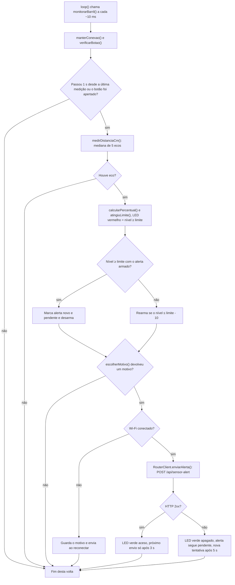
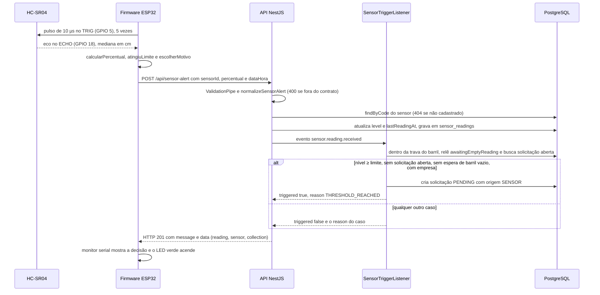

# Sensor ESP32 e simulador

Parte da [documentação do Coillect](README.md).

Este documento cobre o sensor de nível do barril de óleo: as quatro formas de gerar leituras, o firmware do ESP32 (classes, métodos e todas as constantes), o circuito do Wokwi, como rodar no Wokwi e na placa física, o sensor virtual do PC, o contrato com a API e os testes do sensor. Tudo foi conferido no código da `main` do CoillectApp: pasta [`sensor-esp32/`](../sensor-esp32/README.md) e lado da API em `backend/src/sensor/`. A lista completa de rotas está em [Rotas](03-referencia-de-rotas.md).

## Sumário

1. [Visão geral](#visão-geral)
2. [Firmware do ESP32](#firmware-do-esp32)
3. [Circuito do Wokwi](#circuito-do-wokwi)
4. [Como rodar no Wokwi e na placa física](#como-rodar-no-wokwi-e-na-placa-física)
5. [Sensor virtual no PC](#sensor-virtual-no-pc)
6. [Botão Simular leitura do app do síndico](#botão-simular-leitura-do-app-do-síndico)
7. [Contrato com a API](#contrato-com-a-api)
8. [Testes do sensor](#testes-do-sensor)
9. [Limitações e o que não foi verificado](#limitações-e-o-que-não-foi-verificado)

## Visão geral

### Quatro formas de gerar leituras

| Forma | Código | Onde roda | Precisa de |
|---|---|---|---|
| ESP32 físico | [`coillect_sensor.ino`](../sensor-esp32/coillect_sensor/coillect_sensor.ino) | Placa ESP32 DevKit com HC-SR04 | Arduino IDE com o pacote da Espressif, Wi-Fi de 2,4 GHz e uma API que a placa alcance |
| ESP32 virtual no Wokwi | O **mesmo** `coillect_sensor.ino` + [`diagram.json`](../sensor-esp32/coillect_sensor/diagram.json) | Navegador, em wokwi.com | API com URL pública (nuvem ou túnel) |
| Sensor virtual no PC | [`sensor-virtual.mjs`](../sensor-esp32/simulador-pc/sensor-virtual.mjs) | Node no PC, com painel web | Node 18 ou mais novo, sem `npm install` |
| Botão "Simular leitura do sensor" | `SensorSimulator` em [`Components.kt`](https://github.com/CoillectADM/app-mobile-sindico/blob/main/app/src/main/java/br/com/coillect/sindico/ui/components/Components.kt) (app do síndico) | Celular ou emulador | App logado na API |

As quatro enviam a mesma requisição: `POST /api/sensor-alert` com `sensorId`, `percentual` e `dataHora` (o app do síndico não manda `dataHora`). A API não distingue a origem. Depois que a leitura chega, o caminho é o mesmo.

### Política de envio

Decisão do projeto: **envio periódico + alerta imediato**. Quem decide se abre a solicitação de coleta é sempre a API.

| Regra | Firmware e sensor virtual do PC |
|---|---|
| Medição | A cada 1 s (no ESP32, mediana de 5 ecos) |
| Alerta imediato | Envia na hora quando o nível atinge o limite (80%), só na subida |
| Rearme do alerta | Só depois de o nível cair até o limite − 10 (70%) |
| Periódico | A cada 15 s, mesmo sem mudança |
| Variação | Antes do período, quando o nível muda 5 pontos ou mais desde o último envio aceito |
| Espera mínima | 3 s depois de um envio aceito; 5 s depois de uma falha (alerta novo e botão não esperam) |
| Envio manual | Botão no GPIO 4 (firmware) ou "Enviar leitura agora" (painel do PC) |

O limite do sensor só antecipa o envio. A decisão usa o limite do **barril** na API (`alertThreshold`, padrão 80%), avaliado pelo listener (ver [Contrato com a API](#contrato-com-a-api)). Por isso o comentário do firmware pede o mesmo limite nos dois lados. O app do síndico não segue esta política: cada toque envia uma leitura.

### Classes do Diagrama 1

O firmware implementa as classes do diagrama de classes do sensor, descrito em [docs/diagramas.md](../docs/diagramas.md): `SensorConfig`, `UltrasonicSensor.medirDistanciaCm()`, `FillLevelCalculator.calcularPercentual()` e `atingiuLimite()`, `AlertPayload`, `RouterClient.enviarAlerta()` e `SensorController.monitorarBarril()`. O sensor virtual do PC repete as mesmas classes em JavaScript (ver [Mesmas classes do firmware](#mesmas-classes-do-firmware)).

### O que é novo

Nada desta área existia na base do CoillectApp (commit 76f12374). Tudo veio nos PRs de 10/11/2026 (detalhes em [Histórico de mudanças](13-historico-de-mudancas.md)):

| Parte | Origem |
|---|---|
| Pasta `sensor-esp32/` inteira (firmware, `diagram.json`, simulador, testes, README) e o workflow `sensor-esp32.yml` | CoillectApp #3 |
| `POST /api/sensor/readings` e `GET /api/sensor/{sensorId}/status` | CoillectApp #1 |
| `POST /api/sensor-alert`, contrato com `percentual` e `dataHora`, barril com limite próprio | CoillectApp #2 |
| Resultado `AWAITING_EMPTY_READING` (o barril espera a leitura de vazio depois da coleta) | CoillectApp #3 |
| Evento `leitura_sensor` no log da API | CoillectApp #4 |
| Trava por barril no listener (vários clientes ao mesmo tempo) | CoillectApp #6 |
| Botão "Simular leitura do sensor" | app-mobile-sindico #2 |

## Firmware do ESP32

Arquivo: [`sensor-esp32/coillect_sensor/coillect_sensor.ino`](../sensor-esp32/coillect_sensor/coillect_sensor.ino). O mesmo arquivo vai para o Wokwi (colado em `sketch.ino`) e para a placa (Arduino IDE, placa "ESP32 Dev Module"). Usa só o core ESP32 para Arduino (`Arduino.h`, `WiFi.h`, `WiFiClientSecure.h`, `HTTPClient.h`) e `time.h`. Não há biblioteca externa; o `diagram.json` tem `"dependencies": {}`.

### Estrutura do programa

O arquivo tem, nesta ordem: o bloco de configuração, as seis classes e o programa. O programa monta a configuração com as constantes e cria um único `SensorController`:

```cpp
static const SensorConfig configuracao = {
    COILLECT_SENSOR_ID, COILLECT_API_URL, WIFI_SSID, WIFI_SENHA, ALTURA_BARRIL_CM, LIMITE_ALERTA,
};

SensorController controlador(configuracao);

void setup() {
  Serial.begin(115200);
  delay(100);
  controlador.iniciar();
}

void loop() {
  controlador.monitorarBarril();
  delay(10);
}
```

### Constantes de configuração

Editáveis no começo do arquivo. Cada uma está dentro de `#ifndef`, então também pode ser definida na compilação (`-D`). O teste no PC usa isso para trocar a URL.

| Constante | Padrão | Significado |
|---|---|---|
| `COILLECT_API_URL` | `"https://SEU-SERVICO.onrender.com/api/sensor-alert"` | URL **completa** da rota do sensor. Exemplos do próprio arquivo: nuvem (`https://SEU-SERVICO.onrender.com/api/sensor-alert`), túnel (`https://xxxx.trycloudflare.com/api/sensor-alert`) e PC na mesma rede (`http://192.168.0.10:3000/api/sensor-alert`). Enquanto tiver `SEU-SERVICO`, o firmware avisa e não envia. |
| `COILLECT_SENSOR_ID` | `"CLT-8472-A"` | `sensorId` cadastrado na API. Nos dados de demonstração, é o sensor do barril `BRL-8472` do Residencial Aurora. |
| `WIFI_SSID` | `"Wokwi-GUEST"` | Rede Wi-Fi (`roteadorId`). No Wokwi é sempre `Wokwi-GUEST`. |
| `WIFI_SENHA` | `""` | Senha do Wi-Fi (`roteadorSenha`). No Wokwi, vazia. |
| `ALTURA_BARRIL_CM` | `90.0f` | Distância do sensor (preso na tampa) até o fundo do barril vazio, em cm. |
| `LIMITE_ALERTA` | `80` | Percentual que dispara o envio imediato. Use o mesmo limite do barril na API. |
| `INTERVALO_ENVIO_MS` | `15000UL` | Envio periódico (15 s, para a apresentação). O comentário diz que 5 min bastam num barril real. |
| `VARIACAO_ENVIO` | `5` | Envia antes do período quando o nível muda pelo menos 5 pontos. `0` desliga. |
| `FUSO_HORARIO` | `"<-03>3"` | Fuso POSIX do `dataHora`: horário de Brasília (UTC−3), sem horário de verão. |

Pinos (`#define` fixos, iguais no Wokwi e na placa):

| Constante | GPIO | Uso |
|---|---|---|
| `PINO_TRIGGER` | 5 | TRIG do HC-SR04 |
| `PINO_ECHO` | 18 | ECHO do HC-SR04 (na placa, por divisor de tensão de 5 V para 3,3 V) |
| `PINO_LED_ALERTA` | 26 | LED vermelho: nível no limite (opcional) |
| `PINO_LED_ONLINE` | 27 | LED verde: último envio aceito pela API (opcional) |
| `PINO_BOTAO` | 4 | Botão ligado ao GND: envia a leitura na hora (opcional) |

Ritmo interno (`static const`; não aceitam `-D`):

| Constante | Valor | Significado |
|---|---|---|
| `INTERVALO_MEDICAO_MS` | `1000` | Uma medição por segundo |
| `ESPERA_ENTRE_ENVIOS_MS` | `3000` | Mínimo entre envios depois de um envio aceito |
| `ESPERA_APOS_FALHA_MS` | `5000` | Nova tentativa depois de um erro |
| `RECONEXAO_WIFI_MS` | `10000` | Sem Wi-Fi, nova tentativa de conexão a cada 10 s |
| `HISTERESE_ALERTA` | `10` | Novo alerta só depois de o nível cair 10 pontos abaixo do limite |
| `HTTP_CONECTAR_MS` | `15000` | Tempo máximo para conectar na API |
| `HTTP_RESPOSTA_MS` | `60000` | Tempo máximo de espera pela resposta ("a cloud gratuita pode levar ~1 min para acordar"). É `uint16_t`, então o teto é 65535 ms. |
| `UltrasonicSensor::AMOSTRAS` | `5` | Pulsos por medição |
| `UltrasonicSensor::PAUSA_ENTRE_PULSOS_MS` | `40` | Pausa entre pulsos, em ms |

Outros valores fixos no código:

| Valor | Onde | Significado |
|---|---|---|
| `115200` | `setup()` | Velocidade do monitor serial |
| `20000` ms | `iniciar()`, em `conectarWiFi(20000UL)` | Espera máxima pelo Wi-Fi ao ligar |
| `250` ms | `conectarWiFi()` | Intervalo entre verificações do Wi-Fi ao ligar (um ponto no monitor por verificação) |
| canal `6` | `iniciarWiFi()` | Só para `Wokwi-GUEST`. O comentário diz que o ponto de acesso do Wokwi usa o canal 6 e que informar o canal pula a busca (~4 s). Nas outras redes, canal `0`. |
| `2` µs e `10` µs | `medirDistanciaCm()` | TRIG em LOW por 2 µs e em HIGH por 10 µs |
| `30000` µs | `medirDistanciaCm()` | Limite do `pulseIn` (até ~5 m) |
| `58.0` | `medirDistanciaCm()` | Microssegundos de eco por centímetro (ida e volta) |
| `10000` ms | `monitorarBarril()` | Intervalo mínimo entre avisos "Sem eco" |
| `30` ms | `verificarBotao()` | Debounce do botão |
| `"pool.ntp.org"`, `"time.google.com"` | `iniciar()` | Servidores NTP |
| `1700000000` | `preencherDataHora()` | Hora Unix (14/11/2023) abaixo da qual o relógio é considerado não sincronizado |
| `192` bytes | `enviarAlerta()` | Espaço do JSON enviado |
| `200` caracteres | `registrarResposta()` | Trecho do corpo mostrado em erros sem `message` |

### Classes e métodos

| Classe | Membro | O que faz |
|---|---|---|
| `SensorConfig` (struct) | `sensorId`, `apiUrl`, `roteadorId`, `roteadorSenha`, `alturaBarrilCm`, `limiteAlerta` | Configuração do dispositivo: os campos do diagrama mais `roteadorSenha` (senha do Wi-Fi). |
| `UltrasonicSensor` | `UltrasonicSensor(trigger, echo)` | Guarda os pinos (o controller usa 5 e 18). |
| | `iniciar()` | TRIG como saída, em LOW; ECHO como entrada. |
| | `medirDistanciaCm()` | Dispara 5 pulsos. Cada eco válido vira `duração / 58` cm. Ordena as amostras (inserção) e devolve a mediana, `amostras[n / 2]` ("o óleo balança"). Sem nenhum eco, devolve `-1`. |
| `FillLevelCalculator` | `calcularPercentual(distanciaCm, alturaBarrilCm)` | Converte a distância em percentual de 0 a 100 (ver [Cálculo do nível](#cálculo-do-nível)). |
| | `atingiuLimite(percentual, limite)` | `percentual >= limite`. |
| `AlertPayload` (struct) | `sensorId`, `percentual`, `dataHora[32]` | Dados enviados, no formato do `SensorAlertPayload` da API. |
| | `paraJson(destino, tamanho)` | Monta o JSON com `snprintf`. Sem `dataHora` enquanto o relógio não sincronizou. |
| `RouterClient` | `RouterClient(config)` | Guarda a configuração. |
| | `conectarWiFi(esperaMaximaMs)` | `WiFi.mode(WIFI_STA)`, `WiFi.setAutoReconnect(true)` e `WiFi.begin`. Espera até o tempo dado e escreve o IP ou "sem conexão por enquanto; continuo tentando.". |
| | `manterConexao(agora)` | A cada volta: avisa quando o Wi-Fi cai ou volta. Sem conexão, a cada 10 s chama `WiFi.disconnect()` e `WiFi.begin` de novo. Devolve se está conectado. |
| | `conectado()` | `WiFi.status() == WL_CONNECTED`. |
| | `enviarAlerta(payload)` | Monta o JSON, confere tamanho e URL, faz o `POST` por HTTP ou HTTPS e escreve a resposta no monitor. Devolve `true` só para HTTP 2xx. |
| | `iniciarWiFi()` (privado) | `WiFi.begin(ssid, senha, canal)`, com canal 6 para `Wokwi-GUEST` e 0 nas outras redes. |
| | `registrarResposta(status, corpo, duracaoMs)` (privado) | Mostra no monitor o que a API decidiu. |
| | `descreverMotivo(motivo)` (privado) | Traduz o `collection.reason` da API (textos na [tabela de resultados](#resultados-possíveis)). Motivo desconhecido: "ver docs/contrato-sensor.md". |
| | `extrairTexto(json, chave)` e `extrairNumero(json, chave)` (privados) | Leem o JSON por busca de texto, sem biblioteca de JSON. |
| `SensorController` | `SensorController(config)` | Cria `UltrasonicSensor(PINO_TRIGGER, PINO_ECHO)`, `FillLevelCalculator` e `RouterClient`. |
| | `iniciar()` | LEDs como saída e apagados; botão em `INPUT_PULLUP`; inicia o sensor; escreve o cabeçalho; avisa se a URL é a de exemplo; conecta no Wi-Fi (até 20 s); liga o relógio com `configTzTime`. |
| | `monitorarBarril()` | Chamado continuamente pelo `loop()`: mede, decide e envia (ver [Quando envia](#quando-envia)). |
| | `escolherMotivo(percentual, agora)` (privado) | Devolve o motivo do envio, ou nenhum. |
| | `verificarBotao(agora)` (privado) | Lê o botão com debounce de 30 ms. Ao apertar, marca o envio manual. |
| | `preencherDataHora(destino, tamanho)` (privado) | Monta o `dataHora` em ISO 8601 com fuso. |

Estado interno do `SensorController`:

| Variável | Inicial | Para que serve |
|---|---|---|
| `jaMediu` | `false` | Garante a primeira medição logo ao ligar |
| `jaTentou` | `false` | Liga a espera de 3 s ou 5 s depois do primeiro envio |
| `jaEnviou` | `false` | Enquanto for `false`, o motivo é "primeira leitura" |
| `ultimaMedicaoMs` | `0` | Controla o intervalo de 1 s |
| `ultimoEnvioOkMs` | `0` | Início da medição do último envio aceito (base do periódico) |
| `proximoEnvioPermitidoMs` | `0` | Fim da espera de 3 s ou 5 s |
| `ultimoPercentualMedido` | `-1` | Evita repetir a linha `[SENSOR]` quando o nível não mudou |
| `ultimoPercentualEnviado` | `-1` | Base da variação de 5 pontos |
| `alertaArmado` | `true` | Pode disparar alerta na próxima subida |
| `alertaPendente` | `false` | Alerta ainda não aceito pela API |
| `alertaNovo` | `false` | Alerta acabou de disparar: envio imediato |
| `envioManual` | `false` | Botão apertado |
| `avisouSemEco`, `avisoSemEcoMs` | `false`, `0` | Controle do aviso "Sem eco" |
| `avisouOffline` | `false` | Aviso "Sem Wi-Fi" já escrito |
| `botaoLeitura`, `botaoEstavel`, `botaoMudouMs` | `false`, `false`, `0` | Debounce do botão |

### Cálculo do nível

```cpp
int calcularPercentual(float distanciaCm, float alturaBarrilCm) const {
  if (alturaBarrilCm <= 0.0f || distanciaCm < 0.0f) return 0;
  float percentual = (alturaBarrilCm - distanciaCm) * 100.0f / alturaBarrilCm;
  if (percentual < 0.0f) percentual = 0.0f;
  if (percentual > 100.0f) percentual = 100.0f;
  return (int)(percentual + 0.5f);
}
```

- Nível = (altura − distância) × 100 ÷ altura, limitado a 0–100 e arredondado para o inteiro mais próximo.
- Para calibrar ao contrário: distância = altura × (1 − nível ÷ 100). Com 90 cm, cada centímetro vale cerca de 1,1 ponto.
- O HC-SR04 não mede menos de 2 cm: num barril de 90 cm, o maior nível lido é 98%.
- A tabela de distâncias usada no Wokwi está em [Como mexer na distância](#como-mexer-na-distância).

### Quando envia

`SensorController.monitorarBarril()` roda a cada volta do `loop()` (pausa de 10 ms):

1. `manterConexao()`. Sem Wi-Fi, apaga o LED verde.
2. `verificarBotao()`.
3. Se já mediu, não há envio manual e não passou 1 s desde a última medição, termina.
4. `medirDistanciaCm()`. Sem eco: escreve "Sem eco" (no máximo a cada 10 s) e termina sem enviar nada.
5. `calcularPercentual()` e `atingiuLimite()`. Acende ou apaga o LED vermelho. Escreve a linha `[SENSOR]` se o nível mudou.
6. Alerta e histerese: no limite com o alerta armado, marca alerta **novo** e **pendente** e desarma. Abaixo do limite, rearma só quando o nível está em limite − 10 ou menos.
7. `escolherMotivo()`. Sem motivo, termina.
8. Sem Wi-Fi: escreve uma vez "Sem Wi-Fi: leitura (…) será enviada ao reconectar." e termina. O motivo não se perde, porque `alertaNovo`, `alertaPendente` e `envioManual` continuam marcados. Ao reconectar, vai a medição daquele momento.
9. Monta o `AlertPayload` (`sensorId`, `percentual`, `dataHora`) e chama `RouterClient.enviarAlerta()`.
10. Depois do envio: limpa `alertaNovo` e `envioManual`. Se a API respondeu 2xx, guarda o percentual enviado, o instante (início desta medição), limpa o alerta pendente e espera 3 s antes do próximo envio. Se falhou, espera 5 s. O LED verde fica aceso só no sucesso.



Prioridade em `escolherMotivo()` (o texto é o que aparece em `[ENVIO] Motivo:`):

| Ordem | Motivo | Condição | Respeita a espera de 3 s ou 5 s? |
|---|---|---|---|
| 1 | `alerta - atingiu o limite` | O nível acabou de atingir o limite com o alerta armado | Não: envia na hora |
| 2 | `botão (envio manual)` | Botão apertado | Não: envia na hora |
| — | nenhum | Ainda dentro da espera (3 s após sucesso, 5 s após falha) | — |
| 3 | `alerta - nova tentativa` | O alerta anterior não foi aceito pela API | Sim |
| 4 | `primeira leitura` | Nenhum envio aceito desde que ligou | Sim |
| 5 | `periódico` | 15 s desde o último envio aceito | Sim |
| 6 | `variação de nível` | Nível mudou 5 pontos ou mais desde o último envio aceito | Sim |

Exemplo de histerese (é o teste `testeHisterese`): a sequência 10% → 86% → 75% → 86% → 60% → 86% gera dois alertas. Os 75% ficam abaixo do limite, mas acima de 70%, e não rearmam; a volta a 86% é só `variação de nível`. Os 60% rearmam, e os 86% seguintes são alerta de novo. Os percentuais enviados são 10, 86, 75, 86, 60 e 86.

### Relógio (NTP) e fuso −03:00

- `iniciar()` chama `configTzTime("<-03>3", "pool.ntp.org", "time.google.com")` depois de tentar o Wi-Fi.
- `preencherDataHora()` lê `time(NULL)`. Se o valor é menor que `1700000000`, o relógio ainda não sincronizou: o `dataHora` fica vazio e o JSON vai sem ele. Isso pode acontecer nas primeiras leituras depois de ligar. A API aceita.
- Com o relógio certo, o formato é `strftime("%Y-%m-%dT%H:%M:%S")` mais o fuso de `%z` (`-0300`) convertido para `-03:00`. Exemplo: `2026-11-10T14:32:05-03:00`. Se `%z` não tiver 5 caracteres, vai sem fuso.
- A API guarda o `dataHora` como veio, em `sensor_readings.deviceTimestamp`. A hora oficial é a de recebimento (`receivedAt`).

### Envio por HTTP e HTTPS

| A URL começa com | Cliente | Certificado |
|---|---|---|
| `https://` | `WiFiClientSecure` | `setInsecure()`: não valida o certificado do servidor (MVP) |
| outra coisa (ex.: `http://`) | `WiFiClient` | — |

Antes do `POST`, `enviarAlerta()` recusa (devolve `false`) em três casos:

| Situação | Mensagem no monitor |
|---|---|
| JSON não coube em 192 bytes | `[ENVIO] Payload grande demais; confira o COILLECT_SENSOR_ID.` |
| URL contém `SEU-SERVICO` | `[ENVIO] Configure COILLECT_API_URL com a URL da sua API (veja o README).` |
| `http.begin()` falhou | `[ENVIO] URL inválida: <url>` |

Depois: `setConnectTimeout(15000)`, `setTimeout(60000)`, `addHeader("Content-Type", "application/json")`, `POST` do corpo, leitura da resposta (quando o status é maior que 0) e `http.end()`. O único cabeçalho que o firmware acrescenta é `Content-Type`; os demais são os padrões da biblioteca `HTTPClient`. Não há login nem token.

```http
POST /api/sensor-alert HTTP/1.1
Host: xxxx.trycloudflare.com
Content-Type: application/json

{"sensorId":"CLT-8472-A","percentual":86,"dataHora":"2026-11-10T14:32:05-03:00"}
```

Sem relógio sincronizado, o corpo é `{"sensorId":"CLT-8472-A","percentual":86}`.

### Resposta da API no monitor serial

`registrarResposta()` lê a resposta assim:

1. Sem resposta HTTP (status ≤ 0): `[API] Sem resposta (<erro>) após N ms. Nova tentativa em instantes.` O `<erro>` vem de `HTTPClient::errorToString()`, por exemplo `connection refused` ou `read Timeout`.
2. Com resposta: `[API] HTTP <código> em N ms`, seguido de ` - <message>` quando o corpo tem `"message":"…"`.
3. Se há `collection.reason`: `[API] Decisão: <descrição> (<reason>)`. A descrição de cada `reason` está na [tabela de resultados](#resultados-possíveis); o que o firmware faz com cada código HTTP está em [Respostas HTTP](#respostas-http).
4. Se há `sensor.openRequest`: `[API] Solicitação de coleta #<id> aberta para o barril: <status>`.
5. HTTP 404: `[API] sensorId não cadastrado: cadastre-o no admin ou ajuste COILLECT_SENSOR_ID.`
6. HTTP 400 ou mais sem `message` em texto (o 400 de validação traz uma lista): `[API] Resposta: <até 200 caracteres do corpo>`.
7. Se `sensor.lastCollectionAt` mudou (menos na primeira resposta): `[API] Coleta concluída pela empresa em <data>: o barril deve estar vazio agora.`

Todas as mensagens do monitor serial:

| Prefixo | Mensagem | Quando |
|---|---|---|
| `[CONFIG]` | `ATENÇÃO: troque COILLECT_API_URL pela URL da sua API antes de rodar.` | Ao ligar, se a URL tem `SEU-SERVICO` |
| `[WIFI]` | `Conectando a "<SSID>"` + pontos + ` conectado (IP …)` ou ` sem conexão por enquanto; continuo tentando.` | Ao ligar |
| `[WIFI]` | `Reconectado (IP …)` | O Wi-Fi voltou |
| `[WIFI]` | `Conexão perdida; as leituras continuam e serão enviadas ao reconectar.` | O Wi-Fi caiu |
| `[SENSOR]` | `Distância 12.6 cm -> nível 86% (limite 80%)  ** ALERTA **` | O nível mudou (o `** ALERTA **` só aparece no limite) |
| `[SENSOR]` | `Sem eco do HC-SR04: confira a ligação dos pinos TRIG/ECHO.` | Sem eco (no máximo a cada 10 s) |
| `[BOTÃO]` | `Envio manual solicitado.` | Botão apertado |
| `[ENVIO]` | `Motivo: <motivo>` | Antes de cada envio |
| `[ENVIO]` | `POST <url> <json>` | Logo antes do `POST` |
| `[ENVIO]` | `Sem Wi-Fi: leitura (<motivo>) será enviada ao reconectar.` | Há motivo, mas não há Wi-Fi (uma vez) |
| `[ENVIO]` | `Payload grande demais…`, `Configure COILLECT_API_URL…`, `URL inválida…` | Ver tabela anterior |
| `[API]` | `Sem resposta (<erro>) após N ms. Nova tentativa em instantes.` | Sem conexão ou tempo esgotado |
| `[API]` | `HTTP <código> em N ms - <message>` | Toda resposta HTTP |
| `[API]` | `Decisão: <descrição> (<reason>)` | Resposta com `collection.reason` |
| `[API]` | `Solicitação de coleta #<id> aberta para o barril: <status>` | Há solicitação `PENDING` ou `SCHEDULED` para o barril |
| `[API]` | `sensorId não cadastrado: cadastre-o no admin ou ajuste COILLECT_SENSOR_ID.` | HTTP 404 |
| `[API]` | `Resposta: <corpo>` | Erro HTTP sem `message` em texto |
| `[API]` | `Coleta concluída pela empresa em <data>: o barril deve estar vazio agora.` | A empresa concluiu a coleta |

Ao ligar, antes do Wi-Fi, o firmware escreve o cabeçalho. Trecho de exemplo (tempos, IP e número da solicitação variam):

```text
==============================================================
 Coillect - sensor de nível do barril (ESP32 + HC-SR04)
 sensorId: CLT-8472-A | barril: 90 cm | limite: 80%
 API: https://xxxx.trycloudflare.com/api/sensor-alert
 Envio: a cada 15 s, na hora ao atingir 80% e ao variar 5 pontos
==============================================================
[WIFI] Conectando a "Wokwi-GUEST"..... conectado (IP …)
[SENSOR] Distância 81.0 cm -> nível 10% (limite 80%)
[ENVIO] Motivo: primeira leitura
[ENVIO] POST https://xxxx.trycloudflare.com/api/sensor-alert {"sensorId":"CLT-8472-A","percentual":10,"dataHora":"2026-11-10T14:30:02-03:00"}
[API] HTTP 201 em 812 ms - Leitura registrada.
[API] Decisão: abaixo do limite: só registrou a leitura (BELOW_THRESHOLD)
[SENSOR] Distância 12.6 cm -> nível 86% (limite 80%)  ** ALERTA **
[ENVIO] Motivo: alerta - atingiu o limite
[ENVIO] POST https://xxxx.trycloudflare.com/api/sensor-alert {"sensorId":"CLT-8472-A","percentual":86,"dataHora":"2026-11-10T14:31:40-03:00"}
[API] HTTP 201 em 905 ms - Leitura registrada. Solicitação de coleta #12 criada.
[API] Decisão: limite atingido: solicitação de coleta criada para a empresa (THRESHOLD_REACHED)
[API] Solicitação de coleta #12 aberta para o barril: PENDING
```

### LEDs e botão

| Peça | GPIO | Comportamento |
|---|---|---|
| LED vermelho ("Alerta") | 26 | Aceso enquanto a última medição está no limite ou acima. Apaga abaixo do limite (sem histerese). |
| LED verde ("API OK") | 27 | Aceso depois de um envio com HTTP 2xx. Apaga depois de uma falha (sem resposta ou HTTP fora de 2xx) e sempre que o Wi-Fi cai. |
| Botão azul ("Enviar agora") | 4 | `INPUT_PULLUP`: apertado = LOW. Estável por 30 ms, marca o envio manual. Mede e envia na hora, sem esperar 1 s nem a espera de 3 s/5 s. Segurar o botão gera um envio só. No Wokwi, a tecla **E** também aperta (atributo `key`). |

Na placa física, LEDs e botão são opcionais.

### Sequência de uma leitura



Os avisos para a empresa e para o síndico saem depois, pela fila de notificações (ver [Azure Storage e nuvem](08-azure-storage-e-nuvem.md) e [Interações e fluxos](09-interacoes-e-fluxos.md)).

## Circuito do Wokwi

Arquivo: [`sensor-esp32/coillect_sensor/diagram.json`](../sensor-esp32/coillect_sensor/diagram.json) (`"version": 1`, `"author": "Coillect"`, `"editor": "wokwi"`). Sete peças e quatorze ligações.

### Peças

| `id` | Tipo no Wokwi | Atributos | Papel |
|---|---|---|---|
| `esp` | `board-esp32-devkit-c-v4` | — | ESP32 DevKitC V4 |
| `sonar` | `wokwi-hc-sr04` | `distance: "81"` | HC-SR04. Começa a 81 cm do óleo (10%). |
| `r1` | `wokwi-resistor` | `value: "220"`, girado 90° | Resistor do LED vermelho |
| `ledAlerta` | `wokwi-led` | `color: "red"`, `label: "Alerta"` | LED de alerta (GPIO 26) |
| `r2` | `wokwi-resistor` | `value: "220"`, girado 90° | Resistor do LED verde |
| `ledOnline` | `wokwi-led` | `color: "green"`, `label: "API OK"` | LED "API OK" (GPIO 27) |
| `btnEnviar` | `wokwi-pushbutton` | `color: "blue"`, `label: "Enviar agora"`, `key: "e"`, `bounce: "0"` | Botão de envio manual (GPIO 4). A tecla E aperta o botão; `bounce: "0"` desliga a simulação de trepidação do contato. |

### Ligações

| De | Para | Cor do fio | Função |
|---|---|---|---|
| `esp:TX` | `$serialMonitor:RX` | — | Monitor serial |
| `esp:RX` | `$serialMonitor:TX` | — | Monitor serial |
| `sonar:VCC` | `esp:5V` | vermelho | Alimentação do HC-SR04 em 5 V |
| `sonar:GND` | `esp:GND.1` | preto | Terra do HC-SR04 |
| `sonar:TRIG` | `esp:5` | laranja | TRIG no GPIO 5 |
| `sonar:ECHO` | `esp:18` | roxo | ECHO no GPIO 18 (na simulação, sem divisor de tensão) |
| `esp:26` | `r1:2` | vermelho | GPIO 26 para o resistor de 220 Ω |
| `r1:1` | `ledAlerta:A` | vermelho | Resistor para o ânodo do LED vermelho |
| `ledAlerta:C` | `esp:GND.2` | preto | Cátodo do LED vermelho para o terra |
| `esp:27` | `r2:2` | verde | GPIO 27 para o resistor de 220 Ω |
| `r2:1` | `ledOnline:A` | verde | Resistor para o ânodo do LED verde |
| `ledOnline:C` | `esp:GND.2` | preto | Cátodo do LED verde para o terra |
| `btnEnviar:1.l` | `esp:4` | azul | Botão no GPIO 4 |
| `btnEnviar:2.l` | `esp:GND.3` | preto | Outro lado do botão no terra (o firmware usa o pull-up interno) |

### Como mexer na distância

Com a simulação rodando, clique no HC-SR04 e arraste o controle de distância (instrução do cabeçalho do firmware e do README). A distância é da tampa até o óleo: **menor distância = barril mais cheio**. O valor inicial vem de `"distance": "81"` no `diagram.json`. O firmware mede a cada 1 s; a linha `[SENSOR]` mostra o novo nível, e o envio segue a [política](#quando-envia).

Barril de 90 cm, limite de 80%:

| Distância | Nível | O que acontece |
|---|---|---|
| 90 cm ou mais | 0% | Barril vazio (depois da coleta) |
| 81 cm (valor inicial) | 10% | Primeira leitura ao ligar; depois, envio periódico a cada 15 s |
| 54 cm | 40% | Envia antes do período (variou 5 pontos ou mais) |
| 45 cm | 50% | Idem |
| 36 cm | 60% | Idem; rearma o alerta (≤ 70%) |
| 27 cm | 70% | Limite − 10: rearma o alerta |
| 22,5 cm | 75% | Abaixo do limite, mas dentro da histerese: não rearma |
| 18 cm | 80% | **Alerta**: envia na hora; a API abre a solicitação se não houver outra aberta |
| 13,5 cm | 85% | Alerta |
| 12,6 cm | 86% | Alerta (valor usado nos testes) |
| 12 cm | 87% | Alerta (valor do roteiro do README) |
| 7,2 cm | 92% | Acima do limite, sem alerta novo; com solicitação já aberta, a API responde `REQUEST_ALREADY_OPEN` |
| 2 cm | 98% | Mínimo do HC-SR04: maior nível que o sensor lê |

## Como rodar no Wokwi e na placa física

### No Wokwi

**1. A API precisa de URL pública.** Segundo o README do sensor, o gateway gratuito do Wokwi só alcança a internet, não o `localhost` do PC (o gateway privado é pago). Opções:

| Onde está a API | Valor de `COILLECT_API_URL` | Observação |
|---|---|---|
| Azure App Service | `https://<app>.azurewebsites.net/api/sensor-alert` | Opção da A02 no `LEIA-PRIMEIRO-CODEX.txt` §8 (ver [Execução local e deploy](12-execucao-local-e-deploy.md)) |
| Render | `https://<seu-servico>.onrender.com/api/sensor-alert` | O plano gratuito "dorme": abra `https://<seu-servico>.onrender.com/api/health` um minuto antes e espere responder. O firmware espera até 60 s pela resposta. |
| PC + túnel gratuito | `https://<endereço-gerado>.trycloudflare.com/api/sensor-alert` | Suba a API no PC e rode `cloudflared tunnel --url http://localhost:3000` (Cloudflare Quick Tunnels, sem conta). O endereço muda a cada vez que o túnel abre. |

```bash
# API no PC (pasta CoillectApp) e túnel em outro terminal
docker compose up -d --build db backend
cloudflared tunnel --url http://localhost:3000
```

**2. Passo a passo** (do [README do sensor](../sensor-esp32/README.md)):

1. Abra <https://wokwi.com/projects/new/esp32>. Crie a conta gratuita se quiser salvar o projeto e ter um link para a apresentação.
2. Na aba `sketch.ino`, apague tudo e cole o conteúdo de `coillect_sensor/coillect_sensor.ino`.
3. Na aba `diagram.json`, apague tudo e cole o conteúdo de `coillect_sensor/diagram.json`.
4. No começo do sketch, troque `COILLECT_API_URL` pela URL da API. Para outro barril, troque `COILLECT_SENSOR_ID` (`CLT-1264-B` ou `CLT-9801-C` nos dados de demonstração; ver [Dados de demonstração e glossário](14-dados-de-demonstracao-e-glossario.md)). O Wi-Fi já é `Wokwi-GUEST`, sem senha.
5. Clique em ▶. O monitor serial mostra a conexão Wi-Fi, cada leitura e a resposta da API.
6. Clique no HC-SR04 e arraste a distância.

**3. Roteiro da demonstração** (parte do sensor, do README):

| Passo | Ação | Resultado esperado |
|---|---|---|
| 1 | Reinicie os dados de demonstração (desktop ou `POST /api/admin/demo/reset`) | Residencial Aurora em 0% |
| 2 | Rode o Wokwi | Os apps mostram 10% (`BRL-8472`) |
| 3 | Arraste para 45 cm | Os apps mostram 50% |
| 4 | Arraste para 12 cm (87%) | LED vermelho aceso. A empresa recebe a solicitação e o aviso; o síndico recebe só a notificação |
| 5 | App da empresa: **Agendar coleta** | O síndico é avisado |
| 6 | Arraste para 90 cm (0%) | O coletor esvaziou o barril |
| 7 | App da empresa: **Concluir coleta** | Barril em 0%; o síndico é avisado |

Se a coleta for concluída **antes** de esvaziar o barril simulado, a API não abre outra solicitação até o sensor ler o barril abaixo do limite. O monitor mostra `coleta recém-concluída: aguardando o sensor ler o barril vazio (AWAITING_EMPTY_READING)`.

### Na placa física

Material (README): ESP32 DevKit (ESP32-WROOM-32), HC-SR04, resistores de 1 kΩ e 2 kΩ. Opcionais: 2 LEDs com resistores de 220 Ω e 1 botão.

| HC-SR04 | ESP32 |
|---|---|
| VCC | 5V (VIN) |
| GND | GND |
| TRIG | GPIO 5 |
| ECHO | GPIO 18 **por um divisor de tensão**: ECHO → 1 kΩ → GPIO 18 → 2 kΩ → GND (5 V × 2/3 ≈ 3,3 V). O ECHO sai com 5 V e o ESP32 aceita 3,3 V. Segundo o README, com o modelo HC-SR04P basta alimentar em 3V3 e ligar direto. |

LEDs opcionais: GPIO 26 → 220 Ω → LED vermelho → GND; GPIO 27 → 220 Ω → LED verde → GND. Botão opcional: GPIO 4 ↔ GND.

Passos:

1. Arduino IDE 2 → Preferências → *URLs adicionais para Gerenciadores de Placas*: `https://espressif.github.io/arduino-esp32/package_esp32_index.json`.
2. Gerenciador de Placas → instale **esp32 by Espressif Systems** → escolha a placa **ESP32 Dev Module**.
3. Abra `sensor-esp32/coillect_sensor/coillect_sensor.ino` e ajuste no começo do arquivo:
   - `WIFI_SSID` e `WIFI_SENHA` da rede (2,4 GHz);
   - `COILLECT_API_URL`: a URL da nuvem (`https://…`) ou `http://<IP-do-PC>:3000/api/sensor-alert` se a API roda num PC da mesma rede;
   - `ALTURA_BARRIL_CM`: meça do sensor até o fundo do barril vazio;
   - `INTERVALO_ENVIO_MS`: no barril real, `300000UL` (5 min) basta.
4. Carregue na placa e abra o Monitor Serial em 115200.
5. Fixe o sensor na tampa, apontado para baixo, pelo menos 2 cm acima do nível máximo do óleo.

API no PC da mesma rede, por HTTP:

- Com `http://`, o firmware usa `WiFiClient`, sem TLS.
- A API do `docker compose` publica a porta 3000.
- Para achar o IP do PC, o script dos celulares também serve: `node backend/scripts/endereco-celular.mjs`. Ele mostra o IP (ignora adaptadores do WSL e do Docker) e o comando para liberar a porta no firewall do Windows:

```powershell
New-NetFirewallRule -DisplayName "Coillect API 3000" -Direction Inbound -Protocol TCP -LocalPort 3000 -Action Allow -Profile Any
```

Compilar pela linha de comando, com os mesmos comandos do CI (o upload para a placa não está no repositório):

```bash
ESP32_INDEX=https://espressif.github.io/arduino-esp32/package_esp32_index.json
arduino-cli core update-index --additional-urls "$ESP32_INDEX"
arduino-cli core install esp32:esp32 --additional-urls "$ESP32_INDEX"
arduino-cli compile --fqbn esp32:esp32:esp32 --warnings default --additional-urls "$ESP32_INDEX" sensor-esp32/coillect_sensor
```

## Sensor virtual no PC

Arquivo: [`sensor-esp32/simulador-pc/sensor-virtual.mjs`](../sensor-esp32/simulador-pc/sensor-virtual.mjs). Precisa só do Node 18 ou mais novo, sem `npm install` (usa os módulos `node:http`, `node:url` e `node:util`). É o plano B sem Wokwi ou sem internet e permite vários barris de uma vez.

### Como iniciar

```bash
# API local; depois abra http://localhost:4010
node sensor-esp32/simulador-pc/sensor-virtual.mjs --api http://localhost:3000/api

# API na nuvem, três barris
node sensor-esp32/simulador-pc/sensor-virtual.mjs --api https://SEU-SERVICO.onrender.com/api --sensores CLT-8472-A,CLT-1264-B,CLT-9801-C

# Uma leitura por sensor e sai (código 0 = API respondeu 2xx)
node sensor-esp32/simulador-pc/sensor-virtual.mjs --api http://localhost:3000/api --uma-vez --percentual 85
```

Atenção à diferença: no firmware, `COILLECT_API_URL` é a rota **completa** (`…/api/sensor-alert`); no simulador, `--api` é a **base** (`…/api`). O simulador aceita as duas formas.

### Opções de linha de comando

| Opção | Padrão | Efeito |
|---|---|---|
| `--api URL` | Variável de ambiente `COILLECT_API_URL` ou `http://localhost:3000/api` | Base da API. Aceita `…/api`, `…/api/sensor-alert` ou só o host (`normalizarApi()` tira barras e `/sensor-alert` do fim e completa `/api`). Precisa começar com `http://` ou `https://`. |
| `--sensores A,B,C` | `CLT-8472-A` | Um ou mais `sensorId`, separados por vírgula. Cada um ganha seu barril simulado e seu cartão no painel. |
| `--porta N` | `4010` | Porta do painel (escuta só em `127.0.0.1`). |
| `--intervalo S` | `15` | Envio periódico, em segundos (mínimo 1). |
| `--altura CM` | `90` | Distância do sensor ao fundo do barril, em cm (maior que 0). |
| `--limite P` | `80` | Limite de alerta do simulador, em % (maior que 0 e até 100). |
| `--encher-sozinho` | desligado | Todos os barris começam enchendo +5% a cada 3 s, até 100%. |
| `--sem-painel` | desligado | Não abre o painel: só terminal (combina com `--encher-sozinho`). |
| `--uma-vez` | desligado | Envia UMA leitura por sensor e sai. Exige `--percentual`. |
| `--percentual P` | — | Nível (0 a 100) da leitura do `--uma-vez`. |
| `--ajuda`, `-h` | — | Mostra a ajuda. |

Códigos de saída e erros:

| Situação | Mensagem | Código |
|---|---|---|
| `--ajuda` | Texto de ajuda | 0 |
| Opção desconhecida | Erro do `parseArgs` + ajuda | 2 |
| `--altura`, `--limite` ou `--intervalo` fora da faixa | `Valores inválidos em --altura, --limite ou --intervalo.` | 2 |
| `--uma-vez` sem `--percentual` válido | `Use --uma-vez junto com --percentual (0 a 100).` | 2 |
| `--api` sem `http://` ou `https://` | `URL da API inválida: "<url>" (use http:// ou https://)` | 1 |
| `--uma-vez` com alguma resposta fora de 2xx | Linha do sensor com o erro | 1 |
| `--uma-vez` com todas as respostas 2xx | Uma linha por sensor | 0 |

### Painel web

Endereço: `http://localhost:4010` (ou a porta de `--porta`). A página consulta `/estado` a cada 1 s.

| Área | O que mostra |
|---|---|
| Topo | "Coillect · Sensor virtual", `API: <base>` e o selo `conectando…`, `simulador ativo` ou `simulador parado` |
| Cartão de cada sensor | `sensorId`; condomínio · bairro · barril (vindos da API); selo `online na API`, `offline na API` ou `sem status` |
| Barril | Desenho com o nível medido (laranja no limite) e uma linha tracejada no limite; número grande com o percentual medido; `Limite atingido (80%)` ou `Operação normal (limite 80%)`; `HC-SR04: <distância> cm até o óleo` |
| Controle | "Óleo no barril (mundo físico): N%", de 0 a 100, passo 1 |
| Botões | **Enviar leitura agora**, **Simular alerta**, **Esvaziar barril (coleta feita)** |
| Caixa de seleção | **Encher sozinho (+5% a cada 3 s)** |
| Caixa da API | Erro de status (em vermelho); `Solicitação #<id> aberta: <status> · <empresa>` ou `Sem solicitação de coleta aberta`; `Última coleta: …`; `Último envio <hora>: N% (<motivo>) → HTTP 201 · <mensagem>` e `Decisão da API: …`. Fundo laranja-claro quando há solicitação aberta. |
| Histórico | Os 12 eventos mais recentes |
| Rodapé | Lembrete do contrato (`POST /api/sensor-alert`) e da política; "A API decide a coleta." |

O selo `online` vem da API: o sensor recebeu leitura dentro de `SENSOR_ONLINE_MINUTES` (padrão 30 min).

Controles e ações:

| Controle | `acao` enviada a `POST /acao` | Efeito (`SimulacaoSensor.acao()`) |
|---|---|---|
| Controle de nível (ao soltar) | `nivel`, com `valor` de 0 a 100 | Define o óleo do barril simulado. O sensor mede o novo nível em até 1 s. |
| Enviar leitura agora | `enviar` | `solicitarEnvioManual()`: mede e envia na hora, como o botão do circuito |
| Simular alerta | `alerta` | Barril em limite + 5 (85% com limite 80), no máximo 100% |
| Esvaziar barril (coleta feita) | `esvaziar` | Barril em 0% e desliga o "encher sozinho" |
| Encher sozinho | `auto`, com `valor` `true` ou `false` | Liga ou desliga o enchimento automático |

Depois de `nivel`, `alerta` e `esvaziar`, o histórico registra `barril ajustado para N%`.

### Rotas internas do painel

| Rota | Corpo | Resposta |
|---|---|---|
| `GET /` | — | Página HTML do painel |
| `GET /estado` | — | `{ "api": "<base>", "sensores": [ … ] }`, com o resumo de cada sensor |
| `POST /acao` | `{ "sensorId", "acao", "valor" }` em JSON (até 10 000 caracteres) | 200 com o resumo do sensor; 404 `{ "erro": "sensor <id> não está neste simulador" }`; 400 `{ "erro": … }` para JSON inválido ou `ação desconhecida: …` |
| Qualquer outra | — | 404 `{ "erro": "rota não encontrada" }` |

As respostas usam `Cache-Control: no-store`. Resumo de um sensor em `GET /estado` (valores de exemplo):

```json
{
  "api": "http://localhost:3000/api",
  "sensores": [
    {
      "sensorId": "CLT-8472-A",
      "barril": { "percentualReal": 10, "alturaCm": 90, "encherSozinho": false },
      "medicao": { "distanciaCm": 81.1, "percentual": 10, "limite": 80, "noLimite": false },
      "api": {
        "condominio": "Residencial Aurora",
        "bairro": "Jardim Paulista",
        "barril": "BRL-8472",
        "empresa": "EcoColeta Ambiental",
        "nivel": 10,
        "online": true,
        "solicitacaoAberta": null,
        "ultimaColeta": null
      },
      "erroApi": null,
      "ultimoEnvio": {
        "hora": "14:30:02",
        "percentual": 10,
        "motivo": "primeira leitura",
        "status": 201,
        "ms": 35,
        "mensagem": "Leitura registrada.",
        "motivoApi": "BELOW_THRESHOLD",
        "decisao": "abaixo do limite: só registrou a leitura"
      },
      "historico": [
        { "hora": "14:30:02", "texto": "10% (primeira leitura) -> HTTP 201 (35 ms) Leitura registrada. [BELOW_THRESHOLD]" }
      ]
    }
  ]
}
```

### Comportamento

- **Começa no nível da API.** O painel abre primeiro (dá para ver o status enquanto uma API na nuvem "acorda"). Depois, cada sensor chama `GET <api>/sensor/<sensorId>/status`. Se a API devolve `level`, o barril simulado começa nele: `pronto: Condomínio Bosque / BRL-1264, nível inicial 62%`. Senão: `atenção: <erro>; começando em 0%`. Os envios só começam depois disso.
- **Laço.** Cada sensor tem seu laço: `SimulacaoSensor.ciclo()` e pausa de 200 ms. O ciclo enche o barril (se "encher sozinho" estiver ligado: +5 a cada 3 s, até 100%, e então desliga), atualiza o status da API a cada 5 s e chama `controller.monitorarBarril()`.
- **Vários barris.** `--sensores A,B,C` cria um `SimulacaoSensor` por `sensorId`, cada um com barril, controller, histórico e laço próprios. O painel mostra um cartão por sensor.
- **Esvazia sozinho quando a empresa conclui.** `aplicarStatus()` compara o `lastCollectionAt` da API (do status a cada 5 s e da resposta de cada envio). Se mudou, e não é a primeira leitura do status, registra `coleta concluída pela empresa (…)`. Se o barril não está vazio, esvazia, desliga o "encher sozinho" e registra `barril simulado esvaziado (o coletor levou o óleo)`. A próxima medição lê 0% e é enviada (variação), e a API sai de `AWAITING_EMPTY_READING`.
- **Medição simulada.** A distância é `altura × (1 − nível ÷ 100)`, com ruído de ±0,3 cm, limitada a 2–400 cm. Por causa do mínimo de 2 cm, 100% no controle vira 98% na leitura (como no HC-SR04).
- **`dataHora`.** Sempre presente, com o relógio e o fuso do PC (`dataHoraLocal()`). Num PC fora do horário de Brasília, o fuso não é `-03:00`.
- **Espera pela resposta.** Até 70 s por requisição (`AbortSignal.timeout`), no envio e no status.

### Uma leitura e sair

`--uma-vez --percentual P` não abre painel nem lê o status. Para cada sensor, cria uma simulação com o barril em `P` e sem ruído, chama `monitorarBarril()` uma vez e escreve uma linha:

```text
CLT-8472-A: 85% -> HTTP 201 Leitura registrada. Solicitação de coleta #12 criada. [THRESHOLD_REACHED: limite atingido: solicitação de coleta criada para a empresa]
```

Sem resposta, a linha é `<sensorId>: <P>% -> sem resposta: <erro>`. Sai com 0 se todas as respostas foram 2xx; senão, 1. Com `--percentual 100`, envia 98% (mínimo de 2 cm do sensor simulado).

### Mensagens no terminal

As linhas de cada sensor saem como `[hh:mm:ss] <sensorId>  <texto>`:

| Mensagem | Quando |
|---|---|
| `Coillect - sensor virtual no PC`, `API: …`, `Sensores: …`, `Envio: a cada 15 s, na hora ao atingir 80% e ao variar 5 pontos` | Ao iniciar |
| `Painel: http://localhost:4010  (Ctrl+C para sair)` | Painel aberto (não aparece com `--sem-painel`) |
| `pronto: <condomínio> / <barril>, nível inicial N%` | Nível inicial lido da API |
| `atenção: <erro>; começando em 0%` | Status não lido. Erros possíveis: `sensorId não cadastrado na API`, `HTTP <código>` ou um erro de rede |
| `86% (alerta - atingiu o limite) -> HTTP 201 (35 ms) Leitura registrada. Solicitação de coleta #12 criada. [THRESHOLD_REACHED]` | Resposta da API a um envio |
| `… -> HTTP 404 (…) Sensor "<id>" não cadastrado. … -> cadastre o sensor no admin ou confira --sensores` | Resposta 404 |
| `10% (periódico) -> sem resposta: <erro>` | Sem resposta |
| `coleta concluída pela empresa (<data e hora>)` | `lastCollectionAt` mudou |
| `barril simulado esvaziado (o coletor levou o óleo)` | Esvaziou sozinho depois da coleta |
| `barril ajustado para N%` | Ação `nivel`, `alerta` ou `esvaziar` no painel |
| `erro: <mensagem>` | Exceção num ciclo |
| `Encerrando o sensor virtual...` | Ctrl+C (SIGINT) ou SIGTERM |

Erros de rede (`descreverErro()`): `tempo esgotado`, `conexão recusada (a API está rodando nesse endereço?)`, `endereço não encontrado (confira a URL da API)` ou o código do erro.

### Mesmas classes do firmware

Sim. As seis classes do Diagrama 1 têm os mesmos nomes e os mesmos métodos do diagrama. A política (`POLITICA`) tem os mesmos valores, e `escolherMotivo()` tem a mesma ordem e os mesmos textos. O que é hardware (`iniciar()` do sensor, Wi-Fi, LEDs) só existe no firmware.

| Classe (Diagrama 1) | Firmware | Simulador do PC |
|---|---|---|
| `SensorConfig` | `struct` com `sensorId`, `apiUrl`, `roteadorId`, `roteadorSenha`, `alturaBarrilCm`, `limiteAlerta` | `class` com os mesmos campos, sem a senha. `roteadorId` = `"rede do PC (simulador)"`; `apiUrl` = `<base>/sensor-alert` |
| `UltrasonicSensor.medirDistanciaCm()` | HC-SR04 nos GPIO 5 e 18, mediana de 5 ecos, `-1` sem eco | Lê a distância do `BarrilSimulado`, com ruído e limite de 2–400 cm |
| `FillLevelCalculator.calcularPercentual()` e `atingiuLimite()` | Fórmula de [Cálculo do nível](#cálculo-do-nível) | Mesma fórmula (`Math.floor(x + 0.5)`) |
| `AlertPayload` | `struct` + `paraJson()` com `snprintf` | `class` + `toJSON()` |
| `RouterClient.enviarAlerta()` | Wi-Fi + `HTTPClient` (`WiFiClient` ou `WiFiClientSecure` com `setInsecure()`) | `fetch` com tempo máximo de 70 s; guarda `ultimaResposta` |
| `SensorController.monitorarBarril()` | Chamado no `loop()` a cada ~10 ms | Chamado por `SimulacaoSensor.ciclo()` a cada 200 ms; `solicitarEnvioManual()` faz o papel do botão |
| Constantes da política | `INTERVALO_MEDICAO_MS`, `INTERVALO_ENVIO_MS`, `VARIACAO_ENVIO`, `HISTERESE_ALERTA`, `ESPERA_ENTRE_ENVIOS_MS`, `ESPERA_APOS_FALHA_MS` | `POLITICA` = `{ intervaloMedicaoMs: 1000, intervaloEnvioMs: 15000, variacaoEnvio: 5, histereseAlerta: 10, esperaEntreEnviosMs: 3000, esperaAposFalhaMs: 5000 }` |
| Texto do `reason` | `descreverMotivo()` | `descreverMotivoApi()` |

Só no simulador (fora do diagrama, todas exportadas para os testes): `BarrilSimulado` (o "mundo físico": `definirPercentual`, `encher`, `esvaziar`, `distanciaAteOleoCm`), `SimulacaoSensor` (junta barril, sensor e controller de um `sensorId`, com histórico, status da API e ações do painel), `criarServidorPainel()`, `iniciar()`, `normalizarApi()`, `dataHoraLocal()` e `descreverMotivoApi()`.

Diferenças de comportamento:

| Ponto | Firmware | Simulador do PC |
|---|---|---|
| Sem eco | Avisa no monitor e não envia | Não acontece (sempre há distância) |
| Wi-Fi | Reconecta e segura o envio enquanto está fora | Não existe (usa a rede do PC) |
| Espera pela resposta | 15 s para conectar + 60 s de resposta | 70 s no total |
| `dataHora` | NTP, fuso fixo `-03:00`; omitido antes de sincronizar | Relógio e fuso do PC; sempre presente |
| Coleta concluída | Só avisa no monitor | Esvazia o barril simulado |

## Botão Simular leitura do app do síndico

- **Onde:** tela "Visão geral" do app do síndico ([`DashboardScreen.kt`](https://github.com/CoillectADM/app-mobile-sindico/blob/main/app/src/main/java/br/com/coillect/sindico/ui/dashboard/DashboardScreen.kt)), abaixo do nível do reservatório, só quando o síndico tem barril. Título "Simular leitura do sensor".
- **Controle:** `SensorSimulator` ([`Components.kt`](https://github.com/CoillectADM/app-mobile-sindico/blob/main/app/src/main/java/br/com/coillect/sindico/ui/components/Components.kt)) com `−`, `+` e 5 bolinhas de 20% (`SIMULATOR_STEPS = 5` e `SIMULATOR_STEP_PERCENT = 20` em [`Display.kt`](https://github.com/CoillectADM/app-mobile-sindico/blob/main/app/src/main/java/br/com/coillect/sindico/domain/Display.kt)). A bolinha *i* envia (*i* + 1) × 20; `−` e `+` vão para o múltiplo de 20 anterior ou seguinte. Valores possíveis: 0, 20, 40, 60, 80 e 100.
- **Envio:** `SindicoViewModel.simulate(level)` ([`SindicoViewModel.kt`](https://github.com/CoillectADM/app-mobile-sindico/blob/main/app/src/main/java/br/com/coillect/sindico/ui/SindicoViewModel.kt)) chama `ApiSindicoRepository.simulateReading()` ([`ApiSindicoRepository.kt`](https://github.com/CoillectADM/app-mobile-sindico/blob/main/app/src/main/java/br/com/coillect/sindico/data/ApiSindicoRepository.kt)), que faz `POST sensor-alert` com `{ "sensorId": <sensor do barril>, "percentual": <0 a 100> }`, sem `dataHora`.
- **Mensagem:** `Leitura de N% enviada: a API abriu a solicitação #<id> para a empresa.` quando a leitura abriu a solicitação; senão, `Leitura de N% enviada pelo sensor <sensorId>.`. Sem sensor: `Nenhum sensor vinculado ao condomínio.`. Depois, a tela recarrega.
- O síndico não cria a solicitação: a API decide pela mesma regra. No modo demonstração do app, nada é enviado. Detalhes do app em [App do síndico](05-app-sindico.md).

## Contrato com a API

O contrato também está descrito em [docs/contrato-sensor.md](../docs/contrato-sensor.md). As rotas, com guarda e handler, estão em [Rotas](03-referencia-de-rotas.md) (entrada de [`POST /api/sensor-alert`](03-referencia-de-rotas.md#post-apisensor-alert)).

### Rotas do sensor

| Método | Caminho | Handler | Login | Uso |
|---|---|---|---|---|
| POST | `/api/sensor-alert` | `SensorAlertController.receberAlerta` ([sensor-alert.controller.ts](../backend/src/sensor/sensor-alert.controller.ts)) | Não | Rota do diagrama da API. Usada pelo firmware, pelo simulador e pelo app do síndico. Responde 201. |
| POST | `/api/sensor/readings` | `SensorController.receiveReading` ([sensor.controller.ts](../backend/src/sensor/sensor.controller.ts)) | Não | Mesma lógica, mantida por compatibilidade (no PR #1 era a rota do sensor, com `{ sensorId, level }`). Responde 201. |
| GET | `/api/sensor/:sensorId/status` | `SensorController.status` | Não | Estado do sensor (`SensorView`, mensagem `Estado do sensor`). O simulador do PC usa para o nível inicial e para perceber a coleta concluída. 404 se não cadastrado. |

As duas rotas de `POST` usam o mesmo DTO (`SensorAlertPayload`), o mesmo serviço (`SensorAlertService.processarAlerta()`) e a mesma resposta (`toAlertResponse()`). As duas aceitam `percentual` ou `level`.

### Campos aceitos

Validação em [sensor-alert.payload.ts](../backend/src/sensor/dto/sensor-alert.payload.ts), com o `ValidationPipe` global de [app.setup.ts](../backend/src/app.setup.ts) (`whitelist`, `forbidNonWhitelisted` e `transform` ligados).

| Campo | Tipo | Obrigatório | Validação | Tratamento (`normalizeSensorAlert()`) |
|---|---|---|---|---|
| `sensorId` | texto | Sim | `@IsString`, `@IsNotEmpty`, `@MaxLength(60)` | Tira espaços das pontas. Precisa existir como `code` de um sensor; senão, 404. |
| `percentual` | número | Sim, exceto quando vem só `level` | `@ValidateIf` (valida quando `level` não veio ou quando `percentual` veio), `@Type(() => Number)` (aceita texto numérico, ex.: `"86"`), `@IsNumber` sem NaN nem infinito, `@Min(0)`, `@Max(100)` | Arredondado para inteiro (`85.6` → `86`). Tem prioridade sobre `level`. |
| `dataHora` | texto | Não | `@IsOptional`, `@Transform` (número vira texto, ex.: `123456`), `@IsString`, `@MaxLength(40)` | Tira espaços; vazio vira `null`. Guardado como veio em `sensor_readings.deviceTimestamp`. |
| `level` | número | Não (formato antigo, marcado `deprecated`) | `@IsOptional`, `@Type(() => Number)`, `@IsNumber`, `@Min(0)`, `@Max(100)` | Usado só quando `percentual` não veio. |
| Qualquer outro | — | — | Recusado com 400 (`forbidNonWhitelisted`) | — |

```json
{ "sensorId": "CLT-8472-A", "percentual": 86, "dataHora": "2026-11-10T14:32:05-03:00" }
```

Formato antigo, ainda aceito nas duas rotas:

```json
{ "sensorId": "CLT-8472-A", "level": 85 }
```

### O que a API faz com a leitura

`SensorAlertService.processarAlerta()` ([sensor-alert.service.ts](../backend/src/sensor/sensor-alert.service.ts)):

1. Normaliza o payload (`normalizeSensorAlert()`).
2. Põe a leitura na fila do sensor: leituras simultâneas do mesmo `sensorId` são tratadas uma de cada vez.
3. `SensorService.findByCode()` carrega o sensor com barril, condomínio, empresa e síndico (`SENSOR_RELATIONS`). Sem sensor: 404 com `Sensor "<id>" não cadastrado. Cadastre-o em POST /api/admin/sensors.`
4. Atualiza `level` e `lastReadingAt` do sensor e grava a leitura em `sensor_readings` (`level`, `deviceTimestamp`, `receivedAt`).
5. Publica `sensor.reading.received`. O [`SensorTriggerListener`](../backend/src/collection-request/sensor-trigger.listener.ts) avalia dentro da trava do barril ([barrel-lock.ts](../backend/src/collection-request/barrel-lock.ts)): relê `awaitingEmptyReading`, limpa essa marca se a leitura está abaixo do limite, busca solicitação `PENDING` ou `SCHEDULED` do barril e aplica `evaluateCollectionTrigger()` ([collection-trigger.rule.ts](../backend/src/collection-request/collection-trigger.rule.ts)). No caso `THRESHOLD_REACHED`, cria a solicitação com `CollectionRequestService.createFromSensor()` (`PENDING`, origem `SENSOR`, `levelAtRequest`).
6. Escreve o evento `leitura_sensor` (uma linha JSON no log, base do monitoramento; desligado com `LOG_EVENTS=false` e nos testes). Ver [Azure Storage e nuvem](08-azure-storage-e-nuvem.md).
7. Responde 201 com o resultado (`SensorAlertResult`).

Quando a empresa conclui a coleta (status `COMPLETED`), `SensorService` grava `lastCollectionAt` no barril, liga `awaitingEmptyReading` e põe em 0% o nível dos sensores do barril.

### Resultados possíveis

Valores de `collection.reason` (tipo `CollectionTriggerReason` em [domain-events.ts](../backend/src/events/domain-events.ts)), na ordem em que a regra os testa:

| Ordem | `collection.reason` | Quando | `triggered` | `collection.request` | Texto no monitor serial e no painel do PC |
|---|---|---|---|---|---|
| 1 | `BELOW_THRESHOLD` | `percentual` abaixo do `alertThreshold` do barril (80% se o sensor não tem barril) | `false` | A solicitação aberta do barril, se houver | abaixo do limite: só registrou a leitura |
| 2 | `SENSOR_NOT_INSTALLED` | No limite, mas o sensor não está instalado em um barril | `false` | `null` | sensor não está instalado em um barril |
| 3 | `REQUEST_ALREADY_OPEN` | No limite, e já há solicitação `PENDING` ou `SCHEDULED` para o barril | `false` | A solicitação aberta | já existe solicitação aberta para este barril |
| 4 | `AWAITING_EMPTY_READING` | No limite, depois de uma coleta concluída e antes de alguma leitura abaixo do limite | `false` | `null` | coleta recém-concluída: aguardando o sensor ler o barril vazio |
| 5 | `NO_COMPANY_LINKED` | No limite, mas o condomínio do barril não tem empresa coletora | `false` | `null` | condomínio sem empresa coletora vinculada |
| 6 | `THRESHOLD_REACHED` | No limite, e nenhum dos casos acima | `true` | A solicitação criada agora | limite atingido: solicitação de coleta criada para a empresa |

- `NO_COMPANY_LINKED` e `SENSOR_NOT_INSTALLED` geram aviso no log da API; `AWAITING_EMPTY_READING` gera uma linha informativa.
- O tipo de `collection.reason` em `SensorAlertResult` também admite `null` (nenhum listener respondeu).
- `message` da resposta: `Leitura registrada.` ou, quando `triggered` é `true`, `Leitura registrada. Solicitação de coleta #<id> criada.`

### Respostas HTTP

| HTTP | Quando | Corpo | Firmware | Simulador do PC |
|---|---|---|---|---|
| 201 | Leitura registrada (qualquer `reason`) | `APIResponse` com `SensorAlertResult` | LED verde aceso; `[API] HTTP 201 …` e `Decisão` | `HTTP 201 (N ms) … [<reason>]` |
| 400 | Fora do contrato: sem `sensorId`, sem `percentual`/`level`, valor não numérico ou fora de 0–100, `sensorId` com mais de 60 caracteres, `dataHora` com mais de 40, campo extra | Formato padrão do NestJS: `message` (lista), `error` e `statusCode` | Falha: `[API] Resposta: …`; nova tentativa em 5 s | Mensagens unidas por `; ` |
| 404 | `sensorId` não cadastrado | `message` em texto, `error` e `statusCode` | Falha + dica de cadastro; nova tentativa em 5 s | Dica `cadastre o sensor no admin ou confira --sensores` |
| 5xx ou sem resposta | API fora do ar, "acordando" ou com erro interno | — | `[API] Sem resposta (…)` ou `HTTP 5xx`; nova tentativa em 5 s | `sem resposta: …` ou `HTTP 5xx` |

### Corpo da resposta 201

`toAlertResponse()` monta o `APIResponse` com `error: false`, `data` (o `SensorAlertResult`), `statusCode: 201`, `timestamp`, `requester: "sensor:<sensorId>"` e `message`. O `SensorAlertResult` tem:

- `reading`: `id`, `sensorId`, `percentual`, `level` (mesmo valor, por compatibilidade), `dataHora` (como veio, ou `null`) e `receivedAt`;
- `sensor`: o `SensorView` ([sensor.view.ts](../backend/src/sensor/sensor.view.ts)), com `id`, `sensorId`, `barrelId`, `barrelCode`, `condominiumId`, `condominiumName`, `condominiumAddress`, `condominiumNeighborhood`, `companyId`, `companyName`, `sindicoName`, `level`, `threshold`, `capacityLiters`, `estimatedLiters`, `needsCollection`, `online`, `lastReadingAt`, `lastCollectionAt` e `openRequest` (`id`, `status`, `requestedAt`);
- `collection`: `triggered`, `reason` e `request` (o `CollectionRequestView` da solicitação criada ou aberta).

Exemplo resumido (`sensor` e `collection.request` têm mais campos; ids e horários ilustrativos):

```json
{
  "error": false,
  "data": {
    "reading": {
      "id": 345,
      "sensorId": "CLT-8472-A",
      "percentual": 86,
      "level": 86,
      "dataHora": "2026-11-10T14:32:05-03:00",
      "receivedAt": "2026-11-10T17:32:06.120Z"
    },
    "sensor": {
      "sensorId": "CLT-8472-A",
      "barrelCode": "BRL-8472",
      "condominiumName": "Residencial Aurora",
      "companyName": "EcoColeta Ambiental",
      "level": 86,
      "threshold": 80,
      "capacityLiters": 200,
      "estimatedLiters": 172,
      "needsCollection": true,
      "online": true,
      "lastCollectionAt": null,
      "openRequest": { "id": 12, "status": "PENDING", "requestedAt": "2026-11-10T17:32:06.150Z" }
    },
    "collection": {
      "triggered": true,
      "reason": "THRESHOLD_REACHED",
      "request": { "id": 12, "status": "PENDING", "origin": "SENSOR", "levelAtRequest": 86, "barrel": { "code": "BRL-8472", "threshold": 80 } }
    }
  },
  "statusCode": 201,
  "timestamp": "2026-11-10T17:32:06.200Z",
  "requester": "sensor:CLT-8472-A",
  "message": "Leitura registrada. Solicitação de coleta #12 criada."
}
```

## Testes do sensor

Visão geral dos testes desta área (o CI de forma geral está em [Testes e CI](11-testes-e-ci.md)):

| Teste | Arquivo | O que exercita | Onde roda |
|---|---|---|---|
| Firmware no PC | [`testes/firmware_testes.cpp`](../sensor-esp32/testes/firmware_testes.cpp) + `testes/mocks/*.h` | O mesmo `.ino`, com hardware, relógio, Wi-Fi e API simulados | CI (`firmware-pc`) ou `g++` local |
| Sensor virtual | [`simulador-pc/sensor-virtual.test.mjs`](../sensor-esp32/simulador-pc/sensor-virtual.test.mjs) | Classes, política, linha de comando e painel, contra uma API falsa local | CI (`firmware-pc`) ou `node --test` |
| Firmware na API real | [`testes/reproduzir-na-api.mjs`](../sensor-esp32/testes/reproduzir-na-api.mjs) | As requisições gravadas pelo firmware, reenviadas para API + PostgreSQL | CI (`sensor-na-api`) |
| Simulador na API real | [`testes/simulador-na-api.mjs`](../sensor-esp32/testes/simulador-na-api.mjs) | Linha de comando e painel do simulador, com API + PostgreSQL | CI (`sensor-na-api`) |
| Compilação para ESP32 | [`sensor-esp32.yml`](../.github/workflows/sensor-esp32.yml) | `arduino-cli compile` com o core da Espressif | CI (`firmware-esp32`) |

### Firmware no PC

`firmware_testes.cpp` define `COILLECT_API_URL` como `"http://api.teste/api/sensor-alert"` e inclui o próprio `../coillect_sensor/coillect_sensor.ino`: o código testado é o mesmo do Wokwi e da placa. Os mocks em `testes/mocks/` fazem o papel do core ESP32:

| Mock | O que simula |
|---|---|
| [`Arduino.h`](../sensor-esp32/testes/mocks/Arduino.h) | Constantes `HIGH`, `LOW`, `INPUT`, `OUTPUT`, `INPUT_PULLUP`; uma `String` com o que o firmware usa (`indexOf`, `substring`, `toInt`…); o `Serial`, que guarda tudo em `Serial.saida` (e imprime com `--eco`); relógio virtual (`millis()` lê e `delay()` avança `simulado::agoraMs`, então 60 s de teste rodam em milissegundos); pinos (`digitalRead` lê `simulado::entradas`, solto = HIGH; `digitalWrite` grava em `simulado::saidas`); `pulseIn` devolve `simulado::distanciaCm × 58` µs (0 sem eco) e conta `simulado::pulsos`; `configTzTime` só aplica o fuso (sem NTP; usa o relógio do PC). |
| [`WiFi.h`](../sensor-esp32/testes/mocks/WiFi.h) | `wl_status_t`, `WIFI_STA`, `IPAddress` (sempre `10.10.0.2`), `WiFiClient` (tipo `"http"`) e `WiFi` com `begin`, `disconnect`, `status` e `localIP`. O teste liga e desliga a rede com `simulado::wifiDisponivel` e confere `wifiInicios`, `wifiSsid` e `wifiCanal`. |
| [`WiFiClientSecure.h`](../sensor-esp32/testes/mocks/WiFiClientSecure.h) | Cliente HTTPS que registra se `setInsecure()` foi chamado (tipo `"https (setInsecure)"`). |
| [`HTTPClient.h`](../sensor-esp32/testes/mocks/HTTPClient.h) | Guarda cada requisição em `simulado::requisicoes` (instante, URL, corpo, `Content-Type`, tipo de cliente e os dois tempos máximos) e responde com a função `simulado::api` (padrão: 201 `{}`). Avança o relógio pela latência da resposta. `errorToString`: −1 = `connection refused`, −11 = `read Timeout`. |

API falsa do teste (`ApiFalsa`): limite de 80%, ids a partir de 12, uma solicitação aberta por barril e, depois de `concluirColeta()`, só dispara de novo após uma leitura abaixo do limite. `foraDoAr` devolve −1 (conexão recusada) após 1000 ms. Corpo sem `percentual` gera 400. No resto, 201 em 300 ms, com corpo no formato da API real.

`preparar()` zera o mundo simulado antes de cada cenário (relógio em 0, distância de 81 cm, botão solto, Wi-Fi disponível, monitor vazio, API nova). `rodar()` chama `monitorarBarril()` e `delay(10)`, como o `loop()`. O programa termina com `N verificações, M falha(s)` e sai com 0 se não houve falha. Opções: `--eco` mostra o monitor serial; `--capturar <arquivo.jsonl>` grava as requisições do roteiro (`{"ms":…,"corpo":{…}}` por linha) para o CI reenviar à API real.

17 cenários (funções `teste…`) e 81 chamadas `VERIFICA` em `firmware_testes.cpp`:

| # | Função | Cenário | O que verifica | `VERIFICA` |
|---|---|---|---|---|
| 1 | `testeCalculadora` | Distância → percentual | 90 cm = 0%, 81 = 10%, 45 = 50%, 18 = 80%, 12,6 = 86%, 2 = 98%, 0 = 100%, 400 = 0%, altura inválida = 0%, sem eco = 0%; 80% atinge o limite de 80% e 79% não | 12 |
| 2 | `testeUltrassonico` | Mediana de 5 ecos | Mede 45 cm; usa 5 pulsos; sem eco devolve −1 | 3 |
| 3 | `testePayload` | JSON do contrato | JSON exato com `dataHora`; sem relógio, omite `dataHora` | 2 |
| 4 | `testePrimeiraLeitura` | Liga, conecta no Wi-Fi do Wokwi e envia a primeira leitura | Rede `Wokwi-GUEST` no canal 6; 1 envio em 1,5 s; URL configurada; `Content-Type: application/json`; `http://` usa `WiFiClient`; corpo do contrato com `dataHora` em `-03:00`; 15 s para conectar e 60 s de resposta; monitor mostra motivo e decisão; LED verde aceso após 201; LED vermelho apagado em 10% | 13 |
| 5 | `testePeriodico` | Envio periódico sem mudança de nível | 5 envios em 61 s (0, 15, 30, 45 e 60 s); intervalo entre 15 e 15,1 s; 4 envios `periódico` | 3 (a do intervalo roda 4 vezes) |
| 6 | `testeAlertaImediato` | Alerta na hora | 86% enviado em até ~1,3 s com motivo de alerta; monitor mostra a solicitação #12 criada e aberta (`PENDING`); LED vermelho aceso; 40 s acima do limite sem repetir o alerta; periódicos com `REQUEST_ALREADY_OPEN`; uma solicitação só | 10 |
| 7 | `testeHisterese` | Novo alerta só 10 pontos abaixo | 75% não rearma; 60% rearma; envia 10, 86, 75, 86, 60 e 86 | 3 |
| 8 | `testeVariacao` | Envio antes do período | 10% → 40% envia (`variação de nível`); 40% → 42% espera o período | 4 |
| 9 | `testeSemEco` | Sem eco do HC-SR04 | Nenhum envio; aviso "Sem eco do HC-SR04" | 2 |
| 10 | `testeApiForaDoAr` | API fora do ar | Tenta o alerta; "Sem resposta (connection refused)"; LED verde apaga; com a API de volta, reenvia 86% após 5 s com `alerta - nova tentativa`; solicitação criada; LED verde acende | 8 |
| 11 | `testeWiFiCaiu` | Wi-Fi caiu | Sem Wi-Fi não envia; avisa "Conexão perdida" e guarda o alerta; tenta reconectar; "[WIFI] Reconectado"; envia o alerta guardado (86%) | 7 |
| 12 | `testeBotao` | Botão | Apertar por 600 ms gera um envio extra com `botão (envio manual)` | 2 |
| 13 | `testeHttps` | `https://` | Envia usando `WiFiClientSecure` com `setInsecure()` | 2 |
| 14 | `testeUrlDeExemplo` | URL de exemplo | Não envia para `SEU-SERVICO`; aviso "ATENÇÃO: troque COILLECT_API_URL" | 2 |
| 15 | `testeColetaConcluida` | Coleta concluída com o barril ainda cheio | Monitor mostra "Coleta concluída pela empresa em 2026-11-10T18:00:00.000Z" e "aguardando o sensor ler o barril vazio"; nenhuma solicitação nova; depois de ler vazio (95 cm) e cheio de novo, solicitação #13 | 5 |
| 16 | `testeSetupLoop` | `setup()` e `loop()` do sketch | `setup()` + 150 × `loop()` enviam a primeira leitura | 1 |
| 17 | `testeRoteiro` | Roteiro da apresentação | Envia 10, 50, 86, 92 e 0; uma solicitação no ciclo; estas são as requisições gravadas por `--capturar` | 2 |

### Sensor virtual

13 casos em `sensor-virtual.test.mjs` (`node:test`). A API falsa (`criarApiFalsa()`) sobe em `127.0.0.1`, numa porta livre, com `CLT-8472-A` (0%, Residencial Aurora) e `CLT-1264-B` (62%, Condomínio Bosque). Ela atende `GET /api/sensor/:id/status` e `POST /api/sensor-alert`, aceita só `{sensorId, percentual}` ou `{sensorId, percentual, dataHora}` (senão, 400), devolve 404 para sensor desconhecido e aplica as mesmas regras de `reason`. Os testes de política usam `montar()`: controller com relógio falso e um `RouterClient` falso, sem rede.

| # | Caso | O que verifica |
|---|---|---|
| 1 | FillLevelCalculator converte distância em percentual como o firmware | Mesmos valores do firmware (90, 81, 45, 18, 12,6, 2 e 400 cm; altura 0); limite 80/79 |
| 2 | HC-SR04 simulado mede a distância até o óleo (mínimo de 2 cm) | 85% = 13,5 cm; 100% = 2 cm; nível acima de 100 vira 100 |
| 3 | AlertPayload segue o contrato e dataHora vem com fuso | `toJSON()` com e sem `dataHora`; `dataHoraLocal()` no formato `AAAA-MM-DDThh:mm:ss±hh:mm` |
| 4 | normalizarApi aceita base, rota completa ou só o host | Quatro formas aceitas; sem `http(s)://`, erro |
| 5 | política: primeira leitura, periódico a cada 15 s | Envios em 0, 15, 30, 45 e 60 s, com os motivos certos |
| 6 | política: alerta na hora, sem repetir enquanto continua cheio | 86% em até 1 s com motivo de alerta; 40 s depois, ainda um alerta só |
| 7 | política: histerese de 10 pontos para um novo alerta | Envia 10, 86, 75, 86, 60 e 86; dois alertas |
| 8 | política: variação de 5 pontos envia antes; 2 pontos espera | 40% gera `variação de nível`; 42% não |
| 9 | política: falha guarda o alerta e tenta de novo após 5 s | Terceiro envio com `alerta - nova tentativa` |
| 10 | botão "Enviar agora" envia na hora | `solicitarEnvioManual()` gera envio `botão (envio manual)` em 50 ms |
| 11 | RouterClient faz o POST real (JSON) e entende a resposta da API | `Content-Type: application/json`; 201 com `THRESHOLD_REACHED`; 404 para sensor desconhecido; status 0 sem servidor |
| 12 | linha de comando --uma-vez envia a leitura e mostra a decisão da API | Processo sai com 0; linha `CLT-8472-A: 85% -> HTTP 201 Leitura registrada. Solicitação de coleta #12 criada. [THRESHOLD_REACHED…`; `dataHora` com fuso |
| 13 | painel: carrega o nível da API, aplica ações e esvazia quando a coleta é concluída | HTML do painel; começa em 62%; primeira leitura de 62%; ação `nivel` 88 abre a solicitação (`motivoApi` = `THRESHOLD_REACHED`); coleta concluída esvazia o barril e envia 0%; ação para sensor desconhecido dá 404 |

### Firmware e simulador na API real

Os dois scripts exigem `--reset`, porque **reiniciam os dados de demonstração** no começo e no fim (`POST /api/admin/demo/reset`). Não rode no meio da apresentação. Usam as contas de demonstração (`empresa@coillect.com` e `sindico@coillect.com`); a senha vem de `DEMO_PASSWORD` ou do padrão `Coillect@2025`. Cada chamada espera até 90 s.

`reproduzir-na-api.mjs <URL_DA_API> <arquivo.jsonl> --reset` reenvia o roteiro gravado pelo firmware (10, 50, 86, 92 e 0%) para `POST sensor-alert` e confere. São 12 verificações `confere` em `reproduzir-na-api.mjs`:

| # | Verificação |
|---|---|
| 1 | Roteiro do firmware lido (4 requisições ou mais) |
| 2 | A API aceitou todas as requisições do firmware (HTTP 201, contrato idêntico) |
| 3 | O alerta do firmware criou UMA solicitação de coleta |
| 4 | Solicitação `PENDING`, origem `SENSOR`, `reason` `THRESHOLD_REACHED`, com o barril |
| 5 | Leituras seguintes no limite não duplicam (`REQUEST_ALREADY_OPEN`) |
| 6 | Última leitura do roteiro (barril esvaziado) registrada como 0% |
| 7 | `dataHora` do firmware guardado como veio (termina em `±hh:mm`) |
| 8 | A empresa recebeu a solicitação do barril (`GET collection-request/company/active`) |
| 9 | A empresa recebeu o aviso "Nova solicitação de coleta" (`GET notifications/company`) |
| 10 | O síndico recebeu só a notificação `COLLECTION_REQUESTED` da mesma solicitação (`GET notifications/mine`) |
| 11 | Depois de a empresa agendar e concluir, uma leitura de barril cheio responde `AWAITING_EMPTY_READING` sem criar solicitação |
| 12 | Leitura de vazio e depois de cheio: novo ciclo, com outra solicitação |

`simulador-na-api.mjs <URL_DA_API> --reset` roda o simulador do PC contra a API. São 7 verificações `confere` em `simulador-na-api.mjs`:

| # | Verificação |
|---|---|
| 1 | `--uma-vez --sensores CLT-9801-C --percentual 90` sai com 0 e cria a solicitação |
| 2 | O painel começa no nível que a API tinha (Condomínio Bosque, 62%) |
| 3 | Primeira leitura do simulador aceita (HTTP 201) |
| 4 | Painel em 88%: a API abre uma solicitação `PENDING` |
| 5 | A empresa recebeu o aviso "Condomínio Bosque chegou a N% de capacidade" |
| 6 | Depois de a empresa agendar e concluir, o simulador percebe e esvazia o barril |
| 7 | O sensor leu o barril vazio depois da coleta e nenhuma solicitação nova foi aberta |

### Workflow do sensor

[`.github/workflows/sensor-esp32.yml`](../.github/workflows/sensor-esp32.yml), "Sensor ESP32 (firmware, Wokwi e sensor virtual)". Roda em `push` e `pull_request` que mexam em `sensor-esp32/**`, `backend/src/sensor/**`, `backend/src/collection-request/**` ou no próprio workflow, e também manualmente (`workflow_dispatch`).

| Job | Nome | Depende de | Tempo máximo |
|---|---|---|---|
| `firmware-pc` | Firmware no PC (hardware simulado) e sensor virtual | — | 10 min |
| `firmware-esp32` | Firmware compila para o ESP32 (Arduino core da Espressif) | — | 30 min |
| `sensor-na-api` | Firmware e sensor virtual contra a API real (Docker + PostgreSQL) | `firmware-pc` | 20 min |

Passos de `firmware-pc` (Ubuntu, Node 24):

1. Compila `firmware_testes.cpp` com `g++ -std=c++17 -Wall -Wextra -I sensor-esp32/testes/mocks` e roda com `--capturar`, gerando `roteiro-firmware.jsonl`.
2. `node --test sensor-esp32/simulador-pc/sensor-virtual.test.mjs`.
3. "Resumo" (sempre roda): avisos no Actions com a última linha do firmware, o resultado do `node --test` e até 20 linhas com `FALHOU`, `warning:` ou `error:`.
4. Publica o artefato `roteiro-firmware` (falha se o arquivo não existir).

Passos de `firmware-esp32`:

1. `arduino/setup-arduino-cli@v2` e cache de `~/.arduino15` (chave `arduino15-esp32-<SO>-v1`).
2. `arduino-cli core update-index` e `arduino-cli core install esp32:esp32` com o índice `https://espressif.github.io/arduino-esp32/package_esp32_index.json`; `arduino-cli core list`.
3. `arduino-cli compile --fqbn esp32:esp32:esp32 --warnings default` na pasta `sensor-esp32/coillect_sensor` (placa "ESP32 Dev Module"). As linhas "Sketch uses" e "Global variables" viram avisos no Actions.

A versão do core ESP32 **não é fixada** (`esp32:esp32` sem `@versão`), nem a do `arduino-cli`. A versão usada aparece no log do passo `arduino-cli core list`.

Passos de `sensor-na-api` (Ubuntu, Node 24):

1. Baixa o artefato `roteiro-firmware`.
2. `docker build` da API (`./backend`, a mesma imagem da nuvem); sobe `postgres:17-alpine` e a API na porta 8080, numa rede Docker, com `DATABASE_URL` e um `JWT_SECRET` só do CI.
3. Espera `GET /api/health` (60 tentativas, a cada 3 s).
4. `reproduzir-na-api.mjs http://localhost:8080/api <roteiro> --reset` e `simulador-na-api.mjs http://localhost:8080/api --reset`; cada um vira um aviso com o número de "✓".
5. Em falha, mostra as últimas 80 linhas do log da API.

### Rodar na máquina

```bash
# Firmware no PC (Linux, macOS ou WSL; g++ 9 ou mais novo)
g++ -std=c++17 -Wall -Wextra -I sensor-esp32/testes/mocks -o /tmp/firmware-testes sensor-esp32/testes/firmware_testes.cpp
/tmp/firmware-testes          # roda os testes
/tmp/firmware-testes --eco    # mostra também o monitor serial

# Sensor virtual
node --test sensor-esp32/simulador-pc/sensor-virtual.test.mjs

# Contra a API local (REINICIA os dados de demonstração)
/tmp/firmware-testes --capturar roteiro.jsonl
node sensor-esp32/testes/reproduzir-na-api.mjs http://localhost:3000/api roteiro.jsonl --reset
node sensor-esp32/testes/simulador-na-api.mjs http://localhost:3000/api --reset
```

### Testes da API ligados ao sensor

Rodam no workflow do backend, não no `sensor-esp32.yml` (ver [Testes e CI](11-testes-e-ci.md)):

| Arquivo | Casos | O que cobre |
|---|---|---|
| [`sensor-alert.payload.spec.ts`](../backend/src/sensor/dto/sensor-alert.payload.spec.ts) | 10 | Contrato: payload do diagrama, `dataHora` opcional e numérico, formato antigo com `level`, texto numérico, campos obrigatórios, faixa 0–100, campo extra; `normalizeSensorAlert()` |
| [`sensor.view.spec.ts`](../backend/src/sensor/sensor.view.spec.ts) | 3 | `toSensorView()`: campos, sensor offline sem leitura recente, sensor sem barril |
| [`collection-trigger.rule.spec.ts`](../backend/src/collection-request/collection-trigger.rule.spec.ts) | 10 | Regra de disparo e todos os `reason` |
| [`barrel-lock.spec.ts`](../backend/src/collection-request/barrel-lock.spec.ts) | 4 | Trava por barril |
| [`mvp-flow.e2e-spec.ts`](../backend/test/mvp-flow.e2e-spec.ts) | — | Fluxo completo com PostgreSQL, inclusive 400/404 do contrato e a rota antiga com `level` |

## Limitações e o que não foi verificado

### Não verificado em ambiente real

- **Wokwi no navegador:** o firmware não foi executado em wokwi.com. O CI compila para ESP32 e testa a lógica no PC com hardware simulado.
- **Placa ESP32 física:** não foi usada. Ligações, divisor de tensão, HC-SR04P e passos do Arduino IDE vêm do README e não foram testados.
- **Afirmações sobre o Wokwi** (gateway gratuito só com internet, simulação mais lenta que o tempo real, canal 6) vêm do README e dos comentários; não foram conferidas.
- **Túnel `cloudflared`, Render e Azure:** nenhuma URL pública foi testada com o sensor.
- **"Simular leitura" num celular de verdade:** não executado (o app só foi compilado e testado no CI).
- Ao escrever este documento: os 13 testes de `sensor-virtual.test.mjs` passaram localmente com Node. O `firmware_testes.cpp` não foi compilado aqui (sem `g++` no ambiente), e os scripts contra a API real não rodaram aqui (precisam de Docker e PostgreSQL). Os três rodam no CI; segundo o `LEIA-PRIMEIRO-CODEX.txt` §10, a `main` está com o CI verde.

### Limitações conhecidas

- HTTPS sem validação de certificado (`setInsecure()`), aceito no MVP.
- O HC-SR04 não mede menos de 2 cm: com 90 cm de altura, o maior nível lido é 98%. O simulador do PC repete o limite: 100% no controle ou em `--percentual` vira 98%.
- Configuração na compilação: trocar URL, Wi-Fi ou `sensorId` exige editar o arquivo e carregar de novo (no Wokwi, editar e reiniciar a simulação).
- Sem Wi-Fi, o firmware guarda só o motivo (alerta ou botão), não uma lista de leituras. Ao reconectar, envia a medição daquele momento.
- Qualquer resposta fora de 2xx conta como falha. Com `sensorId` não cadastrado (404) ou payload inválido (400), o firmware tenta de novo a cada 5 s, sem parar.
- O firmware lê a resposta por busca de texto (`extrairTexto()`). Pela leitura do código, no 404 a mensagem da API tem aspas escapadas (`Sensor \"X\" …`) e a linha `[API] HTTP 404 …` mostra só `Sensor \`; a linha seguinte explica o problema. Não foi executado.
- Nas primeiras leituras depois de ligar, o `dataHora` pode faltar (NTP ainda não sincronizou). A hora oficial é sempre a de recebimento na API.
- O `dataHora` do simulador usa o fuso do PC; só é `-03:00` se o PC estiver no horário de Brasília.
- O painel do simulador escuta só em `127.0.0.1`: abre apenas no próprio PC.
- O limite do sensor (`LIMITE_ALERTA` ou `--limite`) e o limite do barril na API são independentes. Mudar um não muda o outro (o do barril muda em `PATCH /api/admin/barrels/:id` ou no desktop).
- Duas fontes de leitura para o mesmo sensor fazem o nível "pular". O `LEIA-PRIMEIRO-CODEX.txt` §5.5.1 recomenda uma fonte por sensor na apresentação. A trava por barril impede solicitação duplicada, mas vale para uma instância da API.
- Os 15 s de `INTERVALO_ENVIO_MS` são para a apresentação; num barril real, o README sugere `300000UL` (5 min).
