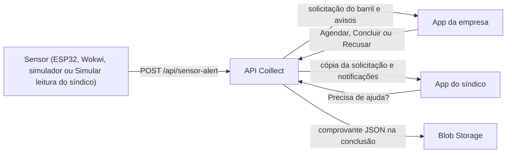
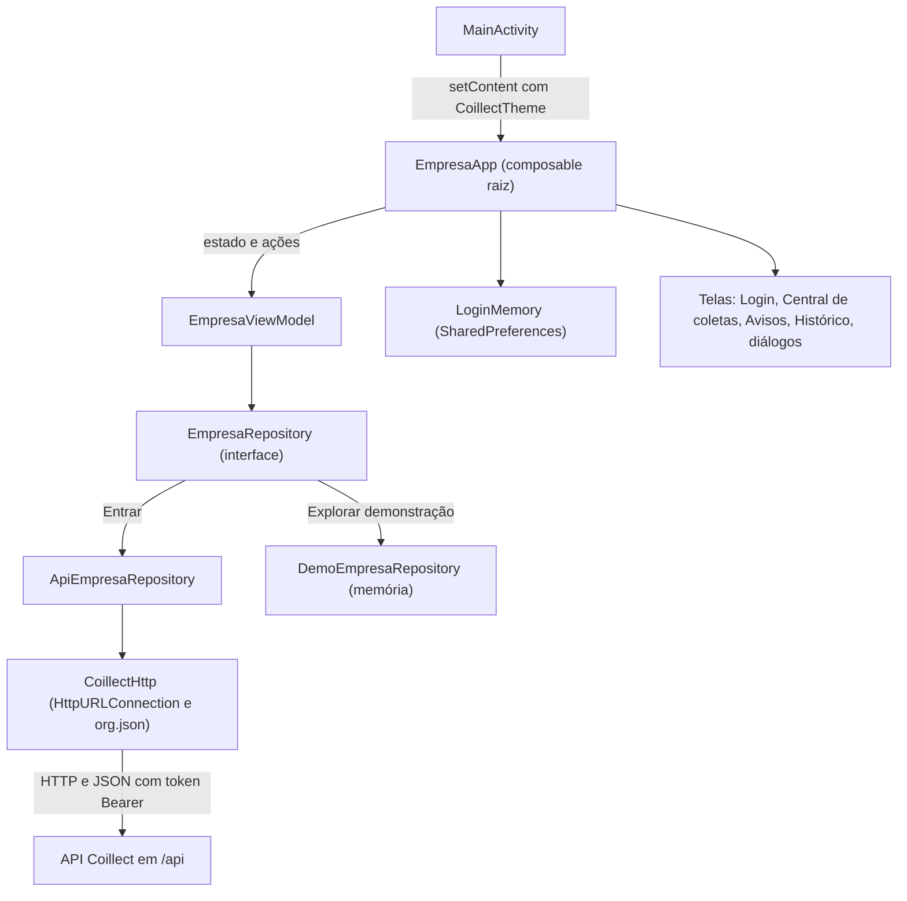
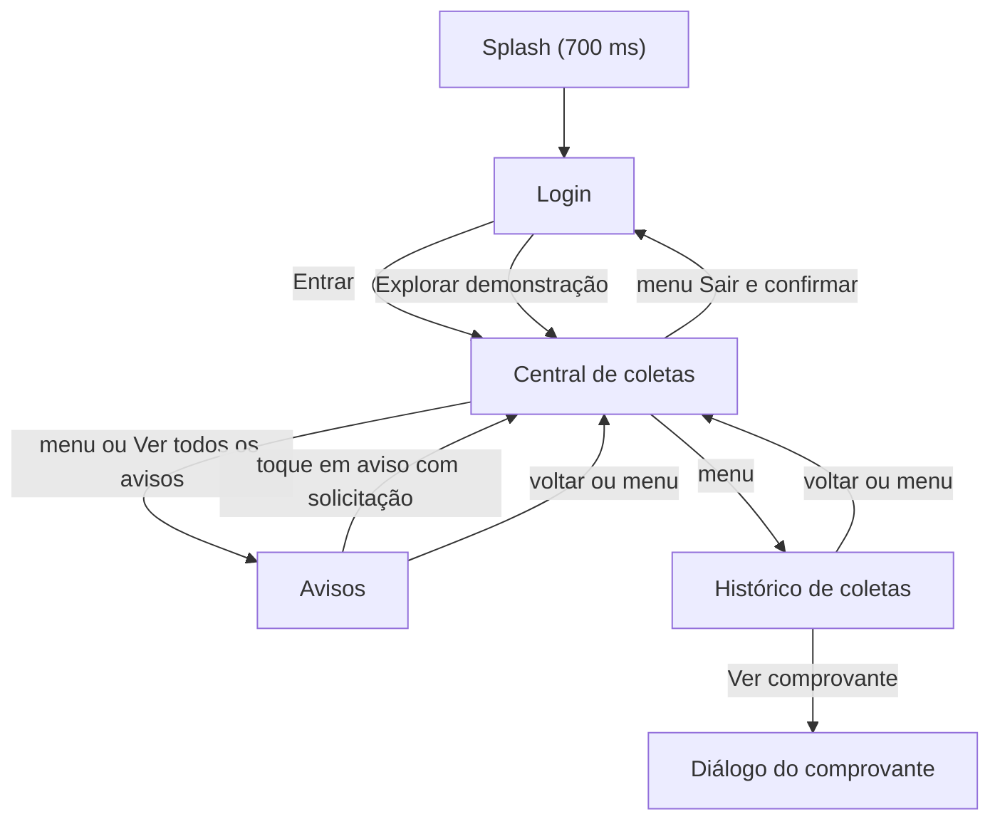
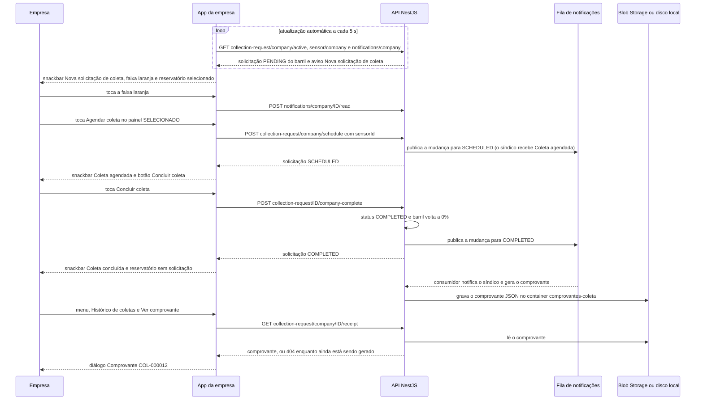

# App da empresa coletora (app-mobile-empresa)

Parte da [documentação do Coillect](README.md).

Este documento descreve o app Android da empresa coletora a partir do código da `main` do repositório
[CoillectADM/app-mobile-empresa](https://github.com/CoillectADM/app-mobile-empresa) (privado; commit
`e0051c92`, 10/11/2026): papel no fluxo, arquitetura, estado da tela, telas, comunicação com a API,
uso em celular de verdade, modo demonstração, build e instalação, testes, mudanças em relação à base
`CoillectMobileRemake` e limitações. O [app do síndico](05-app-sindico.md) é descrito com a mesma
estrutura de seções, para comparação. Nada do que está aqui foi executado em celular ou emulador.

## Sumário

1. [Para que serve o app](#para-que-serve-o-app)
2. [Arquitetura](#arquitetura)
3. [Estado da tela e ViewModel](#estado-da-tela-e-viewmodel)
4. [Telas e componentes](#telas-e-componentes)
5. [Comunicação com a API](#comunicação-com-a-api)
6. [Conexão em celular de verdade](#conexão-em-celular-de-verdade)
7. [Modo demonstração](#modo-demonstração)
8. [Build, CI e instalação](#build-ci-e-instalação)
9. [Testes](#testes)
10. [O que mudou em relação à base CoillectMobileRemake](#o-que-mudou-em-relação-à-base-coillectmobileremake)
11. [Limitações e o que não foi verificado](#limitações-e-o-que-não-foi-verificado)

## Para que serve o app

| Item | Valor |
|---|---|
| Repositório | [CoillectADM/app-mobile-empresa](https://github.com/CoillectADM/app-mobile-empresa) (privado) |
| Pacote e `applicationId` | `br.com.coillect.empresa` |
| Nome no aparelho | cOillect Empresa |
| Tecnologia | Kotlin, Jetpack Compose, Material 3; uma única Activity |
| Android | mínimo 8.0 (API 26); alvo e compilação com API 36 |
| Versão | `0.1.0-mvp` (`versionCode` 1) |
| APK de demonstração | [coillect-empresa.apk](https://github.com/CoillectADM/app-mobile-empresa/releases/download/demo/coillect-empresa.apk) (release `demo`; repositório privado, precisa estar logado no GitHub) |
| Conta de demonstração | `empresa@coillect.com` / `Coillect@2025` (EcoColeta Ambiental, criada pelo seed da API; ver [Dados de demonstração e glossário](14-dados-de-demonstracao-e-glossario.md)) |
| Mockup seguido | "Central de coletas" |

### Papel da empresa no fluxo

A empresa coletora recebe e conduz a coleta do **barril específico**:

1. O sensor do barril de um condomínio cliente (ESP32, Wokwi, sensor virtual no PC ou o botão
   **Simular leitura do sensor** do app do síndico) envia o nível para `POST /api/sensor-alert`.
2. Se o nível atinge o limite do barril (80% por padrão) e não há coleta aberta para aquele barril, a
   API abre **uma** solicitação `PENDING` para a empresa coletora do condomínio e gera o aviso "Nova
   solicitação de coleta" (a faixa laranja deste app).
3. A empresa **agenda** ("Agendar coleta": `PENDING` → `SCHEDULED`), **conclui** ("Concluir coleta":
   → `COMPLETED`; o barril volta a 0% e o comprovante JSON é gravado no Blob Storage) ou **recusa**
   ("Recusar": → `REFUSED`).
4. A empresa também pode agendar a coleta de um barril que ainda não atingiu o limite: a API cria uma
   solicitação nova já `SCHEDULED`, com origem `COMPANY`.
5. Cada passo vira notificação no app do síndico, que só acompanha. Pedidos de ajuda dos síndicos chegam
   aqui como avisos.

A API nunca deixa duas coletas abertas para o mesmo barril; "Agendar coleta" num barril que já tem
solicitação aberta com outra empresa recebe 409
([collection-request.service.ts](../backend/src/collection-request/collection-request.service.ts)).



### O que a empresa faz no app

Rotas relativas a `<servidor>/api/`.

| Ação | Onde | Rota |
|---|---|---|
| Ver contadores, avisos e reservatórios | Central de coletas | `GET collection-request/company/active`, `GET sensor/company`, `GET notifications/company` |
| Selecionar um reservatório | Central de coletas (toque no cartão ou na faixa de aviso) | — (só no aparelho) |
| Agendar coleta | Painel "SELECIONADO" | `POST collection-request/company/schedule` |
| Concluir coleta | Painel "SELECIONADO" | `POST collection-request/{id}/company-complete` |
| Recusar solicitação | Painel "SELECIONADO" | `POST collection-request/{id}/refuse` |
| Ler avisos e marcar como lidos | Avisos e faixa laranja | `GET notifications/company`, `POST notifications/company/{id}/read`, `POST notifications/company/read-all` |
| Ver coletas encerradas e o comprovante | Histórico de coletas | `GET collection-request/company/history`, `GET collection-request/company/{id}/receipt` |
| Responder ao síndico (chat) | Não existe no app | — |

### Comparação rápida com o app do síndico

| Aspecto | App da empresa (este) | [App do síndico](05-app-sindico.md) |
|---|---|---|
| Papel | Recebe e conduz a coleta | Acompanha e é notificado |
| Login | `POST auth/company/login`; o nome vem de `profile.name` | `POST auth/login`; o nome vem de `sensor/mine` (`sindicoName`) |
| Tela principal | "Central de coletas": os reservatórios de todos os condomínios clientes | "Visão geral": o barril do condomínio |
| Ações sobre a coleta | Agendar, Concluir e Recusar | Nenhuma |
| Ações extras | — | Simular leitura, Precisa de ajuda? |
| Lista de mensagens | "Avisos" (`notifications/company`) | "Notificações" (`notifications/mine`) |
| Snackbar de novidade | Nova solicitação `PENDING` ou novo pedido de ajuda | Nova solicitação ou qualquer notificação nova não lida |
| Comprovante | `collection-request/company/{id}/receipt`; mostra o síndico | `collection-request/{id}/receipt`; mostra empresa e CNPJ |
| Modo demonstração | Espera as ações da empresa | Avança sozinho até concluir a coleta |
| Testes unitários | 38 casos | 39 casos |

## Arquitetura

Uma Activity e telas em Compose. Não há `navigation-compose`, injeção de dependência nem Retrofit:
a tela atual é um valor (`Screen`) no estado do ViewModel, e o HTTP usa `HttpURLConnection`.

- `MainActivity` liga o modo edge-to-edge e chama `setContent { CoillectTheme { EmpresaApp() } }`.
- `EmpresaApp` (composable raiz) obtém o ViewModel com `viewModel(factory = EmpresaViewModel.Factory)`,
  observa o estado com `collectAsStateWithLifecycle()`, decide entre splash, login e área logada, mostra
  `message` em snackbar, cria o `LoginMemory` e roda a atualização automática.
- `EmpresaViewModel` guarda o `EmpresaState` num `MutableStateFlow` e executa as ações em
  `viewModelScope`. Ele recebe duas fábricas: `apiFactory: (String) -> EmpresaRepository` (padrão
  `ApiEmpresaRepository(url)`) e `demoFactory: () -> EmpresaRepository` (padrão `DemoEmpresaRepository()`).
  O repositório é escolhido no login. Os testes trocam as fábricas por um repositório falso.
- `EmpresaRepository` (interface em `domain/Models.kt`) é a fronteira de dados: 13 funções `suspend`.
- `ApiEmpresaRepository` fala com a API por meio de `CoillectHttp`. `DemoEmpresaRepository` simula tudo
  em memória.



### Arquivos de `app/src/main`

Caminhos Kotlin relativos a `app/src/main/java/br/com/coillect/empresa/`. "PR" = pull request do
repositório do app (ver [Histórico dos PRs](#histórico-dos-prs)).

| Arquivo | Linhas | Papel | Origem |
|---|---|---|---|
| [`MainActivity.kt`](https://github.com/CoillectADM/app-mobile-empresa/blob/main/app/src/main/java/br/com/coillect/empresa/MainActivity.kt) | 16 | Activity única (`ComponentActivity`): `enableEdgeToEdge()` e `setContent { CoillectTheme { EmpresaApp() } }` | Base, renomeada no PR #1 |
| [`data/ApiEmpresaRepository.kt`](https://github.com/CoillectADM/app-mobile-empresa/blob/main/app/src/main/java/br/com/coillect/empresa/data/ApiEmpresaRepository.kt) | 186 | Objeto `Routes` (todas as rotas do app), `ApiEmpresaRepository` (implementação HTTP) e as funções de mapeamento JSON → modelo (`healthOf`, `toRequest`, `toClient`, `toNotice`, `toReceipt`) | PR #1; alterado nos PRs #2 e #3 |
| [`data/CoillectHttp.kt`](https://github.com/CoillectADM/app-mobile-empresa/blob/main/app/src/main/java/br/com/coillect/empresa/data/CoillectHttp.kt) | 78 | Cliente HTTP mínimo, `ApiException`, tempos limite, leitura do envelope (`dataOf`), helpers de JSON e `displayDate` | PR #1; alterado no PR #2 |
| [`data/DemoEmpresaRepository.kt`](https://github.com/CoillectADM/app-mobile-empresa/blob/main/app/src/main/java/br/com/coillect/empresa/data/DemoEmpresaRepository.kt) | 125 | Repositório em memória do modo demonstração | PR #1; alterado no PR #2 |
| [`data/LoginMemory.kt`](https://github.com/CoillectADM/app-mobile-empresa/blob/main/app/src/main/java/br/com/coillect/empresa/data/LoginMemory.kt) | 24 | Lembra servidor e e-mail do último login (`SharedPreferences`) | PR #3 |
| [`domain/Display.kt`](https://github.com/CoillectADM/app-mobile-empresa/blob/main/app/src/main/java/br/com/coillect/empresa/domain/Display.kt) | 37 | Saudação pelo horário, nome curto, iniciais, escolha do reservatório selecionado e rótulo de pendentes | PR #2 |
| [`domain/FormValidation.kt`](https://github.com/CoillectADM/app-mobile-empresa/blob/main/app/src/main/java/br/com/coillect/empresa/domain/FormValidation.kt) | 7 | Validação do e-mail do login | PR #1 (regra de e-mail da base) |
| [`domain/Models.kt`](https://github.com/CoillectADM/app-mobile-empresa/blob/main/app/src/main/java/br/com/coillect/empresa/domain/Models.kt) | 108 | Modelos, enum de status e a interface `EmpresaRepository` | PR #1; alterado nos PRs #2 e #3 |
| [`domain/ServerAddress.kt`](https://github.com/CoillectADM/app-mobile-empresa/blob/main/app/src/main/java/br/com/coillect/empresa/domain/ServerAddress.kt) | 41 | `normalizeServerUrl` (texto digitado → URL base), `hostOf` e `DEFAULT_API_PORT = 3000` | PR #3 |
| [`ui/Connection.kt`](https://github.com/CoillectADM/app-mobile-empresa/blob/main/app/src/main/java/br/com/coillect/empresa/ui/Connection.kt) | 61 | `ConnectionCheck` e as mensagens do "Testar conexão" e dos erros de rede | PR #3 |
| [`ui/EmpresaApp.kt`](https://github.com/CoillectADM/app-mobile-empresa/blob/main/app/src/main/java/br/com/coillect/empresa/ui/EmpresaApp.kt) | 197 | Composable raiz: splash, login, área logada (menu lateral, barra do topo, snackbar), diálogos de saída e de comprovante, `AUTO_REFRESH_MS` | PR #1; alterado nos PRs #2 e #3 |
| [`ui/EmpresaViewModel.kt`](https://github.com/CoillectADM/app-mobile-empresa/blob/main/app/src/main/java/br/com/coillect/empresa/ui/EmpresaViewModel.kt) | 347 | `Screen`, `EmpresaState`, `EmpresaViewModel` e as funções `attempt`, `describe` e `conflictMessage` | PR #1; alterado nos PRs #2 e #3 |
| [`ui/auth/LoginScreen.kt`](https://github.com/CoillectADM/app-mobile-empresa/blob/main/app/src/main/java/br/com/coillect/empresa/ui/auth/LoginScreen.kt) | 89 | Tela de login, com "Testar conexão" e "Explorar demonstração" (e um `@Preview`) | PR #1; alterado no PR #3 |
| [`ui/components/Components.kt`](https://github.com/CoillectADM/app-mobile-empresa/blob/main/app/src/main/java/br/com/coillect/empresa/ui/components/Components.kt) | 217 | Componentes visuais reutilizados (tabela em [Componentes](#componentes-reutilizáveis)) | Base, renomeado no PR #1; alterado no PR #2 |
| [`ui/history/HistoryScreen.kt`](https://github.com/CoillectADM/app-mobile-empresa/blob/main/app/src/main/java/br/com/coillect/empresa/ui/history/HistoryScreen.kt) | 118 | Tela "Histórico de coletas" e `ReceiptDialog` | PR #2 |
| [`ui/home/HomeScreen.kt`](https://github.com/CoillectADM/app-mobile-empresa/blob/main/app/src/main/java/br/com/coillect/empresa/ui/home/HomeScreen.kt) | 228 | Tela "Central de coletas" (e um `@Preview`) | PR #1; alterado no PR #2 |
| [`ui/notices/NoticesScreen.kt`](https://github.com/CoillectADM/app-mobile-empresa/blob/main/app/src/main/java/br/com/coillect/empresa/ui/notices/NoticesScreen.kt) | 86 | Tela "Avisos" | PR #2 |
| [`ui/theme/CoillectTheme.kt`](https://github.com/CoillectADM/app-mobile-empresa/blob/main/app/src/main/java/br/com/coillect/empresa/ui/theme/CoillectTheme.kt) | 46 | Paleta `CoillectColors` e `CoillectTheme` (Material 3) | Base, renomeado no PR #1; cores trocadas no PR #2 |
| [`AndroidManifest.xml`](https://github.com/CoillectADM/app-mobile-empresa/blob/main/app/src/main/AndroidManifest.xml) | 15 | Permissão de internet, HTTP sem TLS liberado, Activity de entrada | Base; alterado no PR #1 |
| [`res/values/themes.xml`](https://github.com/CoillectADM/app-mobile-empresa/blob/main/app/src/main/res/values/themes.xml) | 10 | Tema da janela Android (`Theme.Coillect`) | Base; cores trocadas no PR #2 |
| [`res/drawable/icone.png`](https://github.com/CoillectADM/app-mobile-empresa/blob/main/app/src/main/res/drawable/icone.png) e [`logo.png`](https://github.com/CoillectADM/app-mobile-empresa/blob/main/app/src/main/res/drawable/logo.png) | binários | Ícone do app (manifest) e logo (`BrandLogo`) | Base, sem alteração |

### Outros arquivos do repositório

| Arquivo | Papel |
|---|---|
| [`README.md`](https://github.com/CoillectADM/app-mobile-empresa/blob/main/README.md) | Papel do app, telas, rotas, execução, celular de verdade e verificação |
| [`AGENTS.md`](https://github.com/CoillectADM/app-mobile-empresa/blob/main/AGENTS.md) | Regras para agentes (Codex, Copilot): escopo da "Central de coletas", contrato da API só em `data/ApiEmpresaRepository.kt`, PR com CI verde |
| [`app/build.gradle.kts`](https://github.com/CoillectADM/app-mobile-empresa/blob/main/app/build.gradle.kts) | Módulo Android (ver [Build](#build-ci-e-instalação)) |
| [`gradle/libs.versions.toml`](https://github.com/CoillectADM/app-mobile-empresa/blob/main/gradle/libs.versions.toml) | Catálogo de versões |
| `build.gradle.kts`, `settings.gradle.kts` (`rootProject.name = "CoillectEmpresa"`), `gradle.properties`, `gradle/wrapper/` | Build Gradle; wrapper com Gradle 9.5.0 |
| `app/coillect-debug.keystore` | Chave de debug fixa (PR #3); arquivo binário |
| `app/proguard-rules.pro` | Modelo padrão, sem regras ativas; o build não o referencia |
| [`.github/workflows/android.yml`](https://github.com/CoillectADM/app-mobile-empresa/blob/main/.github/workflows/android.yml) | CI: build, testes, artefato e release `demo` |
| [`.github/scripts/report_errors.py`](https://github.com/CoillectADM/app-mobile-empresa/blob/main/.github/scripts/report_errors.py) | Transforma falhas do `build.log` em anotações do GitHub Actions |
| `.idea/` | Configuração do Android Studio herdada da base |

## Estado da tela e ViewModel

### Campos de `EmpresaState`

| Campo | Tipo (padrão) | O que controla |
|---|---|---|
| `account` | `Account?` (`null`) | `null` mostra o login; o nome (`profile.name`) vai para a saudação, o menu e as iniciais |
| `demo` | `Boolean` (`false`) | Faixa "Modo demonstração" na Central de coletas e texto no menu lateral |
| `server` | `String?` (`null`) | URL base normalizada em uso; o menu mostra `Servidor: <host:porta>` |
| `checking` | `Boolean` (`false`) | "Testar conexão" em andamento: botão desabilitado com "Testando conexão…" |
| `connection` | `ConnectionCheck?` (`null`) | Resultado do teste (ok + texto) abaixo do botão; zerado ao entrar |
| `busy` | `Boolean` (`false`) | Operação bloqueante (login, demonstração, Agendar, Concluir, Recusar, "Atualizar agora"): desabilita o formulário e os botões do painel (com "Aguarde…") e mostra a barra de progresso |
| `loaded` | `Boolean` (`false`) | Primeira carga feita: troca "Consultando reservatórios…" por "Nenhum condomínio vinculado a esta empresa." |
| `screen` | `Screen` (`HOME`) | Tela atual: `HOME` ("Central de coletas"), `NOTICES` ("Avisos"), `HISTORY` ("Histórico de coletas"); o título vai para a barra do topo |
| `requests` | `List<CollectionRequest>` (vazia) | Solicitações em aberto (`PENDING` e `SCHEDULED`): contador "Coletas pendentes", detalhes do painel "SELECIONADO" e anúncio de novas |
| `requestsError` | `String?` (`null`) | Erro da última consulta das solicitações; guardado, mas nenhuma tela o exibe |
| `clients` | `List<ClientBarrel>` (vazia) | Lista "Reservatórios monitorados", contador "Sensores ativos", botões do painel e seleção |
| `clientsError` | `String?` (`null`) | "Não foi possível consultar: …" quando a lista de reservatórios está vazia |
| `notices` | `List<CompanyNotice>` (vazia) | Tela Avisos, faixa laranja e contagem de não lidos |
| `noticesError` | `String?` (`null`) | "Não foi possível consultar: …" na tela Avisos, quando a lista está vazia |
| `chosenSensorId` | `String?` (`null`) | Reservatório tocado pelo usuário (ou o da solicitação do aviso tocado) |
| `history` | `List<CollectionRequest>` (vazia) | Cartões do histórico |
| `historyLoaded` | `Boolean` (`false`) | Troca "Consultando o histórico…" por "Nenhuma coleta encerrada ainda." |
| `historyError` | `String?` (`null`) | "Não foi possível consultar: …" no histórico vazio |
| `receipt` | `Receipt?` (`null`) | Comprovante aberto no diálogo |
| `receiptLoading` | `Boolean` (`false`) | Desabilita os botões "Ver comprovante" durante a busca |
| `lastSync` | `String?` (`null`) | Hora (`HH:mm:ss`) da última consulta em que solicitações ou reservatórios deram certo |
| `message` | `String?` (`null`) | Texto do snackbar; limpo por `clearMessage()` depois de exibido |
| `unread` (derivado) | `Int` | Avisos com `read = false`: selo do ☰, item "Avisos" do menu e cabeçalho da tela |
| `latestUnread` (derivado) | `CompanyNotice?` | Primeiro aviso não lido da lista (a API devolve os mais recentes primeiro): faixa laranja |
| `selected` (derivado) | `ClientBarrel?` | `pickSelected(clients, chosenSensorId)`: o reservatório do painel "SELECIONADO" |
| `selectedRequest` (derivado) | `CollectionRequest?` | Solicitação em aberto do selecionado: a de `id` igual a `openRequestId`, senão a do mesmo `sensorId` |

### Ações públicas do `EmpresaViewModel`

`login`, `enterDemo`, `schedule`, `completeCollection` e `refuse` passam por `execute`, que ignora o
toque se `busy` já está ligado (por isso um toque duplo em "Agendar coleta" envia um pedido só), liga
`busy`, limpa `message` e, em caso de erro, grava `describe(error, login)` em `message`; só o `login`
usa `login = true`. As outras ações usam `attempt`, que transforma a exceção em `Result` sem derrubar a
tela. Resultados que chegam depois de um logout ou de outro login são descartados.

| Função | O que faz | Rota(s) | Tratamento de erro |
|---|---|---|---|
| `login(server, email, password)` | Normaliza o endereço (`normalizeServerUrl`), cria o repositório da API com `apiFactory`, faz login com o e-mail aparado e, se der certo, guarda o repositório, zera os ids conhecidos (solicitações e avisos), abre a Central de coletas e carrega os dados sem anúncio | `POST auth/company/login`; depois `GET collection-request/company/active`, `GET sensor/company`, `GET notifications/company` | `execute` com `login = true`: mensagem no snackbar (ex.: 401 → "E-mail ou senha inválidos."); continua no login |
| `enterDemo()` | Cria o `DemoEmpresaRepository`, entra como "EcoColeta Demonstração", liga `demo` e carrega os dados simulados | nenhuma | `execute` (o repositório em memória não falha nessas chamadas) |
| `testConnection(server)` | Normaliza; ignora se vazio ou se já está testando. Liga `checking`, chama `health()` de um repositório novo, sem login, e grava `connection` | `GET health` | Sucesso: `describeHealth`. Falha: `describeConnection` com `ok = false` |
| `refresh(silent = false)` | Recarrega solicitações, reservatórios e avisos **com** anúncio; na tela de histórico, também o histórico. `silent = true` (automática) não liga `busy` | `GET collection-request/company/active`, `GET sensor/company`, `GET notifications/company` e, no histórico, `GET collection-request/company/history` | Cada consulta é isolada: a falha vai para `requestsError`, `clientsError`, `noticesError` ou `historyError`, e o valor anterior continua na tela |
| `open(screen)` | Troca a tela; ao abrir o histórico, carrega a lista | `GET collection-request/company/history` | `historyError` |
| `select(sensorId)` | Marca o reservatório tocado como escolhido (`chosenSensorId`) | nenhuma | — |
| `schedule(sensorId)` | "Agendar coleta": com solicitação `PENDING` no barril, a API a aceita; sem solicitação aberta, cria uma já agendada. Mostra "Coleta agendada: <condomínio> (solicitação #ID)." e recarrega sem anúncio | `POST collection-request/company/schedule` | `execute`: 409 → "A API recusou: <mensagem da API>"; 401 → "Sessão expirada. Entre novamente."; demais na tabela de `describe` |
| `completeCollection(id)` | "Concluir coleta": mostra "Coleta concluída: <condomínio>. O comprovante vai para o Blob Storage." e recarrega sem anúncio | `POST collection-request/{id}/company-complete` | `execute`, igual ao anterior |
| `refuse(id)` | "Recusar": mostra "Solicitação #ID recusada." e recarrega sem anúncio | `POST collection-request/{id}/refuse` | `execute`, igual ao anterior |
| `openNotice(notice)` | Marca o aviso como lido na tela na hora e seleciona o reservatório cuja solicitação aberta tem o `requestId` do aviso (se houver); avisa a API | `POST notifications/company/{id}/read` | Ignorado; se a API não gravou, o aviso volta como não lido na próxima atualização |
| `markAllNoticesRead()` | Marca todos como lidos na tela e avisa a API | `POST notifications/company/read-all` | `describe(error)` no snackbar |
| `openReceipt(requestId)` | Liga `receiptLoading`, busca o comprovante e abre o diálogo | `GET collection-request/company/{id}/receipt` | 404 → "O comprovante ainda está sendo gerado. Tente de novo em instantes."; outros → `describe(error)` |
| `closeReceipt()` | Fecha o diálogo do comprovante | — | — |
| `logout()` | Descarta o repositório, volta ao estado inicial (tela de login) e chama `logout()` do repositório em segundo plano (na API, só apaga o token da memória) | nenhuma | Ignorado |
| `clearMessage()` | Limpa `message` depois que o snackbar apareceu | — | — |

### Tratamento de erros (`describe`)

`describe(error, login)` fica em `ui/EmpresaViewModel.kt` (igual à do app do síndico) e é usada em todas
as mensagens gerais. As regras são avaliadas nesta ordem:

| Erro | Mensagem |
|---|---|
| `ApiException` 401 no login | "E-mail ou senha inválidos." |
| `ApiException` 401 fora do login | "Sessão expirada. Entre novamente." |
| `ApiException` 404 no login | "O servidor respondeu, mas não é a API Coillect. Confira o endereço com "Testar conexão"." |
| `ApiException` 404 fora do login | "Endpoint ainda não disponível na API." |
| `ApiException` 409 | "A API recusou: <message do corpo>" (ou "conflito." se o corpo não tiver `message`) |
| Outra `ApiException` | "A API respondeu com erro <status>." |
| Tempo esgotado, endereço não encontrado ou inválido | Mensagem de `networkProblem` (ver [Testar conexão](#testar-conexão-e-mensagens)) |
| Outra `IOException` | "Sem conexão com a API. Confira o endereço do servidor." |
| `JSONException` | "Resposta inesperada da API." |
| Qualquer outra | "Não foi possível concluir. Tente novamente." |

### Atualização automática

- Constante `AUTO_REFRESH_MS = 5_000L` em `ui/EmpresaApp.kt`. Enquanto a área logada está na tela, um
  `LaunchedEffect` repete: espera 5 s e chama `refresh(silent = true)`.
- O item "Atualizar agora" do menu chama `refresh()` (não silencioso: liga `busy` e mostra a barra de
  progresso).
- `refresh` não faz nada sem repositório ou se outra atualização ainda está em andamento (flag
  `refreshing`). A versão não silenciosa também não roda se `busy` estiver ligado.
- Cada carga faz as três consultas em sequência (solicitações, reservatórios, avisos). O rodapé da
  Central de coletas mostra "Atualizado às HH:mm:ss • atualização automática a cada 5 s" ou
  "Consultando…".
- Não há push: novidades aparecem na próxima consulta (até 5 s), mais o tempo da fila da API para gerar o
  aviso.

### Anúncios de novidades

A carga com anúncio (`load(announce = true)`) só acontece em `refresh`. Login, demonstração e as ações
Agendar, Concluir e Recusar carregam sem anúncio: atualizam o que o app já conhece, sem snackbar. Cada
carga mostra no máximo uma mensagem; a nova solicitação tem prioridade.

| Novidade | Condição | Snackbar |
|---|---|---|
| Nova solicitação | Chegou solicitação `PENDING` com `id` nunca visto desde o login. O conjunto de ids vistos só cresce e inclui os das cargas sem anúncio | "Nova solicitação de coleta: <condomínios separados por vírgula>." |
| Novo pedido de ajuda | Já existe uma lista de avisos conhecida (a primeira depois do login nunca é anunciada) e chegou aviso `HELP_REQUESTED` **não lido** com `id` fora dela | O título do aviso (ex.: "Pedido de ajuda • Residencial Aurora") |

Outros avisos novos (ex.: "Solicitação cancelada") não geram snackbar: aparecem na faixa laranja, no selo
do menu e na tela Avisos.

## Telas e componentes

### Navegação



O menu lateral fica disponível nas três telas logadas. O botão voltar do Android fecha o menu, se
aberto; nas telas Avisos e Histórico, volta para a Central de coletas; na Central de coletas, segue o
comportamento padrão do sistema.

### Splash

Mostrada uma vez ao abrir o app, por 700 ms: logo (200 dp), "Cada gota tem um novo caminho." e
"Empresa coletora".

### Login

| Elemento | Comportamento |
|---|---|
| Cabeçalho | Logo (112 dp), "Área da empresa coletora" e "Receba as solicitações de coleta geradas pelos sensores dos condomínios clientes." |
| Campo "E-mail" | Teclado de e-mail. Começa com o último e-mail salvo. Erro "Informe um e-mail válido." (regex `^[^\s@]+@[^\s@]+\.[^\s@]+$` sobre o texto aparado) |
| Campo "Senha" | Oculta, com botão de olho ("Mostrar Senha" / "Ocultar Senha"). Erro "Informe sua senha.". Não é gravada em lugar nenhum, nem no estado salvo da tela |
| Campo "Servidor da API" | Teclado de URL. Começa com o servidor salvo; na primeira vez, `BuildConfig.API_URL`. Erro "Informe o endereço da API.". Dica: "No celular: IP do PC na rede Wi-Fi (ex.: 192.168.0.15:3000) ou o endereço da API na nuvem." |
| Botão "Testar conexão" | Habilitado sem operação em andamento e com servidor preenchido. Chama `GET /api/health` sem login. Durante o teste: "Testando conexão…". O resultado aparece abaixo, em verde-escuro (`GreenDark`) se ok ou em marrom-alaranjado (`OrangeText`) se falhou |
| Botão "Entrar" | Valida os três campos (os erros só aparecem depois do primeiro toque). Se válidos, salva servidor normalizado e e-mail no `LoginMemory` e chama `login`. Durante o login: spinner e "Aguarde…". Erros no snackbar (tabela de `describe`) |
| "Explorar demonstração" | Abaixo de "Sem servidor disponível?". Entra no [modo demonstração](#modo-demonstração), sem rede |

### Central de coletas

Coluna com rolagem, largura máxima de 840 dp.

| Elemento | Conteúdo | Ação ou rota ligada |
|---|---|---|
| Saudação | "<Bom dia, Boa tarde ou Boa noite>, <primeira palavra do nome da empresa>" (sem nome: "empresa") e "Veja o que precisa da sua atenção hoje." | Nome de `profile.name` do login |
| Faixa "Modo demonstração" | Verde: "Dados simulados no aparelho; nada é enviado à API." Só no modo demonstração | — |
| Contadores | "<n> Sensores ativos" (verde; n = número de reservatórios devolvidos por `sensor/company`, sem filtrar por `online`) e "<n> Coleta pendente" ou "Coletas pendentes" (laranja; n = solicitações em aberto, `PENDING` e `SCHEDULED`) | `GET sensor/company` e `GET collection-request/company/active` |
| Faixa laranja de aviso | Aviso não lido mais recente: título e mensagem (ex.: "Nova solicitação de coleta" / "Residencial Aurora chegou a 86% de capacidade."). Com mais de um não lido, botão "Ver todos os avisos (N)" | Toque → `openNotice` (`POST notifications/company/{id}/read` e seleção do reservatório); o botão abre Avisos |
| "Reservatórios monitorados" | Um cartão por reservatório (tabela abaixo). Sem lista: "Não foi possível consultar: <erro>", "Nenhum condomínio vinculado a esta empresa." ou "Consultando reservatórios…" | `GET sensor/company`; toque → `select(sensorId)` |
| Painel "SELECIONADO" | Ação da empresa para o reservatório selecionado (tabela abaixo) | Agendar, Concluir, Recusar |
| Rodapé | "Atualizado às HH:mm:ss • atualização automática a cada 5 s" ou "Consultando…"; barra de progresso quando `busy` | — |

#### Cartão de reservatório

"Alerta" = nível ≥ limite (`needsCollection`) ou solicitação `PENDING`.

| Parte | Conteúdo |
|---|---|
| Mini barril | `MiniBarrel` de 44 × 58 dp: laranja em alerta, verde (`Fill`) nos outros casos |
| Nome | Nome do condomínio |
| Linha de baixo | "<sensorId> • <bairro>" |
| Barra | `LevelBar` com o nível (laranja em alerta) |
| Solicitação | Se há solicitação aberta: "Solicitação #ID • <rótulo do status>", laranja se `PENDING`, verde nos outros |
| Percentual | "N%" à direita, laranja em alerta, verde nos outros casos |
| Selecionado | Borda verde de 2 dp |

#### Painel "SELECIONADO"

Os botões dependem da solicitação aberta informada pelo reservatório (`openRequest` de
`sensor/company`); a linha de detalhes usa a solicitação de `company/active`.

| Parte | Conteúdo |
|---|---|
| Rótulo e nome | "SELECIONADO" e o nome do condomínio |
| Leitura | "Leitura atual recebida do sensor <sensorId> em <data>." (sem data, termina no id do sensor) |
| Detalhes | Com solicitação: "Solicitação #ID • nível no alerta N% • barril <código> • síndico <nome> • agendada para <data>" (só as partes que existirem) |
| Botão principal | "Concluir coleta  ✓" se a solicitação aberta do reservatório está `SCHEDULED` → `completeCollection(id)`. Nos outros casos, "Agendar coleta  →" → `schedule(sensorId)`: com `PENDING` aceita a solicitação; sem solicitação cria uma já agendada |
| "Recusar esta solicitação" | Só com solicitação `PENDING` → `refuse(id)` |
| Durante uma operação | Os botões ficam desabilitados e o principal mostra spinner e "Aguarde…" |

#### Reservatório selecionado

`pickSelected(clients, chosenSensorId)` em `domain/Display.kt`, avaliada nesta ordem:

| Ordem | Critério |
|---|---|
| 1 | O reservatório tocado pelo usuário (`chosenSensorId`), se ainda está na lista |
| 2 | O primeiro com solicitação `PENDING` |
| 3 | O primeiro com qualquer solicitação aberta |
| 4 | O mais cheio entre os que atingiram o limite |
| 5 | O primeiro da lista |

### Avisos

| Elemento | Comportamento |
|---|---|
| Cabeçalho | "N não lido(s)" ou "Tudo lido" e o botão "Marcar todos como lidos" (habilitado se há não lidos) → `markAllNoticesRead()` |
| Lista vazia | "Não foi possível consultar: <erro>" ou "Nenhum aviso ainda. Eles aparecem quando um sensor atinge o limite ou um síndico pede ajuda." |
| Cartão | Fundo laranja-claro (`OrangeSoft`) se não lido, branco se lido. Bolinha laranja (verde para pedido de ajuda) se não lido, cinza se lido. Título, mensagem e rodapé "<data> • solicitação #ID • pedido de ajuda do síndico" (as partes que existirem) |
| Toque no cartão | `openNotice(aviso)` → `POST notifications/company/{id}/read`; se o aviso tem solicitação, volta para a Central de coletas com o reservatório dela selecionado |

Os avisos são gerados pela API ([notification.text.ts](../backend/src/notification/notification.text.ts)):
"Nova solicitação de coleta" (ex.: "Residencial Aurora chegou a 86% de capacidade. Barril BRL-8472."),
"Solicitação cancelada" (só no fluxo antigo de pedido manual) e "Pedido de ajuda • <condomínio>", com a
mensagem "<síndico> (<assunto>): <texto>". Agendar, concluir ou recusar não geram aviso para a própria
empresa.

### Histórico de coletas e comprovante

| Elemento | Comportamento |
|---|---|
| Lista vazia | "Não foi possível consultar: <erro>", "Nenhuma coleta encerrada ainda." ou "Consultando o histórico…" |
| Cartão | Nome do condomínio e o rótulo do status (verde se `COMPLETED`, laranja nos outros); "Solicitação #ID • barril <código> • nível no alerta N%"; "solicitada em <data> • concluída em <data>" |
| Botão do comprovante | Só em coletas `COMPLETED`: "Ver comprovante" se `receiptAvailable`, senão "Comprovante em geração…" (o botão funciona nos dois casos). Desabilitado durante a busca → `openReceipt(id)` |
| Diálogo do comprovante | Título "Comprovante <protocolo>". Linhas "Condomínio", "Síndico", "Barril / sensor", "Nível no alerta", "Volume estimado" (litros), "Solicitada em", "Agendada para", "Concluída em"; seção "Armazenamento" com provedor · container e o nome do blob em fonte monoespaçada. Botão "Fechar" |

O comprovante é o JSON que a API grava no Azure Blob Storage (container `comprovantes-coleta`) ou em
disco no modo local; ver [Azure Storage e nuvem](08-azure-storage-e-nuvem.md). Ele é gerado pela fila
logo depois da conclusão; até lá a rota responde 404 e o app mostra a mensagem amigável.

### Diálogo "Precisa de ajuda?"

Não existe neste app. O pedido de ajuda é enviado pelo síndico (ver
[app do síndico](05-app-sindico.md#diálogo-precisa-de-ajuda)) e chega aqui como aviso `HELP_REQUESTED`
sem solicitação (`requestId` nulo), com snackbar quando é novo e bolinha verde na tela Avisos. A empresa
não responde pelo app: não há chat.

### Menu lateral, barra do topo e saída

| Elemento | Conteúdo |
|---|---|
| Barra do topo | Botão ☰ com selo de não lidos ("9+" acima de 9), título da tela no centro e avatar com as iniciais do nome da empresa (ou do e-mail) |
| Cabeçalho do menu | "cOillect"; nome da empresa (ou "Empresa coletora"); e-mail; "Modo demonstração" ou "Servidor: <host:porta>" (ex.: "Servidor: 192.168.0.15:3000") |
| Itens | "Central de coletas"; "Avisos" com o número de não lidos em laranja; "Histórico de coletas"; divisória; "Atualizar agora" (`refresh()`); "Sair" |
| Diálogo de saída | "Sair da conta?" / "Você deixará de receber as solicitações de coleta neste aparelho até entrar novamente." Botões "Sair" (`logout()`) e "Continuar no aplicativo" |

### Componentes reutilizáveis

Em [`ui/components/Components.kt`](https://github.com/CoillectADM/app-mobile-empresa/blob/main/app/src/main/java/br/com/coillect/empresa/ui/components/Components.kt):

| Componente | Uso |
|---|---|
| `BrandLogo` | Logo (`R.drawable.logo`), 112 dp; 200 dp na splash |
| `FormPage` | Fundo em degradê (`GreenSoft` → `Background`), coluna de até 520 dp com rolagem e espaço para o teclado |
| `FormField` | Campo de texto com erro, tipo de teclado e botão de mostrar/ocultar senha |
| `PrimaryAction` | Botão verde (`Green`) grande (altura mínima 56 dp, texto de 17 sp em negrito), usado em "Entrar", "Agendar coleta" e "Concluir coleta"; com `busy`, spinner e "Aguarde…" |
| `InfoLine` | Rótulo e valor (diálogo do comprovante) |
| `TopBar` e `Avatar` | Barra do topo (64 dp) e círculo de 40 dp com as iniciais |
| `SectionLabel` | Rótulo verde em maiúsculas ("SELECIONADO") |
| `Banner` | Faixa com "!": laranja (aviso) ou verde (informação) |
| `MiniBarrel` | Barril de 44 × 58 dp com o nível (laranja em alerta); descrição de acessibilidade "Barril com N%" |
| `LevelBar` | Barra horizontal de 6 dp com o nível (laranja em alerta); descrição "Nível N%" |

### Cores e tema

[`ui/theme/CoillectTheme.kt`](https://github.com/CoillectADM/app-mobile-empresa/blob/main/app/src/main/java/br/com/coillect/empresa/ui/theme/CoillectTheme.kt)
define `CoillectColors` (cores do mockup: verde-oliva, laranja de alerta, fundo claro) e o
`CoillectTheme`, um `MaterialTheme` com `lightColorScheme`. A paleta é idêntica à do app do síndico.

| Nome | Hex | Papel no Material 3 | Uso neste app |
|---|---|---|---|
| `Green` | `#8FAE45` | `primary` | "cOillect" no menu, botão principal, borda do selecionado, contador "Sensores ativos", rótulo "SELECIONADO", solicitação agendada no cartão, percentual normal, status concluído, bolinha de pedido de ajuda não lido, iniciais |
| `GreenDark` | `#6E8A2E` | `secondary` | Resultado positivo do "Testar conexão" |
| `GreenSoft` | `#E6EDD8` | `primaryContainer`, `secondaryContainer` | Início do degradê do login, fundo do avatar, faixa informativa, painel "SELECIONADO" |
| `Fill` | `#9DB55B` | — | Nível abaixo do limite (mini barril e barra) |
| `Orange` | `#D9883A` | `tertiary` | Contagem de avisos no menu, alerta (mini barril, barra, percentual), contador "Coletas pendentes", solicitação `PENDING` no cartão, bolinha de aviso não lido, faixa de alerta, status não concluído no histórico |
| `OrangeSoft` | `#FFF6EC` | `tertiaryContainer` | Fundo da faixa de alerta e dos avisos não lidos |
| `OrangeBorder` | `#F1D7B6` | — | Borda da faixa de alerta |
| `OrangeText` | `#6B3D10` | `onTertiaryContainer` | Texto da faixa de alerta e falha do "Testar conexão" |
| `Ink` | `#1E2420` | `onBackground`, `onSurface`, `onPrimaryContainer`, `onSecondaryContainer` | Texto principal, ícone do menu, saudação |
| `Muted` | `#6D736B` | `onSurfaceVariant` | Textos secundários |
| `Background` | `#F3F4EF` | `background` | Fundo das telas |
| `Card` | `#FFFFFF` | `surface` | Cartões, contadores, barra do topo |
| `Divider` | `#E7E9E2` | `outline` | Divisórias, trilho da barra de nível, separador dos contadores |
| `GaugeBorder` | `#A8AEA5` | — | Borda do mini barril |
| `GaugeEmpty` | `#F0F2EC` | `surfaceVariant` | Parte vazia do mini barril |
| `Dot` | `#DDE0D8` | — | Bolinha de aviso lido |
| `Dark` | `#1F2421` | — | Definida, mas não usada neste app |
| (erro) | `#B3261E` | `error` | Cor de erro do Material (campos inválidos) |

O tema da janela Android ([`res/values/themes.xml`](https://github.com/CoillectADM/app-mobile-empresa/blob/main/app/src/main/res/values/themes.xml))
é `Theme.Coillect`, filho de `android:style/Theme.Material.Light.NoActionBar`, com fonte `sans`, barra de
status clara, `windowBackground` `#F3F4EF` e `colorAccent` `#8FAE45`.

## Comunicação com a API

### Cliente HTTP (`CoillectHttp.kt`)

[`data/CoillectHttp.kt`](https://github.com/CoillectADM/app-mobile-empresa/blob/main/app/src/main/java/br/com/coillect/empresa/data/CoillectHttp.kt)
(idêntico no app do síndico, exceto o pacote):

| Item | Valor no código |
|---|---|
| Cliente | `java.net.HttpURLConnection`, executado em `Dispatchers.IO`; sem Retrofit nem OkHttp |
| URL | Base aparada, sem barras finais, mais `/`; o caminho perde a barra inicial (`base + path`) |
| Tempo limite de conexão | `CONNECT_TIMEOUT_MS = 15_000` (15 s) |
| Tempo limite de leitura | `READ_TIMEOUT_MS = 60_000` (60 s). Comentário do código: a API na nuvem pode estar "acordando" (Render gratuito, App Service sem Always On) |
| Cabeçalhos | `Accept: application/json` sempre; `Content-Type: application/json; charset=utf-8` nos POST; `Authorization: Bearer <token>` quando há token |
| Corpo | `post(path, body)` sempre envia JSON em UTF-8; sem corpo explícito, envia `{}` |
| Token | Campo `token` em memória. O login grava o `access_token`; o logout apaga. Não é persistido |
| Status 2xx | Lê o corpo em UTF-8 e devolve o texto |
| Outros status | Lê o `errorStream` e lança `ApiException(status, body)`, subclasse de `IOException` |
| Erros de rede | Exceções de `java.net` e `javax.net.ssl` sobem sem tratamento; viram mensagem em `describe` e `describeConnection` |
| Conexão | `disconnect()` no `finally` |
| JSON | `org.json` (`JSONObject`, `JSONArray`), que já vem no Android; nos testes JVM, a biblioteca `org.json:json` |

Helpers do mesmo arquivo:

| Função | O que faz |
|---|---|
| `dataOf(text)` | Lê o envelope `APIResponse` da API e devolve `data`, ou `null` se ausente ou JSON `null` |
| `JSONObject.text(name)` | Texto não vazio, ou `null` se ausente, `null` ou em branco |
| `JSONObject.intOrNull(name)` | Inteiro, ou `null` se ausente ou `null` |
| `JSONArray.objects()` | Lista dos objetos do array (itens que não são objeto são ignorados) |
| `displayDate(iso)` | Data ISO da API → `dd/MM/yyyy HH:mm` no fuso do aparelho; texto original se não reconhecer |

O token só é aceito pela API no formato Bearer (`ExtractJwt.fromAuthHeaderAsBearerToken()` nas
estratégias JWT do backend) e vale 1 dia (`expiresIn: '1d'` em
[auth.module.ts](../backend/src/auth/auth.module.ts)).

### Rotas e mapeamento das respostas

As rotas ficam no objeto `Routes` de `data/ApiEmpresaRepository.kt` e são relativas à URL base, que
sempre termina em `/api/` (ex.: `GET health` = `GET http://192.168.0.15:3000/api/health`). O `AGENTS.md`
do repositório pede que o contrato da API fique só nesse arquivo.

```kotlin
object Routes {
    const val HEALTH = "health"
    const val LOGIN = "auth/company/login"
    const val REQUESTS = "collection-request/company/active"
    const val HISTORY = "collection-request/company/history"
    const val CLIENTS = "sensor/company"
    const val NOTICES = "notifications/company"
    const val NOTICES_READ_ALL = "notifications/company/read-all"
    const val SCHEDULE = "collection-request/company/schedule"
    fun noticeRead(id: String) = "notifications/company/$id/read"
    fun complete(id: String) = "collection-request/$id/company-complete"
    fun refuse(id: String) = "collection-request/$id/refuse"
    fun receipt(id: String) = "collection-request/company/$id/receipt"
}
```

| Função do repositório | Método e rota | Corpo enviado | Campos lidos da resposta | Retorno |
|---|---|---|---|---|
| `health()` | `GET health` | — | `data.status` (obrigatório), `data.database`, `data.storage`. Um 503 com corpo é lido como resposta (API no ar sem banco) | `ServerHealth` |
| `login(email, password)` | `POST auth/company/login` | `{ email, password }` | `access_token` e `profile.name` (a resposta do login não tem envelope) | `Account(email, name)` |
| `requests()` | `GET collection-request/company/active` | — | `data[]`, cada item por `toRequest` (abaixo) | `List<CollectionRequest>` (`PENDING` e `SCHEDULED`) |
| `clients()` | `GET sensor/company` | — | `data[]`: `sensorId`, `condominiumName`, `level`, `threshold`, `lastReadingAt`, `condominiumNeighborhood`, `barrelCode`, `online`, `openRequest.id`, `openRequest.status` | `List<ClientBarrel>` |
| `notices()` | `GET notifications/company` | — | `data[]`: `id`, `type`, `title`, `message`, `read`, `createdAt`, `requestId` | `List<CompanyNotice>` |
| `markNoticeRead(id)` | `POST notifications/company/{id}/read` | `{}` | — | — |
| `markAllNoticesRead()` | `POST notifications/company/read-all` | `{}` | — | — |
| `schedule(sensorId)` | `POST collection-request/company/schedule` | `{ sensorId }` | `data` por `toRequest` | `CollectionRequest` |
| `completeCollection(id)` | `POST collection-request/{id}/company-complete` | `{}` | `data` por `toRequest` | `CollectionRequest` |
| `refuse(id)` | `POST collection-request/{id}/refuse` | `{}` | `data` por `toRequest` | `CollectionRequest` |
| `history()` | `GET collection-request/company/history` | — | `data[]` por `toRequest` | `List<CollectionRequest>` |
| `receipt(requestId)` | `GET collection-request/company/{id}/receipt` | — | `data.requestId`, `data.receipt.*` e `data.storage.*` (detalhe em `Receipt`, abaixo) | `Receipt` |
| `logout()` | nenhuma | — | — | Apaga o token |

`schedule`, `completeCollection`, `refuse` e `receipt` lançam `JSONException` ("Resposta sem dados")
se a resposta não tiver `data`. A API também aceita `scheduledDate` no agendamento; o app não envia, e a
API usa a hora atual. Todas as rotas, exceto `health` e `auth/company/login`, exigem o token da empresa
(`JwtCompanyAuthGuard`). A lista completa da API está em [Referência de rotas](03-referencia-de-rotas.md)
e em [docs/api-apps.md](../docs/api-apps.md).

### Modelos (`Models.kt`)

[`domain/Models.kt`](https://github.com/CoillectADM/app-mobile-empresa/blob/main/app/src/main/java/br/com/coillect/empresa/domain/Models.kt).
"Data" = convertida por `displayDate`.

**`ClientBarrel`** (reservatório de um condomínio cliente, de `GET sensor/company`)

| Campo | JSON | Regra |
|---|---|---|
| `sensorId` | `sensorId` | "—" se ausente |
| `condominiumName` | `condominiumName` | "—" se ausente |
| `level` | `level` | Inteiro limitado a 0..100; 0 se ausente |
| `threshold` | `threshold` | `null` se ausente |
| `lastReadingAt` | `lastReadingAt` | Data |
| `neighborhood` | `condominiumNeighborhood` | — |
| `barrelCode` | `barrelCode` | Mapeado, não exibido |
| `online` | `online` | `false` se ausente; mapeado, não exibido |
| `openRequestId` | `openRequest.id` | `null` sem solicitação aberta (no máximo uma por barril) |
| `openRequestStatus` | `openRequest.status` | `RequestStatus.from`; `null` sem solicitação aberta |
| `needsCollection` (derivado) | — | `threshold` presente e `level ≥ threshold` |

**`CollectionRequest`** (`toRequest`; usado em `company/active`, `company/history` e nas respostas de
agendar, concluir e recusar)

| Campo | JSON | Regra |
|---|---|---|
| `id` | `id` | Texto ("" se ausente) |
| `status` | `status` | `RequestStatus.from` (desconhecido → `UNKNOWN`) |
| `condominiumName` | `condominiumName`, senão `sensor.condominiumName`, senão `user.name`, senão "Condomínio" | O fallback para `sensor` atende respostas antigas, sem o nome na raiz |
| `sindicoName` | `user.name` | — |
| `sensorId` | `sensor.sensorId` | — |
| `level` | `levelAtRequest`, senão `sensor.level` | Nível no alerta |
| `requestedAt` | `requestedAt` | Data |
| `scheduledFor` | `scheduledDate` | Data |
| `barrelCode` | `barrel.code` | — |
| `origin` | `origin` | `SENSOR`, `COMPANY` ou `MANUAL`; mapeado, não exibido |
| `completedAt` | `completedAt` | Data |
| `receiptAvailable` | `receiptAvailable` | `false` se ausente; `true` quando o comprovante já está gravado |

**`CompanyNotice`** (de `GET notifications/company`)

| Campo | JSON | Regra |
|---|---|---|
| `id` | `id` | Texto |
| `type` | `type` | "" se ausente; `isHelp` = `type == "HELP_REQUESTED"` |
| `title` | `title` | "Aviso" se ausente |
| `message` | `message` | "" se ausente |
| `read` | `read` | `false` se ausente |
| `createdAt` | `createdAt` | Data |
| `requestId` | `requestId` | `null` se ausente ou `null` (pedido de ajuda) |

**`Receipt`** (de `GET collection-request/company/{id}/receipt`; `receipt` = `data.receipt`, `storage` = `data.storage`)

| Campo | JSON | Regra |
|---|---|---|
| `requestId` | `data.requestId`, senão `receipt.solicitacaoId` | Texto |
| `protocol` | `receipt.protocolo` | "—" se ausente (ex.: `COL-000012`) |
| `condominium` | `receipt.condominio.nome` | — |
| `sindico` | `receipt.sindico.nome` | — |
| `barrel` | `receipt.barril.codigo` | — |
| `sensor` | `receipt.sensor` | — |
| `levelAtRequest` | `receipt.nivelNoAlertaPercentual` | — |
| `estimatedLiters` | `receipt.volumeEstimadoLitros` | — |
| `requestedAt` | `receipt.solicitadaEm` | Data |
| `scheduledFor` | `receipt.agendadaPara` | Data |
| `completedAt` | `receipt.concluidaEm` | Data |
| `storageProvider` | `storage.provider`, senão `receipt.armazenamento.provedor` | — |
| `container` | `storage.container`, senão `receipt.armazenamento.container` | — |
| `blob` | `storage.blob`, senão `receipt.armazenamento.blob` | — |

**`ServerHealth`** (de `GET health`): `status`, `database`, `storage`; `ok` = `status == "ok"` e
`database != "down"`. Sem `data` ou sem `status` (ex.: página HTML de um portal de Wi-Fi), `healthOf`
lança `JSONException`.

**`Account`**: `email` (o digitado) e `name` (`profile.name` do login).

**Enum `RequestStatus`**

| Valor | Rótulo |
|---|---|
| `PENDING` | "Nova: aguardando agendamento" |
| `SCHEDULED` | "Coleta agendada" |
| `COMPLETED` | "Concluída" |
| `CANCELLED` | "Cancelada" |
| `REFUSED` | "Recusada" |
| `UNKNOWN` | "Situação não informada" (qualquer valor desconhecido) |

**Interface `EmpresaRepository`**: `health()` (com implementação padrão que responde "ok", usada pelo
repositório de demonstração), `login`, `requests`, `clients`, `notices`, `markNoticeRead`,
`markAllNoticesRead`, `schedule`, `completeCollection`, `refuse`, `history`, `receipt` e `logout`.

### Formatações (`Display.kt` e datas)

[`domain/Display.kt`](https://github.com/CoillectADM/app-mobile-empresa/blob/main/app/src/main/java/br/com/coillect/empresa/domain/Display.kt)
mais as datas de `CoillectHttp.kt`:

| Formatação | Função | Regra | Exemplo |
|---|---|---|---|
| Saudação | `greetingFor(hora)` | Hora do aparelho: 5h a 11h "Bom dia"; 12h a 17h "Boa tarde"; nos demais horários "Boa noite" | 8h → "Bom dia"; 14h → "Boa tarde"; 22h → "Boa noite" |
| Nome na saudação | `shortNameOf` | Primeira palavra do nome da empresa; `null` se vazio | "EcoColeta Ambiental" → "EcoColeta" ("Bom dia, EcoColeta") |
| Iniciais do avatar | `initialsOf` | Duas ou mais palavras: primeira letra da primeira e da última; uma palavra: duas primeiras letras; vazio: "E"; tudo em maiúsculas | "EcoColeta Ambiental" → "EA" |
| Rótulo do contador | `pendingLabel` | 1 → "Coleta pendente"; outro número → "Coletas pendentes" | 0 → "Coletas pendentes" |
| Reservatório selecionado | `pickSelected` | Tabela em [Reservatório selecionado](#reservatório-selecionado) | Sem escolha, o com `PENDING` |
| Percentual | `toClient`, `MiniBarrel`, `LevelBar` | Nível limitado a 0..100 e mostrado como "N%" | −5 → 0% |
| Alerta do reservatório | `ReservoirCard` (em `HomeScreen.kt`) | `needsCollection` ou solicitação `PENDING` | 85% com limite 80 → laranja |
| Datas da API | `displayDate` (`CoillectHttp.kt`) | ISO-8601 → fuso do aparelho → `dd/MM/yyyy HH:mm`; texto original se não reconhecer | `2026-11-10T13:00:00.000Z` → `10/11/2026 10:00` num aparelho em UTC−3 |
| Hora da atualização | `clock()` (`EmpresaViewModel.kt`) | Hora local `HH:mm:ss` | "Atualizado às 10:00:00" |

## Conexão em celular de verdade

Os apps não conversam entre si. Cada celular, o desktop e o sensor falam com a **mesma API** pelo
endereço digitado em "Servidor da API", e os apps atualizam a tela a cada 5 s. Opções de endereço
descritas no README do app: IP do PC na mesma rede Wi-Fi (o script
[endereco-celular.mjs](../backend/scripts/endereco-celular.mjs) mostra o IP e o comando do firewall do
Windows), túnel público (`cloudflared tunnel --url http://localhost:3000`) ou a URL da nuvem. Passo a
passo em [Execução local e deploy](12-execucao-local-e-deploy.md). "Agendar coleta" e leituras
simultâneas do mesmo barril não abrem duas solicitações: a API processa um barril por vez.

### Endereço digitado (`ServerAddress.kt`)

`normalizeServerUrl(input)` em
[`domain/ServerAddress.kt`](https://github.com/CoillectADM/app-mobile-empresa/blob/main/app/src/main/java/br/com/coillect/empresa/domain/ServerAddress.kt)
(idêntico no app do síndico) é aplicada no `login`, no `testConnection` e antes de salvar o servidor no
`LoginMemory`. Regras:

1. Remove os espaços (nas pontas e no meio). Texto vazio vira `""`.
2. Com `://`, mantém o esquema digitado, em minúsculas.
3. Sem esquema: usa `http` se há porta ou se o host é `localhost` ou um IPv4 (quatro grupos de 1 a 3
   dígitos; a faixa 0–255 não é conferida); nos demais casos, `https`.
4. Sem esquema, host local (IPv4 ou `localhost`) e sem porta: acrescenta `:3000` (`DEFAULT_API_PORT`).
5. Caminho vazio, `/api` ou começando com `/api/` vira `/api/` (o resto é descartado, ex.: `/api/docs`);
   outro caminho é mantido, com `/` no final.

`hostOf(url)` devolve só `host:porta`, usado no menu e nas mensagens.

Exemplos tirados de `ServerAddressTest.kt` e `EmpresaViewModelTest.kt`:

| Digitado | URL base usada |
|---|---|
| `192.168.0.15` | `http://192.168.0.15:3000/api/` |
| `192.168.0.15:3000` com espaços nas pontas | `http://192.168.0.15:3000/api/` |
| `192.168.0.15:3000/api` | `http://192.168.0.15:3000/api/` |
| `http://192.168.0.15:3000` | `http://192.168.0.15:3000/api/` |
| `192.168.0.15:8080/` | `http://192.168.0.15:8080/api/` |
| `localhost` | `http://localhost:3000/api/` |
| `http://10.0.2.2:3000/api/` | `http://10.0.2.2:3000/api/` (padrão do emulador mantido) |
| `app-coillect.azurewebsites.net` | `https://app-coillect.azurewebsites.net/api/` |
| `https://abc-def.trycloudflare.com/` | `https://abc-def.trycloudflare.com/api/` |
| `HTTPS://app-coillect.azurewebsites.net/api/docs` | `https://app-coillect.azurewebsites.net/api/` |
| Só espaços | `""` (vazio) |

| URL | `hostOf` |
|---|---|
| `http://192.168.0.15:3000/api/` | `192.168.0.15:3000` |
| `https://app-coillect.azurewebsites.net/api/` | `app-coillect.azurewebsites.net` |

### Testar conexão e mensagens

O botão "Testar conexão" chama `GET /api/health` no endereço normalizado, sem login. Se a API responde
503 com corpo (API no ar, banco fora), o corpo é lido assim mesmo. As mensagens ficam em
[`ui/Connection.kt`](https://github.com/CoillectADM/app-mobile-empresa/blob/main/app/src/main/java/br/com/coillect/empresa/ui/Connection.kt)
(idêntico no app do síndico; `<host>` = `hostOf` do endereço):

| Resultado (`describeHealth`) | Mensagem |
|---|---|
| `ok` (`status` "ok" e banco diferente de "down") | "Conectado à API Coillect em <host> (banco <database>, armazenamento <storage>)." (`storage` é `azure` ou `local`) |
| Não ok | "A API em <host> está no ar, mas sem banco de dados. Confira o PostgreSQL." |

| Erro (`describeConnection`, nesta ordem) | Mensagem e dica |
|---|---|
| `ApiException` 404 | "<host> respondeu, mas não é a API Coillect. Confira se o endereço termina em /api." |
| Outra `ApiException` | "<host> respondeu com erro <status>." |
| `SocketTimeoutException` | "<host> não respondeu. API no PC: celular e PC na mesma rede Wi-Fi e porta liberada no firewall do Windows. API na nuvem: ela pode estar iniciando, tente de novo." |
| `UnknownHostException` | "Endereço não encontrado: <host>. Confira o que foi digitado e a internet do celular." |
| `ConnectException` | "<host> recusou a conexão. A API está rodando nessa porta?" |
| `SSLException` | "Falha no HTTPS com <host>. Para a API rodando no PC, use http://" |
| `MalformedURLException` | "Endereço inválido. Exemplo: 192.168.0.15:3000" |
| Outra `SocketException` | "Não foi possível alcançar <host> pela rede do celular." |
| `JSONException` | "<host> respondeu, mas não parece ser a API Coillect." (ex.: página de login de Wi-Fi) |
| Outra `IOException` | "Sem conexão com <host>." |
| Qualquer outro | "Não foi possível testar a conexão." |

`networkProblem(error)`, usada por `describe` nas demais telas:

| Erro | Mensagem |
|---|---|
| `SocketTimeoutException` | "A API não respondeu a tempo. Confira a rede do celular ou tente de novo." |
| `UnknownHostException` | "Endereço da API não encontrado. Confira o servidor digitado." |
| `MalformedURLException` | "Endereço da API inválido. Exemplo: 192.168.0.15:3000" |
| `ApiException` e outros | Nenhuma (segue as outras regras de `describe`) |

### Servidor e e-mail lembrados (`LoginMemory.kt`)

[`data/LoginMemory.kt`](https://github.com/CoillectADM/app-mobile-empresa/blob/main/app/src/main/java/br/com/coillect/empresa/data/LoginMemory.kt)
(idêntico no app do síndico; cada app tem o próprio armazenamento):

| Item | Valor |
|---|---|
| Onde | `SharedPreferences` "coillect_login", modo privado do app |
| Chaves | `server` (URL base normalizada) e `email` (aparado) |
| Leitura | `server` sem valor salvo → `BuildConfig.API_URL`; `email` sem valor salvo → "" |
| Quando grava | Ao tocar "Entrar" com o formulário válido, **antes** da resposta da API (grava mesmo se o login falhar) |
| O que não guarda | A senha e o token. Ao reabrir o app depois de o processo ser encerrado, é preciso entrar de novo |

O manifest tem `android:allowBackup="false"`, então esses dados não entram no backup do Android.

### Endereço padrão (`BuildConfig.API_URL`)

Definido em [`app/build.gradle.kts`](https://github.com/CoillectADM/app-mobile-empresa/blob/main/app/build.gradle.kts)
por `buildConfigField("String", "API_URL", ...)`. O valor vem, nesta ordem, da propriedade Gradle
`COILLECT_API_URL`, da variável de ambiente `COILLECT_API_URL`, de `COILLECT_API_URL` em
`local.properties` ou do padrão `http://10.0.2.2:3000/api/` (10.0.2.2 é o PC visto de dentro do emulador
Android):

```kotlin
val apiUrl = providers.gradleProperty("COILLECT_API_URL")
    .orElse(providers.environmentVariable("COILLECT_API_URL"))
    .getOrElse(local.getProperty("COILLECT_API_URL", "http://10.0.2.2:3000/api/"))
```

Exemplo do README para trocar o padrão sem editar código, em `local.properties` (arquivo ignorado pelo
Git):

```properties
COILLECT_API_URL=http://192.168.0.10:3000/api/
```

O workflow do CI não define `COILLECT_API_URL`, então o APK da release `demo` vem com
`http://10.0.2.2:3000/api/`. Esse endereço só funciona no emulador; no celular, digite o servidor e use
"Testar conexão" na primeira vez (depois o app lembra).

### Fluxo principal: aviso, Agendar, Concluir e comprovante



Depois da conclusão, a API só abre outra solicitação para o barril depois de uma leitura abaixo do
limite (motivo `AWAITING_EMPTY_READING`, ver [API e backend](02-api-backend.md)). Diagramas com todos os
participantes estão em [Interações e fluxos](09-interacoes-e-fluxos.md).

## Modo demonstração

"Explorar demonstração" troca o repositório da API por
[`DemoEmpresaRepository`](https://github.com/CoillectADM/app-mobile-empresa/blob/main/app/src/main/java/br/com/coillect/empresa/data/DemoEmpresaRepository.kt).
Nada é enviado à rede. Os dados ficam em memória e são perdidos no "Sair" ou quando o processo termina.

| Item | Valor |
|---|---|
| Conta | `demonstracao@coillect`, nome "EcoColeta Demonstração" (saudação "…, EcoColeta"); qualquer e-mail e senha (o app passa vazio) |
| Reservatório principal | "Residencial Aurora (demo)", sensor `CLT-DEMO-A`, barril `BRL-DEMO`, bairro "Jardim Paulista", `online` |
| Reservatórios ilustrativos | "Condomínio Bosque (ilustrativo)" (`CLT-ILUS-B`, 62%, Vila Mariana, `BRL-ILUS-B`) e "Edifício Átria (ilustrativo)" (`CLT-ILUS-C`, 31%, Pinheiros, `BRL-ILUS-C`): níveis fixos, sem leitura nem solicitação |
| Síndico | "Síndico (demo)" |
| Limite e passo | 80% e 10% (parâmetros `threshold` e `step` do construtor) |
| Nível inicial | 50% |

O nível do reservatório principal sobe a cada consulta de solicitações, isto é, a cada carga
(atualização automática de 5 s, "Atualizar agora" e as cargas que seguem login e ações), enquanto não
houver solicitação aberta:

| Consulta | Nível | Solicitação | Aviso criado |
|---|---|---|---|
| 1ª (logo após entrar) | 60% | — | — |
| 2ª | 70% | — | — |
| 3ª | 80% | Abre #1, `PENDING`, origem `SENSOR` | "Nova solicitação de coleta" ("Residencial Aurora (demo) chegou a 80% de capacidade.") |
| Seguintes | 80% | Espera a ação da empresa | — |

| Ação | Comportamento |
|---|---|
| Agendar coleta | Só no reservatório principal (nos ilustrativos aparece "Não foi possível concluir. Tente novamente."). Com solicitação aberta, ela vira `SCHEDULED` (agendada para agora). Sem solicitação, cria uma nova já `SCHEDULED`, origem `COMPANY`, com o nível atual |
| Concluir coleta | A solicitação vai para o histórico (`COMPLETED`, comprovante disponível) e o nível volta a 5%. A carga logo após a conclusão já mostra 15%; depois sobe 10% por consulta e abre nova solicitação em 85% |
| Recusar | A solicitação vai para o histórico (`REFUSED`). O nível não muda, então a carga logo após a recusa já abre outra solicitação (nível + 10%), sem snackbar de novidade |
| Comprovante | Protocolo `COL-` + id com 6 dígitos (ex.: `COL-000001`); síndico "Síndico (demo)"; volume estimado = nível no alerta × 2 litros; armazenamento "Demonstração (sem Azure)", container `comprovantes-coleta`, blob `demo/coleta-<id>.json`. Comprovante inexistente → "Não foi possível concluir. Tente novamente." |
| Avisos | Só "Nova solicitação de coleta"; marcar como lido só em memória. Não há aviso de pedido de ajuda nem de cancelamento |
| Testar conexão | Não usa o repositório de demonstração (sempre testa o endereço digitado) |

## Build, CI e instalação

### `app/build.gradle.kts`

Idêntico ao do app do síndico, exceto `namespace` e `applicationId`.

| Configuração | Valor |
|---|---|
| `namespace` e `applicationId` | `br.com.coillect.empresa` |
| `compileSdk` / `minSdk` / `targetSdk` | 36 / 26 (Android 8.0) / 36 |
| `versionCode` / `versionName` | 1 / `0.1.0-mvp` |
| `buildConfigField` | `String API_URL` (ver [Endereço padrão](#endereço-padrão-buildconfigapi_url)) |
| `buildFeatures` | `compose = true`, `buildConfig = true` |
| Java e Kotlin | `sourceCompatibility` e `targetCompatibility` 17; `jvmTarget = "17"` |
| Assinatura de debug | `signingConfigs.debug` com `app/coillect-debug.keystore` (PKCS12, alias `androiddebugkey`); a senha é a padrão de debug do Android, `android`. O comentário do código explica: chave fixa e versionada, só para debug, para que o APK de qualquer build (CI ou PC) instale por cima do anterior |
| `testInstrumentationRunner` | `androidx.test.runner.AndroidJUnitRunner` (herdado da base; não há testes instrumentados) |
| Tipos de build | Só os padrões; o CI gera apenas o `debug` |

### Dependências (`gradle/libs.versions.toml`)

Idênticas às do app do síndico. Plugins: Android Gradle Plugin `9.3.2`, Kotlin `2.2.10` (`kotlin-android`
e compilador Compose). Gradle `9.5.0` pelo wrapper.

| Configuração | Biblioteca | Versão |
|---|---|---|
| `implementation` | `androidx.compose:compose-bom` (platform) | `2024.12.01` |
| `implementation` | `androidx.core:core-ktx` | `1.15.0` |
| `implementation` | `androidx.activity:activity-compose` | `1.9.3` |
| `implementation` | `androidx.lifecycle:lifecycle-viewmodel-compose` | `2.8.7` |
| `implementation` | `androidx.lifecycle:lifecycle-runtime-compose` | `2.8.7` |
| `implementation` | `androidx.compose.ui:ui`, `ui-tooling-preview` | pelo BOM |
| `implementation` | `androidx.compose.material3:material3` | pelo BOM |
| `implementation` | `androidx.compose.material:material-icons-extended` | pelo BOM |
| `debugImplementation` | `androidx.compose.ui:ui-tooling` | pelo BOM |
| `testImplementation` | `junit:junit` | `4.13.2` |
| `testImplementation` | `org.jetbrains.kotlinx:kotlinx-coroutines-test` | `1.9.0` |
| `testImplementation` | `org.json:json` (org.json real nos testes JVM) | `20240303` |

Mais detalhes em [Bibliotecas e ferramentas](10-bibliotecas-e-ferramentas.md).

### `AndroidManifest.xml`

| Item | Valor |
|---|---|
| Permissões | Só `android.permission.INTERNET` |
| `android:usesCleartextTraffic` | `true`. Comentário: na demo a API local é acessada por HTTP simples (ex.: `http://10.0.2.2:3000`) |
| `android:allowBackup` | `false` |
| Ícone, nome e tema | `@drawable/icone`, "cOillect Empresa", `@style/Theme.Coillect` |
| Activity | `.MainActivity`, `exported = true`, `MAIN`/`LAUNCHER`, `windowSoftInputMode = adjustResize` |

Não há permissão de notificações (`POST_NOTIFICATIONS`), serviço em segundo plano nem receptor de push.

### Workflow `.github/workflows/android.yml`

Nome "Android CI". Roda em todo `push` (qualquer branch) e manualmente (`workflow_dispatch`). Permissão
`contents: write` (para publicar a release). Concorrência por ref, sem cancelar execuções em andamento.
Um job `build` em `ubuntu-latest`, com limite de 30 min:

| Passo | O que faz |
|---|---|
| `actions/checkout@v4` | Baixa o código |
| `actions/setup-java@v4` | JDK Temurin 21 |
| Compilar APK e rodar testes unitários | `./gradlew --no-daemon --stacktrace :app:assembleDebug :app:testDebugUnitTest`, com saída em `build.log` |
| Resumir erros (só se falhar) | `python3 .github/scripts/report_errors.py build.log`: anotações "Erros de compilação", "Gradle" (trecho após "What went wrong"), "Testes com falha" e "Fim do log" |
| Publicar APK de debug (se passou) | Artefato `app-mobile-empresa-debug-apk` com `app/build/outputs/apk/debug/*.apk`, guardado por 7 dias |
| APK na release "demo" (se passou e é a `main`) | Copia `app-debug.apk` para `coillect-empresa.apk`, apaga a release e a tag `demo` antigas e cria de novo a release `demo` apontando para o commit, com título "Coillect Empresa — APK de demonstração". Escreve o link como aviso da execução |

Link fixo do APK (sempre o último build da `main`):
`https://github.com/CoillectADM/app-mobile-empresa/releases/download/demo/coillect-empresa.apk`.
O repositório é privado: o download exige estar logado no GitHub com acesso ao repositório. Visão geral
do CI de todos os repositórios em [Testes e CI](11-testes-e-ci.md).

### Instalar no celular

Do README do app:

1. Baixe `coillect-empresa.apk` na release `demo` (link acima). Como o repositório é privado, entre no
   GitHub no celular ou baixe no PC e passe o arquivo para o celular.
2. Permita instalar apps dessa fonte e instale.
3. Alternativa: Android Studio com o celular no cabo USB (depuração USB ligada) → Run.
4. Abra o app, digite o servidor, toque em **Testar conexão** e depois em **Entrar**.

O APK é assinado com a chave de debug fixa, então versões novas instalam por cima. **Observação:** um APK
gerado antes do PR #3 (artefato do CI ou build local) foi assinado com a chave de debug da máquina que o
compilou. O Android não atualiza um app instalado com assinatura diferente; nesse caso, desinstale a
versão antiga uma vez. O `applicationId` próprio permite manter este app e o do síndico no mesmo
aparelho.

### Compilar e testar no PC

Requisitos do README: Android Studio, JDK 17 ou 21 e Android SDK 36.

```bash
./gradlew :app:assembleDebug :app:testDebugUnitTest
```

```powershell
.\gradlew.bat :app:assembleDebug :app:testDebugUnitTest
```

O APK sai em `app/build/outputs/apk/debug/app-debug.apk`.

## Testes

Testes unitários JVM (JUnit 4) em `app/src/test/java/br/com/coillect/empresa/`, rodados por
`:app:testDebugUnitTest`. Os testes do ViewModel usam `StandardTestDispatcher` como `Dispatchers.Main`
e um `FakeRepository` injetado pelas fábricas do ViewModel. Não há testes instrumentados nem de
interface. Total: **38 casos**.

### `ApiMappingTest.kt`

9 casos em [`ApiMappingTest.kt`](https://github.com/CoillectADM/app-mobile-empresa/blob/main/app/src/test/java/br/com/coillect/empresa/ApiMappingTest.kt)
(JSON nos formatos de `docs/api-apps.md`):

| Teste | O que verifica |
|---|---|
| `mapsCompanyActiveRequests` | Envelope de `company/active` vira `CollectionRequest`: id "42", `PENDING`, condomínio "Residencial Aurora", sensor "CLT-8472-A", nível 86 (de `levelAtRequest`, não do sensor), barril "BRL-8472", origem `SENSOR`, comprovante indisponível |
| `oldPayloadWithoutCondominiumStillWorks` | Sem nome do condomínio na raiz, usa `sensor.condominiumName` ("Jardim") e `sensor.level` (86); data agendada preenchida |
| `unknownStatusDoesNotCrash` | Status "EM_ROTA" → `UNKNOWN` |
| `mapsReservoirWithOpenRequest` | `sensor/company`: bairro, `openRequestId` "12", `PENDING`, `needsCollection` e `online` verdadeiros |
| `reservoirWithoutRequestAndClampedLevel` | Nível −5 vira 0; sem limite; `openRequest` `null` → id e status `null` |
| `mapsNoticesIncludingHelpRequest` | Aviso de solicitação (requestId "12", `isHelp` falso) e pedido de ajuda (`requestId` `null`, `isHelp` verdadeiro) |
| `mapsReceiptFromBlobStorage` | Comprovante só com `receipt.armazenamento`: protocolo `COL-000012`, síndico "Leonardo Costa", provedor "Azure Blob Storage", blob "x.json" |
| `mapsHealthForConnectionTest` | `health` ok (`ok` verdadeiro, `storage` "azure") e degradado (banco "down" → `ok` falso) |
| `otherServerIsNotTheApi` | HTML de portal de Wi-Fi → `JSONException` |

### `ConnectionTest.kt`

5 casos em [`ConnectionTest.kt`](https://github.com/CoillectADM/app-mobile-empresa/blob/main/app/src/test/java/br/com/coillect/empresa/ConnectionTest.kt)
(idêntico no app do síndico):

| Teste | O que verifica |
|---|---|
| `healthyApi` | `describeHealth` ok, com "192.168.0.15:3000" e "azure" no texto |
| `apiWithoutDatabase` | Banco "down" → não ok, texto com "sem banco" |
| `phoneCannotReachThePc` | Tempo esgotado → "firewall"; conexão recusada → "recusou"; host desconhecido → "não encontrado" |
| `wrongServerOrPath` | 404 → texto cita "/api"; `JSONException` → "não parece ser a API" |
| `generalMessagesExplainNetworkErrors` | `describe`: tempo esgotado → "não respondeu a tempo"; host desconhecido → "não encontrado"; `IOException` → "Sem conexão com a API. Confira o endereço do servidor."; 404 no login cita "Testar conexão"; 404 fora do login → "Endpoint ainda não disponível na API." |

### `DisplayTest.kt`

2 casos em [`DisplayTest.kt`](https://github.com/CoillectADM/app-mobile-empresa/blob/main/app/src/test/java/br/com/coillect/empresa/DisplayTest.kt):

| Teste | O que verifica |
|---|---|
| `greetingAndNames` | 8h "Bom dia", 14h "Boa tarde", 22h "Boa noite"; "EcoColeta Ambiental" → nome curto "EcoColeta" e iniciais "EA"; `pendingLabel(1)` "Coleta pendente" e `pendingLabel(0)` "Coletas pendentes" |
| `selectionFollowsTheMockup` | `pickSelected`: sem escolha, o reservatório com `PENDING`; sem solicitação, o mais cheio acima do limite; a escolha do usuário vence; escolha que sumiu → primeiro da lista; lista vazia → `null` |

### `FormValidationTest.kt`

2 casos em [`FormValidationTest.kt`](https://github.com/CoillectADM/app-mobile-empresa/blob/main/app/src/test/java/br/com/coillect/empresa/FormValidationTest.kt):

| Teste | O que verifica |
|---|---|
| `surroundingEmailWhitespaceIsAccepted` | " empresa@exemplo.com " é aceito (espaços nas pontas) |
| `invalidEmailIsRejected` | "sindico @exemplo" é rejeitado |

### `ServerAddressTest.kt`

5 casos em [`ServerAddressTest.kt`](https://github.com/CoillectADM/app-mobile-empresa/blob/main/app/src/test/java/br/com/coillect/empresa/ServerAddressTest.kt)
(idêntico no app do síndico; exemplos na tabela de [Endereço digitado](#endereço-digitado-serveraddresskt)):

| Teste | O que verifica |
|---|---|
| `pcOnTheLocalNetwork` | IP com e sem porta, com espaços, com `/api`, com `http://`, porta 8080 e `localhost` |
| `emulatorDefaultIsKept` | `http://10.0.2.2:3000/api/` não muda |
| `cloudAddressesUseHttpsAndApiPath` | Domínio sem esquema vira `https`; `/` e `/api/docs` viram `/api/`; esquema em maiúsculas |
| `blankStaysBlank` | Só espaços → `""` |
| `hostShownInTheMenu` | `hostOf` de URL local e de nuvem |

### `EmpresaViewModelTest.kt`

15 casos em [`EmpresaViewModelTest.kt`](https://github.com/CoillectADM/app-mobile-empresa/blob/main/app/src/test/java/br/com/coillect/empresa/EmpresaViewModelTest.kt):

| Teste | O que verifica |
|---|---|
| `loginNormalizesTheTypedServerAddress` | Login com "192.168.0.15:3000" cria o repositório com `http://192.168.0.15:3000/api/`, guarda em `server` e entra |
| `testConnectionChecksHealthWithoutLoggingIn` | "Testar conexão" com "192.168.0.15": resultado ok com "192.168.0.15:3000", sem login, `checking` desligado no fim |
| `testConnectionExplainsWhenThePhoneCannotReachThePc` | Tempo esgotado no `health` → não ok, texto com "firewall" |
| `invalidCredentialsKeepCompanyLoggedOut` | 401 no login → continua deslogado e "E-mail ou senha inválidos." |
| `loginKeepsCompanyNameForTheGreeting` | O nome "EcoColeta Ambiental" do login fica em `account.name` |
| `newPendingRequestIsAnnouncedOnce` | Nova solicitação `PENDING` "5" gera snackbar uma vez; a atualização seguinte não repete |
| `selectedReservoirPrefersTheOneWithPendingRequest` | Selecionado = reservatório com `PENDING` ("B"), com a solicitação "5"; `select("A")` troca o selecionado, sem solicitação |
| `doubleTapSchedulesOnlyOnce` | Dois toques seguidos em agendar → uma chamada só; status `SCHEDULED` |
| `failedScheduleExplainsConflict` | 409 → "A API recusou: O barril BRL-1 já tem a solicitação #9 aberta com outra empresa."; continua `PENDING`; `busy` desligado |
| `completeAndRefuseRemoveTheOpenRequest` | Concluir "1" e recusar "2" esvaziam as abertas; mensagem "Solicitação #2 recusada." |
| `noticeBannerMarksReadAndSelectsReservoir` | Tocar a faixa marca o aviso "10" como lido na API, zera os não lidos e seleciona o reservatório "B" da solicitação |
| `helpRequestFromSindicoIsAnnounced` | Novo `HELP_REQUESTED` → snackbar com o título "Pedido de ajuda • Aurora" e 1 não lido |
| `historyAndReceipt` | Abrir o histórico carrega a lista; `openReceipt("7")` → protocolo `COL-000007`; `closeReceipt` fecha |
| `missingClientsEndpointDoesNotHideRequests` | 404 nos reservatórios → `clientsError` "Endpoint ainda não disponível na API.", mas a solicitação "3" aparece |
| `demoRunsTheFullCollectionCycle` | Demonstração: 3 atualizações → `PENDING` e aviso; agendar → `SCHEDULED`; concluir → nenhuma aberta e nível < 80; comprovante `COL-` + id com 6 dígitos |

## O que mudou em relação à base CoillectMobileRemake

A base é o [CoillectMobileRemake](https://github.com/CoillectADM/CoillectMobileRemake) no commit
`4d594a3`: um app único (pacote `com.example.coillectremake`) com login, cadastro, recuperação de senha,
painel com mapa e solicitar/cancelar coleta, e um repositório de API que só tinha stubs (lançava
`UnsupportedOperationException`). A base não tinha fluxo de empresa coletora; o README do app diz que
ela será descontinuada em favor de um app por perfil.

### Removido

| Item da base | Onde estava |
|---|---|
| Cadastro de conta (nome, e-mail, telefone, senha, termos) | `ui/auth/AuthScreens.kt` (`RegisterScreen`), `Registration`, `FormValidation.registration` |
| Recuperação de senha | `RecoveryScreen`, `recoverPassword` |
| Mapa (Google Maps Compose, ponto de referência em São Paulo) | `ui/dashboard/CollectionMap.kt`, `MAPS_API_KEY`, `meta-data` da chave no manifest, `BuildConfig.MAPS_ENABLED` |
| Solicitar e cancelar coleta pelo usuário, com diálogo de confirmação | `requestCollection`, `cancelCollection`, `ui/dashboard/CollectionDialogs.kt`, `CollectionStatus` |
| Navegação com `navigation-compose` (rotas splash, login, register, recover, dashboard) | `ui/CoillectApp.kt` |
| Painel do usuário e menu "Atualizar coleta" / "Sobre o cOillect" | `ui/dashboard/DashboardScreen.kt` |
| Componente `CheckRow` | `ui/components/Components.kt` |
| Repositórios e ViewModel genéricos | `ApiCoillectRepository`, `DemoCoillectRepository`, `CoillectRepository`, `CoillectViewModel` |
| Testes da base: 9 unitários (`CoillectViewModelTest` com 5, `FormValidationTest` com 4) e 1 instrumentado (`CollectionFlowTest`) | `app/src/test`, `app/src/androidTest` |

### Adicionado

| Item | PR |
|---|---|
| Pacote `br.com.coillect.empresa`, nome "cOillect Empresa", `versionName` `0.1.0-mvp` | #1 |
| Integração real com a API (`ApiEmpresaRepository`, `CoillectHttp`, `Routes`), `EmpresaViewModel`, `EmpresaApp`, `LoginScreen`, `HomeScreen`, repositório de demonstração | #1 |
| HTTP sem TLS liberado (`usesCleartextTraffic`) e endereço da API em `BuildConfig.API_URL` | #1 |
| CI (`android.yml`, `report_errors.py`) e `AGENTS.md` | #1 |
| Telas do mockup: Central de coletas (contadores, faixa de aviso, reservatórios, painel "SELECIONADO" com Agendar, Concluir e Recusar), Avisos, histórico e comprovante; paleta do mockup; `Display.kt` | #2 |
| Nome da empresa do `profile` do login; tempos limite de 15 s e 60 s | #2 |
| "Testar conexão", endereço simplificado, mensagens de rede, servidor e e-mail lembrados, chave de debug fixa, APK na release `demo` | #3 |
| Testes: 6 arquivos, 38 casos | #1, #2 e #3 |

### Mantido da base (adaptado)

Activity única com Compose e Material 3; padrão `MainActivity` → composable raiz → ViewModel com
`StateFlow` → interface de repositório com implementação de API e de demonstração; `execute` com trava
de `busy` contra toque duplo; botão "Explorar demonstração"; splash de 700 ms com "Cada gota tem um novo
caminho."; diálogo "Sair da conta?" com "Sair" e "Continuar no aplicativo"; regra de e-mail de
`FormValidation`; componentes `BrandLogo`, `FormPage`, `FormField` e `PrimaryAction`; ícone e logo;
SDKs 26/36; versões de AGP, Kotlin e Compose BOM; `gradle.properties` e wrapper sem alteração.

### Dependências removidas e adicionadas

Diferença do `gradle/libs.versions.toml` em relação à base (feita no PR #1):

| Mudança | Biblioteca |
|---|---|
| Removida | `androidx.navigation:navigation-compose` `2.8.5` |
| Removida | `com.google.maps.android:maps-compose` `6.4.1` |
| Removida | `androidx.compose.ui:ui-test-junit4` (BOM) |
| Removida | `androidx.compose.ui:ui-test-manifest` (BOM) |
| Removida | `androidx.test:runner` `1.6.2` |
| Adicionada | `org.json:json` `20240303` (só testes) |

### Histórico dos PRs

Todos mergeados em 10/11/2026 (horários em UTC). A verificação citada é a declarada no corpo de cada PR.

| PR | Título | Branch | Criado → mergeado | +/− (arquivos) | Merge | Resumo |
|---|---|---|---|---|---|---|
| [#1](https://github.com/CoillectADM/app-mobile-empresa/pull/1) | App da empresa: escopo do MVP a partir do MobileRemake | `escopo-mvp` | 02:37 → 04:39 | +1183 / −883 (36) | `b4ac9e3e` | Solicitações recebidas da API com aviso, "iniciar etapa de coleta" (`POST :id/accept`) e concluir, condomínios clientes com nível, login da empresa, atualização a cada 5 s, demonstração. Na época, agendar antes do alerta ficava fora; `company-complete` e `sensor/company` eram rotas propostas. "Actions run #1 verde" com 12 testes |
| [#2](https://github.com/CoillectADM/app-mobile-empresa/pull/2) | Central de coletas: telas do mockup, avisos, histórico e comprovante | `telas-mockup` | 06:53 → 06:54 | +1333 / −300 (18) | `ec337753` | Visual do mockup e rotas novas da API (CoillectApp PR #4): contadores, faixa laranja, reservatórios, painel "SELECIONADO" com Agendar (`company/schedule`, no lugar do `accept`), Concluir e Recusar; Avisos; histórico e comprovante; nome do `profile`; tempos limite 15 s/60 s. CI verde; sem execução em dispositivo |
| [#3](https://github.com/CoillectADM/app-mobile-empresa/pull/3) | Celular de verdade: Testar conexão, endereço simplificado, servidor lembrado e APK fixo | `celular-api` | 07:44 → 07:44 | +478 / −12 (16) | `e0051c92` | `ServerAddress.kt`, `Connection.kt`, `LoginMemory.kt`, chave de debug fixa, release `demo`, seção "No celular de verdade" no README. Não verificado em celular real |

### Commits na `main`

| Commit | Data (UTC) | Mensagem |
|---|---|---|
| `005ae241` | 02:29 | Initial commit (cópia da base, segundo o PR #1) |
| `8dfd719f` | 02:30 | Especializa o app para o perfil da empresa coletora (MVP) |
| `b4ac9e3e` | 04:39 | Merge PR #1: app da empresa no escopo do MVP |
| `4a727bfe` | 06:37 | Telas do mockup: Central de coletas, avisos, agendar/concluir/recusar… |
| `d1e35cce` | 06:45 | Teste: histórico do repositório falso sem usar função da classe externa |
| `4a7c782d` | 06:47 | AGENTS aponta para o guia do Codex (CoillectApp/LEIA-PRIMEIRO-CODEX.txt) |
| `ec337753` | 06:54 | Merge PR #2: Central de coletas do app da empresa |
| `6cd451eb` | 07:37 | Celular de verdade: Testar conexão, endereço simplificado, servidor l… |
| `e0051c92` | 07:44 | Merge PR #3: celular de verdade (Testar conexão, endereço, APK fixo) |

O histórico de todos os repositórios está em [Histórico de mudanças](13-historico-de-mudancas.md).

## Limitações e o que não foi verificado

**Não verificado em ambiente real**

- O app nunca foi executado em celular nem em emulador. Segundo os PRs, o CI compilou o APK e rodou os
  testes unitários; o visual do mockup, o teclado, a rotação e as redes reais não foram conferidos.
- Este documento foi escrito lendo o código; o build e os testes não foram executados na escrita.
- Não foram testados: celular falando com a API no PC pela Wi-Fi (firewall, rede que isola aparelhos),
  túnel `cloudflared`, API na Azure, instalação do APK da release `demo` e os dois apps em celulares
  diferentes ao mesmo tempo.

**Limitações conhecidas**

| Limitação | Detalhe |
|---|---|
| Avisos só dentro do app | Não há notificação na bandeja do Android: nenhuma permissão `POST_NOTIFICATIONS`, nenhum `NotificationManager`, nenhum push (Firebase). A empresa só vê novas solicitações com o app aberto, na faixa laranja, no selo do menu e no snackbar |
| Atualização por consulta periódica | A cada 5 s, sem push nem WebSocket. Uma novidade leva até 5 s, mais o tempo da fila da API para gerar o aviso |
| Sessão só em memória | O token não é salvo. Se o processo do app termina, é preciso entrar de novo. O token vale 1 dia; depois disso as consultas falham com "Sessão expirada. Entre novamente." e é preciso usar "Sair" e entrar de novo (não há logout automático) |
| Endereço padrão do APK | O APK da release usa `http://10.0.2.2:3000/api/`, que só funciona no emulador |
| Lista de avisos | O app não pede `limit`; a API devolve os 50 mais recentes por padrão ([notification.service.ts](../backend/src/notification/notification.service.ts)), e a contagem de não lidos considera só esses |
| Botões mais restritos que a API | "Concluir coleta" só aparece com a solicitação `SCHEDULED` e "Recusar" só com `PENDING`; a API aceita concluir ou recusar nos dois status. O app não envia `scheduledDate`: a API grava como data agendada a hora em que recebe o pedido |
| Contador "Sensores ativos" | Conta todos os reservatórios devolvidos, sem usar o campo `online` |
| Mensagem de 404 genérica | Fora do login e do comprovante, todo 404 vira "Endpoint ainda não disponível na API.", inclusive quando a API recusa a ação com "Barril não encontrado entre os condomínios clientes desta empresa" ou "Solicitação não encontrada para esta empresa" (barril ou solicitação que deixou de ser da empresa entre duas atualizações) |
| Erros e campos não exibidos | São guardados ou mapeados, mas não aparecem na tela: `requestsError`; `online` e `barrelCode` do reservatório; `origin` da solicitação |
| Snackbar só para dois casos | Só nova solicitação `PENDING` e novo pedido de ajuda geram snackbar; um cancelamento aparece só na faixa, no selo e na tela Avisos |
| Sem resposta ao síndico | O pedido de ajuda chega como aviso; não há chat |
| Modo demonstração | Isolado da API; dados perdidos ao sair; só o reservatório principal aceita "Agendar coleta"; depois de "Recusar", outra solicitação abre na hora |
| Sem testes de interface | Só testes unitários JVM; o CI não roda lint |
