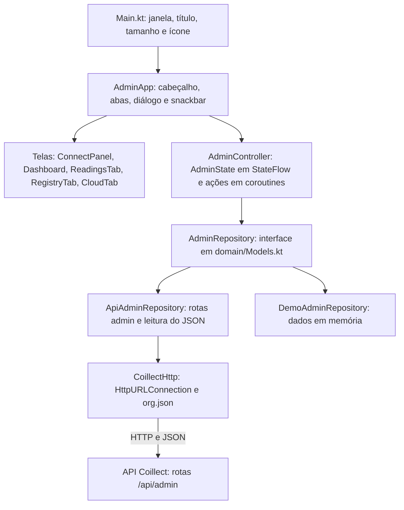
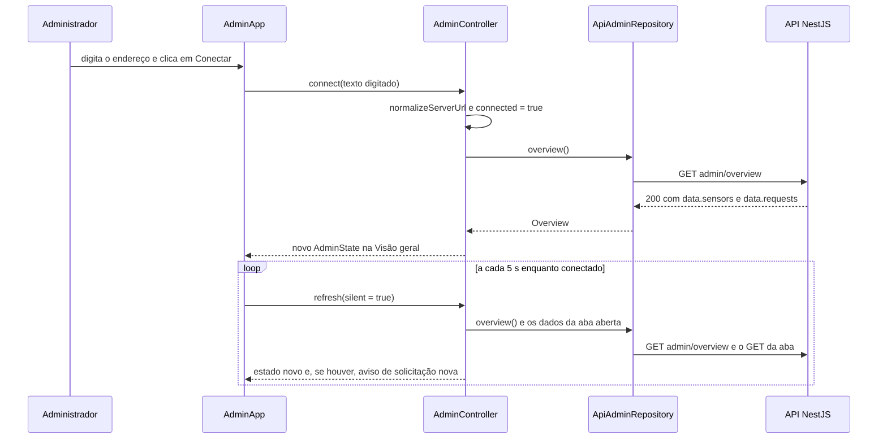
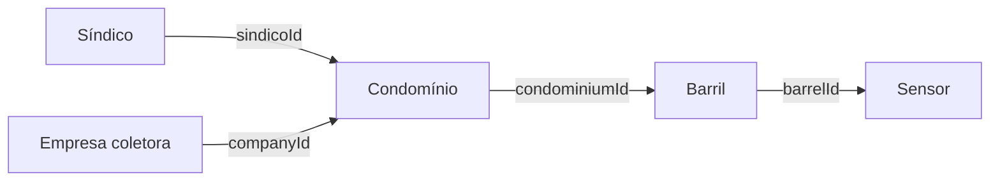
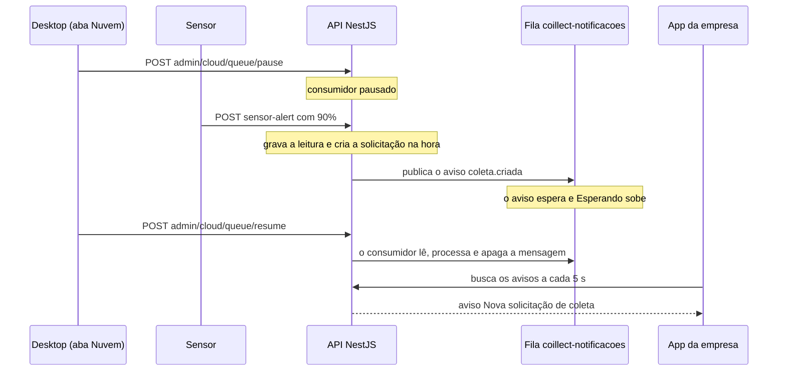

# App desktop do administrador

Parte da [documentação do Coillect](README.md).

Este documento cobre o repositório `interface-desktop-adm-coillect` (branch `main`, commit `4e321739`): o app desktop do administrador, em Kotlin com Compose Multiplatform Desktop (JVM), pacote `br.com.coillect.admin`. Explica para que o app serve, a arquitetura e o papel de cada arquivo, o estado e as ações do `AdminController`, cada aba, a comunicação com a API, o modo demonstração, o build e o CI, os testes, o que mudou em relação à base `CoillectMobileRemake` e as limitações. Tudo foi conferido no código. O que não foi verificado está na última seção.

## Sumário

- [Para que serve](#para-que-serve)
- [Arquitetura](#arquitetura)
- [Estado e ações do AdminController](#estado-e-ações-do-admincontroller)
- [Abas e telas](#abas-e-telas)
- [Comunicação com a API](#comunicação-com-a-api)
- [Modo demonstração](#modo-demonstração)
- [Build, execução e CI](#build-execução-e-ci)
- [Testes](#testes)
- [Mudanças em relação à base e histórico dos PRs](#mudanças-em-relação-à-base-e-histórico-dos-prs)
- [Limitações e o que não foi verificado](#limitações-e-o-que-não-foi-verificado)

## Para que serve

O app é a tela do administrador no MVP. Roda no PC (JVM) e conversa só com a API, pelas rotas `/api/admin/*`. Não fala com os celulares nem com o sensor: todos usam a mesma API (ver [Interações e fluxos](09-interacoes-e-fluxos.md)).

| O que o administrador faz | Onde no app | Rota da API |
|---|---|---|
| Acompanha sensores, níveis dos barris e solicitações de coleta | aba **Visão geral** | `GET admin/overview` |
| Vê cada leitura que chega dos sensores, ao vivo | aba **Leituras do sensor** | `GET admin/readings?limit=50` |
| Cadastra síndicos, empresas coletoras, condomínios, barris e sensores | aba **Cadastros** | `GET` e `POST` em `admin/sindicos`, `admin/companies`, `admin/condominiums`, `admin/barrels`; `POST admin/sensors` |
| Mostra a fila de notificações e os comprovantes do Azure Storage e pausa/retoma o consumidor da fila (Atividade A02) | aba **Nuvem (Azure)** | `GET admin/cloud`, `POST admin/cloud/queue/pause`, `POST admin/cloud/queue/resume` |
| Reinicia a demonstração | botão **Reiniciar demonstração** | `POST admin/demo/reset` |
| Mostra as telas sem API | botão **Modo demonstração** | nenhuma (dados em memória) |

### Por que não tem login

- A API não tem perfil de administrador. As rotas de [admin.controller.ts](../backend/src/admin/admin.controller.ts) e [cloud.controller.ts](../backend/src/cloud/cloud.controller.ts) não têm guard. O comentário do controller diz: "Sem login no MVP, como a interface desktop atual espera".
- Segurança está fora do escopo do MVP por decisão do autor ([LEIA-PRIMEIRO-CODEX.txt](../LEIA-PRIMEIRO-CODEX.txt): "sem login de admin, CORS aberto etc.").
- O `CoillectHttp.kt` do desktop é o mesmo cliente dos apps móveis e mantém a propriedade `token`. Nos apps ela recebe o token do login; no desktop nenhum código atribui valor a ela. Por isso o cabeçalho `Authorization` nunca é enviado.

## Arquitetura

O app tem quatro camadas: telas Compose → controlador de estado → interface de dados (`AdminRepository`) → implementação. Há duas implementações: HTTP (`ApiAdminRepository`) ou memória (`DemoAdminRepository`). As telas são as mesmas nos dois casos; só muda o repositório escolhido no painel de conexão.



- `Main.kt` abre a janela: título `cOillect • Administração`, tamanho inicial 1280 × 820 dp (`rememberWindowState`), ícone `icone.png` e conteúdo `CoillectTheme { AdminApp() }`. Fechar a janela encerra o app (`onCloseRequest = ::exitApplication`).
- `AdminApp` cria o `AdminController` com `rememberCoroutineScope()`. As coroutines rodam no contexto da interface. As chamadas HTTP trocam para `Dispatchers.IO` dentro de `CoillectHttp`.
- O estado fica num `MutableStateFlow<AdminState>`, exposto como `StateFlow` e observado com `collectAsState()`.
- Respostas atrasadas: cada coroutine guarda o repositório com que começou (`current`). Se o administrador trocou de fonte nesse meio-tempo (`repository !== current`), o resultado é descartado.

### Papel de cada arquivo

Caminhos relativos a `app/src/main/kotlin/br/com/coillect/admin/`, exceto onde indicado. A coluna "Origem" diz em que PR o arquivo foi criado ou alterado. "Base" é arquivo herdado do `CoillectMobileRemake`, sem alteração.

| Arquivo | Camada | Papel | Linhas | Origem |
|---|---|---|---|---|
| [`Main.kt`][d-main] | entrada | `fun main() = application { Window(...) }`: janela, título, tamanho, ícone e tema | 23 | #1 |
| [`ui/AdminApp.kt`][d-app] | interface | tela raiz: cria o controlador, liga a atualização automática (`AUTO_REFRESH_MS`), mostra snackbar, cabeçalho, abas, painel de conexão (`ConnectPanel`), Visão geral (`Dashboard`, `Kpi`, `SensorsCard`, `RequestsCard`, `StatusChip`) e o diálogo de reinício | 260 | #1, #2 |
| [`ui/AdminController.kt`][d-ctrl] | estado | `DEFAULT_API_URL`, `AdminTab`, `AdminState`, a classe `AdminController` e as funções `attempt`, `describe` e `apiMessage` (erros) | 267 | #1, #2, #3 |
| [`ui/ReadingsTab.kt`][d-read] | interface | aba Leituras do sensor | 55 | #2 |
| [`ui/RegistryTab.kt`][d-reg] | interface | aba Cadastros: 5 formulários (`SindicoForm`, `CompanyForm`, `CondominiumForm`, `BarrelForm`, `SensorForm`) e 4 listas | 198 | #2 |
| [`ui/CloudTab.kt`][d-cloud] | interface | aba Nuvem (Azure): fila (`QueueCard`), comprovantes (`BlobCard`), Pausar/Retomar | 121 | #2 |
| [`ui/Components.kt`][d-comp] | interface | paleta `CoillectColors`, `CoillectTheme`, `loadImage`, `BrandLogo`, `LevelBar`, `Cell`, `TabButton`, `Choice` | 148 | #1, #2 |
| [`domain/Models.kt`][d-models] | domínio | modelos de tela (`SensorRow`, `RequestRow`, `ReadingRow`, `Registry`, `CloudStatus` etc.) e a interface `AdminRepository` | 124 | #1, #2 |
| [`domain/ServerAddress.kt`][d-addr] | domínio | `normalizeServerUrl` (texto digitado → URL base), `DEFAULT_API_PORT = 3000` e `hostOf` (declarada, sem uso) | 41 | #3 |
| [`data/ApiAdminRepository.kt`][d-api] | dados | objeto `Routes` (11 rotas) e `ApiAdminRepository`: chama a API e converte o JSON (`toOverview`, `toSensor`, `toRequestRow`, `toReading`, `toPerson`, `toCondominium`, `toBarrel`, `toCloud`) | 199 | #1, #2 |
| [`data/CoillectHttp.kt`][d-http] | dados | cliente HTTP, `ApiException`, timeouts, leitura do envelope e formatação de datas | 90 | #1, #2 |
| [`data/DemoAdminRepository.kt`][d-demo] | dados | modo demonstração em memória | 155 | #1, #2 |
| `app/src/main/res/drawable/` [`icone.png`][d-icone] e [`logo.png`][d-logo] | recursos | ícone da janela e logo do cabeçalho | binários | base |
| `app/src/test/kotlin/br/com/coillect/admin/` (3 arquivos) | testes | ver [Testes](#testes) | 334 | #1, #2, #3 |
| [`build.gradle.kts`][d-build], [`app/build.gradle.kts`][d-app-build], [`settings.gradle.kts`][d-settings], [`gradle.properties`][d-props], [`gradle/libs.versions.toml`][d-libs], [`gradle/wrapper/gradle-wrapper.properties`][d-wrapper] | build | ver [Build, execução e CI](#build-execução-e-ci) | — | #1 |
| [`gradlew`][d-gradlew], [`gradlew.bat`][d-gradlew-bat], [`gradle/wrapper/gradle-wrapper.jar`][d-wrapper-jar] | build | Gradle Wrapper (scripts idênticos aos da base) | — | base |
| [`.github/workflows/desktop.yml`][d-ci], [`.github/scripts/report_errors.py`][d-report] | CI | build + testes a cada push; resumo dos erros | 24 e 42 | #1 |
| [`README.md`][d-readme] | docs | uso, abas, rotas, execução | 63 | base, #1, #2 |
| [`AGENTS.md`][d-agents] | docs | regras para agentes: escopo, contrato de API só em `ApiAdminRepository.kt`, uma branch por tarefa, merge com CI verde | 11 | #1, #2 |
| [`.gitignore`][d-gitignore] | repo | o da base mais `.idea/` | 18 | base, #1 |

## Estado e ações do AdminController

Arquivo: [`ui/AdminController.kt`][d-ctrl]. O construtor recebe o `CoroutineScope` e duas fábricas: `apiFactory: (String) -> AdminRepository` (padrão `ApiAdminRepository(it)`) e `demoFactory: () -> AdminRepository` (padrão `DemoAdminRepository()`). Os testes trocam a `apiFactory` por um repositório falso.

### Estado (AdminState)

| Campo | Tipo e padrão | Significado | Onde aparece |
|---|---|---|---|
| `server` | `String` = `DEFAULT_API_URL` (`http://localhost:3000/api/`) | URL base em uso, já normalizada depois de **Conectar** | subtítulo "Fonte: API …" e campo do painel de conexão |
| `connected` | `Boolean` = `false` | há uma fonte escolhida (API ou demonstração) | troca o painel de conexão pelas abas e liga a atualização automática |
| `demo` | `Boolean` = `false` | a fonte é o `DemoAdminRepository` | subtítulo e faixa da Visão geral |
| `busy` | `Boolean` = `false` | atualização não silenciosa (ao conectar ou com **Atualizar**) ou reinício em andamento | barra de progresso; desabilita **Atualizar** e **Reiniciar demonstração** |
| `tab` | `AdminTab` = `OVERVIEW` | aba aberta | botões de aba |
| `overview` | `Overview?` = `null` | sensores e solicitações | Visão geral; limites usados na aba Leituras |
| `error` | `String?` = `null` | erro da última consulta a `admin/overview` | faixa de erro (`errorContainer`) da Visão geral |
| `readings` | `List<ReadingRow>` = vazia | leituras recebidas | aba Leituras do sensor |
| `registry` | `Registry?` = `null` | síndicos, empresas, condomínios e barris | aba Cadastros (listas e seletores) |
| `cloud` | `CloudStatus?` = `null` | estado do Azure Storage | aba Nuvem (Azure) |
| `tabError` | `String?` = `null` | erro ao carregar a aba atual (Leituras, Cadastros ou Nuvem) | faixa de erro acima da aba; não aparece na Visão geral |
| `saving` | `Boolean` = `false` | um cadastro em andamento | desabilita os 5 botões "Cadastrar …" |
| `lastSync` | `String?` = `null` | hora (`HH:mm:ss`) da última Visão geral recebida | rodapé "Atualizado às …" |
| `message` | `String?` = `null` | aviso de uma linha | snackbar; apagado com `clearMessage()` depois de exibido |

### Abas (AdminTab)

| Valor | Título | O que é carregado ao abrir (`loadTab`) |
|---|---|---|
| `OVERVIEW` | Visão geral | nada a mais; os dados vêm de `refresh()` |
| `READINGS` | Leituras do sensor | `readings(50)` |
| `REGISTRY` | Cadastros | `registry()` |
| `CLOUD` | Nuvem (Azure) | `cloud()` |

### Funções públicas

| Função | O que faz | Chamada ao repositório (rota) | Tratamento de erro |
|---|---|---|---|
| `connect(server)` | normaliza o texto com `normalizeServerUrl`. Vazio: mensagem "Informe o endereço da API." e não conecta. Senão cria o repositório da API e inicia (`start`) | `refresh()` inicial: `overview()` (`GET admin/overview`) | erro vai para `error` (Visão geral) |
| `enterDemo()` | inicia com `DemoAdminRepository` e `demo = true`; mantém o `server` do estado (texto digitado sem clicar em **Conectar** não é guardado) | `overview()` em memória | — |
| `disconnect()` | esquece o repositório e os ids conhecidos e volta ao estado inicial, guardando só `server` (botão **Trocar fonte de dados**) | — | — |
| `selectTab(tab)` | muda a aba, limpa `tabError` e carrega a aba | ver tabela de abas | erro vai para `tabError` |
| `refresh(silent = false)` | busca a Visão geral, detecta solicitações novas e recarrega a aba aberta. `silent = true` é a atualização automática: não liga `busy` e não recarrega Cadastros | `overview()` e a aba aberta | `error` (Visão geral) e `tabError` (aba) |
| `createSindico(name, email, password?)` | aplica `trim` nos textos | `POST admin/sindicos` | mensagem de `describe` |
| `createCompany(name, email, cnpj, password?)` | aplica `trim`; o CNPJ vai só com os dígitos | `POST admin/companies` | idem |
| `createCondominium(name, address?, neighborhood?, sindicoId?, companyId?)` | aplica `trim` | `POST admin/condominiums` | idem |
| `createBarrel(code, condominiumId?, capacityLiters?, alertThreshold?)` | aplica `trim` no código | `POST admin/barrels` | idem |
| `createSensor(sensorId, barrelId?)` | aplica `trim` | `POST admin/sensors` | idem |
| `resetDemo()` | liga `busy`, chama o reinício, zera os ids conhecidos, mostra a mensagem e faz uma atualização silenciosa | `POST admin/demo/reset` | mensagem de `describe` |
| `setQueuePaused(paused)` | pausa ou retoma o consumidor da fila, mostra a mensagem e recarrega a aba Nuvem | `POST admin/cloud/queue/pause` ou `POST admin/cloud/queue/resume` | mensagem de `describe` |
| `clearMessage()` | apaga `message` | — | — |

Os cinco `create…` passam pela função privada `save(what, action)`:

1. Não faz nada se não há fonte ou se já há um cadastro em andamento (`saving`).
2. Liga `saving`, chama o repositório e desliga `saving`.
3. Sucesso: mensagem "`<what>` cadastrado: `<nome>`.", com `<what>` = "Síndico", "Empresa coletora", "Condomínio", "Barril" ou "Sensor". Depois recarrega a aba Cadastros (`registry()`).
4. Falha: mensagem de `describe(error)`.

Funções privadas: `save`, `loadTab` (carrega a aba e grava `tabError`) e `start` (troca o repositório, zera os ids conhecidos, define `connected = true` e chama `refresh()`).

### Ciclo de atualização

`refresh(silent)` faz, nesta ordem:

1. Sai se não há fonte ou se outra atualização ainda está em andamento (flag `refreshing`). Assim as atualizações não se acumulam quando a API demora.
2. Se não é silenciosa, liga `busy`.
3. Chama `overview()`.
4. Compara os ids das solicitações com os já conhecidos (`knownIds`) e grava a Visão geral, `error = null` e `lastSync`.
5. Recarrega a aba aberta, exceto Cadastros na atualização automática ("Cadastros só mudam quando o admin salva").
6. Em erro, grava `describe(error)` em `error` e mantém a Visão geral anterior na tela.
7. No fim, desliga `refreshing` e `busy`.



### Conexão com o servidor

- O painel de conexão tem o campo **Servidor da API** (preenchido com `server`) e os botões **Conectar** e **Modo demonstração**.
- `connect()` passa o texto por `normalizeServerUrl` (regras em [Endereço do servidor](#endereço-do-servidor-serveraddresskt)). Assim, `localhost:3000`, o IP do PC ou o domínio da nuvem sem `/api` viram uma URL completa.
- Não há teste prévio da conexão nem botão "Testar conexão" (os apps móveis têm). `start()` já define `connected = true` e a tela troca para as abas. A primeira consulta (`GET admin/overview`) mostra "Consultando…". Se a consulta falhar, a Visão geral mostra o erro e "Sem dados para exibir.".
- Para corrigir o endereço, use **Trocar fonte de dados** (`disconnect()`): o painel volta com o último endereço normalizado.

### Atualização automática

Em `AdminApp.kt`, `LaunchedEffect(state.connected)` roda um laço enquanto há conexão: espera `AUTO_REFRESH_MS = 5_000L` (5 s) e chama `refresh(silent = true)`. O laço para quando `connected` muda (desconexão).

| Aba aberta | Chamadas a cada 5 s |
|---|---|
| Visão geral | `GET admin/overview` |
| Leituras do sensor | `GET admin/overview` e `GET admin/readings?limit=50` |
| Cadastros | `GET admin/overview` (as listas só recarregam ao abrir a aba, depois de salvar ou com **Atualizar**) |
| Nuvem (Azure) | `GET admin/overview` e `GET admin/cloud` |

O botão **Atualizar** chama `refresh()` não silencioso: mostra a barra de progresso e recarrega a aba aberta, qualquer que seja. Na aba Cadastros isso são 4 GETs: síndicos, empresas, condomínios e barris.

### Aviso de nova solicitação

- `knownIds` guarda os ids das solicitações já vistas. Começa `null` ao conectar, ao entrar na demonstração e depois de reiniciar a demonstração.
- Com `knownIds` nulo, a atualização só registra os ids e não avisa. Por isso solicitações que já existiam ao conectar não geram aviso.
- Nas atualizações seguintes, toda solicitação `PENDING` com id novo gera a mensagem "Nova solicitação de coleta: #`<id>` `<condomínio>`." (várias ficam separadas por vírgula).

### Reiniciar a demonstração

- O botão abre o diálogo "Reiniciar a demonstração?" com o texto: "Apaga as solicitações, notificações e leituras e volta os barris ao nível inicial. Os cadastros (síndicos, empresas, condomínios, barris e sensores) continuam. Os comprovantes já gravados no Blob Storage também continuam." Botões **Reiniciar** e **Cancelar**.
- **Reiniciar** chama `resetDemo()` → `POST admin/demo/reset`. Sucesso: "Demonstração reiniciada: sem solicitações, barris no nível inicial.". Depois o controlador faz uma atualização silenciosa.
- Na API, [admin.service.ts](../backend/src/admin/admin.service.ts) chama `DemoSeedService.resetDemoData()` ([demo-seed.service.ts](../backend/src/demo/demo-seed.service.ts)). O método apaga notificações, solicitações e leituras e põe todos os sensores em 0%. Depois volta os sensores de demonstração ao nível de [demo-data.ts](../backend/src/demo/demo-data.ts): `CLT-8472-A` 0%, `CLT-1264-B` 62%, `CLT-9801-C` 31%. A fila e o Blob não são tocados. A resposta traz a Visão geral, que o desktop ignora. Detalhes em [API e backend](02-api-backend.md) e [Dados de demonstração](14-dados-de-demonstracao-e-glossario.md).

### Tratamento de erros

Toda chamada passa por `attempt { … }`, que devolve `Result` e relança `CancellationException`. O texto mostrado vem de `describe(error)`:

| Erro | Texto mostrado |
|---|---|
| `ApiException` com HTTP 404 | "Endpoint não encontrado na API (confira o endereço e a versão da API)." |
| `ApiException` com HTTP 400 ou 409 | "A API recusou: " + mensagem extraída do corpo por `apiMessage` |
| `ApiException` com HTTP 401 | "A API recusou o acesso (401)." |
| outra `ApiException` | "A API respondeu com erro `<código>`." |
| `IOException` (sem rede, host desconhecido, tempo esgotado, URL inválida) | "Sem conexão com a API. Confira o endereço do servidor." |
| `JSONException` (resposta que não é o JSON esperado) | "Resposta inesperada da API." |
| `IllegalStateException` | a mensagem da exceção, ou "Não foi possível concluir." |
| qualquer outro | "Não foi possível atualizar. Tente novamente." |

`apiMessage(body)` lê o corpo de erro padrão do NestJS. Com `{ "message": "texto" }`, devolve o texto. Com `{ "message": ["a", "b"] }` (validação), devolve "a; b". Sem `message` ou com JSON inválido, devolve "dados inválidos.".

Mensagens do snackbar:

| Situação | Texto |
|---|---|
| Conectar com o campo vazio | "Informe o endereço da API." |
| Solicitação nova | "Nova solicitação de coleta: #`<id>` `<condomínio>`." |
| Cadastro salvo | "`<Síndico, Empresa coletora, Condomínio, Barril ou Sensor>` cadastrado: `<nome>`." |
| Reinício | "Demonstração reiniciada: sem solicitações, barris no nível inicial." |
| Pausa | "Consumidor da fila pausado: os avisos vão esperar na fila do Azure." |
| Retomada | "Consumidor da fila retomado: os avisos que estavam na fila serão entregues." |

## Abas e telas

### Janela e cabeçalho

| Elemento | Comportamento |
|---|---|
| Janela | título "cOillect • Administração", 1280 × 820 dp, ícone `icone.png`, fundo `CoillectColors.Background` |
| Cabeçalho | logo (`BrandLogo`, 56 dp), título "cOillect • Administração" e subtítulo: "Desconectado", "Fonte: demonstração local (dados simulados)" ou "Fonte: API `<server>`" |
| Botões (só com conexão) | **Atualizar** e **Reiniciar demonstração** (desabilitados com `busy`); **Trocar fonte de dados** |
| Barra de progresso | `LinearProgressIndicator` em toda a largura enquanto `busy` |
| Abas | um `TabButton` por `AdminTab` |
| Erro da aba | faixa `errorContainer` com `tabError`, acima do conteúdo (exceto na Visão geral) |
| Mensagens | `SnackbarHost`; cada `message` é exibida e depois apagada |

Painel de conexão (`ConnectPanel`, cartão de até 680 dp de largura):

- Título "Conectar à API Coillect".
- Texto "Informe o endereço do backend. Com o docker-compose do CoillectApp na mesma máquina: http://localhost:3000/api/".
- Campo **Servidor da API** e botões **Conectar** e **Modo demonstração**.

### Visão geral

Dados de `GET admin/overview`. No modo demonstração aparece no topo a faixa "Demonstração • dados simulados nesta máquina; nada é lido nem enviado à API.". Sem dados, a tela mostra "Consultando…"; com erro, "Sem dados para exibir.".

Indicadores (calculados no desktop a partir das listas; o objeto `counts` da API não é usado):

| Indicador | Cálculo |
|---|---|
| Sensores | quantidade de sensores |
| No limite de coleta | sensores com `level >= threshold` |
| Solicitações novas | solicitações com status `PENDING` |
| Coletas em andamento | solicitações com status `SCHEDULED` |

A API devolve só as 50 solicitações mais recentes (`findRecent(50)`). Os dois últimos indicadores contam dentro dessas 50.

Tabela "Sensores / barris" (sensores em ordem de código, como a API devolve):

| Coluna | Conteúdo |
|---|---|
| Sensor | `sensorId` |
| Condomínio | `condominiumName` ("—" se o sensor não está num barril com condomínio) |
| Nível | `LevelBar` + "`N`%"; a barra fica laranja quando o nível atinge o limite do barril |
| Última leitura | `lastReadingAt` em `dd/MM/yyyy HH:mm`, no fuso do PC; "—" se nunca leu |

Vazia: "Nenhum sensor cadastrado.".

Tabela "Solicitações de coleta" (mais recentes primeiro). Subtítulo: "A empresa recebe a solicitação; o síndico vê a mesma solicitação como cópia informativa.".

| Coluna | Conteúdo |
|---|---|
| Protocolo | "#" + `id` |
| Condomínio | `condominiumName`; se nulo, `sensor.condominiumName`; se nulo, `user.name`; se nulo, "Condomínio" |
| Empresa | `company.name` ou "—" |
| Síndico | `user.name` ou "—" |
| Situação | `StatusChip` com o rótulo do status |
| Solicitada em | `requestedAt` em `dd/MM/yyyy HH:mm` |
| Previsão | `scheduledDate` (data em que a empresa agendou ou iniciou a coleta) ou "—" |

Vazia: "Nenhuma solicitação registrada.".

| Status da API | Rótulo | Cor do chip |
|---|---|---|
| `PENDING` | Nova | fundo laranja claro `#FFF6EC`, texto `#6B3D10` |
| `SCHEDULED` | Em andamento | fundo verde claro `#E6EDD8`, texto `#1E2420` |
| `COMPLETED` | Concluída | fundo `#F0F2EC`, texto `#6D736B` |
| `CANCELLED` | Cancelada | idem |
| `REFUSED` | Recusada | idem |
| outro valor | Não informada | idem |

Rodapé: "Atualizado às `HH:mm:ss` • atualização automática a cada 5 s".

### Leituras do sensor

Dados de `GET admin/readings?limit=50` ([`ReadingsTab.kt`][d-read]). Cada linha é um `POST /api/sensor-alert` recebido pela API. A origem pode ser o ESP32, o Wokwi, o sensor virtual ou o botão "Simular leitura" do app do síndico (ver [Sensor ESP32 e simulador](04-sensor-esp32-e-simulador.md)). Título: "Leituras recebidas dos sensores"; subtítulo: "As 50 mais recentes, atualizadas a cada 5 s. Cada linha é um POST /api/sensor-alert.". A API ordena da mais recente para a mais antiga.

| Coluna | Campo da API | Formato | Significado |
|---|---|---|---|
| Sensor | `sensorId` | texto | sensor que enviou |
| Nível | `level` | barra + "`N`%" (0 a 100) | nível enviado. A barra fica laranja quando o nível ≥ limite do barril desse sensor, tirado da Visão geral; verde abaixo |
| Hora no sensor | `dataHora` | `dd/MM HH:mm:ss` no fuso do PC | hora da medição no dispositivo. "—" quando o sensor não mandou `dataHora` (ex.: ESP32 ainda sem NTP). Se `Instant.parse` não reconhecer o texto, ele aparece como veio |
| Recebida pela API | `receivedAt` | `dd/MM HH:mm:ss` no fuso do PC | hora oficial de recebimento |

Sem leituras: "Nenhuma leitura recebida ainda. Ligue o sensor (Wokwi, ESP32 ou sensor virtual).".

A tela não mostra o resultado do disparo de cada leitura. O endpoint `GET admin/readings` devolve só `id`, `sensorId`, `level`, `dataHora` e `receivedAt` ([admin.service.ts](../backend/src/admin/admin.service.ts), `listReadings`). O resultado existe na resposta do `POST /api/sensor-alert` ao sensor (`data.collection.triggered` e `data.collection.reason`) e no log `leitura_sensor` ([sensor-alert.service.ts](../backend/src/sensor/sensor-alert.service.ts)). No desktop, o resultado se percebe assim:

| Resultado na API (`reason`) | Quando acontece | O que o desktop mostra |
|---|---|---|
| `THRESHOLD_REACHED` (`triggered: true`) | nível ≥ limite, sensor num barril, sem solicitação aberta, sem espera de leitura vazia, condomínio com empresa | barra laranja; na atualização seguinte, solicitação "Nova" na Visão geral e o aviso "Nova solicitação de coleta" |
| `BELOW_THRESHOLD` | nível abaixo do limite | barra verde; nada mais muda |
| `REQUEST_ALREADY_OPEN` | o barril já tem solicitação `PENDING` ou `SCHEDULED` | barra laranja; nenhuma solicitação nova |
| `AWAITING_EMPTY_READING` | houve coleta concluída e o sensor ainda não leu o barril abaixo do limite | barra laranja; nenhuma solicitação nova |
| `NO_COMPANY_LINKED` | o condomínio do barril não tem empresa coletora | barra laranja; nenhuma solicitação nova |
| `SENSOR_NOT_INSTALLED` | o sensor não está em nenhum barril (limite padrão 80%) | barra laranja a partir de 80%; Condomínio "—" na Visão geral; nenhuma solicitação |

As regras completas estão em [API e backend](02-api-backend.md).

### Cadastros

[`RegistryTab.kt`][d-reg]. Duas colunas com rolagem: à esquerda os 5 formulários; à direita as 4 listas. A ordem segue `docs/api-apps.md`:



Formulários (o botão de cada um também fica desabilitado enquanto `saving`):

| Formulário (dica exibida) | Campos | Botão habilitado quando | Corpo do POST |
|---|---|---|---|
| **1. Síndico** ("Entra no app do síndico com este e-mail. Sem senha: usa a senha de demonstração.") | Nome; E-mail; Senha (opcional, mín. 6) | nome preenchido e e-mail com `@` | `name`, `email` e `password` (só se preenchida) → `POST admin/sindicos` |
| **2. Empresa coletora** ("Entra no app da empresa com este e-mail. CNPJ com 14 dígitos.") | Nome; E-mail; CNPJ (o rótulo conta os dígitos, ex.: "CNPJ (11/14)"); Senha (opcional, mín. 6) | nome preenchido, e-mail com `@` e CNPJ com 14 dígitos | `name`, `email`, `cnpj` (só dígitos) e `password` (opcional) → `POST admin/companies` |
| **3. Condomínio** ("Liga o síndico (só é notificado) e a empresa coletora (recebe as solicitações).") | Nome; Endereço; Bairro; seletor Síndico; seletor Empresa coletora | nome preenchido | `name`, `address` e `neighborhood` (se preenchidos), `sindicoId` e `companyId` (se escolhidos) → `POST admin/condominiums` |
| **4. Barril** ("O reservatório de óleo do condomínio. O limite (%) dispara a solicitação de coleta.") | Código (ex.: BRL-8472); seletor Condomínio; Capacidade (litros), padrão "200"; Limite de alerta (%), padrão "80" | código preenchido e limite entre 1 e 100 (ou não numérico) | `code`, `condominiumId` (se escolhido), `capacityLiters` e `alertThreshold` (só se forem números inteiros) → `POST admin/barrels` |
| **5. Sensor** ("O ID é o COILLECT_SENSOR_ID do firmware do ESP32 (ou do sensor virtual). Um barril tem um sensor.") | ID do sensor (ex.: CLT-8472-A); seletor Barril (mostra "código • condomínio") | ID preenchido | `sensorId` e `barrelId` (se escolhido) → `POST admin/sensors` |

- Os seletores (`Choice`) têm a opção "— nenhum —" e usam as listas da aba. Depois de um cadastro salvo, as listas recarregam e o item novo já aparece nos seletores.
- Sem senha, a API usa a senha de demonstração (`DEMO_PASSWORD`; padrão `Coillect@2025`).
- Barril com limite não numérico: o campo não é enviado e a API usa 80%. Capacidade não numérica: não é enviada e fica vazia ("Capacidade: —").
- O formulário de sensor não usa o atalho da API que cria o barril `BRL-<sensorId>` a partir de `condominiumId`.
- Os campos não são limpos depois de salvar.

Validações da API ([people.dto.ts](../backend/src/admin/dto/people.dto.ts), [condominium.dto.ts](../backend/src/admin/dto/condominium.dto.ts), [sensor-admin.dto.ts](../backend/src/admin/dto/sensor-admin.dto.ts)). A API usa `ValidationPipe` com `whitelist`, `forbidNonWhitelisted` e `transform` ([app.setup.ts](../backend/src/app.setup.ts)):

| Rota | HTTP 400 (validação) | HTTP 409 (conflito) |
|---|---|---|
| `POST admin/sindicos` | `name` vazio ou com mais de 100; `email` inválido ou com mais de 120; `password` com menos de 6 ou mais de 60 | "Já existe um usuário com o e-mail `<email>`" |
| `POST admin/companies` | `name`, `email` e `password` como acima; `cnpj` fora de `^\d{14}$` ("cnpj deve ter 14 dígitos (somente números)") | "Já existe uma empresa com o CNPJ `<cnpj>`" ou "Já existe uma empresa com o e-mail `<email>`" |
| `POST admin/condominiums` | `name` vazio ou com mais de 120; `address` com mais de 200; `neighborhood` com mais de 80 | nenhum (o nome do condomínio não é único) |
| `POST admin/barrels` | `code` vazio, com mais de 60 ou com caracteres fora de letras, números, `.`, `-`, `_` ("code deve conter apenas letras, números, ponto, hífen ou sublinhado"); `capacityLiters` < 1; `alertThreshold` fora de 1–100 | `Barril "<código>" já cadastrado` |
| `POST admin/sensors` | `sensorId` vazio, com mais de 60 ou com caracteres inválidos ("sensorId deve conter apenas letras, números, ponto, hífen ou sublinhado") | `Sensor "<id>" já cadastrado`; `O barril <código> já tem o sensor <outro> instalado` |

- Os erros 400 e 409 aparecem em texto claro no snackbar: "A API recusou: `<mensagem>`". Várias mensagens de validação aparecem separadas por "; ".
- As mensagens padrão do class-validator vêm em inglês. Exemplo do teste: "A API recusou: email must be an email". O desktop aceita `y@z` (tem `@`), mas a API recusa.
- As mensagens próprias (CNPJ, códigos e conflitos) vêm em português.
- Um id inexistente devolve 404 ("Síndico N não encontrado", "Barril N não encontrado" etc.). O desktop mostra esse 404 como "Endpoint não encontrado na API…". Isso só acontece se a lista estiver desatualizada.

Listas (coluna da direita):

| Lista (título com a quantidade) | Rota | Cada item |
|---|---|---|
| Condomínios (`N`) | `GET admin/condominiums` | "`<nome>` • `<bairro>`"; "Síndico: `<nome ou —>` • Empresa: `<nome ou —>`"; "Barris: `<códigos ou —>` • Sensores: `<IDs ou —>`" |
| Barris (`N`) | `GET admin/barrels` | "`<código>` • `<condomínio>`" (ou "• sem condomínio"); "Capacidade: `<N>` L • Limite: `<N>`%"; "Sensor: `<IDs>`" (ou "nenhum instalado") |
| Síndicos (`N`) | `GET admin/sindicos` | nome; e-mail |
| Empresas coletoras (`N`) | `GET admin/companies` | nome; "e-mail • CNPJ `<cnpj>`" |

Não há lista própria de sensores: eles aparecem dentro de Condomínios e Barris (e na Visão geral). Com os dados de demonstração da API (criados por padrão, `SEED_DEMO`), `Residencial Aurora`, `BRL-8472` e `CLT-8472-A` já existem e aparecem nas listas. Cadastrar de novo o mesmo código de barril ou de sensor devolve 409. Cadastrar de novo o condomínio cria um segundo com o mesmo nome.

### Nuvem (Azure)

[`CloudTab.kt`][d-cloud]. Dados de `GET admin/cloud` ([cloud.controller.ts](../backend/src/cloud/cloud.controller.ts)), recarregados a cada 5 s com a aba aberta. Sem dados: "Consultando o armazenamento…" ou, com erro, "Sem dados do armazenamento.". Contexto da Atividade A02 em [Azure Storage e nuvem](08-azure-storage-e-nuvem.md).

Faixa do topo:

| `mode` | Faixa |
|---|---|
| `azure` | verde claro: "Azure Storage conectado • conta `<conta>`" |
| `local` | laranja claro: "Modo local: a API está sem AZURE_STORAGE_CONNECTION_STRING (comprovantes em disco, fila em memória)." |

Com o `docker compose` padrão do CoillectApp, a API usa o Azurite (`UseDevelopmentStorage=true`, [docker-compose.yaml](../docker-compose.yaml)). A aba então mostra "Azure Storage conectado • conta devstoreaccount1" e provedores com "(emulador Azurite)".

Cartão "Fila de notificações (Queue Storage)". Subtítulo: "`<provedor>` • `<nome da fila>`" (padrão `coillect-notificacoes`). As métricas vêm de `MessageQueueService.status()` ([message-queue.service.ts](../backend/src/cloud/message-queue.service.ts)). Os contadores ficam em memória e contam desde que a API subiu:

| Métrica | Campo | Significado |
|---|---|---|
| Esperando | `queue.waiting` | mensagens pendentes na fila do Azure (contagem aproximada); 0 no modo local; "—" se a API não conseguiu consultar |
| Publicadas | `queue.published` | avisos publicados pela API |
| Processadas | `queue.processed` | avisos processados com sucesso pelo consumidor |
| Falhas | `queue.failed` | tentativas de processamento que deram erro (no Azure a mensagem volta e é tentada de novo) |
| Poison | `queue.poisoned` | mensagens movidas para a poison queue |

Textos condicionais:

| Condição | Texto |
|---|---|
| há `poisonQueue` (só no Azure) | "Mensagens que falharam 5 vezes vão para: `<fila>-poison`" |
| `fallbacks > 0` | "Fila indisponível `N` vez(es): avisos processados localmente." (laranja) |
| `lastError` | "Último erro: `<erro>`" (vermelho) |

O número 5 é fixo no texto do desktop. Na API o limite é `QUEUE_MAX_DEQUEUE`, padrão 5 ([cloud.config.ts](../backend/src/cloud/cloud.config.ts)).

Botões:

| Estado | Botão | Texto ao lado |
|---|---|---|
| consumidor ativo, `mode = azure` | **Pausar consumidor** | "Para a aula: pause, envie uma leitura de 90% e veja a mensagem na fila." |
| consumidor pausado | **Retomar consumidor** | "Consumidor pausado: os avisos estão esperando na fila." (laranja) |
| `mode = local` | **Pausar consumidor** desabilitado | "Disponível só com o Azure Storage." |

Cartão "Comprovantes (Blob Storage)":

- Subtítulo "`<provedor>` • container `<container>`" (padrão `comprovantes-coleta`).
- Métrica "Comprovantes gravados" (`blob.count`, total de blobs do container).
- "Erro: …" quando há `blob.error`.
- Os até 10 comprovantes mais recentes que a API devolve (`status(10)`), com nome em fonte monoespaçada e tamanho em bytes (ex.: `2026/11/10/coleta-12-20261110T061500Z.json`, `812 B`).
- Sem comprovantes: "Nenhum comprovante ainda: conclua uma coleta no app da empresa.".
- Rodapé: "No portal da Azure: Storage account → Navegador de armazenamento → Filas / Contêineres de blobs.".

Para que serve o Pausar/Retomar na A02: mostrar o desacoplamento. A solicitação de coleta é gravada na hora em que a leitura chega. A fila só leva os avisos (empresa, síndico) e a geração do comprovante quando a coleta é concluída. Com o consumidor pausado, o desktop já mostra a solicitação nova (lida do banco), mas o aviso fica esperando na fila. Ao retomar, a API lê a fila e entrega os avisos.



Roteiro (ver [LEIA-PRIMEIRO-CODEX.txt](../LEIA-PRIMEIRO-CODEX.txt), seção 7.2, passo 9, e [docs/azure-a02.md](../docs/azure-a02.md)):

1. Aba **Nuvem (Azure)** → **Pausar consumidor**. Aparece a mensagem de pausa e o botão vira **Retomar consumidor**.
2. Envie uma leitura de 90% (o roteiro usa o sensor `CLT-1264-B`). A Visão geral mostra a solicitação "Nova" e o aviso "Nova solicitação de coleta". O app da empresa não recebe o aviso.
3. Na aba Nuvem, "Esperando" e "Publicadas" sobem; "Processadas" não. No portal, a mensagem aparece em Filas → `coillect-notificacoes`.
4. **Retomar consumidor**. A API volta a ler a fila; nas atualizações seguintes, "Esperando" volta a 0 e "Processadas" sobe. O app da empresa mostra o aviso.

A pausa é um estado em memória da API (`MessageQueueService.paused`). Se a API reiniciar, o consumidor volta ativo. No modo local, a API responde 409 a pause/resume ("Pausar a fila só faz sentido com o Azure Storage (no modo local a fila é em memória)."), mas o botão já fica desabilitado.

### Componentes reutilizáveis e cores

Componentes públicos de [`ui/Components.kt`][d-comp]:

| Componente | O que faz | Usado em |
|---|---|---|
| `CoillectColors` | objeto com as 9 cores da paleta (tabela abaixo) | `AdminApp`, `CloudTab`, `LevelBar`, tema |
| `CoillectTheme { }` | aplica `MaterialTheme` com o esquema claro `Colors` | `Main.kt` |
| `loadImage(name)` | lê a imagem do classpath (`ClassLoader.getResourceAsStream`), decodifica com Skia (`Image.makeFromEncoded`) e devolve `ImageBitmap`; `null` se o arquivo não existir | `Main.kt` (`icone.png`), `BrandLogo` (`logo.png`) |
| `BrandLogo(modifier)` | mostra `logo.png`; sem o arquivo, mostra o texto "cOillect" na cor primária | cabeçalho (56 dp) |
| `LevelBar(level, threshold)` | barra de 12 dp com cantos arredondados; preenchimento proporcional ao nível (limitado a 0–100); laranja quando nível ≥ limite, verde abaixo; descrição de acessibilidade "Nível `N`%" | Visão geral e Leituras |
| `RowScope.Cell(text, weight, bold)` | célula de tabela com peso de coluna, até 2 linhas com reticências; `bold` usa SemiBold (cabeçalhos) | tabelas da Visão geral e das Leituras |
| `TabButton(text, selected, onClick)` | botão de aba: `Button` quando selecionada, `OutlinedButton` quando não. Não usa as abas do Material 3, "que mudam entre versões" (comentário no código) | barra de abas |
| `Choice(label, options, selected, display, onSelect, allowNone = true)` | seletor genérico: botão com o item escolhido e menu suspenso, com a opção "— nenhum —" | formulários de Condomínio, Barril e Sensor |

Componentes privados de cada tela: `ConnectPanel`, `Dashboard`, `Kpi`, `SensorsCard`, `RequestsCard`, `StatusChip` (`AdminApp.kt`); `FormCard`, `Field`, `ListCard`, `Entry` e os 5 formulários (`RegistryTab.kt`); `CloudContent`, `QueueCard`, `BlobCard`, `Metric` (`CloudTab.kt`).

Paleta (`CoillectColors`, "cores dos mockups do Coillect"):

| Nome | Hex | Uso |
|---|---|---|
| `Green` | `#8FAE45` | `primary`; barra de nível abaixo do limite; números dos indicadores e métricas |
| `GreenSoft` | `#E6EDD8` | `primaryContainer` e `secondaryContainer`; faixa "Azure Storage conectado"; chip "Em andamento"; faixa da demonstração |
| `Orange` | `#D9883A` | `tertiary`; barra de nível no limite; textos de alerta da aba Nuvem |
| `OrangeSoft` | `#FFF6EC` | `tertiaryContainer`; faixa "Modo local"; chip "Nova" |
| `Ink` | `#1E2420` | `onPrimaryContainer`, `onSecondaryContainer`, `onBackground`, `onSurface` |
| `Muted` | `#6D736B` | `onSurfaceVariant` (textos secundários) |
| `Background` | `#F3F4EF` | `background` e fundo da janela |
| `Card` | `#FFFFFF` | `surface` (cartões) |
| `Divider` | `#E7E9E2` | declarada; não é usada no código |

Outras cores do esquema: `secondary` `#6E8A2E`; `onTertiaryContainer` `#6B3D10`; `surfaceVariant` `#F0F2EC`; `error` `#B3261E`; `onPrimary`, `onSecondary` e `onTertiary` brancos.

## Comunicação com a API

### Cliente HTTP (CoillectHttp.kt)

[`data/CoillectHttp.kt`][d-http] é o mesmo cliente dos apps móveis: só mudam o pacote e um comentário, e o desktop acrescenta `displayTime`.

| Aspecto | Comportamento |
|---|---|
| URL | `baseUrl` sem espaços nas pontas, sem `/` final, mais `/`; o caminho é concatenado sem `/` inicial (ex.: `http://localhost:3000/api/` + `admin/overview`) |
| Biblioteca | `java.net.HttpURLConnection` e `org.json` |
| Thread | `withContext(Dispatchers.IO)` |
| Timeouts | `CONNECT_TIMEOUT_MS = 15_000` (conexão) e `READ_TIMEOUT_MS = 60_000` (resposta). O comentário explica: na nuvem a API pode estar "acordando" (Render gratuito, App Service sem Always On) |
| Cabeçalhos | `Accept: application/json` sempre; `Content-Type: application/json; charset=utf-8` quando há corpo; `Authorization` só se `token` tiver valor (nunca, no desktop) |
| Métodos | `get(path)` e `post(path, body = JSONObject())`. POST sem corpo explícito envia `{}` |
| Sucesso | status 200–299: devolve o texto da resposta (UTF-8) |
| Erro | outro status: lê o `errorStream` e lança `ApiException(status, body)`, subclasse de `IOException` com mensagem "HTTP `<status>`" |
| Conexão | `disconnect()` sempre, no `finally` |

Funções auxiliares do mesmo arquivo:

| Função | O que faz |
|---|---|
| `dataOf(text)` | lê o envelope `APIResponse` da API (`error`, `data`, `statusCode`, `timestamp`, `requester`, `message`) e devolve só `data` (ou `null`) |
| `JSONObject.text(name)` | texto do campo; `null` se ausente, nulo ou em branco |
| `JSONObject.intOrNull(name)` | inteiro do campo ou `null` |
| `JSONArray.objects()` | lista dos objetos do array (ignora o que não é objeto) |
| `displayDate(iso)` | ISO-8601 → `dd/MM/yyyy HH:mm` no fuso do PC; se não reconhecer, devolve o texto original |
| `displayTime(iso)` | ISO-8601 → `dd/MM HH:mm:ss` no fuso do PC (feed de leituras) |

Respostas de erro da API seguem o formato padrão do NestJS (`statusCode`, `message`, `error`), sem o envelope `APIResponse`. É desse corpo que `apiMessage` tira o texto.

### Rotas usadas

O contrato fica só em [`data/ApiAdminRepository.kt`][d-api] (regra do `AGENTS.md`):

```kotlin
object Routes {
    const val OVERVIEW = "admin/overview"
    const val READINGS = "admin/readings"
    const val SINDICOS = "admin/sindicos"
    const val COMPANIES = "admin/companies"
    const val CONDOMINIUMS = "admin/condominiums"
    const val BARRELS = "admin/barrels"
    const val SENSORS = "admin/sensors"
    const val RESET = "admin/demo/reset"
    const val CLOUD = "admin/cloud"
    const val QUEUE_PAUSE = "admin/cloud/queue/pause"
    const val QUEUE_RESUME = "admin/cloud/queue/resume"
}
```

As rotas são relativas a `<servidor>/api/`. A coluna "Campos lidos" lista o que o desktop lê de `data`; o resto da resposta é ignorado.

| Função do repositório | Método e rota | Corpo enviado | Campos lidos |
|---|---|---|---|
| `overview()` | `GET admin/overview` | — | `sensors[]`: `sensorId`, `condominiumName`, `companyName`, `level`, `threshold`, `lastReadingAt`. `requests[]`: `id`, `status`, `condominiumName` (ou `sensor.condominiumName`, ou `user.name`), `company.name`, `user.name`, `requestedAt`, `scheduledDate`. Ignora `counts` e `generatedAt`. Sem `data`, devolve Visão geral vazia |
| `readings(limit)` | `GET admin/readings?limit=50` | — | `id`, `sensorId`, `level`, `dataHora`, `receivedAt` |
| `registry()` | `GET admin/sindicos`, `GET admin/companies`, `GET admin/condominiums`, `GET admin/barrels` (em sequência) | — | pessoa: `id`, `name`, `email`, `cnpj`. Condomínio: `id`, `name`, `neighborhood`, `sindico.name`, `company.name`, `barrels[].code`, `sensors[].sensorId`. Barril: `id`, `code`, `condominium.name`, `capacityLiters`, `alertThreshold` (padrão 80), `sensors[].sensorId` |
| `createSindico(...)` | `POST admin/sindicos` | `name`, `email`, `password`? | `name` (para a mensagem) |
| `createCompany(...)` | `POST admin/companies` | `name`, `email`, `cnpj`, `password`? | `name` |
| `createCondominium(...)` | `POST admin/condominiums` | `name`, `address`?, `neighborhood`?, `sindicoId`?, `companyId`? | `name` |
| `createBarrel(...)` | `POST admin/barrels` | `code`, `condominiumId`?, `capacityLiters`?, `alertThreshold`? | `code` |
| `createSensor(...)` | `POST admin/sensors` | `sensorId`, `barrelId`? | `sensorId` |
| `resetDemo()` | `POST admin/demo/reset` | `{}` | nada |
| `cloud()` | `GET admin/cloud` | — | `mode`; `blob`: `account`, `provider`, `container`, `count`, `recent[]` (`name`, `size`, `lastModified`), `error`; `queue`: `account`, `provider`, `name`, `poisonQueue`, `waiting`, `published`, `processed`, `failed`, `poisoned`, `fallbacks`, `paused`, `lastError`. Sem `data`: `JSONException` ("Resposta inesperada da API.") |
| `setQueuePaused(true)` / `setQueuePaused(false)` | `POST admin/cloud/queue/pause` / `POST admin/cloud/queue/resume` | `{}` | nada |

- Campos com `?` só vão no corpo quando têm valor.
- Se a resposta de um cadastro não trouxer o campo esperado, a mensagem usa a palavra "cadastro".
- Na leitura: `level` é limitado a 0–100; textos ausentes viram "—" (ou `""` no e-mail); números ausentes viram `null`; `mode` ausente vira `local`.
- As rotas GET respondem 200. Os POSTs de cadastro respondem 201, `demo/reset` responde 200 e pause/resume respondem 201. O desktop aceita qualquer 2xx.

Exemplo do que o desktop envia ao cadastrar um barril:

```http
POST /api/admin/barrels HTTP/1.1
Accept: application/json
Content-Type: application/json; charset=utf-8

{"code":"BRL-8472","condominiumId":1,"capacityLiters":200,"alertThreshold":80}
```

Rotas `admin` da API que o desktop não chama (todas em [Referência de rotas](03-referencia-de-rotas.md)):

| Rota | Uso na API |
|---|---|
| `GET admin/sensors` | lista sensores com barril, condomínio e nível |
| `GET admin/users` | mesmo que `admin/sindicos` (nome antigo) |
| `PATCH admin/condominiums/:id` | altera condomínio ou vínculos |
| `PATCH admin/barrels/:id` | altera condomínio, capacidade ou limite do barril |
| `PATCH admin/sensors/:sensorId` | troca o barril do sensor ou altera limite e capacidade |

Das 20 rotas sob `/api/admin`, o desktop usa 15. O filtro `sensorId` de `GET admin/readings` também não é usado.

### Modelos (domain/Models.kt)

| Modelo | Campos | Preenchido por |
|---|---|---|
| `SensorRow` | `sensorId`, `condominiumName`, `companyName` (não exibido), `level` (0–100), `threshold?`, `lastReadingAt?` (texto já formatado) | `toSensor()` |
| `RequestStatus` | `PENDING` "Nova", `SCHEDULED` "Em andamento", `COMPLETED` "Concluída", `CANCELLED` "Cancelada", `REFUSED` "Recusada", `UNKNOWN` "Não informada"; `from(value)` devolve `UNKNOWN` para valor desconhecido | `toRequestRow()` |
| `RequestRow` | `id` (texto), `status`, `condominiumName`, `companyName?`, `sindicoName?`, `requestedAt?`, `scheduledFor?` | `toRequestRow()` |
| `Overview` | `sensors`, `requests` | `toOverview()` |
| `ReadingRow` | `id`, `sensorId`, `level`, `deviceTime?` (`dataHora`), `receivedAt?` | `toReading()` |
| `PersonRow` | `id`, `name`, `email`, `cnpj?` (síndico ou empresa) | `toPerson()` |
| `CondominiumRow` | `id`, `name`, `neighborhood?`, `sindicoName?`, `companyName?`, `barrels` (códigos), `sensors` (IDs) | `toCondominium()` |
| `BarrelRow` | `id`, `code`, `condominiumName?`, `capacityLiters?`, `alertThreshold`, `sensorIds` | `toBarrel()` |
| `Registry` | `sindicos`, `companies`, `condominiums`, `barrels` | `registry()` |
| `BlobRow` | `name`, `size` (`Long`), `lastModified?` (não exibido) | `toCloud()` |
| `CloudStatus` | `mode`, `account?`, `blobProvider`, `container`, `blobCount`, `recentBlobs`, `blobError?`, `queueProvider`, `queueName`, `poisonQueue?`, `waiting?`, `published`, `processed`, `failed`, `poisoned`, `fallbacks`, `paused`, `lastError?`; `isAzure` = (`mode == "azure"`) | `toCloud()` |
| `AdminRepository` | interface com 11 funções `suspend`: `overview`, `readings`, `registry`, `createSindico`, `createCompany`, `createCondominium`, `createBarrel`, `createSensor` (as cinco devolvem o nome criado), `resetDemo`, `cloud`, `setQueuePaused` | `ApiAdminRepository`, `DemoAdminRepository` e o falso dos testes |

O endereço do condomínio é enviado no cadastro, mas não é lido: `CondominiumRow` não tem endereço e a lista não o mostra.

### Endereço do servidor (ServerAddress.kt)

[`domain/ServerAddress.kt`][d-addr] (PR #3) é o mesmo arquivo dos apps móveis (só mudam o pacote e uma linha de comentário). `normalizeServerUrl(input)` aplica estas regras:

1. Tira os espaços das pontas e todos os espaços internos. Texto vazio → `""` (o controlador mostra "Informe o endereço da API.").
2. Separa esquema (antes de `://`, em minúsculas), autoridade (até a primeira `/`) e caminho (sem `/` final).
3. "Local" = host `localhost` (sem diferenciar maiúsculas) ou IPv4 (`^\d{1,3}(\.\d{1,3}){3}$`).
4. Esquema: o digitado; sem esquema, `http` se houver porta ou se for local; senão `https`.
5. Porta: sem esquema, local e sem porta → acrescenta `:3000` (`DEFAULT_API_PORT`).
6. Caminho: vazio, `/api` ou começando com `/api/` → `/api/` (por isso `/api/docs` vira `/api/`). Outro caminho é mantido, com `/` no fim.

| Digitado | Resultado | Fonte |
|---|---|---|
| `http://localhost:3000/api/` | `http://localhost:3000/api/` | `ServerAddressTest` |
| `localhost:3000` | `http://localhost:3000/api/` | `ServerAddressTest` |
| `https://app-coillect.azurewebsites.net` | `https://app-coillect.azurewebsites.net/api/` | `ServerAddressTest` |
| `app-coillect.azurewebsites.net/api/docs` | `https://app-coillect.azurewebsites.net/api/` | `ServerAddressTest` |
| `192.168.0.15` | `http://192.168.0.15:3000/api/` | KDoc |
| `192.168.0.15:3000/api` | `http://192.168.0.15:3000/api/` | KDoc |
| `app-coillect.azurewebsites.net` | `https://app-coillect.azurewebsites.net/api/` | KDoc |
| `http://10.0.2.2:3000/api/docs` | `http://10.0.2.2:3000/api/` | KDoc |
| `http://192.168.0.15` | `http://192.168.0.15/api/` (sem porta: com esquema digitado, a 3000 não é completada) | regra 5 |
| `localhost:3000/outra` | `http://localhost:3000/outra/` | regra 6 |

As duas últimas linhas saem da leitura das regras; não há teste para elas. `hostOf(url)` ("192.168.0.15:3000") está declarada, mas nenhum código a usa: o cabeçalho mostra a URL inteira.

## Modo demonstração

[`data/DemoAdminRepository.kt`][d-demo]. Entra pelo botão **Modo demonstração**, sem API. Nada é lido nem enviado pela rede. O cabeçalho mostra "Fonte: demonstração local (dados simulados)" e a Visão geral mostra a faixa de demonstração. O construtor tem os parâmetros `threshold` (padrão 80) e `step` (padrão 10); o controlador usa os padrões.

Dados iniciais:

| Tipo | Dados |
|---|---|
| Síndico | 1: "Síndico Demonstração", `sindico@demo` |
| Empresa | 1: "EcoColeta (demo)", `empresa@demo`, CNPJ `11222333000181` |
| Condomínio | 1: "Condomínio Demonstração", bairro "Centro", barril `BRL-DEMO`, sensor `COI-DEMO-01` |
| Barril | 1: `BRL-DEMO`, 200 L, limite 80%, sensor `COI-DEMO-01` |
| Sensores da Visão geral | `COI-DEMO-01` (dinâmico, começa em 50%); `COI-ILUS-02` "Residencial Aurora (ilustrativo)" 35%; `COI-ILUS-03` "Edifício Primavera (ilustrativo)" 12% (fixos, sem última leitura) |

Cada chamada de `overview()` (atualização automática, **Atualizar** ou depois do reinício) avança a simulação:

| Chamada | Nível de `COI-DEMO-01` | Evento |
|---|---|---|
| 1ª (ao entrar) | 60% | nova leitura |
| 2ª | 70% | nova leitura |
| 3ª | 80% | nova leitura; solicitação #1 "Nova" (o controlador avisa); "Publicadas" +1 |
| 4ª | 80% | nada (com solicitação aberta não há leitura nova) |
| 5ª | 80% | solicitação "Em andamento", com Previsão; "Publicadas" +1 |
| 6ª | 80% | nada |
| 7ª | 20% | solicitação "Concluída"; comprovante `demo/coleta-1.json` (812 B); "Publicadas" +1 |
| 8ª a 13ª | 30% a 80% | novas leituras; na 13ª surge a solicitação #2 |

Com a atualização a cada 5 s, a primeira solicitação aparece cerca de 10 s depois de entrar.

| Função | Comportamento em memória |
|---|---|
| `readings(limit)` | as leituras simuladas, mais recentes primeiro (hora no formato `dd/MM/yyyy HH:mm`) |
| `registry()` | cópias das listas |
| `createSindico`, `createCompany` | acrescentam na lista com id sequencial; a senha é ignorada |
| `createCondominium` | acrescenta com os nomes do síndico e da empresa escolhidos; o endereço é ignorado |
| `createBarrel` | acrescenta; sem limite informado, usa 80 |
| `createSensor` | acrescenta o ID ao barril escolhido; sem barril, não guarda nada, mas mostra sucesso |
| `resetDemo()` | apaga solicitações e leituras, fecha a solicitação aberta e põe o nível em 0% (comprovantes e contador da fila ficam) |
| `cloud()` | `mode = "local"`, provedores "Demonstração (sem Azure)" e "Memória (demonstração)", container `comprovantes-coleta`, fila `coillect-notificacoes`, sem poison queue, Esperando 0, Processadas = Publicadas, últimos 10 comprovantes |
| `setQueuePaused()` | lança `IllegalStateException("Pausar a fila só existe com o Azure Storage")`; na tela o botão já fica desabilitado |

Limites do modo: nada é validado (não há 400 nem 409); sensores novos não entram na Visão geral (os 3 sensores são fixos); a aba Nuvem mostra a faixa "Modo local: a API está sem AZURE_STORAGE_CONNECTION_STRING…", texto pensado para a API e não para a demonstração.

## Build, execução e CI

### Versões

| Item | Versão | Onde |
|---|---|---|
| Kotlin (plugins `org.jetbrains.kotlin.jvm` e `org.jetbrains.kotlin.plugin.compose`) | 2.2.20 | [`gradle/libs.versions.toml`][d-libs] |
| Compose Multiplatform (plugin `org.jetbrains.compose`) | 1.9.3 | idem |
| kotlinx-coroutines (`core` e `test`) | 1.10.2 | idem |
| org.json (`org.json:json`) | 20240303 | idem |
| JUnit | 4.13.2 | idem |
| Material 3 | `compose.material3` (versão do plugin Compose) | [`app/build.gradle.kts`][d-app-build] |
| Gradle (wrapper) | 8.14.3 (`gradle-8.14.3-bin.zip`) | [`gradle-wrapper.properties`][d-wrapper] |
| JDK | 17 ou superior (README); Temurin 21 no CI. O build não fixa toolchain | [`README.md`][d-readme], [`desktop.yml`][d-ci] |
| Versão do pacote nativo | 1.0.0 | `app/build.gradle.kts` |

### Arquivos de build

| Arquivo | Conteúdo |
|---|---|
| [`settings.gradle.kts`][d-settings] | repositórios de plugins (`google()`, `mavenCentral()`, `gradlePluginPortal()`); repositórios de dependências (`google()`, `mavenCentral()`) com `FAIL_ON_PROJECT_REPOS`; `rootProject.name = "CoillectAdmin"`; módulo `:app` |
| [`build.gradle.kts`][d-build] (raiz) | declara os 3 plugins com `apply false` |
| [`app/build.gradle.kts`][d-app-build] | aplica os 3 plugins; dependências; `sourceSets["main"].resources.srcDir("src/main/res/drawable")`; `compose.desktop.application` com `mainClass = "br.com.coillect.admin.MainKt"` e `nativeDistributions` |
| [`gradle/libs.versions.toml`][d-libs] | catálogo de versões, bibliotecas e plugins |
| [`gradle.properties`][d-props] | `org.gradle.jvmargs=-Xmx2048m -Dfile.encoding=UTF-8` e `kotlin.code.style=official` |
| [`gradle-wrapper.properties`][d-wrapper] | distribuição Gradle 8.14.3, `networkTimeout=10000`, `validateDistributionUrl=true` |

Dependências do módulo `app`:

| Configuração | Dependência | Para quê |
|---|---|---|
| `implementation` | `compose.desktop.currentOs` | Compose Desktop com os binários nativos do sistema em que o build roda |
| `implementation` | `compose.material3` | componentes Material 3 |
| `implementation` | `org.json:json:20240303` | JSON no cliente HTTP (nos apps Android, `org.json` já vem com o sistema; na JVM é dependência) |
| `implementation` | `kotlinx-coroutines-core:1.10.2` | coroutines, `StateFlow`, `Dispatchers.IO` |
| `testImplementation` | `junit:junit:4.13.2` | testes |
| `testImplementation` | `kotlinx-coroutines-test:1.10.2` | `runTest` e `advanceUntilIdle` |

### Tarefas

| Comando | O que faz |
|---|---|
| `./gradlew :app:run` | compila e abre a janela |
| `./gradlew :app:build` | compila e roda os testes (o que o CI executa) |
| `./gradlew :app:test` | só os testes |
| `./gradlew :app:packageDistributionForCurrentOS` | gera o instalador do sistema atual, entre os formatos configurados |

Empacotamento nativo (`nativeDistributions`): formatos `TargetFormat.Msi` e `TargetFormat.Exe` (Windows) e `TargetFormat.Deb` (Linux); nenhum formato de macOS. `packageName = "CoillectAdmin"`, `packageVersion = "1.0.0"`. Não há ícone configurado para o instalador: o ícone é só o da janela, definido em tempo de execução.

### Executar

1. Suba a API (ver [Execução local e deploy](12-execucao-local-e-deploy.md)).
2. Na pasta do repositório do desktop, rode `:app:run` (comandos abaixo).
3. No campo **Servidor da API**, mantenha `http://localhost:3000/api/` (API no mesmo PC) ou digite o IP ou o domínio da nuvem.
4. Clique em **Conectar**. Sem API, use **Modo demonstração**.

```bash
cd interface-desktop-adm-coillect
./gradlew :app:run
```

```powershell
cd interface-desktop-adm-coillect
.\gradlew.bat :app:run
```

O README também indica abrir a pasta no IntelliJ IDEA ou no Android Studio e executar `main` em `Main.kt`.

### Workflow desktop.yml

```yaml
name: Desktop CI

on:
  push:
  workflow_dispatch:

jobs:
  build:
    runs-on: ubuntu-latest
    timeout-minutes: 30
    steps:
      - uses: actions/checkout@v4
      - uses: actions/setup-java@v4
        with:
          distribution: temurin
          java-version: '21'
      - name: Compilar e rodar testes
        run: |
          chmod +x gradlew
          ./gradlew --no-daemon --stacktrace :app:build 2>&1 | tee build.log
          exit ${PIPESTATUS[0]}
      - name: Resumir erros
        if: failure()
        run: python3 .github/scripts/report_errors.py build.log
```

| Passo | O que faz |
|---|---|
| Gatilhos | `push` em qualquer branch e `workflow_dispatch` (manual); não há gatilho `pull_request` |
| Ambiente | `ubuntu-latest`, limite de 30 min |
| `actions/checkout@v4` | baixa o código |
| `actions/setup-java@v4` | JDK Temurin 21 |
| Compilar e rodar testes | `./gradlew --no-daemon --stacktrace :app:build`, com a saída copiada para `build.log` por `tee`; `exit ${PIPESTATUS[0]}` devolve o código do Gradle, não o do `tee` |
| Resumir erros | só quando um passo falha: `python3 .github/scripts/report_errors.py build.log` |

Não há cache do Gradle, empacotamento nem upload de artefatos.

### report_errors.py

[`.github/scripts/report_errors.py`][d-report] transforma as falhas do `build.log` em anotações do GitHub Actions (`::error title=…::…`), que aparecem no PR e na aba Actions.

| Anotação | Linhas do log |
|---|---|
| "Erros de compilação" | linhas que começam com `e: ` ou contêm `: error:` (até 60) |
| "Gradle" | as 15 linhas depois de cada `* What went wrong` |
| "Testes com falha" | linhas com ` FAILED` e `>`, mais as 3 seguintes (até 80 linhas) |
| "Fim do log" | as últimas 50 linhas |

O script remove `file://` e o caminho do workspace (`GITHUB_WORKSPACE`), corta cada anotação em 6000 caracteres e escapa `%`, `\r` e `\n` no formato dos comandos do Actions. Emite no máximo 9 anotações. Sem `build.log`, emite "build.log não encontrado" e sai com código 0.

## Testes

Pasta `app/src/test/kotlin/br/com/coillect/admin/`. Total: 18 casos (`@Test`), todos JUnit 4. São 11 casos em `AdminControllerTest.kt`, 5 casos em `ApiMappingTest.kt` e 2 casos em `ServerAddressTest.kt`. Rodam com `./gradlew :app:build` (ou `:app:test`) e no CI. Visão do projeto inteiro em [Testes e CI](11-testes-e-ci.md).

### AdminControllerTest.kt (11 casos)

[`AdminControllerTest.kt`][d-t-ctrl] usa `runTest` e `advanceUntilIdle()` e passa o escopo do teste ao controlador. Apoio do arquivo:

- `FakeRepository`: um `AdminRepository` em memória com chaves (`value`, `error`, `saveError`, `reset`, `paused`, `lastCnpj`). Devolve 1 leitura de 86%, 1 condomínio, 1 barril e a nuvem em modo `azure`.
- `overview(...)`: monta a Visão geral com 1 sensor `COI-001` a 85% (limite 80).
- `pending(id)`: monta uma solicitação `PENDING`.

| Teste | O que verifica |
|---|---|
| `connectLoadsOverviewWithoutAnnouncingExistingRequests` | ao conectar com uma solicitação `PENDING` já existente: `connected`, 1 solicitação carregada, nenhuma mensagem (não avisa o que já existia), `busy` falso |
| `newPendingRequestIsAnnounced` | depois de conectar com #1, surge #2; `refresh(silent = true)` gera mensagem com "#2" e sem "#1" |
| `missingEndpointIsExplained` | `ApiException(404)` na Visão geral → `error` = "Endpoint não encontrado na API (confira o endereço e a versão da API)." e Visão geral nula |
| `blankServerIsRejected` | `connect("   ")` não conecta e mostra mensagem |
| `readingsTabShowsTheSensorFeed` | `selectTab(READINGS)` muda a aba e carrega a leitura (nível 86) |
| `registrationsAreSavedAndListed` | `createSindico(" Leonardo Costa ", …)` → mensagem "Síndico cadastrado: Leonardo Costa." e a lista recarregada traz o nome sem espaços; `createCompany` com `11.222.333/0001-81` envia `11222333000181` |
| `validationErrorsFromTheApiAreShown` | `ApiException(400)` com corpo NestJS (`message` em array) → mensagem "A API recusou: email must be an email" e `saving` falso |
| `resetDemoCallsTheApi` | `resetDemo()` chama o repositório e, após a atualização, a lista de solicitações fica vazia |
| `cloudTabPausesAndResumesTheQueue` | `selectTab(CLOUD)` carrega a nuvem (`isAzure`, não pausada); `setQueuePaused(true)` → nuvem recarregada com `paused` e mensagem com "pausado". Apesar do nome, só a pausa é exercitada |
| `demoCreatesRequestAfterThreshold` | com o `DemoAdminRepository` real: entrar e 3 atualizações silenciosas → primeira solicitação `PENDING`, nível ≥ 80 e leituras não vazias |
| `disconnectReturnsToConnectionScreen` | `disconnect()` → `connected` falso e Visão geral nula |

### ApiMappingTest.kt (5 casos)

[`ApiMappingTest.kt`][d-t-map] testa as funções de conversão com JSON no formato das rotas `admin`. O primeiro caso usa o envelope `APIResponse` completo.

| Teste | O que verifica |
|---|---|
| `mapsProposedOverview` | envelope com `data.sensors` e `data.requests`: nível 86, `lastReadingAt` formatada, `id` "42", status `SCHEDULED`, condomínio tirado de `sensor.condominiumName`, empresa e síndico |
| `missingListsBecomeEmpty` | `{}` → listas de sensores e solicitações vazias |
| `mapsReadingFeed` | leitura com `dataHora` em `-03:00` e `receivedAt` em UTC: `sensorId`, nível 86 e as duas horas preenchidas |
| `mapsCondominiumAndBarrelViews` | condomínio: nome do síndico, códigos dos barris e IDs dos sensores; barril: nome do condomínio, capacidade 200 e IDs dos sensores |
| `mapsCloudStatus` | `mode = azure`, conta `stcoillect`, tamanho 812 do blob recente, `waiting` 1, `paused` verdadeiro e `lastError` nulo |

### ServerAddressTest.kt (2 casos)

[`ServerAddressTest.kt`][d-t-addr]:

| Teste | O que verifica |
|---|---|
| `defaultLocalAddressIsKept` | `http://localhost:3000/api/` fica igual; `localhost:3000` → `http://localhost:3000/api/` |
| `cloudAddressGetsHttpsAndApi` | `https://app-coillect.azurewebsites.net` e `app-coillect.azurewebsites.net/api/docs` → `https://app-coillect.azurewebsites.net/api/` |

### O que os testes não cobrem

- As telas Compose (não há teste de interface).
- `CoillectHttp` e as chamadas HTTP de `ApiAdminRepository` (só as funções de conversão são testadas).
- A retomada da fila e as mensagens de 401, 409, sem conexão e JSON inválido em `describe`.
- A regra IP → porta 3000 de `normalizeServerUrl` (os testes usam `localhost:3000` e domínios).
- O ciclo completo do modo demonstração (andamento, conclusão, comprovante).

## Mudanças em relação à base e histórico dos PRs

O repositório começou com a cópia de `CoillectMobileRemake` (commit `4d594a3`). O PR #1 diz: "A `main` contém a cópia do CoillectMobileRemake (`4d594a3`)". Os três PRs de 10/11/2026 transformaram essa base no app desktop. Visão do histórico de todos os repositórios em [Histórico de mudanças](13-historico-de-mudancas.md).

### Da base Android para o Compose Desktop

| Aspecto | Base `CoillectMobileRemake` | Desktop (`main` atual) |
|---|---|---|
| Plataforma | app Android (uma Activity, Jetpack Compose) | Compose Multiplatform Desktop (JVM), uma janela |
| Pacote | `com.example.coillectremake` | `br.com.coillect.admin` |
| Pasta do código | `app/src/main/java/…` | `app/src/main/kotlin/…` |
| Entrada | `MainActivity.kt` (`ComponentActivity`, `setContent`) | `Main.kt` (`application { Window(…) }`) |
| Estado | `CoillectViewModel` (AndroidX `ViewModel`, `viewModelScope`) | `AdminController` (classe comum; escopo recebido do Compose) |
| Navegação | `navigation-compose` (splash, login, cadastro, recuperação, painel) | abas (`AdminTab` + `TabButton`), sem navegação |
| Telas | login, cadastro, recuperação de senha, painel com mapa, diálogos de cancelar e sair | conexão, Visão geral, Leituras, Cadastros, Nuvem, diálogo de reinício |
| Contrato de dados | `CoillectRepository` (login, cadastro, recuperação, coleta atual, solicitar, cancelar, sair) | `AdminRepository` (11 funções) |
| API | `ApiCoillectRepository` com stubs que lançam `UnsupportedOperationException` | `ApiAdminRepository` com HTTP real (`CoillectHttp`) |
| Demonstração | `DemoCoillectRepository` (uma coleta em memória) | `DemoAdminRepository` (barril que enche, solicitação, comprovante) |
| Tema | `CoillectTheme` em `ui/theme/` (primária `#28623A`) | `CoillectTheme` em `ui/Components.kt` (primária `#8FAE45`, paleta dos mockups) |
| Imagens | `res/drawable` via `R.drawable` e manifesto | mesma pasta como recurso de classpath + `loadImage` |
| Mapa | Google Maps Compose (`MAPS_API_KEY`) | removido |
| Validação de formulário | `FormValidation.kt` | condições nos botões de `RegistryTab.kt` + validação da API |
| Testes | `CoillectViewModelTest` (5), `FormValidationTest` (4), `androidTest/CollectionFlowTest` (1) | `AdminControllerTest` (11), `ApiMappingTest` (5), `ServerAddressTest` (2) |
| CI | nenhum | `Desktop CI` |

Removido no PR #1 (arquivos apagados):

- `.idea/` (11 arquivos);
- `app/proguard-rules.pro`, `app/src/main/AndroidManifest.xml` e `app/src/main/res/values/themes.xml`;
- `MainActivity.kt`, `data/ApiCoillectRepository.kt`, `data/DemoCoillectRepository.kt`, `domain/CoillectRepository.kt`, `domain/FormValidation.kt`;
- `ui/CoillectApp.kt`, `ui/CoillectViewModel.kt`, `ui/auth/AuthScreens.kt`, `ui/components/Components.kt`, `ui/dashboard/CollectionDialogs.kt`, `ui/dashboard/CollectionMap.kt`, `ui/dashboard/DashboardScreen.kt`, `ui/theme/CoillectTheme.kt`;
- os testes `CoillectViewModelTest.kt`, `FormValidationTest.kt` e `CollectionFlowTest.kt`.

Mantido da base:

- `gradlew` e `gradlew.bat` (idênticos);
- `gradle/wrapper/gradle-wrapper.jar`;
- `app/src/main/res/drawable/icone.png` e `logo.png` (mesmos nomes e tamanhos, 18 745 e 20 038 bytes; nenhum PR os alterou);
- `.gitignore`, mais a linha `.idea/`;
- `README.md`, reescrito.

Adicionado: todo o código em `app/src/main/kotlin/br/com/coillect/admin/`, os 3 testes, `AGENTS.md`, o workflow e o script de erros.

### Dependências

| Base (Android) | Desktop |
|---|---|
| Android Gradle Plugin 9.3.2 (`com.android.application`), `compileSdk` 36, `minSdk` 26, `targetSdk` 36, Java 17 | removido; plugin `org.jetbrains.compose` 1.9.3 |
| `org.jetbrains.kotlin.android` 2.2.10 | `org.jetbrains.kotlin.jvm` 2.2.20 |
| `org.jetbrains.kotlin.plugin.compose` 2.2.10 | 2.2.20 |
| Compose BOM 2024.12.01 (`ui`, `ui-tooling`, `ui-tooling-preview`, `material3`, `material-icons-extended`) | `compose.desktop.currentOs` e `compose.material3` |
| `core-ktx` 1.15.0, `activity-compose` 1.9.3, `lifecycle-viewmodel-compose` 2.8.7, `lifecycle-runtime-compose` 2.8.7, `navigation-compose` 2.8.5 | removidos |
| `maps-compose` 6.4.1 | removido |
| — | `org.json:json` 20240303 e `kotlinx-coroutines-core` 1.10.2 |
| `kotlinx-coroutines-test` 1.9.0, `junit` 4.13.2 | `kotlinx-coroutines-test` 1.10.2, `junit` 4.13.2 |
| `androidx.test:runner` 1.6.2, `ui-test-junit4`, `ui-test-manifest` | removidos |
| Gradle 9.5.0; `gradle.properties` com várias opções `android.*` | Gradle 8.14.3; `gradle.properties` com 2 linhas |
| `rootProject.name = "CoillectRemake"` | `rootProject.name = "CoillectAdmin"` |

Mais detalhes das bibliotecas em [Bibliotecas e ferramentas](10-bibliotecas-e-ferramentas.md).

### Logo e ícone (res/drawable)

- Na base Android, `icone.png` era o ícone do app (`android:icon="@drawable/icone"` no manifesto). `logo.png` aparecia no `BrandLogo` por `painterResource(R.drawable.logo)`, com 112 dp.
- No desktop não existe o sistema de recursos do Android. [`app/build.gradle.kts`][d-app-build] declara a pasta como pasta de recursos da JVM: `sourceSets["main"].resources.srcDir("src/main/res/drawable")`. O comentário diz: "Reaproveita o logo e o ícone herdados do CoillectMobileRemake sem duplicar os arquivos de imagem". Os dois PNGs vão para a raiz do classpath.
- `Main.kt` chama `loadImage("icone.png")` e usa o resultado (`BitmapPainter`) como ícone da janela.
- `BrandLogo` chama `loadImage("logo.png")` e mostra o logo com 56 dp no cabeçalho.
- Se um arquivo faltar, `loadImage` devolve `null`: a janela fica com o ícone padrão e o cabeçalho mostra o texto "cOillect".
- O nome `res/drawable` é só herança da base.

### Histórico dos PRs

Todos com base `main`, mergeados em 10/11/2026 (horários em UTC):

| PR | Título | Branch | Criado → mergeado | Arquivos | Linhas | Commit de merge |
|---|---|---|---|---|---|---|
| #1 | Interface desktop do admin: base do MobileRemake em Compose Desktop | `escopo-mvp` | 02:37 → 04:40 | 51 | +983 / −1238 | `0974e882` |
| #2 | Administração: leituras ao vivo, cadastros, aba Nuvem (Azure) e reiniciar demonstração | `telas-admin` | 06:53 → 06:54 | 14 | +1161 / −42 | `b45efdc3` |
| #3 | Servidor da API: aceita só o IP/domínio e completa http(s), porta e /api | `endereco-servidor` | 07:44 → 07:44 | 3 | +68 / −1 | `4e321739` |

**PR #1** transformou a base em app Compose Desktop. Entraram:

- indicadores e as tabelas de sensores/barris e de solicitações, só para leitura;
- atualização a cada 5 s e modo demonstração em memória;
- `Main.kt`, `AdminApp.kt`, `AdminController.kt`, `Components.kt`, `Models.kt`, `ApiAdminRepository.kt`, `CoillectHttp.kt` e `DemoAdminRepository.kt`;
- `AdminControllerTest` e `ApiMappingTest`, o workflow, o script de erros e o `AGENTS.md`.

Também removeu os arquivos de Android. Na época, `GET admin/overview` era rota proposta, e o aviso de 404 cobria a falta dela. O corpo do PR registra o run #1 do Actions verde: `:app:build` com 8 testes. Diz também: "A janela não foi aberta nem inspecionada visualmente".

**PR #2** criou as abas Leituras do sensor (`ReadingsTab.kt`), Cadastros (`RegistryTab.kt`) e Nuvem (`CloudTab.kt`) e o botão Reiniciar demonstração com confirmação. Também trouxe:

- a paleta Coillect e os timeouts HTTP (15 s de conexão, 60 s de leitura);
- o modo demonstração atualizado;
- o README e o `AGENTS.md`, que passou a apontar para `CoillectApp/LEIA-PRIMEIRO-CODEX.txt`;
- testes ampliados.

São 2 commits. O segundo, "Teste: comentário sem /* aninhado; AGENTS aponta para o guia do Codex", ajustou um comentário de teste: em Kotlin, `/*` dentro de um comentário de bloco abre um comentário aninhado. O corpo do PR registra: "Não verificado: execução numa máquina real contra a API (só build e testes no CI)".

**PR #3** criou `ServerAddress.kt` (`normalizeServerUrl`) e `ServerAddressTest`. Também mudou `connect()` em `AdminController.kt` para normalizar o texto digitado, como nos apps móveis. O README não foi alterado nesse PR.

Commits da `main` (do mais antigo ao mais novo):

| Commit | Hora (UTC) | Mensagem |
|---|---|---|
| `2016fd16` | 02:29 | Initial commit |
| `efba5622` | 02:31 | Transforma a base do MobileRemake na interface desktop administrativa… |
| `0974e882` | 04:40 | Merge PR #1: interface desktop do admin |
| `1b0c8e98` | 06:44 | Admin: leituras ao vivo, cadastros, reiniciar demonstração e aba Nuve… |
| `b6d4cd39` | 06:47 | Teste: comentário sem /* aninhado; AGENTS aponta para o guia do Codex |
| `b45efdc3` | 06:54 | Merge PR #2: abas da administração (leituras, cadastros, nuvem) |
| `fd5a504d` | 07:37 | Servidor da API: aceita só o IP/domínio e completa http(s), porta e /api |
| `4e321739` | 07:44 | Merge PR #3: endereço do servidor simplificado |

As mensagens terminadas em "…" estão truncadas assim no histórico.

## Limitações e o que não foi verificado

### Limitações conhecidas

- Sem login nem perfil de administrador: as rotas `admin` não têm proteção. É decisão de escopo do MVP.
- Sem edição nem exclusão. As rotas `PATCH` existem na API, mas o desktop não as usa. O escopo do `AGENTS.md` exclui edição/exclusão em massa e outras features sem aprovação.
- **Conectar** não testa a API antes. A tela troca para as abas e o erro aparece na Visão geral. Não há botão "Testar conexão".
- Um 404 de cadastro (id inexistente) aparece como "Endpoint não encontrado na API…".
- As mensagens padrão de validação da API vêm em inglês.
- "Solicitações novas" e "Coletas em andamento" contam só entre as 50 solicitações mais recentes. Os contadores `counts` da API não são usados.
- Leituras: só as 50 mais recentes, sem filtro por sensor e sem o resultado do disparo.
- Cadastros não se atualizam sozinhos e os campos não são limpos depois de salvar. Não há lista própria de sensores.
- A mensagem de sucesso usa sempre "cadastrado", por exemplo "Empresa coletora cadastrado: …".
- Aba Nuvem:
  - o texto "falharam 5 vezes" é fixo;
  - a faixa "Modo local: a API está sem AZURE_STORAGE_CONNECTION_STRING…" também aparece quando a API força `CLOUD_STORAGE=local` e no modo demonstração;
  - a pausa vale só enquanto o processo da API estiver no ar;
  - os contadores contam desde que a API subiu;
  - só os 10 comprovantes mais recentes aparecem, sem abrir o conteúdo.
- `normalizeServerUrl` não completa a porta 3000 quando o esquema é digitado com um IP (`http://192.168.0.15` → porta 80).
- No modo demonstração, os cadastros não são validados e sensores novos não entram na Visão geral.
- Pacote nativo sem ícone próprio e sem formato para macOS. `hostOf()` e `CoillectColors.Divider` estão declarados, sem uso.

### Não verificado

- A janela não foi aberta nem inspecionada visualmente (PR #1: "A janela não foi aberta nem inspecionada visualmente"). Layout, cores, tamanhos, snackbar e diálogo foram descritos a partir do código.
- A única verificação foi o CI: `:app:build` (compilação + testes) no Ubuntu com JDK 21. Nada rodou numa máquina real contra a API (PR #2: "Não verificado: execução numa máquina real contra a API"). Isso vale para API local, Azurite e Azure.
- A execução no Windows e o empacotamento (`packageDistributionForCurrentOS`) não rodam no CI. Os instaladores `.msi`, `.exe` e `.deb` nunca foram gerados nem testados.
- O README pede JDK 17 ou superior; o CI usa 21. O build com JDK 17 não foi verificado.
- Para este documento, não foi possível rodar o Gradle localmente. Os arquivos binários (`icone.png`, `logo.png`, `gradle-wrapper.jar`) não foram inspecionados: só nomes e tamanhos.
- Os exemplos de `normalizeServerUrl` que não estão em teste ou no KDoc saem da leitura das regras do código.

[d-main]: https://github.com/CoillectADM/interface-desktop-adm-coillect/blob/main/app/src/main/kotlin/br/com/coillect/admin/Main.kt
[d-app]: https://github.com/CoillectADM/interface-desktop-adm-coillect/blob/main/app/src/main/kotlin/br/com/coillect/admin/ui/AdminApp.kt
[d-ctrl]: https://github.com/CoillectADM/interface-desktop-adm-coillect/blob/main/app/src/main/kotlin/br/com/coillect/admin/ui/AdminController.kt
[d-read]: https://github.com/CoillectADM/interface-desktop-adm-coillect/blob/main/app/src/main/kotlin/br/com/coillect/admin/ui/ReadingsTab.kt
[d-reg]: https://github.com/CoillectADM/interface-desktop-adm-coillect/blob/main/app/src/main/kotlin/br/com/coillect/admin/ui/RegistryTab.kt
[d-cloud]: https://github.com/CoillectADM/interface-desktop-adm-coillect/blob/main/app/src/main/kotlin/br/com/coillect/admin/ui/CloudTab.kt
[d-comp]: https://github.com/CoillectADM/interface-desktop-adm-coillect/blob/main/app/src/main/kotlin/br/com/coillect/admin/ui/Components.kt
[d-models]: https://github.com/CoillectADM/interface-desktop-adm-coillect/blob/main/app/src/main/kotlin/br/com/coillect/admin/domain/Models.kt
[d-addr]: https://github.com/CoillectADM/interface-desktop-adm-coillect/blob/main/app/src/main/kotlin/br/com/coillect/admin/domain/ServerAddress.kt
[d-api]: https://github.com/CoillectADM/interface-desktop-adm-coillect/blob/main/app/src/main/kotlin/br/com/coillect/admin/data/ApiAdminRepository.kt
[d-http]: https://github.com/CoillectADM/interface-desktop-adm-coillect/blob/main/app/src/main/kotlin/br/com/coillect/admin/data/CoillectHttp.kt
[d-demo]: https://github.com/CoillectADM/interface-desktop-adm-coillect/blob/main/app/src/main/kotlin/br/com/coillect/admin/data/DemoAdminRepository.kt
[d-icone]: https://github.com/CoillectADM/interface-desktop-adm-coillect/blob/main/app/src/main/res/drawable/icone.png
[d-logo]: https://github.com/CoillectADM/interface-desktop-adm-coillect/blob/main/app/src/main/res/drawable/logo.png
[d-t-ctrl]: https://github.com/CoillectADM/interface-desktop-adm-coillect/blob/main/app/src/test/kotlin/br/com/coillect/admin/AdminControllerTest.kt
[d-t-map]: https://github.com/CoillectADM/interface-desktop-adm-coillect/blob/main/app/src/test/kotlin/br/com/coillect/admin/ApiMappingTest.kt
[d-t-addr]: https://github.com/CoillectADM/interface-desktop-adm-coillect/blob/main/app/src/test/kotlin/br/com/coillect/admin/ServerAddressTest.kt
[d-build]: https://github.com/CoillectADM/interface-desktop-adm-coillect/blob/main/build.gradle.kts
[d-app-build]: https://github.com/CoillectADM/interface-desktop-adm-coillect/blob/main/app/build.gradle.kts
[d-settings]: https://github.com/CoillectADM/interface-desktop-adm-coillect/blob/main/settings.gradle.kts
[d-props]: https://github.com/CoillectADM/interface-desktop-adm-coillect/blob/main/gradle.properties
[d-libs]: https://github.com/CoillectADM/interface-desktop-adm-coillect/blob/main/gradle/libs.versions.toml
[d-wrapper]: https://github.com/CoillectADM/interface-desktop-adm-coillect/blob/main/gradle/wrapper/gradle-wrapper.properties
[d-wrapper-jar]: https://github.com/CoillectADM/interface-desktop-adm-coillect/blob/main/gradle/wrapper/gradle-wrapper.jar
[d-gradlew]: https://github.com/CoillectADM/interface-desktop-adm-coillect/blob/main/gradlew
[d-gradlew-bat]: https://github.com/CoillectADM/interface-desktop-adm-coillect/blob/main/gradlew.bat
[d-ci]: https://github.com/CoillectADM/interface-desktop-adm-coillect/blob/main/.github/workflows/desktop.yml
[d-report]: https://github.com/CoillectADM/interface-desktop-adm-coillect/blob/main/.github/scripts/report_errors.py
[d-readme]: https://github.com/CoillectADM/interface-desktop-adm-coillect/blob/main/README.md
[d-agents]: https://github.com/CoillectADM/interface-desktop-adm-coillect/blob/main/AGENTS.md
[d-gitignore]: https://github.com/CoillectADM/interface-desktop-adm-coillect/blob/main/.gitignore
