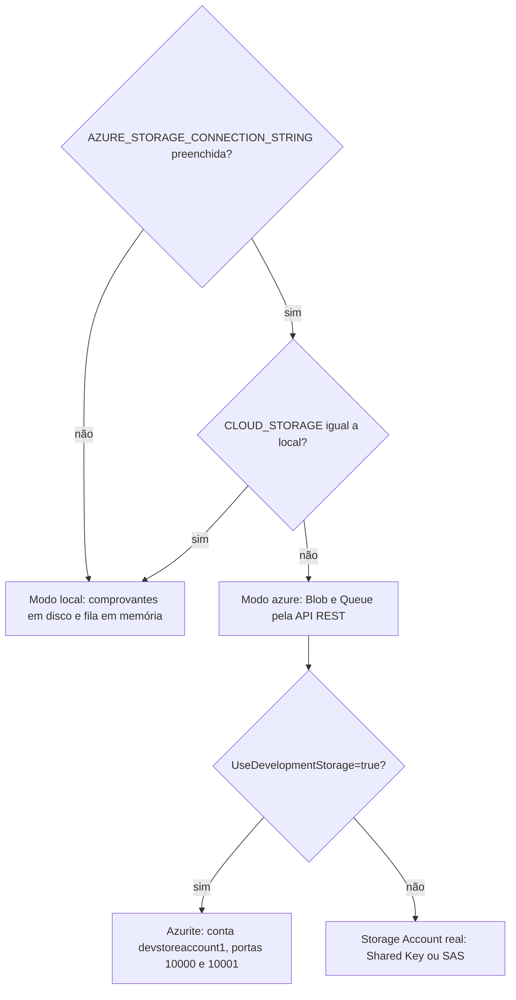
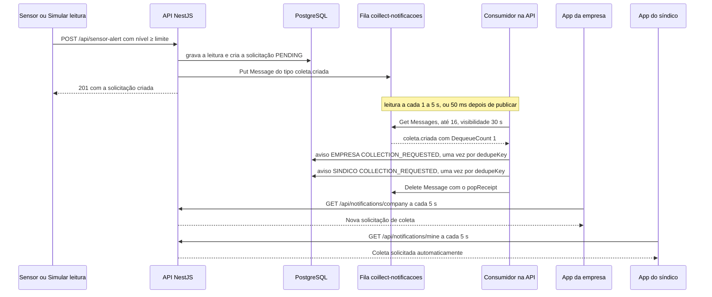
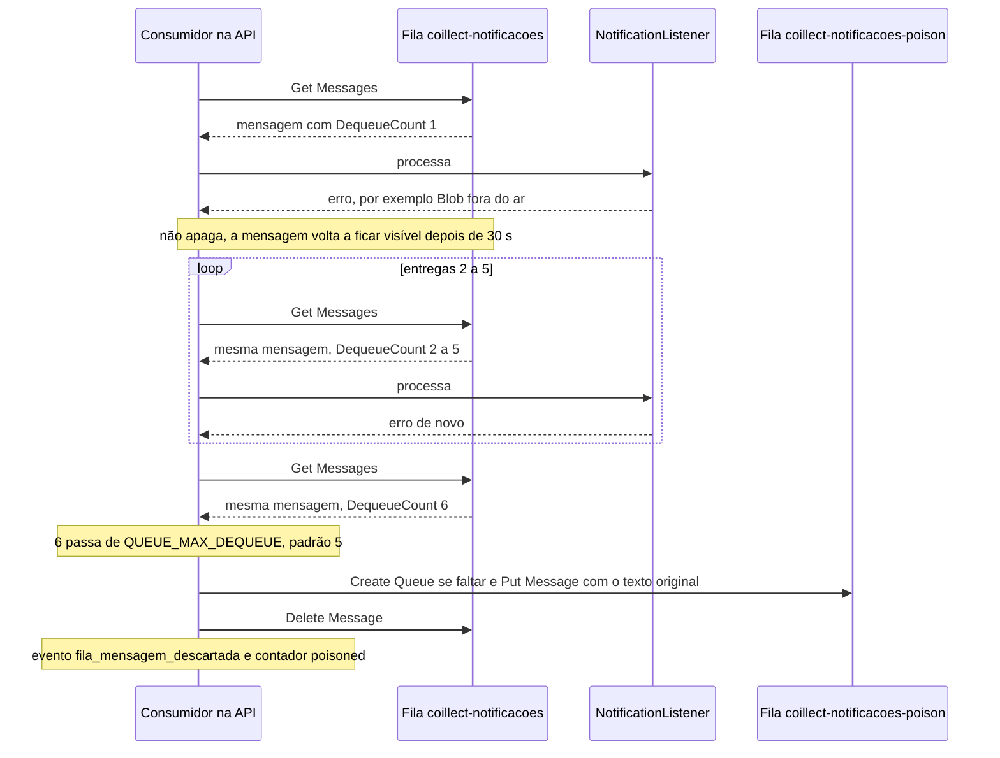
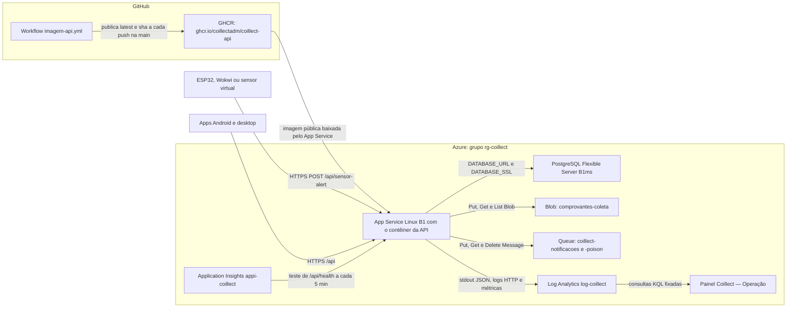

# Azure Storage e nuvem (Atividade A02)

Parte da [documentação do Coillect](README.md).

Este documento descreve como a API usa o Azure Storage na Atividade A02 de Computação em Nuvem II:
Blob Storage para os comprovantes de coleta, Queue Storage para as notificações, o modo local sem
Azure, as variáveis de configuração, o cliente REST escrito sem SDK, a telemetria para o Log
Analytics, o health check, o mapa dos itens da A02 e a arquitetura planejada na Azure. Todo o código
citado aqui é NOVO (PRs de 10/11/2026): `backend/src/cloud/`, os comprovantes (`receipt*.ts`), o
"Precisa de ajuda?" e a fila entraram no PR #4 do CoillectApp ("Azure Storage (A02)"); o health check
nasceu no PR #1 e ganhou o 503 e o campo `storage` no PR #4. Como subir tudo e publicar na nuvem está
em [Execução local e deploy](12-execucao-local-e-deploy.md).

## Sumário

- [Visão geral](#visão-geral)
- [Por que Blob e Queue](#por-que-blob-e-queue)
- [Precisa da Azure? Modo local e Azurite](#precisa-da-azure-modo-local-e-azurite)
- [Configuração](#configuração)
- [Cliente REST do Azure Storage](#cliente-rest-do-azure-storage)
- [Blob Storage: comprovantes de coleta](#blob-storage-comprovantes-de-coleta)
- [Queue Storage: fila de notificações](#queue-storage-fila-de-notificações)
- [Telemetria e Log Analytics](#telemetria-e-log-analytics)
- [Health check](#health-check)
- [Itens da A02 no projeto](#itens-da-a02-no-projeto)
- [Arquitetura planejada na Azure](#arquitetura-planejada-na-azure)
- [Testes relacionados](#testes-relacionados)
- [Limitações e o que não foi verificado](#limitações-e-o-que-não-foi-verificado)

## Visão geral

| Arquivo | Papel |
|---|---|
| [cloud.config.ts](../backend/src/cloud/cloud.config.ts) | Lê as variáveis de ambiente e decide o modo: `azure` ou `local` |
| [azure-storage.client.ts](../backend/src/cloud/azure-storage.client.ts) | Cliente da API REST do Blob e da Queue (Shared Key ou SAS), sem SDK |
| [blob-storage.service.ts](../backend/src/cloud/blob-storage.service.ts) | Grava, lê e lista comprovantes no Azure Blob Storage ou em disco |
| [message-queue.service.ts](../backend/src/cloud/message-queue.service.ts) | Publica e consome a fila; poison queue, fallback, backoff, pausa |
| [cloud.controller.ts](../backend/src/cloud/cloud.controller.ts) | `GET /api/admin/cloud`, `POST /api/admin/cloud/queue/pause` e `POST /api/admin/cloud/queue/resume` |
| [cloud.module.ts](../backend/src/cloud/cloud.module.ts) | Módulo `@Global()`; liga o Blob e a fila em `onApplicationBootstrap` |
| [telemetry.ts](../backend/src/cloud/telemetry.ts) | Uma linha JSON por evento de negócio no stdout (base dos dashboards) |
| [receipt.ts](../backend/src/collection-request/receipt.ts) | Formato, nome do blob e protocolo do comprovante |
| [receipt.service.ts](../backend/src/collection-request/receipt.service.ts) | Gera e lê o comprovante no Blob Storage |
| [notification.listener.ts](../backend/src/notification/notification.listener.ts) | Produz as mensagens da fila e é o seu consumidor (despachante de avisos) |
| [help-request.controller.ts](../backend/src/notification/help-request.controller.ts) | "Precisa de ajuda?" do síndico, publicado na fila |
| [health.controller.ts](../backend/src/health/health.controller.ts) | `GET /api/health` (banco, modo do storage, fila pausada) |

O ciclo em quatro passos:

1. O sensor envia a leitura. A API grava a leitura e, se for o caso, cria a solicitação de coleta
   na hora, no PostgreSQL. O sensor recebe a resposta com a solicitação.
2. A API publica uma mensagem na fila `coillect-notificacoes` (Queue Storage). No modo azure, a
   resposta ao sensor espera só a publicação, não a entrega dos avisos (no modo local, sem fila, os
   avisos são processados na hora).
3. O consumidor, dentro da própria API, lê a fila, grava os avisos da empresa e do síndico e, quando a
   coleta é concluída, grava o comprovante JSON no container `comprovantes-coleta` (Blob Storage).
4. Os apps leem avisos e comprovantes pela API (atualizam a cada 5 s). Nenhum app fala com o Storage.

Como a API escolhe o modo ([cloud.config.ts](../backend/src/cloud/cloud.config.ts) e
`parseConnectionString` em [azure-storage.client.ts](../backend/src/cloud/azure-storage.client.ts)):



## Por que Blob e Queue

A A02 pede Blob Storage e, à escolha, Table **ou** Queue Storage. O projeto usa Blob e Queue.

**Blob para os comprovantes.** O comprovante é um arquivo: um por coleta concluída, gravado uma vez e
lido depois. O comentário de [receipt.ts](../backend/src/collection-request/receipt.ts) o define como
"o 'arquivo' do projeto: imutável, um por coleta, consultado pelos apps", e
[docs/azure-a02.md](../docs/azure-a02.md) §2 o chama de documento/arquivo morto. Dados estruturados
(usuários, barris, solicitações) continuam no PostgreSQL.

**Queue no lugar de Table.** Justificativa de [docs/azure-a02.md](../docs/azure-a02.md) §3, confirmada
pelo código:

| | Queue Storage | Table Storage |
|---|---|---|
| Para que serve | Mensagens entre partes do sistema, processadas de forma assíncrona | Dados NoSQL chave-valor (consultas por PartitionKey/RowKey) |
| No Coillect | É o "listener" do projeto: o alerta do sensor vira mensagens que alguém precisa entregar | Duplicaria o PostgreSQL, que já guarda os dados estruturados |
| Ganho | Desacoplamento, nova tentativa automática, absorve picos, permite várias instâncias | Só mais um lugar para guardar a mesma coisa |

No código, a fila separa o que precisa ser síncrono do que pode esperar. O comentário de
[message-queue.service.ts](../backend/src/cloud/message-queue.service.ts) resume: "A solicitação de
coleta é gravada na hora (o sensor recebe a resposta); a fila leva o 'recado' para quem precisa ser
avisado: empresa coletora (nova solicitação), síndico (cópia informativa) e o comprovante da coleta
concluída no Blob Storage." A demonstração disso em aula é pausar o consumidor (ver
[Pausar e retomar](#pausar-e-retomar)).

## Precisa da Azure? Modo local e Azurite

Não. A mesma API roda de três formas:

| Situação | Como ligar | Onde ficam comprovantes e mensagens | `storage` no `/api/health` |
|---|---|---|---|
| Storage Account da Azure | `AZURE_STORAGE_CONNECTION_STRING` com a cadeia de conexão do portal | Na conta da Azure | `azure` |
| Azurite (emulador oficial, sem conta) | `AZURE_STORAGE_CONNECTION_STRING=UseDevelopmentStorage=true` (o `docker-compose.yaml` já define, com `DevelopmentStorageProxyUri=http://azurite`) | No contêiner `azurite` (conta `devstoreaccount1`) | `azure` |
| Modo local | Sem a variável, ou com `CLOUD_STORAGE=local` | Disco + memória do processo da API | `local` |

O Azurite está no [docker-compose.yaml](../docker-compose.yaml) (portas 10000 Blob, 10001 Queue,
10002 Table, esta não usada) e no CI ([backend.yml](../.github/workflows/backend.yml)). Segundo
[docs/azure-a02.md](../docs/azure-a02.md) e [docs/deploy-cloud.md](../docs/deploy-cloud.md), a Storage
Account também pode ser usada com a API hospedada fora da Azure (ex.: Render), bastando cadastrar a
variável no provedor.

O que o modo local faz, exatamente:

| Parte | Comportamento no modo local |
|---|---|
| Comprovantes | `LocalBlobDriver` grava em `<STORAGE_LOCAL_DIR>/comprovantes-coleta/AAAA/MM/DD/coleta-<id>-<carimbo>.json`. Sem `STORAGE_LOCAL_DIR`, a base é `storage-local/` na pasta onde a API foi iniciada (com `npm run start:dev` em `backend/`: `backend/storage-local/`). Mesmo nome de arquivo do modo azure. Provedor exibido: "Disco local (sem Azure)" |
| Leitura do comprovante | Mesmas rotas; o arquivo é lido do disco. Nomes que escapariam da pasta (`..`) são recusados |
| Fila | Não existe fila. `publish()` chama o consumidor na hora, no mesmo processo (`via: "memoria"`). Sem nova tentativa, sem poison queue, sem persistência: um erro no consumidor fica registrado (`failed`, evento `fila_mensagem_erro`) e não desfaz a solicitação |
| Momento dos avisos | Os avisos e o comprovante são gravados antes de a requisição HTTP responder |
| Pausar/retomar | `POST /api/admin/cloud/queue/pause` e `/resume` respondem 409: "Pausar a fila só faz sentido com o Azure Storage (no modo local a fila é em memória)." |
| `GET /api/admin/cloud` | `mode: "local"`, fila "Memória (sem Azure)", `waiting: 0`, `poisonQueue`, `pollMs`, `account` e `endpoint` da fila `null`; mensagem "Modo local (defina AZURE_STORAGE_CONNECTION_STRING para usar o Azure)" |
| Git e imagem Docker | `storage-local` está no `.gitignore` e no `.dockerignore` do backend |

## Configuração

Todas as variáveis lidas por [cloud.config.ts](../backend/src/cloud/cloud.config.ts) e
[telemetry.ts](../backend/src/cloud/telemetry.ts):

| Variável | Padrão | Regra no código |
|---|---|---|
| `AZURE_STORAGE_CONNECTION_STRING` | vazia (modo local) | Espaços nas pontas são removidos. Preenchida → modo `azure` |
| `CLOUD_STORAGE` | — | `local` (sem diferenciar maiúsculas) força o modo local mesmo com connection string. Não aparece no `.env.example` nem no `deploy-cloud.md` |
| `AZURE_STORAGE_CONTAINER` | `comprovantes-coleta` | Container dos comprovantes. Nome inválido volta ao padrão |
| `AZURE_STORAGE_QUEUE` | `coillect-notificacoes` | Fila de notificações. A poison queue é sempre `<fila>-poison`, cortada em 63 caracteres |
| `QUEUE_POLL_MS` | `1000` | Intervalo da leitura quando há mensagens. Precisa ser número maior que 0, senão vale o padrão |
| `QUEUE_POLL_MAX_MS` | `5000` | Teto do backoff com a fila vazia. Nunca fica abaixo de `QUEUE_POLL_MS` (o código usa o maior dos dois) |
| `QUEUE_MAX_DEQUEUE` | `5` | Entregas permitidas: com `DequeueCount` acima deste valor, a mensagem vai para a poison queue. Não documentada fora do código |
| `STORAGE_LOCAL_DIR` | `<pasta de trabalho>/storage-local` | Pasta-base do modo local. Não documentada fora do código |
| `LOG_EVENTS` | ligado, exceto com `NODE_ENV=test` | `false`, `0`, `no`, `off`, `nao` ou `não` desligam; `true`, `1`, `yes`, `on` ou `sim` ligam (até nos testes) |
| `NODE_ENV` | — | Com `test` e sem `LOG_EVENTS`, os eventos JSON ficam desligados |

Nomes de container e fila passam por `trim()` e `toLowerCase()` e precisam casar com
`^[a-z0-9](?:[a-z0-9-]{1,61})[a-z0-9]$`: 3 a 63 caracteres, minúsculas, números e hífen, começando e
terminando com letra ou número. Exemplo do teste: `Comprovantes_Coleta` volta para `comprovantes-coleta`.

### Connection strings aceitas

A cadeia é dividida em pedaços `chave=valor` separados por `;`. As chaves não diferenciam maiúsculas e
o valor pode conter `=` (a chave da conta é base64). Os exemplos abaixo não têm segredos.

| Formato | Exemplo | Resultado |
|---|---|---|
| Azurite padrão | `UseDevelopmentStorage=true` | Conta `devstoreaccount1` com a chave pública fixa do Azurite (embutida no código; só funciona no emulador). Blob `http://127.0.0.1:10000/devstoreaccount1`, Queue `http://127.0.0.1:10001/devstoreaccount1` |
| Azurite em outro host | `UseDevelopmentStorage=true;DevelopmentStorageProxyUri=http://azurite` | Troca o host: `http://azurite:10000/devstoreaccount1` e `http://azurite:10001/devstoreaccount1`. É o padrão do compose; o CI usa `http://coillect-azurite` |
| Conta com chave (formato do portal) | `DefaultEndpointsProtocol=https;AccountName=<conta>;AccountKey=<chave>;EndpointSuffix=core.windows.net` | Endpoints `https://<conta>.blob.core.windows.net` e `https://<conta>.queue.core.windows.net`. Sem `DefaultEndpointsProtocol` vale `https`; sem `EndpointSuffix`, `core.windows.net` |
| Endpoints explícitos | `BlobEndpoint=<url>;QueueEndpoint=<url>;AccountName=<conta>;AccountKey=<chave>` | Usa as URLs informadas (barra final removida). Host `127.0.0.1`, `localhost` ou `azurite` é tratado como emulador |
| SAS | `BlobEndpoint=https://<conta>.blob.core.windows.net/;QueueEndpoint=https://<conta>.queue.core.windows.net/;SharedAccessSignature=<token>` | Sem `AccountName`, o nome da conta é o primeiro pedaço do host do `BlobEndpoint`. O token (sem `?` inicial) vai na URL de cada chamada |

Erros de configuração (lançados ao criar `BlobStorageService` e `MessageQueueService`, ou seja, na
subida da API, que então não sobe):

- "Connection string do Storage sem AccountName nem BlobEndpoint/QueueEndpoint."
- "Connection string do Storage precisa de AccountKey ou SharedAccessSignature."

## Cliente REST do Azure Storage

[azure-storage.client.ts](../backend/src/cloud/azure-storage.client.ts) chama a API REST oficial do
Storage. O comentário do arquivo explica a escolha: "não adiciona dependências ao backend, e cada
chamada fica visível (PUT do blob, POST da mensagem...), o que ajuda a explicar a integração na
disciplina de Computação em Nuvem."

**Sem dependência npm nova.** As dependências do `backend/package.json` são as mesmas do commit base
76f12374 (o corpo do PR #4 diz que o `package-lock.json` não mudou). O código de nuvem usa só recursos
nativos do Node:

| Recurso | Onde | Uso |
|---|---|---|
| `crypto.createHmac` | azure-storage.client.ts | Assinatura Shared Key (HMAC-SHA256) |
| `crypto.randomUUID` | message-queue.service.ts | `id` de cada mensagem (chave de idempotência) |
| `fetch`, `AbortSignal.timeout`, `URL`, `Buffer`, `Headers` (globais) | azure-storage.client.ts | Chamadas HTTP, tempo limite, montagem da URL, corpo e cabeçalhos |
| `fs.promises`, `path` | blob-storage.service.ts e cloud.config.ts | Modo local em disco e pasta padrão |

Os globais `fetch` e `AbortSignal.timeout` exigem Node 18 ou mais novo; a imagem Docker usa Node 24.

### Cabeçalhos e versão

Toda chamada leva `x-ms-date` (data atual em UTC, formato `toUTCString()`) e
`x-ms-version: 2021-08-06` (`STORAGE_API_VERSION`, "aceita pelo Azure e pelo Azurite", segundo o
comentário). Os demais cabeçalhos dependem da operação.

### Assinatura Shared Key

Usada quando há `AccountKey` e não há SAS. O cabeçalho é
`Authorization: SharedKey <conta>:<assinatura>`, em que a assinatura é o HMAC-SHA256 da StringToSign
(UTF-8) com a chave da conta decodificada de base64, codificado em base64.

A StringToSign (`stringToSign()`) tem 12 linhas fixas, depois os cabeçalhos `x-ms-*` e o recurso:

| Linha | Conteúdo |
|---|---|
| 1 | Verbo HTTP em maiúsculas |
| 2 a 3 | `Content-Encoding`, `Content-Language` |
| 4 | `Content-Length` (vazio quando é `0`) |
| 5 a 6 | `Content-MD5`, `Content-Type` |
| 7 | `Date`: sempre vazio, porque vale o `x-ms-date` |
| 8 a 12 | `If-Modified-Since`, `If-Match`, `If-None-Match`, `If-Unmodified-Since`, `Range` |
| Cabeçalhos canônicos | Cada `x-ms-*` em minúsculas, ordenado, no formato `nome:valor` (valor sem espaços nas pontas), um por linha |
| Recurso canônico | `/<conta><caminho da URL>` e, para cada parâmetro da URL (nome em minúsculas, ordenado), uma linha `nome:valores ordenados separados por vírgula` |

O `fetch` do Node envia `Content-Length` sozinho; o cliente só o coloca na cópia dos cabeçalhos usada
na assinatura. Exemplo do teste unitário (Put Blob de 42 bytes, conta `conta`):

```text
PUT


42

application/json; charset=utf-8


x-ms-blob-type:BlockBlob
x-ms-date:Tue, 10 Nov 2026 06:00:00 GMT
x-ms-version:2021-08-06
/conta/comprovantes-coleta/2026/11/10/coleta-1.json
```

No Azurite o caminho da URL já começa com o nome da conta, então o recurso canônico o repete. Exemplo
do teste para List Blobs: `/devstoreaccount1/devstoreaccount1/comprovantes-coleta`, seguido das linhas
`comp:list`, `prefix:2026/11/` e `restype:container`.

### SAS

Com `SharedAccessSignature`, o token é acrescentado à query string de cada chamada e não há cabeçalho
`Authorization`. Se a cadeia tiver chave e SAS, vale o SAS.

### Operações implementadas

`{blob}` e `{queue}` são os endpoints da conta; `{container}` e `{fila}`, os nomes configurados.
Cada segmento do nome do blob é codificado com `encodeURIComponent` (as barras são mantidas).

| Classe | Operação REST | Método e URL | Aceita | Uso no Coillect |
|---|---|---|---|---|
| `AzureBlobContainer` | Create Container | `PUT {blob}/{container}?restype=container` (corpo vazio) | 201 criado, 409 já existia | Na subida e antes da primeira gravação/leitura |
| `AzureBlobContainer` | Put Blob | `PUT {blob}/{container}/{nome}` com `x-ms-blob-type: BlockBlob` e `content-type` | 201 | Grava (ou sobrescreve) o comprovante |
| `AzureBlobContainer` | Get Blob | `GET {blob}/{container}/{nome}` | 200; 404 vira `null` | Lê o comprovante |
| `AzureBlobContainer` | List Blobs | `GET {blob}/{container}?restype=container&comp=list` (+ `prefix`, `marker`) | 200; 404 vira lista vazia | Aba "Nuvem" do desktop; segue `NextMarker` por até 20 páginas |
| `AzureQueue` | Create Queue | `PUT {queue}/{fila}` (corpo vazio) | 201 criada; 204 ou 409 já existia | Na subida (fila principal) e na primeira mensagem descartada (poison) |
| `AzureQueue` | Put Message | `POST {queue}/{fila}/messages?messagettl=604800` com corpo XML | 201 (lê o `MessageId`) | Publica a mensagem; TTL de 7 dias |
| `AzureQueue` | Get Messages | `GET {queue}/{fila}/messages?numofmessages=16&visibilitytimeout=30` | 200 | Consumidor: até 16 mensagens (o método limita entre 1 e 32), escondidas por 30 s |
| `AzureQueue` | Delete Message | `DELETE {queue}/{fila}/messages/{messageId}?popreceipt=...` | 204; 404 também é aceito | Confirma o processamento |
| `AzureQueue` | Get Queue Metadata | `GET {queue}/{fila}?comp=metadata` | 200 (lê `x-ms-approximate-messages-count`) | Campo `waiting` do `GET /api/admin/cloud` |

O corpo do Put Message é
`<?xml version="1.0" encoding="utf-8"?><QueueMessage><MessageText>...</MessageText></QueueMessage>`
com o JSON escapado para XML (`&`, `<`, `>`, `"` e `'`), sem base64. As respostas XML são lidas por
expressões regulares (`xmlBlocks`, `xmlText`, `xmlUnescape`), sem biblioteca de XML.

### Erros e tempo limite

| Situação | Comportamento |
|---|---|
| Status fora da lista aceita (padrão 200, 201, 202, 204) | Lança `AzureStorageError` com `status`, `code` (cabeçalho `x-ms-error-code`) e mensagem `Azure Storage <MÉTODO> <caminho> → HTTP <status> (<código>): <detalhe>`; o detalhe é o `<Message>` do XML ou os primeiros 300 caracteres do corpo |
| Tempo limite | `AbortSignal.timeout(15_000)`: 15 s por chamada (nenhuma operação muda esse valor) |
| Nova tentativa | O cliente não repete chamadas. Quem repete é a fila (a mensagem volta) e os serviços (o container é criado de novo na próxima gravação) |

## Blob Storage: comprovantes de coleta

### Onde e com que nome

- Container: `comprovantes-coleta` (`AZURE_STORAGE_CONTAINER`). A API cria o container sozinha
  (Create Container sem o cabeçalho de acesso público): na subida, em `BlobStorageService.start()`, ou
  na primeira gravação. Se falhar na subida, a API continua e registra "Blob Storage indisponível
  agora (...). A API continua; tenta de novo na próxima gravação."
- Nome do blob (`receiptBlobName()`): `AAAA/MM/DD/coleta-<id>-<AAAAMMDD>T<HHMMSS>Z.json`, com as
  pastas e o carimbo da data de conclusão em UTC (sem data de conclusão, a hora atual). Exemplo do
  teste: `2026/11/10/coleta-12-20261110T061500Z.json`.
- O container é privado: os apps leem pela API, sem chave da conta. O nome do blob fica na coluna
  `receiptBlob` da solicitação (`varchar(200)`).

### Conteúdo do comprovante

Gravado com `JSON.stringify(comprovante, null, 2)` e `content-type: application/json; charset=utf-8`.

| Campo | Conteúdo |
|---|---|
| `tipo` | Sempre `"comprovante-de-coleta"` |
| `versao` | Sempre `1` |
| `protocolo` | `COL-` + id com 6 dígitos, ex.: `COL-000012` |
| `solicitacaoId` | Id da solicitação |
| `origem` | `SENSOR`, `COMPANY` ou `MANUAL` (sem valor: `MANUAL`) |
| `condominio` | `{ nome, endereco, bairro }` ou `null` |
| `sindico` | `{ nome, email }` ou `null` |
| `empresaColetora` | `{ nome, cnpj }` (CNPJ da empresa ou, sem ele, o `companyCnpjSnapshot`) ou `null` |
| `barril` | `{ codigo, capacidadeLitros, limiteAlertaPercentual }` (limite padrão 80) ou `null` |
| `sensor` | Código do sensor, ex.: `CLT-8472-A`, ou `null` |
| `nivelNoAlertaPercentual` | Nível no momento da solicitação (`levelAtRequest`) |
| `volumeEstimadoLitros` | `round(capacidade × nível / 100)`; `null` sem capacidade ou sem nível |
| `solicitadaEm`, `agendadaPara`, `concluidaEm` | Datas ISO 8601 (`requestedAt`, `scheduledDate`, `completedAt`) ou `null` |
| `emitidoEm` | Data ISO da geração do comprovante |
| `armazenamento` | `{ provedor, container, blob }` no momento da gravação |

Exemplo montado com os dados do teste unitário
([receipt.spec.ts](../backend/src/collection-request/receipt.spec.ts)) e o nome de blob que
`generate()` usaria para eles; o provedor depende do modo:

```json
{
  "tipo": "comprovante-de-coleta",
  "versao": 1,
  "protocolo": "COL-000012",
  "solicitacaoId": 12,
  "origem": "SENSOR",
  "condominio": { "nome": "Residencial Aurora", "endereco": "Rua das Acácias, 120 - São Paulo/SP", "bairro": "Jardim Paulista" },
  "sindico": { "nome": "Leonardo Costa", "email": "sindico@coillect.com" },
  "empresaColetora": { "nome": "EcoColeta Ambiental", "cnpj": "11222333000181" },
  "barril": { "codigo": "BRL-8472", "capacidadeLitros": 200, "limiteAlertaPercentual": 80 },
  "sensor": "CLT-8472-A",
  "nivelNoAlertaPercentual": 86,
  "volumeEstimadoLitros": 172,
  "solicitadaEm": "2026-11-10T05:00:00.000Z",
  "agendadaPara": "2026-11-10T05:30:00.000Z",
  "concluidaEm": "2026-11-10T06:15:00.000Z",
  "emitidoEm": "2026-11-10T06:15:01.000Z",
  "armazenamento": {
    "provedor": "Azure Blob Storage",
    "container": "comprovantes-coleta",
    "blob": "2026/11/10/coleta-12-20261110T061500Z.json"
  }
}
```

### Quando é gravado

1. A empresa conclui a coleta (`POST /api/collection-request/{id}/company-complete`; no fluxo antigo,
   `POST /api/collection-request/{id}/complete`). A solicitação passa a `COMPLETED`.
2. A mudança de status vira a mensagem `coleta.status` na fila.
3. O consumidor chama `ReceiptService.generate(requestId)`: relê a solicitação (se não existir ou não
   estiver `COMPLETED`, não faz nada), monta o comprovante, grava o blob, salva `receiptBlob` e emite o
   evento `comprovante_gerado`.

É idempotente: o nome vem do id e da data de conclusão, então reprocessar a mesma mensagem sobrescreve
o mesmo arquivo. No modo azure o comprovante aparece alguns segundos depois da conclusão; no modo local,
antes de a requisição responder.

### Como os apps leem

| Quem | Rota | Autenticação |
|---|---|---|
| App do síndico | `GET /api/collection-request/{id}/receipt` | Token de `POST /api/auth/login`; só solicitações do próprio síndico |
| App da empresa | `GET /api/collection-request/company/{id}/receipt` | Token de `POST /api/auth/company/login`; só solicitações da empresa |
| Desktop | `GET /api/admin/cloud` | Sem login; lista os 10 blobs mais recentes (nome, tamanho, data, tipo), não o conteúdo |

Resposta 200 (dentro do envelope `APIResponse`, em `data`):

```json
{
  "requestId": 12,
  "receipt": { "tipo": "comprovante-de-coleta", "protocolo": "COL-000012" },
  "storage": { "mode": "azure", "provider": "Azure Blob Storage", "container": "comprovantes-coleta", "blob": "2026/11/10/coleta-12-20261110T061500Z.json" }
}
```

(`receipt` traz o comprovante inteiro; acima, só dois campos.) Cada solicitação também tem
`receiptAvailable` (`true` quando `receiptBlob` está preenchido) e `receiptBlob`.

| Caso | HTTP | Mensagem |
|---|---|---|
| Solicitação não é do síndico/empresa | 404 | "Solicitação não encontrada para este usuário" / "para esta empresa" |
| Solicitação ainda não concluída | 404 | "A solicitação #\<id> ainda não foi concluída; o comprovante é gerado na conclusão." |
| Concluída, mas o consumidor ainda não gravou (ou o arquivo não existe) | 404 | "O comprovante da solicitação #\<id> ainda está sendo gerado. Tente de novo em instantes." |

Nos apps Android, o Histórico mostra o botão "Ver comprovante" quando `receiptAvailable` é `true` e
"Comprovante em geração…" quando não é. Um 404 vira o aviso "O comprovante ainda está sendo gerado.
Tente de novo em instantes." (ver [App do síndico](05-app-sindico.md) e [App da empresa](06-app-empresa.md)).

## Queue Storage: fila de notificações

### Formato da mensagem

`publish()` acrescenta três campos ao conteúdo (`QueueEnvelope`): `id` (UUID de `randomUUID()`),
`versao: 1` e `enviadaEm` (data ISO). Exemplo de [docs/azure-a02.md](../docs/azure-a02.md) §3:

```json
{ "tipo": "coleta.criada", "requestId": 12, "status": "PENDING", "origem": "SENSOR",
  "id": "5f0c…", "versao": 1, "enviadaEm": "2026-11-16T14:30:15.120Z" }
```

No Azure, esse JSON vai escapado dentro de `<MessageText>` e vive até 7 dias (`messagettl=604800`).
O `id` do envelope é diferente do `MessageId` que o Azure devolve (este aparece no evento
`fila_mensagem_enviada` como `mensagemId`).

### Tipos de mensagem

| `tipo` | Campos próprios | Quem publica e quando | O que o consumidor faz |
|---|---|---|---|
| `coleta.criada` | `requestId`, `status`, `origem` | `NotificationListener`, ao receber o evento interno `collection-request.created`, emitido por `CollectionRequestService.createRequest()`: alerta do sensor (`POST /api/sensor-alert`), "Agendar coleta" sem solicitação aberta (`POST /api/collection-request/company/schedule`) e fluxo antigo (`POST /api/collection-request`) | Origem `COMPANY`: só o síndico (`COLLECTION_SCHEDULED`). Demais: empresa e síndico (`COLLECTION_REQUESTED`) |
| `coleta.status` | `requestId`, `status`, `statusAnterior` | `NotificationListener`, no evento `collection-request.status-changed`, emitido por `transition()` quando o status muda. Rotas sob `/api/collection-request/`: agendar ou iniciar (`POST company/schedule`, `POST {id}/accept`), concluir (`POST {id}/company-complete`), recusar (`POST {id}/refuse`) e, no fluxo antigo, `POST {id}/cancel` e `POST {id}/complete` | `SCHEDULED`, `COMPLETED`, `REFUSED`, `CANCELLED` → aviso ao síndico. `CANCELLED` → também à empresa. `COMPLETED` → também o comprovante no Blob. Outros status: nada |
| `ajuda.solicitada` | `sindicoId`, `companyId`, `sindico`, `condominio`, `empresa`, `assunto`, `mensagem` | `HelpRequestController` (`POST /api/help-request`, "Precisa de ajuda?") | `HELP_REQUESTED` para a empresa ("Pedido de ajuda • <condomínio>") e confirmação para o síndico ("Pedido de ajuda enviado") |

Os títulos dos avisos (ex.: "Nova solicitação de coleta" para a empresa, "Coleta solicitada
automaticamente" para o síndico) estão em
[notification.text.ts](../backend/src/notification/notification.text.ts).

### Produtor

O evento interno é emitido depois de a solicitação ser salva, dentro da mesma requisição HTTP, e o
`DomainEventsService` espera cada listener. Por isso:

- no modo azure, a requisição espera o Put Message (e, se a fila ainda não estiver pronta, o Create
  Queue; cada chamada tem tempo limite de 15 s), mas não a entrega dos avisos;
- no modo local, a requisição espera o processamento completo.

Antes de publicar, o listener emite `solicitacao_criada` ou `solicitacao_status`. Falha ao publicar
nunca desfaz a solicitação: `NotificationListener.publish()` só registra o erro. Depois de publicar, a
mesma instância antecipa a próxima leitura da fila para 50 ms ("kick"), se não estiver pausada.

### Consumidor

Há um único consumidor por instância da API: `MessageQueueService`, com o handler registrado por
`NotificationListener` em `onModuleInit`. Ele liga em `CloudModule.onApplicationBootstrap()` (depois do
Blob), cria a fila se faltar e começa o laço:

| Item | Valor no código |
|---|---|
| Mensagens por leitura | Até 16 (Get Messages), processadas uma por vez, na ordem recebida |
| Visibilidade | 30 s: enquanto isso, nenhuma outra leitura recebe a mensagem |
| Intervalo com mensagens | `QUEUE_POLL_MS` (1 s) depois de uma leitura que tratou mensagens |
| Backoff com a fila vazia | O intervalo dobra a cada leitura vazia até `QUEUE_POLL_MAX_MS`: 2 s, 4 s e então 5 s |
| Erro na leitura | Próxima tentativa em `QUEUE_POLL_MAX_MS` (5 s); o erro fica em `lastError` |
| Logo depois de publicar | Leitura em 50 ms (só na instância que publicou) |
| Pausado | Não lê; confere de novo a cada `QUEUE_POLL_MAX_MS` |
| Desligamento | `onApplicationShutdown` para o timer (o `main.ts` chama `enableShutdownHooks()`); o timer usa `unref()` |

Para cada mensagem recebida (`handleReceived`):

1. Texto que não é JSON ou sem `tipo` → poison queue na hora (motivo "mensagem não é um JSON da Coillect").
2. `DequeueCount` maior que `QUEUE_MAX_DEQUEUE` → poison queue (motivo "falhou N vezes").
3. Chama o handler. Sucesso → Delete Message. Erro → não apaga.

Mensagem de solicitação que não existe mais (ex.: depois de "Reiniciar demonstração") não é erro: o
handler registra "Solicitação #\<id> não existe mais; mensagem ignorada." e a mensagem é apagada.

### Apagar só depois de processar e idempotência

A mensagem só é apagada depois que o handler termina sem erro: "se a API cair no meio, a mensagem
volta" (comentário em `handleReceived`). Com erro, ela fica invisível até acabarem os 30 s e é entregue
de novo, com `DequeueCount` maior. A fila entrega "pelo menos uma vez", então o consumidor precisa ser
idempotente:

| Efeito | Como evita duplicar |
|---|---|
| Aviso no banco (`notifications`) | Coluna `dedupeKey` (`varchar(80)`, única) = `<id do envelope>:SINDICO` ou `<id do envelope>:EMPRESA`. `saveOnce()` devolve o aviso existente; se outra instância gravou ao mesmo tempo (erro PostgreSQL `23505`), relê e devolve o existente |
| Comprovante | Mesmo nome de blob para o mesmo id e data de conclusão: sobrescreve |
| Vários passos na mesma mensagem | `all()` executa todos os passos mesmo se um falhar e só lança o erro no fim; na nova tentativa, os passos já feitos não duplicam |

### Poison queue

- Nome: `<fila>-poison`, ou seja, `coillect-notificacoes-poison`. É criada na primeira mensagem
  descartada (o `GET /api/admin/cloud` mostra o nome desde a subida, no modo azure).
- N = `QUEUE_MAX_DEQUEUE` = 5. Uma mensagem que sempre falha é processada nas entregas 1 a 5 e vai para
  a poison na 6ª entrega. Com a visibilidade de 30 s, isso leva pelo menos 5 × 30 s.
- O texto original é copiado para a poison (Put Message com TTL de 7 dias) e apagado da fila
  principal. O contador `poisoned` sobe e o evento `fila_mensagem_descartada` registra `tentativas` e
  `motivo`.
- Nada consome a poison: ela serve para análise no portal ou no Azure Storage Explorer.

### Fallback quando o Azure falha

Se criar a fila ou o Put Message falhar (erro HTTP ou tempo limite), `publish()` não perde o aviso:
soma 1 em `fallbacks`, guarda `lastError`, emite `fila_indisponivel` (`tipo`, `erro`) e processa a
mensagem no próprio processo (`via: "fallback-local"`), como no modo local, sem nova tentativa. Se o
consumidor falhar ao ler, o laço espera `QUEUE_POLL_MAX_MS` e tenta de novo.

### Pausar e retomar

Feito para a demonstração do desacoplamento (botões "Pausar consumidor" e "Retomar consumidor" da aba
"Nuvem (Azure)" do [desktop](07-desktop-admin.md)).

| Rota | Efeito | Resposta |
|---|---|---|
| `POST /api/admin/cloud/queue/pause` | O consumidor para de ler | 201, `data: { "paused": true }`, mensagem "Consumidor da fila pausado" |
| `POST /api/admin/cloud/queue/resume` | Volta a ler em 50 ms | 201, `data: { "paused": false }`, mensagem "Consumidor da fila retomado" |
| Qualquer uma, no modo local | Nada | 409 (ver [modo local](#precisa-da-azure-modo-local-e-azurite)) |

Enquanto pausado:

- leituras do sensor e solicitações continuam normais (a solicitação nasce na hora);
- as mensagens continuam sendo publicadas e ficam esperando na fila do Azure (visíveis no portal em
  Filas → `coillect-notificacoes`; campo `waiting` do `GET /api/admin/cloud`; TTL de 7 dias);
- os avisos não chegam aos apps e o comprovante de uma coleta concluída não é gravado ("Comprovante em
  geração…");
- `GET /api/health` mostra `"queuePaused": true`.

Ao retomar, as mensagens acumuladas são entregues. A pausa fica só na memória da instância que recebeu
a chamada: reiniciar a API volta ao estado "não pausado" e, com várias instâncias, as outras continuam
consumindo.

### Métricas em GET /api/admin/cloud

Rota sem login (como as demais rotas do desktop). Os contadores são da instância e zeram quando a API
reinicia. Exemplo com Azurite (valores ilustrativos; o formato é o do código):

```json
{
  "error": false,
  "data": {
    "mode": "azure",
    "blob": {
      "provider": "Azure Blob Storage (emulador Azurite)",
      "account": "devstoreaccount1",
      "endpoint": "http://azurite:10000/devstoreaccount1",
      "container": "comprovantes-coleta",
      "count": 1,
      "savedSinceStart": 1,
      "recent": [
        {
          "name": "2026/11/10/coleta-12-20261110T061500Z.json",
          "size": 812,
          "lastModified": "Tue, 10 Nov 2026 06:15:01 GMT",
          "contentType": "application/json; charset=utf-8"
        }
      ],
      "error": null
    },
    "queue": {
      "provider": "Azure Queue Storage (emulador Azurite)",
      "account": "devstoreaccount1",
      "endpoint": "http://azurite:10001/devstoreaccount1",
      "name": "coillect-notificacoes",
      "poisonQueue": "coillect-notificacoes-poison",
      "published": 4,
      "processed": 4,
      "failed": 0,
      "poisoned": 0,
      "fallbacks": 0,
      "lastPublishedAt": "2026-11-10T06:15:00.420Z",
      "lastProcessedAt": "2026-11-10T06:15:00.610Z",
      "lastError": null,
      "pollMs": 1000,
      "paused": false,
      "waiting": 0
    }
  },
  "statusCode": 200,
  "timestamp": "2026-11-10T06:20:00.000Z",
  "requester": "admin",
  "message": "Azure Storage conectado"
}
```

| Campo | Significado |
|---|---|
| `mode` | `azure` ou `local` |
| `blob.provider` | "Azure Blob Storage", "Azure Blob Storage (emulador Azurite)" ou "Disco local (sem Azure)" |
| `blob.account`, `blob.endpoint` | Conta e endpoint do Blob; no modo local, `null` e a pasta em disco |
| `blob.count` | Total de blobs no container (todos, inclusive de demonstrações anteriores) |
| `blob.savedSinceStart` | Comprovantes gravados desde a subida |
| `blob.recent` | Até 10, do mais recente para o mais antigo (data de modificação; empate pelo nome) |
| `blob.error` | Último erro de gravação ou da listagem atual; `null` se tudo certo |
| `queue.provider` | "Azure Queue Storage", "Azure Queue Storage (emulador Azurite)" ou "Memória (sem Azure)" |
| `queue.published` | Mensagens publicadas (inclui as processadas em memória ou no fallback) |
| `queue.processed`, `queue.failed` | Execuções do handler com sucesso e com erro (cada nova tentativa conta) |
| `queue.poisoned`, `queue.fallbacks` | Mensagens movidas para a poison; publicações que caíram no fallback |
| `queue.lastPublishedAt`, `queue.lastProcessedAt`, `queue.lastError` | Datas ISO e último erro |
| `queue.pollMs` | `QUEUE_POLL_MS`; `null` no modo local |
| `queue.paused` | Consumidor pausado |
| `queue.waiting` | Mensagens esperando (contagem aproximada do Azure); `null` se a consulta falhou; `0` no modo local |

### Diagramas

Solicitação criada pelo sensor, entregue pela fila:



Mensagem que sempre falha e vai para a poison queue:



Uma mensagem que não é JSON da Coillect vai para a poison já na primeira entrega, sem passar pelo
handler.

## Telemetria e Log Analytics

[telemetry.ts](../backend/src/cloud/telemetry.ts) escreve no stdout (com `process.stdout.write`, fora
do logger do Nest) uma linha JSON por evento de negócio:

```json
{"app":"coillect-api","evento":"leitura_sensor","sensorId":"CLT-8472-A","percentual":86,"limite":80,"condominio":"Residencial Aurora","barril":"BRL-8472","disparouColeta":true,"motivo":"THRESHOLD_REACHED","solicitacaoId":12,"em":"2026-11-16T14:30:15.100Z"}
```

Ordem dos campos: `app` (sempre `coillect-api`), `evento`, os dados do evento e `em` (data ISO).
Liga e desliga com `LOG_EVENTS` (ver [Configuração](#configuração)); a variável é lida a cada evento.

Todos os nomes de evento do tipo `TelemetryEvent` e onde cada um é emitido:

| Evento | Emitido em | Quando | Campos |
|---|---|---|---|
| `leitura_sensor` | sensor/sensor-alert.service.ts | Cada `POST /api/sensor-alert` processado, depois de o listener decidir | `sensorId`, `percentual`, `limite`, `condominio`, `barril`, `disparouColeta`, `motivo`, `solicitacaoId` |
| `solicitacao_criada` | notification/notification.listener.ts | Solicitação criada, antes de publicar `coleta.criada` | `requestId`, `origem`, `status`, `nivel`, `condominio`, `barril`, `empresa` |
| `solicitacao_status` | notification/notification.listener.ts | Mudança de status, antes de publicar `coleta.status` | `requestId`, `de`, `para`, `condominio`, `empresa` |
| `fila_mensagem_enviada` | cloud/message-queue.service.ts | Put Message aceito (só modo azure) | `tipo`, `fila`, `mensagemId`, `requestId` (quando houver) |
| `fila_mensagem_processada` | cloud/message-queue.service.ts | Handler terminou sem erro (fila do Azure, memória ou fallback) | `tipo`, `via` (`azure-queue`, `memoria` ou `fallback-local`), `tentativas`, `ms`, `requestId` |
| `fila_mensagem_erro` | cloud/message-queue.service.ts | Handler lançou erro | `tipo`, `via`, `tentativas`, `erro`, `requestId` |
| `fila_mensagem_descartada` | cloud/message-queue.service.ts | Mensagem movida para a poison queue | `fila`, `mensagemId`, `tentativas`, `motivo` |
| `fila_indisponivel` | cloud/message-queue.service.ts | Falha ao publicar no Azure (fallback) | `tipo`, `erro` |
| `comprovante_gerado` | collection-request/receipt.service.ts | Comprovante gravado | `requestId`, `protocolo`, `condominio`, `provedor`, `container`, `blob`, `bytes` |
| `ajuda_solicitada` | notification/help-request.controller.ts | `POST /api/help-request` aceito, depois de publicar | `condominio`, `empresa`, `assunto` |
| `armazenamento_iniciado` | cloud/blob-storage.service.ts e cloud/message-queue.service.ts | Subida da API: Blob (se o container ficou pronto) e fila | Blob: `servico: "blob"`, `modo`, `provedor`, `container`. Fila azure: `servico: "fila"`, `modo: "azure"`, `fila`, `conta`. Fila local: `servico: "fila"`, `modo: "local"` |
| `comprovante_erro` | — | Declarado no tipo, mas nenhuma linha do código o emite | — |

No App Service, segundo [docs/azure-a02.md](../docs/azure-a02.md) §4, o stdout vai para a tabela
`AppServiceConsoleLogs` do Log Analytics (coluna `ResultDescription`); no Render, para a aba Logs. As
consultas KQL de `docs/azure-a02.md` §4, conferidas com os nomes e campos de evento acima:

Nível dos barris ao longo do tempo (gráfico de linhas):

```kusto
AppServiceConsoleLogs
| where ResultDescription startswith '{"app":"coillect-api"'
| extend e = parse_json(ResultDescription)
| where tostring(e.evento) == "leitura_sensor"
| summarize nivel = max(toint(e.percentual)) by bin(TimeGenerated, 1m), sensor = tostring(e.sensorId)
| render timechart
```

Solicitações de coleta por condomínio (barras):

```kusto
AppServiceConsoleLogs
| where ResultDescription startswith '{"app":"coillect-api"'
| extend e = parse_json(ResultDescription)
| where tostring(e.evento) == "solicitacao_criada"
| summarize solicitacoes = count() by condominio = tostring(e.condominio)
| render barchart
```

Fila: mensagens processadas, tempo médio e falhas (`ms` só existe em `fila_mensagem_processada`):

```kusto
AppServiceConsoleLogs
| where ResultDescription startswith '{"app":"coillect-api"'
| extend e = parse_json(ResultDescription)
| where tostring(e.evento) startswith "fila_"
| summarize total = count(), ms_medio = avg(toint(e.ms)) by evento = tostring(e.evento), bin(TimeGenerated, 5m)
| render columnchart
```

Comprovantes gravados no Blob:

```kusto
AppServiceConsoleLogs
| where ResultDescription startswith '{"app":"coillect-api"'
| extend e = parse_json(ResultDescription)
| where tostring(e.evento) == "comprovante_gerado"
| project TimeGenerated, protocolo = tostring(e.protocolo), condominio = tostring(e.condominio),
          blob = tostring(e.blob), bytes = toint(e.bytes)
| order by TimeGenerated desc
```

Tempo de resposta e erros por rota (logs HTTP do App Service, não dependem do `telemetry.ts`):

```kusto
AppServiceHTTPLogs
| summarize requisicoes = count(), ms_medio = avg(TimeTaken), erros_5xx = countif(ScStatus >= 500)
    by rota = CsUriStem
| order by requisicoes desc
```

O mesmo documento sugere fixar as consultas no painel "Coillect — Operação" e três alertas: teste de
disponibilidade falhando em 2+ locais, métrica Http 5xx acima de 5 em 5 min e consulta com
`fila_mensagem_erro` ou `fila_mensagem_descartada` acima de 0 em 15 min. Localmente, as mesmas linhas
aparecem em `docker compose logs -f backend`.

## Health check

`GET /api/health` ([health.controller.ts](../backend/src/health/health.controller.ts)) não exige login.
Executa `SELECT 1` no PostgreSQL e responde:

| Campo de `data` | Valores |
|---|---|
| `status` | `ok` (banco no ar) ou `degraded` |
| `database` | `up` ou `down` |
| `storage` | `azure` ou `local`: o modo configurado. O health não testa o Storage |
| `queuePaused` | `true` quando o consumidor está pausado |
| `uptimeSeconds` | Segundos desde que o processo subiu |

HTTP 200 com o banco no ar; HTTP 503, `error: true` e `status: "degraded"` sem o banco:

```json
{
  "error": false,
  "data": { "status": "ok", "database": "up", "storage": "azure", "queuePaused": false, "uptimeSeconds": 42 },
  "statusCode": 200,
  "timestamp": "2026-11-10T06:20:00.000Z",
  "message": "Coillect API"
}
```

Quem usa:

| Cliente | Uso |
|---|---|
| App Service | Health check com caminho `/api/health` (configurado no portal, [docs/azure-a02.md](../docs/azure-a02.md) §7) |
| Application Insights | Teste de disponibilidade a cada 5 min, com alerta por e-mail (§4 e §7 do mesmo documento) |
| Render | `healthCheckPath: /api/health` no [render.yaml](../render.yaml) |
| CI | Job `docker` do [backend.yml](../.github/workflows/backend.yml): espera o health e confere `"storage":"azure"` com o Azurite |
| Apps Android | Botão "Testar conexão": lê o corpo também no 503 e mostra "A API em \<host> está no ar, mas sem banco de dados. Confira o PostgreSQL." |
| Scripts | [smoke-flow.mjs](../backend/scripts/smoke-flow.mjs) (passo 1) e [endereco-celular.mjs](../backend/scripts/endereco-celular.mjs) |

Papel na alta disponibilidade, segundo [docs/azure-a02.md](../docs/azure-a02.md) §6: o 503 faz o App
Service tirar a instância doente do balanceador e substituí-la se continuar doente. Isso é
comportamento da plataforma, descrito no documento e não testado neste projeto.

## Itens da A02 no projeto

Mapa baseado em [docs/azure-a02.md](../docs/azure-a02.md) e no
[LEIA-PRIMEIRO-CODEX.txt](../LEIA-PRIMEIRO-CODEX.txt) §9.

| Item da A02 | Situação | Onde está | Como demonstrar |
|---|---|---|---|
| 1. Infraestrutura, onde é publicado, recursos | Planejado e documentado; nenhum recurso criado | `docs/azure-a02.md` §1 e §7; [imagem-api.yml](../.github/workflows/imagem-api.yml); [backend/Dockerfile](../backend/Dockerfile); [Arquitetura planejada](#arquitetura-planejada-na-azure) | Prints do grupo de recursos `rg-coillect` e do App Service rodando; `/api/health` com `"storage":"azure"` |
| 2. Storage Account: Blob Storage | Implementado | [blob-storage.service.ts](../backend/src/cloud/blob-storage.service.ts), [receipt.ts](../backend/src/collection-request/receipt.ts), [receipt.service.ts](../backend/src/collection-request/receipt.service.ts) | Concluir uma coleta no app da empresa → portal: Storage account → Navegador de armazenamento → Contêineres de blobs → `comprovantes-coleta` → abrir o JSON; "Ver comprovante" no Histórico dos apps; aba Nuvem do desktop |
| 3. Table ou Queue Storage | Implementado: Queue | [message-queue.service.ts](../backend/src/cloud/message-queue.service.ts), [notification.listener.ts](../backend/src/notification/notification.listener.ts), [cloud.controller.ts](../backend/src/cloud/cloud.controller.ts) | Desktop → Nuvem → "Pausar consumidor" → leitura de 90% → portal: Filas → `coillect-notificacoes` com a mensagem → "Retomar consumidor" → aviso no app da empresa. Prints da fila com mensagem e vazia |
| 4. Monitoramento e dashboards | Eventos implementados; Log Analytics, Application Insights e painel a configurar no portal | [telemetry.ts](../backend/src/cloud/telemetry.ts); consultas KQL acima | Log Analytics → Logs → consultas; painel "Coillect — Operação"; teste de disponibilidade do `/api/health` |
| 5. Política de backup | Descrita (sem código) | `docs/azure-a02.md` §5 | Explicar: PostgreSQL com backup automático e restauração para um ponto no tempo (retenção de 7 a 35 dias); Blob com soft delete, controle de versão e LRS/GRS; fila transitória (TTL de 7 dias); código e imagem no GitHub |
| 6. Alta disponibilidade | Parte no código, parte descrita como configuração | Tabela abaixo; `docs/azure-a02.md` §6 | Explicar a tabela demonstração × produção do §6, com custos |

O que da alta disponibilidade está no código:

| Mecanismo | Onde |
|---|---|
| API sem estado (dados no PostgreSQL e no Storage) | Toda a API; exceções: estado da pausa e contadores do `/api/admin/cloud`, que são por instância |
| Health 503 sem banco | [health.controller.ts](../backend/src/health/health.controller.ts) |
| Fila com nova tentativa, idempotência e poison queue | [message-queue.service.ts](../backend/src/cloud/message-queue.service.ts), [notification.service.ts](../backend/src/notification/notification.service.ts) |
| Fallback com o Storage fora | `publish()` em message-queue.service.ts |
| Reconexão ao banco na subida | [database.config.ts](../backend/src/config/database.config.ts): `retryAttempts` 10 (`DATABASE_RETRY_ATTEMPTS`) × `retryDelay` 3 s, cerca de 30 s |
| Sensor e apps resilientes | Firmware reenvia a cada 5 s e espera até 60 s; apps esperam 15 s para conectar e 60 s pela resposta (ver [Sensor](04-sensor-esp32-e-simulador.md)) |

Uma trava por barril ([barrel-lock.ts](../backend/src/collection-request/barrel-lock.ts)) evita duas
solicitações abertas para o mesmo barril em uma instância; o PR #6 registra que, com várias instâncias,
essa garantia teria de vir do banco (índice único parcial), o que não foi feito.

## Arquitetura planejada na Azure

Planejamento de [docs/azure-a02.md](../docs/azure-a02.md) §1 e §7. Nenhum destes recursos foi criado.



| Recurso (nome sugerido) | Serviço e SKU | Função |
|---|---|---|
| `rg-coillect` | Grupo de recursos, região Brazil South (ou East US se a assinatura bloquear) | Agrupa tudo; apagar o grupo apaga o projeto |
| `stcoillect<sufixo>` | Storage Account StorageV2, Standard, LRS (ou GRS) | Container `comprovantes-coleta` e filas `coillect-notificacoes` e `-poison`, criados pela API |
| `psql-coillect-<sufixo>` | Azure Database for PostgreSQL Flexible Server, Burstable B1ms, 32 GB | Banco da API |
| `asp-coillect` | App Service Plan Linux B1 | Máquina que roda o contêiner |
| `app-coillect-<sufixo>` | Web App for Containers | API em `https://app-coillect-<sufixo>.azurewebsites.net/api`, imagem `ghcr.io/coillectadm/coillect-api:latest` |
| `log-coillect` | Log Analytics workspace | Eventos JSON, logs HTTP e métricas |
| `appi-coillect` | Application Insights baseado no workspace | Teste de disponibilidade e alertas |
| Painel "Coillect — Operação" | Painel do portal da Azure | Gráficos das consultas KQL e métricas |

Custos e créditos (Azure for Students, App Service B1 por volta de US$ 13/mês, B1ms na oferta gratuita
de 12 meses) são estimativas do `docs/azure-a02.md` e do `LEIA-PRIMEIRO-CODEX.txt` §8.2, não conferidas.
O passo a passo resumido está em [Execução local e deploy](12-execucao-local-e-deploy.md#deploy).

O que NÃO foi verificado nesta arquitetura:

- Nenhum recurso real foi criado: Storage Account, App Service, PostgreSQL Flexible Server, Log
  Analytics, Application Insights e painel ficaram como passo a passo (PR #4, seção "Não verificado";
  `LEIA-PRIMEIRO-CODEX.txt` §10).
- O deploy depende da assinatura Azure for Students do Allan.
- O pacote `coillect-api` no GHCR precisa ficar público uma vez (github.com/CoillectADM → Packages →
  `coillect-api` → Package settings → Change visibility → Public); sem isso o App Service não baixa a
  imagem sem credenciais.
- Não foi possível conferir aqui (sem acesso ao GitHub) se o workflow `imagem-api.yml` já publicou a
  imagem.
- As consultas KQL nunca rodaram num workspace real.

## Testes relacionados

| Arquivo | Casos | O que cobre |
|---|---|---|
| [azure-storage.client.spec.ts](../backend/src/cloud/azure-storage.client.spec.ts) | 10 casos | Connection strings (Azurite, Azurite em outro host, conta com chave, só SAS, erro sem chave/SAS), assinatura (recurso canônico, StringToSign do Put Blob, `Content-Length` 0 e HMAC) e XML |
| [cloud.config.spec.ts](../backend/src/cloud/cloud.config.spec.ts) | 3 casos | Padrões do modo local, modo azure e `CLOUD_STORAGE=local`, nomes inválidos |
| [message-queue.service.spec.ts](../backend/src/cloud/message-queue.service.spec.ts) | 7 casos | Modo local (processa na hora; erro não derruba quem publicou) e modo azure com fila falsa (apaga depois de processar, falha não apaga, poison por tentativas, poison por JSON inválido, fallback) |
| [telemetry.spec.ts](../backend/src/cloud/telemetry.spec.ts) | 2 casos | Formato da linha e `LOG_EVENTS` |
| [receipt.spec.ts](../backend/src/collection-request/receipt.spec.ts) | 3 casos | Nome do blob, conteúdo, volume nulo |
| [azure-storage.e2e-spec.ts](../backend/test/azure-storage.e2e-spec.ts) | 7 casos | Contra o Azurite: container e fila criados, avisos pela fila, comprovante no Blob, consumidor pausado, "Precisa de ajuda?", poison, fila vazia no fim. Pulado sem `AZURE_STORAGE_CONNECTION_STRING` |

No CI, o job `azure-storage` roda o e2e com `QUEUE_POLL_MS=200` e `QUEUE_POLL_MAX_MS=1000`, e o job
`docker` roda o `smoke-flow.mjs` na imagem sem Azure e com o Azurite. Detalhes em
[Testes e CI](11-testes-e-ci.md).

## Limitações e o que não foi verificado

- `storage` no `/api/health` só informa o modo configurado; o Storage fora do ar não muda o health.
- Modo local e fallback: sem nova tentativa. Se o Storage estiver fora no momento da conclusão de uma
  coleta e a publicação cair no fallback, o aviso do síndico é gravado no banco, mas o comprovante
  falha e não é refeito automaticamente (não há rota para regenerar).
- No modo local, uma falha do processo durante o processamento perde os avisos daquela mensagem (a
  fila é só memória).
- A pausa e os contadores são por instância e não sobrevivem a um reinício.
- "Reiniciar demonstração" apaga solicitações, notificações e leituras do banco, mas não apaga os
  blobs do container nem as mensagens já publicadas. As mensagens de solicitações apagadas são
  ignoradas e removidas pelo consumidor; um `ajuda.solicitada` pendente ainda é entregue.
- O evento `comprovante_erro` existe no tipo, mas nunca é emitido.
- O texto do desktop "Mensagens que falharam 5 vezes vão para…"
  ([CloudTab.kt](https://github.com/CoillectADM/interface-desktop-adm-coillect/blob/main/app/src/main/kotlin/br/com/coillect/admin/ui/CloudTab.kt))
  usa 5 fixo; não acompanha `QUEUE_MAX_DEQUEUE`.
- Verificado só no CI: Azurite (e2e e smoke). Segundo o PR #4, o cliente também passou em 15 chamadas
  contra um servidor falso que validava a assinatura Shared Key.
- Não verificado: Storage Account real, autenticação SAS numa conta real (só o parsing tem teste), App
  Service, PostgreSQL Flexible Server, Log Analytics, Application Insights, painel e alertas.
