# Interações e fluxos

Parte da [documentação do Coillect](README.md).

Este documento mostra como as partes do Coillect conversam: quem chama qual rota, em que ordem, o que
a API faz por dentro em cada caso e o que cada app passa a mostrar. Cada fluxo tem um diagrama de
sequência. O formato exato de cada rota está em [03-referencia-de-rotas.md](03-referencia-de-rotas.md).

## Sumário

- [Princípios de comunicação](#princípios-de-comunicação)
- [Mapa de interações](#mapa-de-interações)
- [Tempos e intervalos](#tempos-e-intervalos)
- [Fluxo 1: leitura abaixo do limite](#fluxo-1-leitura-abaixo-do-limite)
- [Fluxo 2: leitura no limite abre a solicitação](#fluxo-2-leitura-no-limite-abre-a-solicitação)
- [Fluxo 3: a empresa agenda a coleta](#fluxo-3-a-empresa-agenda-a-coleta)
- [Fluxo 4: a empresa conclui a coleta](#fluxo-4-a-empresa-conclui-a-coleta)
- [Fluxo 5: a empresa recusa a solicitação](#fluxo-5-a-empresa-recusa-a-solicitação)
- [Fluxo 6: Simular leitura no app do síndico](#fluxo-6-simular-leitura-no-app-do-síndico)
- [Fluxo 7: Precisa de ajuda?](#fluxo-7-precisa-de-ajuda)
- [Fluxo 8: cadastros do administrador](#fluxo-8-cadastros-do-administrador)
- [Fluxo 9: reiniciar a demonstração](#fluxo-9-reiniciar-a-demonstração)
- [Fluxo 10: pausar e retomar a fila](#fluxo-10-pausar-e-retomar-a-fila)
- [Fluxo 11: vários clientes ao mesmo tempo](#fluxo-11-vários-clientes-ao-mesmo-tempo)
- [Fluxo 12: celulares conectando na API](#fluxo-12-celulares-conectando-na-api)
- [Matriz de notificações](#matriz-de-notificações)
- [Estados da solicitação e de quem é cada ação](#estados-da-solicitação-e-de-quem-é-cada-ação)

## Princípios de comunicação

- Todo cliente fala só com a API, por HTTP e JSON, no prefixo `/api`. Os apps não se comunicam entre
  si e não existe notificação push: cada app consulta a API periodicamente.
- O sensor não faz login: basta conhecer a URL da API e o próprio `sensorId`.
- O síndico e a empresa fazem login e recebem um `access_token` (JWT), enviado depois no cabeçalho
  `Authorization: Bearer <token>`. Cada rota usa o `sub` do token como id do síndico ou da empresa.
  Os dois tipos de token são assinados com o mesmo segredo e os guards não conferem o campo `role`;
  na prática cada app só chama as próprias rotas (segurança está fora do escopo do MVP).
- O desktop do administrador não faz login: as rotas `/api/admin/*` são abertas.
- A API devolve as respostas no envelope `APIResponse` (`error`, `data`, `statusCode`, `timestamp`,
  `requester`, `message`); os erros seguem o formato padrão do NestJS (`statusCode`, `message`,
  `error`).

| Cliente | Autenticação | O que consulta em cada atualização | Ações que envia |
|---|---|---|---|
| Sensor (ESP32, Wokwi, sensor virtual) | Nenhuma | Sensor virtual: `GET /api/sensor/{sensorId}/status` para saber o nível e a coleta | `POST /api/sensor-alert` |
| App do síndico | JWT de usuário (`POST /api/auth/login`) | `GET /api/sensor/mine`, `GET /api/collection-request/my-active`, `GET /api/notifications/mine` a cada 5 s; histórico ao abrir a tela | Simular leitura (`POST /api/sensor-alert`), pedir ajuda (`POST /api/help-request`), marcar notificações como lidas, abrir comprovante |
| App da empresa | JWT de empresa (`POST /api/auth/company/login`) | `GET /api/collection-request/company/active`, `GET /api/sensor/company`, `GET /api/notifications/company` a cada 5 s; histórico ao abrir a tela | Agendar (`POST /api/collection-request/company/schedule`), concluir, recusar, marcar avisos como lidos, abrir comprovante |
| Desktop do administrador | Nenhuma | `GET /api/admin/overview` a cada 5 s e a aba aberta: Leituras (`GET /api/admin/readings?limit=50`) ou Nuvem (`GET /api/admin/cloud`); a aba Cadastros recarrega ao abrir ou ao atualizar manualmente | Cadastros (`POST /api/admin/...`), reiniciar demonstração, pausar e retomar a fila |
| Botão "Testar conexão" (apps móveis) | Nenhuma | `GET /api/health` | — |

## Mapa de interações

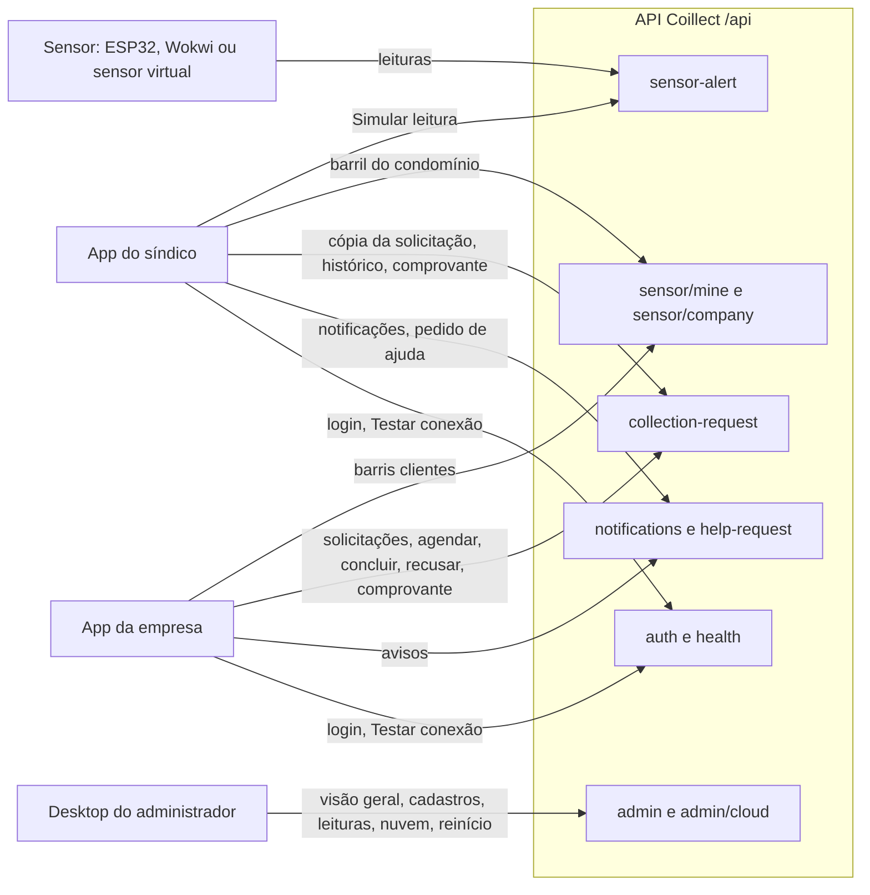

## Tempos e intervalos

| O quê | Valor | Onde está definido |
|---|---|---|
| Atualização automática dos três apps | 5 s | `AUTO_REFRESH_MS` em `SindicoApp.kt`, `EmpresaApp.kt` e `AdminApp.kt` |
| Envio periódico do sensor (firmware e sensor virtual) | 15 s | `INTERVALO_ENVIO_MS` no firmware; `--intervalo` no sensor virtual |
| Envio por variação de nível | a cada 5 pontos percentuais | `VARIACAO_ENVIO` no firmware |
| Novo alerta imediato depois de um alerta | só depois de o nível cair 10 pontos abaixo do limite | `HISTERESE_ALERTA` no firmware |
| Medição do HC-SR04 | a cada 1 s | `INTERVALO_MEDICAO_MS` no firmware |
| Leitura da fila pelo consumidor | 1 s, dobrando até 5 s quando a fila está vazia; logo após publicar, em 50 ms | `QUEUE_POLL_MS`, `QUEUE_POLL_MAX_MS` em [cloud.config.ts](../backend/src/cloud/cloud.config.ts) |
| Mensagens lidas da fila por vez e tempo de invisibilidade | até 16 mensagens, 30 s | `receive(16, 30)` em [message-queue.service.ts](../backend/src/cloud/message-queue.service.ts) |
| Tentativas antes da poison queue | 5 (a 6ª entrega vai para `coillect-notificacoes-poison`) | `QUEUE_MAX_DEQUEUE` |
| Tempo limite HTTP nos apps e no firmware | 15 s para conectar, 60 s para responder | `CoillectHttp.kt` dos apps; `HTTP_CONECTAR_MS` e `HTTP_RESPOSTA_MS` no firmware |
| Sensor considerado ativo | leitura nos últimos 30 min | `SENSOR_ONLINE_MINUTES` |

## Fluxo 1: leitura abaixo do limite

A leitura é gravada e o nível do sensor é atualizado, mas nenhuma solicitação é criada.

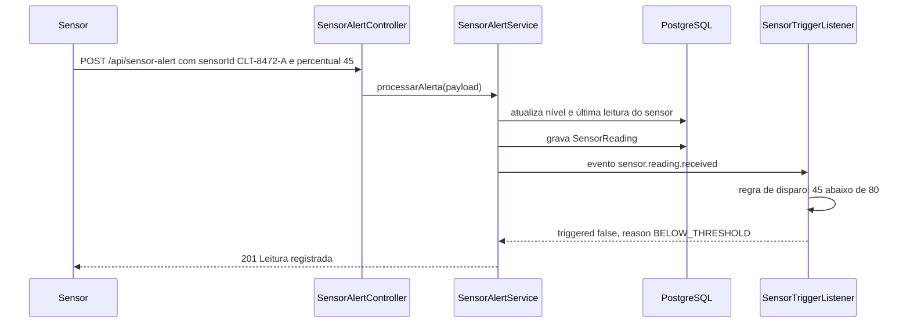

Arquivos: [sensor-alert.controller.ts](../backend/src/sensor/sensor-alert.controller.ts),
[sensor-alert.service.ts](../backend/src/sensor/sensor-alert.service.ts),
[sensor-trigger.listener.ts](../backend/src/collection-request/sensor-trigger.listener.ts),
[collection-trigger.rule.ts](../backend/src/collection-request/collection-trigger.rule.ts).

A regra avalia as condições nesta ordem e devolve o primeiro motivo que se aplica:

| Ordem | Condição | Motivo (`reason`) | Cria solicitação? |
|---|---|---|---|
| 1 | Nível abaixo do limite do barril | `BELOW_THRESHOLD` | Não |
| 2 | Sensor não está instalado em um barril | `SENSOR_NOT_INSTALLED` | Não |
| 3 | Já existe solicitação `PENDING` ou `SCHEDULED` para o barril | `REQUEST_ALREADY_OPEN` | Não (a resposta traz a solicitação aberta) |
| 4 | Houve coleta concluída e o sensor ainda não leu o barril abaixo do limite | `AWAITING_EMPTY_READING` | Não |
| 5 | O condomínio do barril não tem empresa coletora | `NO_COMPANY_LINKED` | Não |
| 6 | Nenhuma das anteriores | `THRESHOLD_REACHED` | Sim |

Um `sensorId` não cadastrado devolve 404; um corpo inválido devolve 400.

## Fluxo 2: leitura no limite abre a solicitação

A resposta ao sensor sai assim que a solicitação é gravada. Os avisos seguem pela fila e chegam aos
apps na atualização seguinte.

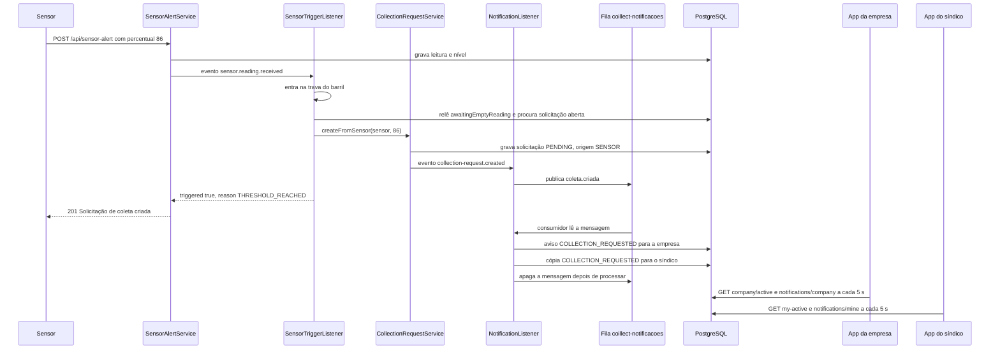

O que cada um vê depois:

| Quem | O que aparece |
|---|---|
| Sensor | Resposta `201` com `collection.triggered: true` e a solicitação; o monitor serial do firmware mostra a decisão da API |
| App da empresa | Faixa laranja "Nova solicitação de coleta" com "Residencial Aurora chegou a 86% de capacidade. Barril BRL-8472.", o contador de coletas pendentes e o reservatório acima do limite |
| App do síndico | Situação "Coleta solicitada à empresa", a notificação "Coleta solicitada automaticamente" e o badge de não lidas |
| Desktop | A solicitação nova na visão geral (o desktop mostra "Nova solicitação de coleta: #id Condomínio") e a leitura na aba Leituras |

Sem Azure, a mensagem é processada na hora, em memória, antes da resposta ao sensor. Se o Azure
estiver configurado mas fora do ar, a API processa a mensagem localmente e conta um `fallback`. Ver
[08-azure-storage-e-nuvem.md](08-azure-storage-e-nuvem.md).

## Fluxo 3: a empresa agenda a coleta

"Agendar coleta" (`POST /api/collection-request/company/schedule` com `sensorId` ou `barrelId` e
`scheduledDate` opcional) usa a mesma trava por barril do sensor. Há três casos:

| Situação do barril | O que a API faz | Notificação |
|---|---|---|
| Tem solicitação `PENDING` desta empresa | Aceita a mesma solicitação: `PENDING` → `SCHEDULED`, com a data enviada ou a atual | Síndico: `COLLECTION_SCHEDULED` ("Coleta agendada") |
| Tem solicitação `SCHEDULED` desta empresa | Só troca a data, se uma data foi enviada | Nenhuma (o status não muda, então nenhum evento é publicado) |
| Não tem solicitação aberta | Cria uma nova já `SCHEDULED`, origem `COMPANY` (coleta agendada antes do alerta) | Síndico: `COLLECTION_SCHEDULED` |
| Tem solicitação aberta de outra empresa | 409 | — |
| O barril não é de um condomínio cliente desta empresa | 404 | — |

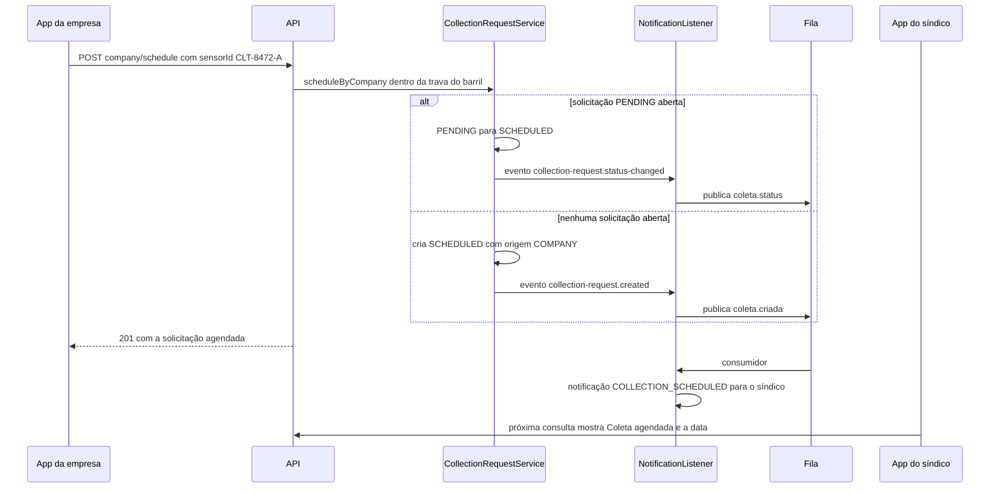

A rota antiga `POST /api/collection-request/{id}/accept` ("Iniciar etapa de coleta") faz a mesma
transição `PENDING` → `SCHEDULED` para uma solicitação específica.

## Fluxo 4: a empresa conclui a coleta

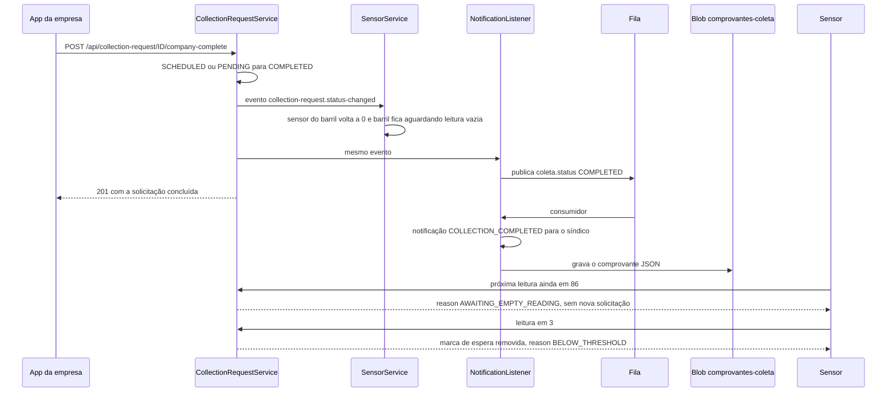

- O comprovante é um JSON gravado em `comprovantes-coleta/AAAA/MM/DD/coleta-<id>-<data>.json` e
  aberto pelos apps em `GET /api/collection-request/{id}/receipt` (síndico) e
  `GET /api/collection-request/company/{id}/receipt` (empresa). A rota responde 404 se a
  solicitação não está concluída ou se o consumidor ainda não gravou o comprovante ("ainda está sendo
  gerado"); os apps mostram essa situação.
- Concluir uma solicitação já concluída devolve a mesma solicitação, sem erro.
- O sensor virtual do PC consulta `GET /api/sensor/{sensorId}/status`, percebe a coleta concluída e
  esvazia o barril sozinho; no Wokwi é preciso arrastar a distância do HC-SR04 para o barril vazio.

## Fluxo 5: a empresa recusa a solicitação

`POST /api/collection-request/{id}/refuse` leva `PENDING` ou `SCHEDULED` a `REFUSED` e notifica o
síndico (`COLLECTION_REFUSED`, "Solicitação recusada"). O barril não é zerado nem fica aguardando
leitura de vazio. Por isso, se o sensor continuar lendo o barril acima do limite, a leitura seguinte
(em até 15 s com o firmware ou o sensor virtual) abre uma nova solicitação.

Como `GET /api/collection-request/my-active` também devolve solicitações `REFUSED`, o app do síndico
passa a mostrar a situação "Coleta solicitada à empresa" sempre que não houver solicitação pendente
ou agendada mais nova, até a demonstração ser reiniciada (ver [05-app-sindico.md](05-app-sindico.md)).
O roteiro da aula não usa "Recusar" e começa com "Reiniciar demonstração".

## Fluxo 6: Simular leitura no app do síndico

O botão "Simular leitura do sensor" envia o mesmo `POST /api/sensor-alert` do ESP32, com o `sensorId`
do barril do condomínio (lido de `GET /api/sensor/mine`) e o percentual escolhido (0 a 100). A partir
daí o caminho é idêntico aos fluxos 1 e 2. Serve para demonstrar sem Wokwi nem sensor virtual.

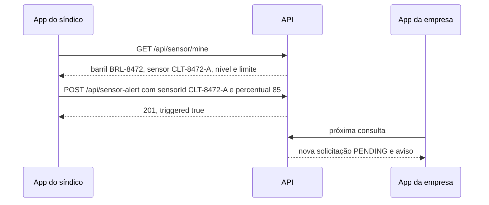

## Fluxo 7: Precisa de ajuda?

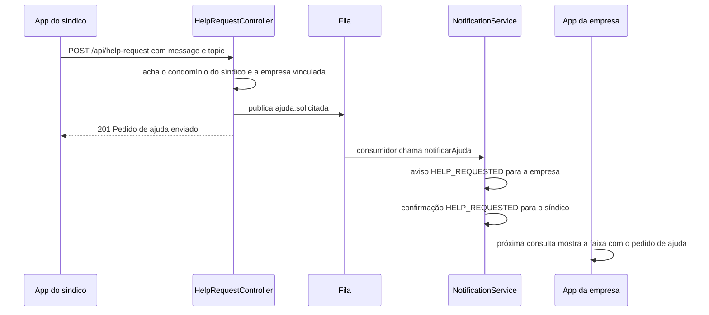

- Assuntos aceitos (`topic`): `COLETA`, `SENSOR`, `CADASTRO`, `OUTRO` (padrão `OUTRO`). A mensagem
  (`message`) é obrigatória, com até 500 caracteres.
- Aviso da empresa: título "Pedido de ajuda • Residencial Aurora", texto "Leonardo Costa (Coleta):
  ...". Confirmação do síndico: "Pedido de ajuda enviado".
- Síndico sem condomínio vinculado: 404. Condomínio sem empresa coletora: 409.

## Fluxo 8: cadastros do administrador

Os cadastros têm uma ordem natural, porque cada item se liga ao anterior. Todos ficam disponíveis na
hora para os outros clientes.

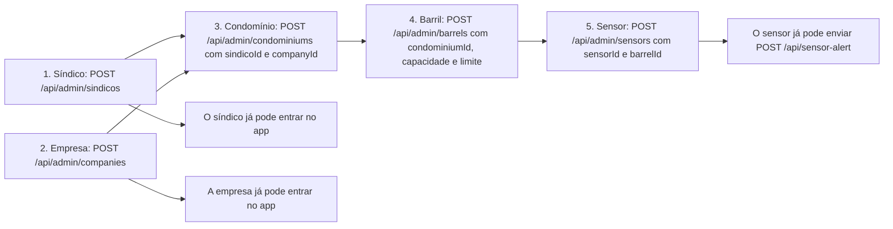

- Síndico e empresa cadastrados sem senha recebem a senha das contas de demonstração (`DEMO_PASSWORD`,
  padrão `Coillect@2025`).
- Um barril aceita um único sensor; um segundo sensor no mesmo barril devolve 409.
- As rotas `PATCH /api/admin/condominiums/{id}`, `PATCH /api/admin/barrels/{id}` e
  `PATCH /api/admin/sensors/{sensorId}` existem na API (Swagger), mas o desktop não as usa.

## Fluxo 9: reiniciar a demonstração

O botão "Reiniciar demonstração" do desktop pede confirmação e chama `POST /api/admin/demo/reset`. Em
uma única transação a API:

1. apaga todas as notificações, solicitações de coleta e leituras;
2. zera o nível de todos os sensores e a data da última coleta de todos os barris;
3. recria o que faltar dos dados de demonstração e devolve os níveis iniciais: Residencial Aurora 0%,
   Condomínio Bosque 62% e Edifício Átria 31%, removendo a marca de "aguardando leitura vazia" desses
   barris.

Contas, condomínios, barris e sensores cadastrados continuam existindo. Os comprovantes já gravados no
Blob não são apagados. A lista completa dos dados está em
[14-dados-de-demonstracao-e-glossario.md](14-dados-de-demonstracao-e-glossario.md).

## Fluxo 10: pausar e retomar a fila

Serve para mostrar na A02 que o sistema continua aceitando leituras e criando solicitações enquanto os
avisos esperam na fila. Só funciona com Azure Storage ou Azurite; no modo local a API responde 409.

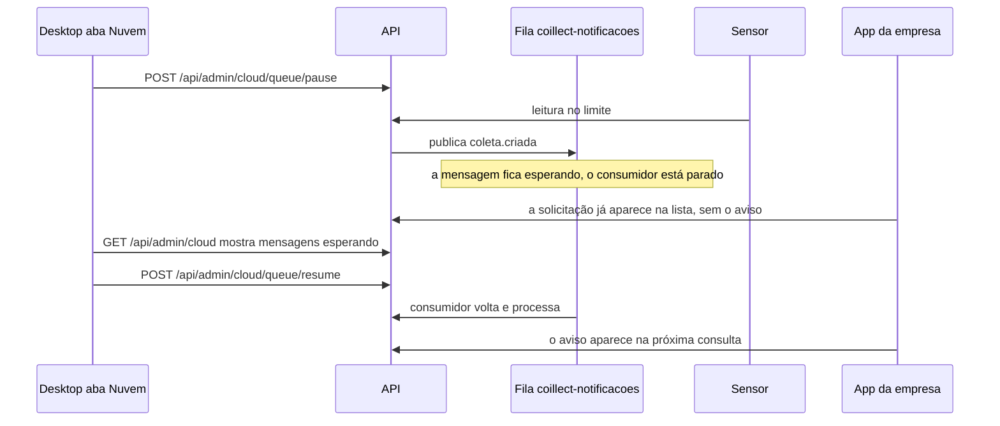

## Fluxo 11: vários clientes ao mesmo tempo

Na demonstração, o Wokwi, o sensor virtual, o "Simular leitura" do síndico e o "Agendar coleta" da
empresa podem chegar juntos. Duas proteções evitam duas solicitações para o mesmo barril:

| Proteção | Onde | O que garante |
|---|---|---|
| Fila por sensor | `SensorAlertService` ([sensor-alert.service.ts](../backend/src/sensor/sensor-alert.service.ts)) | Leituras do mesmo `sensorId` são processadas uma de cada vez |
| Trava por barril | `barrelLock` ([barrel-lock.ts](../backend/src/collection-request/barrel-lock.ts)), usada pelo listener do sensor e por `scheduleByCompany` | Para o mesmo barril, só uma avaliação por vez; a segunda já encontra a solicitação aberta |

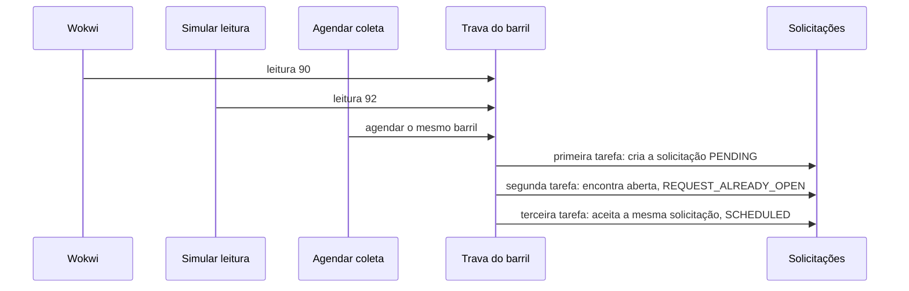

A trava fica na memória do processo: vale para uma instância da API, que é o caso do MVP. O teste e2e
"vários clientes ao mesmo tempo" envia 5 leituras e 1 "Agendar coleta" simultâneos no mesmo barril e
confere que existe uma única solicitação.

## Fluxo 12: celulares conectando na API

Os celulares falam com a API pelo endereço digitado na tela de login. Os apps completam o endereço
sozinhos (`domain/ServerAddress.kt`): `192.168.0.15` vira `http://192.168.0.15:3000/api/` e
`app-coillect.azurewebsites.net` vira `https://app-coillect.azurewebsites.net/api/`.

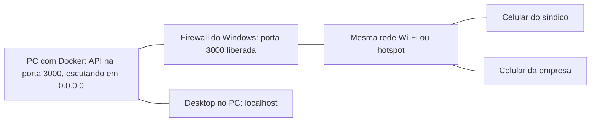

1. Com a API rodando, `node backend/scripts/endereco-celular.mjs` mostra o IP para digitar nos
   celulares, confere se a API responde nesse endereço e imprime o comando do firewall do Windows.
2. No app, "Testar conexão" chama `GET /api/health` sem login e mostra o resultado (banco e modo de
   armazenamento) ou a causa provável do erro (rede diferente, firewall, endereço sem `/api`, HTTPS no
   PC).
3. O app guarda o último servidor e e-mail usados (a senha não). O menu lateral mostra o servidor em
   uso.

Quando a rede da faculdade isola os aparelhos, as alternativas são o hotspot do celular, o túnel
`cloudflared tunnel --url http://localhost:3000` ou a API na nuvem. Detalhes em
[12-execucao-local-e-deploy.md](12-execucao-local-e-deploy.md).

## Matriz de notificações

Todas as notificações passam pela fila `coillect-notificacoes`. Cada gravação usa o id da mensagem
mais o destinatário como chave única (`dedupeKey`), então uma mensagem entregue duas vezes não gera
aviso duplicado.

| Acontecimento | Mensagem na fila | Empresa recebe | Síndico recebe | Outros efeitos |
|---|---|---|---|---|
| Solicitação criada pelo sensor (origem `SENSOR`) | `coleta.criada` | `COLLECTION_REQUESTED` "Nova solicitação de coleta": "Residencial Aurora chegou a 86% de capacidade. Barril BRL-8472." | `COLLECTION_REQUESTED` "Coleta solicitada automaticamente": "O barril BRL-8472 de Residencial Aurora atingiu 86%. A solicitação #1 foi enviada para EcoColeta Ambiental." | — |
| Solicitação criada pela empresa (origem `COMPANY`, já `SCHEDULED`) | `coleta.criada` | — | `COLLECTION_SCHEDULED` "Coleta agendada" | — |
| Solicitação manual do frontend antigo (origem `MANUAL`) | `coleta.criada` | `COLLECTION_REQUESTED`: "Leonardo Costa pediu uma coleta (solicitação #N)." | `COLLECTION_REQUESTED` | — |
| `PENDING` → `SCHEDULED` | `coleta.status` | — | `COLLECTION_SCHEDULED`: "EcoColeta Ambiental agendou a coleta do barril BRL-8472 para DD/MM, HH:MM (solicitação #N)." | — |
| → `COMPLETED` | `coleta.status` | — | `COLLECTION_COMPLETED` "Coleta concluída" | Comprovante JSON no Blob. Barril a 0% e aguardando leitura vazia (pelo evento de domínio, fora da fila) |
| → `REFUSED` | `coleta.status` | — | `COLLECTION_REFUSED` "Solicitação recusada" | — |
| → `CANCELLED` (só pedidos `MANUAL`) | `coleta.status` | `COLLECTION_CANCELLED`: "... foi cancelada pelo síndico." | `COLLECTION_CANCELLED` | — |
| Pedido de ajuda | `ajuda.solicitada` | `HELP_REQUESTED` "Pedido de ajuda • Condomínio" | `HELP_REQUESTED` "Pedido de ajuda enviado" | — |

Os textos estão em [notification.text.ts](../backend/src/notification/notification.text.ts); as datas
usam o fuso `APP_TIMEZONE` (padrão `America/Sao_Paulo`). A empresa não recebe aviso das próprias ações
(agendar, concluir, recusar).

## Estados da solicitação e de quem é cada ação

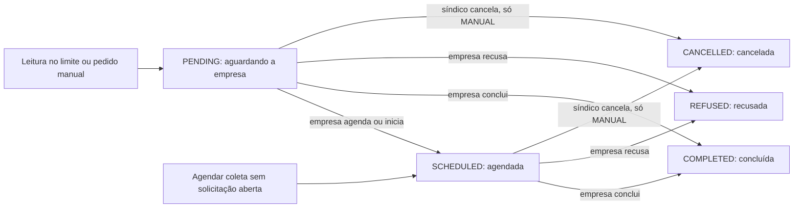

| Ação | Rota | Quem | Estados de origem | Resultado |
|---|---|---|---|---|
| Criar pelo sensor | `POST /api/sensor-alert` | Sensor | — | `PENDING`, origem `SENSOR` |
| Agendar | `POST /api/collection-request/company/schedule` | Empresa | nenhum, `PENDING` ou `SCHEDULED` | `SCHEDULED` (origem `COMPANY` se for nova) |
| Iniciar etapa de coleta | `POST /api/collection-request/{id}/accept` | Empresa | `PENDING` | `SCHEDULED` |
| Concluir | `POST /api/collection-request/{id}/company-complete` | Empresa | `PENDING`, `SCHEDULED` | `COMPLETED` |
| Recusar | `POST /api/collection-request/{id}/refuse` | Empresa | `PENDING`, `SCHEDULED` | `REFUSED` |
| Criar manualmente | `POST /api/collection-request` | Síndico (frontend antigo) | — | `PENDING`, origem `MANUAL` |
| Cancelar ou concluir | `POST /api/collection-request/{id}/cancel` e `/complete` | Síndico (frontend antigo) | `PENDING`, `SCHEDULED`, só origem `MANUAL` | `CANCELLED` ou `COMPLETED`; nas outras origens, 403 |

Uma ação num estado não permitido devolve 409 com o estado atual na mensagem. Uma solicitação de outra
empresa ou de outro síndico devolve 404.
