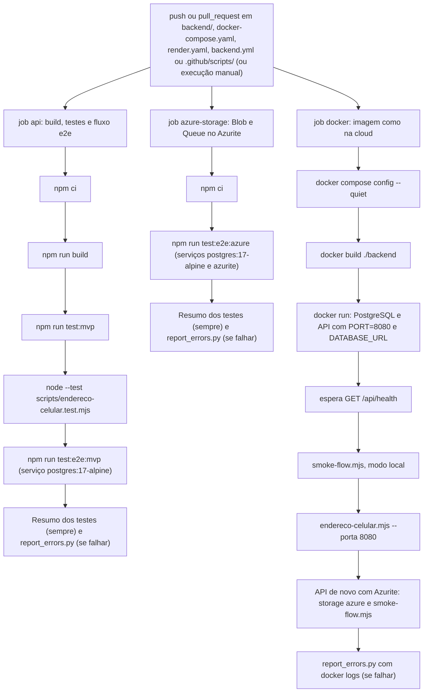
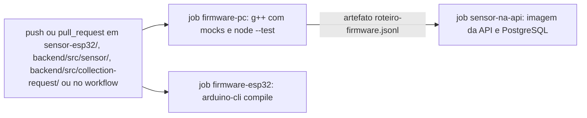

# Testes e integração contínua

Parte da [documentação do Coillect](README.md).

Este documento descreve todos os testes automatizados do Coillect (API, sensor, apps Android e
desktop), cada workflow do GitHub Actions dos quatro repositórios, como rodar cada suíte na sua
máquina e os resultados de CI registrados nos PRs. As bibliotecas e ferramentas citadas aqui estão
em [Bibliotecas e ferramentas](10-bibliotecas-e-ferramentas.md).

## Sumário

- [Visão geral](#visão-geral)
- [Testes da API (backend)](#testes-da-api-backend)
- [Testes do sensor](#testes-do-sensor)
- [Testes dos apps Android e do desktop](#testes-dos-apps-android-e-do-desktop)
- [Integração contínua (GitHub Actions)](#integração-contínua-github-actions)
- [Como rodar cada suíte localmente](#como-rodar-cada-suíte-localmente)
- [Resultados conhecidos do CI](#resultados-conhecidos-do-ci)

## Visão geral

Contagens feitas no código da `main` de 10/11/2026 (`it(`/`test(` nos arquivos JavaScript e
TypeScript, `@Test` no Kotlin, funções de cenário no C++). "PR #N" sem repositório é um PR do
CoillectApp; nas tabelas dos apps e do desktop, os números de PR são do próprio repositório.

| Camada | O que é testado | Como | Onde roda | Arquivos e contagem |
|---|---|---|---|---|
| API — unidade | Regras e serviços sem banco: regra de disparo, contrato do sensor, formatos de resposta, textos das notificações, configuração, cliente do Azure Storage, fila (com fila falsa), comprovante, trava por barril, eventos | Jest + ts-jest (`npm run test:mvp`) | CI (job `api`) ou PC, sem banco | 13 arquivos `*.spec.ts`, 70 casos |
| API — e2e com PostgreSQL real | O fluxo inteiro por HTTP: sensor → solicitação → empresa → síndico → admin, comprovante, ajuda, validações, concorrência | Jest + supertest + `@nestjs/testing`; o app é montado com o mesmo `AppModule` e o mesmo `configureApp` do `main.ts` | CI (job `api`, serviço `postgres:17-alpine`) ou PC com PostgreSQL | `test/mvp-flow.e2e-spec.ts`, 22 casos |
| API — e2e com Azurite | Fila (Queue Storage) e comprovantes (Blob Storage) no emulador oficial | Idem, com `AZURE_STORAGE_CONNECTION_STRING=UseDevelopmentStorage=true` | CI (job `azure-storage`) ou PC com Azurite | `test/azure-storage.e2e-spec.ts`, 7 casos |
| API — imagem Docker | A imagem de produção sobe como numa cloud (`PORT=8080`, `DATABASE_URL`) e passa no roteiro HTTP, sem Azure e com Azurite | `scripts/smoke-flow.mjs`, duas vezes; `scripts/endereco-celular.mjs` contra o container | CI (job `docker`) ou contra qualquer API | 16 verificações por execução |
| Script dos celulares | Escolha do IP da rede local (sem adaptadores virtuais) | `node --test` | CI (job `api`) ou PC | `scripts/endereco-celular.test.mjs`, 4 casos |
| Firmware no PC | O mesmo `.ino` do Wokwi e da placa, com hardware simulado | g++ (C++17) + mocks do Arduino | CI (job `firmware-pc`) ou PC (Linux, macOS, WSL) | `testes/firmware_testes.cpp`, 17 cenários, 81 chamadas `VERIFICA` |
| Firmware para ESP32 | O `.ino` compila para a placa "ESP32 Dev Module" | arduino-cli + core `esp32:esp32` | CI (job `firmware-esp32`) | `coillect_sensor/` (só compilação) |
| Sensor virtual | Classes do diagrama, política de envio, linha de comando e painel | `node --test` com uma API falsa local | CI (job `firmware-pc`) ou PC | `simulador-pc/sensor-virtual.test.mjs`, 13 casos |
| Sensor contra a API real | As requisições gravadas do firmware e o sensor virtual contra a imagem da API + PostgreSQL | Scripts Node | CI (job `sensor-na-api`) | `testes/reproduzir-na-api.mjs` (12 conferências), `testes/simulador-na-api.mjs` (7) |
| App do síndico | ViewModel, mapeamento dos JSON, endereço do servidor, mensagens de conexão, exibição | JUnit 4 + kotlinx-coroutines-test + `org.json`, na JVM (`testDebugUnitTest`) | CI (`android.yml`) ou PC | 6 arquivos, 39 `@Test` |
| App da empresa | Idem | Idem | CI (`android.yml`) ou PC | 6 arquivos, 38 `@Test` |
| Desktop | Controlador das abas, mapeamento dos JSON, endereço do servidor | JUnit 4 + kotlinx-coroutines-test (`:app:build`) | CI (`desktop.yml`) ou PC | 3 arquivos, 18 `@Test` |

### O que não é testado

- **Nada roda em aparelho real.** Os apps Android têm só testes JVM (`app/src/test`); o teste
  instrumentado do MobileRemake (`CollectionFlowTest`, em `androidTest`) foi apagado no PR #1 de cada
  app, e o CI não usa emulador. A janela do desktop não foi aberta (PR #1 do desktop).
- O firmware é testado no PC e compilado para o ESP32, mas **não rodou no wokwi.com nem numa placa
  física** (PR #3).
- O Azure Storage é testado contra o **Azurite**; a Storage Account real, o App Service, o
  PostgreSQL Flexible Server e o Log Analytics **não foram verificados** (PR #4). O deploy no Render
  também não.
- Os apps não são testados contra a API de verdade: os testes de mapeamento usam JSON nos formatos
  da API. O CI da API simula as chamadas dos apps por HTTP.
- O CI não roda lint (`npm run lint` na API, lint do Android).
- Não há teste que reenvie a mesma mensagem da fila para conferir a idempotência das notificações
  (`dedupeKey`).
- Os testes antigos da API (legado) não rodam (ver [Specs antigos](#specs-antigos-legado-fora-do-ci)).
- O frontend web antigo (`frontend/`) não tem testes no CI.

## Testes da API (backend)

### Testes unitários do MVP (`npm run test:mvp`)

O script passa ao Jest uma lista de caminhos: `src/config`, `src/events`, `src/sensor`,
`src/notification`, `src/cloud` e quatro arquivos de `src/collection-request`. Com a configuração do
`package.json` (`rootDir: src`, arquivos `*.spec.ts`), isso seleciona exatamente os 13 arquivos
abaixo. Nenhum precisa de banco ou de rede.

| Arquivo | Casos | O que verifica | Criado no PR (alterado) |
|---|---|---|---|
| [`src/config/database.config.spec.ts`](../backend/src/config/database.config.spec.ts) | 4 | `DATABASE_URL` tem prioridade (com `DATABASE_SSL=true`, SSL sem validar certificado; `synchronize` ligado); `DATABASE_*` sem URL e `DATABASE_SYNC=false`; `PORT` da plataforma com padrão 3000 (`abc` → 3000); flags booleanas (`true`, `1`, `false`, vazio) | #1 |
| [`src/events/domain-events.service.spec.ts`](../backend/src/events/domain-events.service.spec.ts) | 3 | Barramento em memória: listeners em ordem e com os resultados; evento sem listener não falha; erro do listener chega a quem emitiu | #1 |
| [`src/sensor/dto/sensor-alert.payload.spec.ts`](../backend/src/sensor/dto/sensor-alert.payload.spec.ts) | 10 | Contrato do sensor: aceita `{ sensorId, percentual, dataHora }`; `dataHora` opcional e, se numérica, vira texto; aceita o formato antigo `{ sensorId, level }`; `percentual` em texto numérico; exige `percentual` (ou `level`) e `sensorId`; rejeita fora de 0–100 e campos extras. `normalizeSensorAlert`: arredonda, prefere `percentual` a `level`, `dataHora` vazia vira nula | #2 |
| [`src/sensor/sensor.view.spec.ts`](../backend/src/sensor/sensor.view.spec.ts) | 3 | Visão do sensor de `sensor/mine`, `sensor/company` e `admin/overview` (barril, condomínio, bairro, empresa, síndico, 170 L estimados em 85% de 200 L, `needsCollection`, `online`); sem leitura recente fica offline; sensor sem barril | #1 (#2) |
| [`src/notification/notification.text.spec.ts`](../backend/src/notification/notification.text.spec.ts) | 7 | Aviso da empresa ("Residencial Aurora chegou a 86% de capacidade. Barril BRL-8472."); cópia do síndico; agendamento com data no fuso de São Paulo; cancelamento pelo síndico (fluxo antigo); "Precisa de ajuda?": aviso da empresa, confirmação do síndico e assunto desconhecido como "Outro assunto"; mensagem cortada em 300 caracteres | #2 (#4) |
| [`src/cloud/azure-storage.client.spec.ts`](../backend/src/cloud/azure-storage.client.spec.ts) | 10 | Connection string: Azurite local (`127.0.0.1:10000` e `:10001`, conta `devstoreaccount1`), Azurite em outro host, conta com chave (formato do portal), só SAS, erro sem chave nem SAS. Shared Key: recurso canônico, StringToSign do Put Blob, `Content-Length` 0 vazio e `Authorization` igual ao HMAC-SHA256. XML: escape/unescape e listagem de blobs | #4 |
| [`src/cloud/cloud.config.spec.ts`](../backend/src/cloud/cloud.config.spec.ts) | 3 | Sem connection string: modo local, container `comprovantes-coleta`, fila `coillect-notificacoes`, poison `coillect-notificacoes-poison`, 1000/5000 ms, 5 tentativas; com a variável: modo azure, e `CLOUD_STORAGE=local` força o local; nomes inválidos voltam ao padrão | #4 |
| [`src/cloud/message-queue.service.spec.ts`](../backend/src/cloud/message-queue.service.spec.ts) | 7 | Modo local: processa na hora, em memória; erro no consumidor não derruba quem publicou. Modo azure com fila falsa: publicar só envia e o consumidor apaga depois de processar; falha não apaga; 6ª entrega vai para a poison queue; texto que não é JSON vai direto para a poison; Azure fora do ar: processa localmente e conta o fallback | #4 |
| [`src/cloud/telemetry.spec.ts`](../backend/src/cloud/telemetry.spec.ts) | 2 | Evento em uma linha JSON (`app`, `evento`, dados, `em`); ligado por padrão, desligado com `NODE_ENV=test` ou `LOG_EVENTS=false` | #4 |
| [`src/collection-request/collection-trigger.rule.spec.ts`](../backend/src/collection-request/collection-trigger.rule.spec.ts) | 10 | Regra de disparo: 79% não dispara; 80% dispara; 100% dispara; solicitação aberta (`REQUEST_ALREADY_OPEN`); sensor sem barril (`SENSOR_NOT_INSTALLED`); abaixo do limite sem barril; após coleta (`AWAITING_EMPTY_READING`); leitura baixa após coleta; solicitação aberta tem prioridade sobre a espera; sem empresa (`NO_COMPANY_LINKED`) | #1 (#2, #3) |
| [`src/collection-request/collection-request.view.spec.ts`](../backend/src/collection-request/collection-request.view.spec.ts) | 4 | Formato da solicitação para os apps (barril e sensor); nenhuma senha ou hash no JSON; usa o barril do sensor quando a solicitação não guardou; solicitações antigas sem barril nem sensor | #1 (#2) |
| [`src/collection-request/receipt.spec.ts`](../backend/src/collection-request/receipt.spec.ts) | 3 | Nome do blob por data de conclusão em UTC (`2026/11/10/coleta-12-20261110T061500Z.json`) e protocolo `COL-000012`; conteúdo completo do comprovante (172 L estimados); volume nulo sem nível no alerta | #4 |
| [`src/collection-request/barrel-lock.spec.ts`](../backend/src/collection-request/barrel-lock.spec.ts) | 4 | Trava por barril: mesma chave em sequência e na ordem de chegada; 4 chamadas simultâneas de "há coleta aberta? se não, cria" criam uma só; chaves diferentes rodam em paralelo; erro libera a trava | #6 |
| **Total** | **70** | | |

### Fluxo e2e com PostgreSQL (`test/mvp-flow.e2e-spec.ts`)

[`mvp-flow.e2e-spec.ts`](../backend/test/mvp-flow.e2e-spec.ts) tem 22 casos, executados em ordem e
dependentes entre si (o estado passa de um caso para o outro). Antes de tudo, o teste chama
`POST /api/admin/demo/reset` e faz login como `sindico@coillect.com` e `empresa@coillect.com` (senha
`DEMO_PASSWORD` ou `Coillect@2025`), conferindo `role` `user` e `company`. No fim, reinicia a
demonstração de novo e apaga do banco os cadastros criados pelo teste (`E2E-*`, `e2e-*@coillect.test`).
O sensor principal é `CLT-8472-A` (barril `BRL-8472`, Residencial Aurora).

Nas tabelas desta seção, os caminhos curtos `company/…`, `my-active` e `:id/…` são rotas de
`/api/collection-request/`; `notifications/…`, `sensor/…` e `admin/…` ficam direto em `/api/`. Lista
completa em [Referência de rotas](03-referencia-de-rotas.md).

| # | Caso (`it`) | O que verifica |
|---|---|---|
| 1 | `health: API no ar e banco conectado` | `GET /api/health` → 200, `status: ok`, `database: up` |
| 2 | `síndico vê o barril do condomínio (sensor/mine)` | `GET /api/sensor/mine` com o token do síndico: sensor, barril, condomínio e bairro (Jardim Paulista), empresa, síndico, nível 0, limite 80, sem solicitação aberta |
| 3 | `leitura abaixo do limite NÃO cria solicitação nem aviso` | `POST /api/sensor-alert` com 50% e `dataHora`: 201, leitura guarda 50% e a `dataHora` enviada, `triggered: false` (`BELOW_THRESHOLD`), sensor `online`; empresa sem solicitações e sem avisos |
| 4 | `leitura no limite cria UMA solicitação PENDING do barril para a empresa` | 86%: `triggered: true` (`THRESHOLD_REACHED`); solicitação `PENDING`, origem `SENSOR`, `levelAtRequest` 86, barril, sensor, empresa e síndico corretos |
| 5 | `novas leituras (rota e formato antigos) não duplicam a solicitação` | `POST /api/sensor/readings` com `{ sensorId, level: 92 }`: `REQUEST_ALREADY_OPEN`, mesmo id |
| 6 | `empresa recebe a solicitação, o aviso e vê os barris clientes` | `company/active` com 1 solicitação (nível 92) e sem `password` no JSON; `notifications/company` com 1 aviso `COLLECTION_REQUESTED` ("Nova solicitação de coleta", "… chegou a 86% de capacidade. Barril BRL-8472."), não lido; `sensor/company` com 3 itens ou mais e o sensor principal com `needsCollection` e `openRequest` |
| 7 | `síndico recebe só a cópia/notificação da MESMA solicitação` | `my-active` é a mesma solicitação; `notifications/mine` com 1 notificação `SINDICO` `COLLECTION_REQUESTED`, não lida |
| 8 | `síndico NÃO pode cancelar nem concluir a coleta gerada pelo sensor` | `:id/cancel` → 403 (mensagem com "apenas acompanha"); `:id/complete` → 403; a solicitação continua `PENDING` |
| 9 | `desktop administrativo acompanha barris, sensores, leituras e solicitações` | `GET /api/admin/overview`: 1 solicitação aberta, 3 barris ou mais, 1 sensor online ou mais, sensor principal em 92%; `GET /api/admin/readings?sensorId=…` → níveis `[92, 86, 50]` e a `dataHora` original da primeira leitura |
| 10 | `"Agendar coleta" no barril com alerta aceita a MESMA solicitação` | `POST /api/collection-request/company/schedule` com `scheduledDate`: mesma solicitação, `SCHEDULED`, data gravada; síndico recebe `COLLECTION_SCHEDULED` com "12/11" na mensagem |
| 11 | `empresa conclui a coleta; barril volta a 0% e síndico é avisado` | `:id/company-complete` → `COMPLETED` com `completedAt`; `sensor/mine` em 0%, sem solicitação, com `lastCollectionAt` igual ao de `GET /api/sensor/{id}/status`; `my-active` nulo; notificações do síndico: `COMPLETED`, `SCHEDULED`, `REQUESTED`; `company/active` vazio |
| 12 | `comprovante da coleta concluída fica no Blob Storage e os apps leem` | `GET :id/receipt` (síndico) e `GET company/:id/receipt` (empresa) com o mesmo blob: protocolo `COL-` + id com 6 dígitos, condomínio, síndico, empresa, barril, sensor, container `comprovantes-coleta`, nome `AAAA/MM/DD/coleta-<id>-<data>.json`; `company/history` com `receiptAvailable` e `receiptBlob`; `GET admin/cloud`: modo `azure` ou `local` conforme a variável, blob listado, 3 mensagens processadas ou mais e 0 falhas; no modo local, `POST admin/cloud/queue/pause` → 409 |
| 13 | `empresa agenda a coleta de um barril ANTES do alerta (origem COMPANY)` | `company/schedule` no barril do Condomínio Bosque (62%): solicitação `SCHEDULED`, origem `COMPANY`, `user: null`, sem aviso para a própria empresa; alerta de 90% desse barril → `REQUEST_ALREADY_OPEN`; conclusão volta o barril a 0%; sensor inexistente → 404; sem `sensorId` → 400 |
| 14 | `após a coleta, só abre outra solicitação depois de o sensor ler o barril vazio` | 85% logo após a conclusão → `AWAITING_EMPTY_READING`, sem solicitação nem aviso; 3% → `BELOW_THRESHOLD` |
| 15 | `o fluxo pode ser repetido: nova leitura no limite gera nova solicitação` | 81% → nova solicitação (id diferente); comprovante de solicitação aberta → 404; `:id/accept` da solicitação concluída → 409 com "COMPLETED" |
| 16 | `"Precisa de ajuda?": síndico envia mensagem e a empresa recebe o aviso` | `POST /api/help-request` → `sent: true` com empresa, condomínio e tópico; empresa recebe `HELP_REQUESTED` ("Pedido de ajuda • Residencial Aurora", sem `requestId`), com o nome do síndico e o texto; síndico recebe "Pedido de ajuda enviado"; mensagem vazia → 400; tópico inválido → 400; sem token → 401 |
| 17 | `síndico e empresa marcam notificações como lidas` | `notifications/read-all` do síndico (`updated` 1 ou mais) e `notifications/mine?unread=true` vazio; empresa marca uma (`notifications/company/{id}/read` → `read: true`) e todas (`notifications/company/read-all`); `notifications/company?unread=true` vazio |
| 18 | `valida o contrato do sensor` | 150% → 400; sem `percentual` → 400; sem `sensorId` → 400; campo extra → 400; sensor inexistente → 404 |
| 19 | `rotas do síndico e da empresa exigem token` | `sensor/mine`, `company/active`, `notifications/company` e `company/schedule` sem token → 401 |
| 20 | `admin cadastra síndico, empresa, condomínio, barril e sensor, e o fluxo funciona com eles` | `POST admin/sindicos` (201; e-mail repetido → 409); `admin/companies` (201; CNPJ inválido → 400); os dois novos usuários fazem login; `admin/condominiums` (bairro Moema); `admin/barrels` (limite 75); `admin/sensors` (201; segundo sensor no mesmo barril → 409; sensor repetido → 409); `sensor/mine` do novo síndico; alerta de 76% cria a solicitação para a nova empresa |
| 21 | `atalho antigo (sensor + condomínio) cria o barril; sensor sem barril não dispara coleta` | `admin/sensors` com `condominiumId` e `threshold: 70` cria o barril `BRL-<sensor>`; sensor sem barril: alerta de 95% → `SENSOR_NOT_INSTALLED`; `PATCH admin/sensors/{id}` com `threshold` → 409 |
| 22 | `vários clientes ao mesmo tempo: leituras e "Agendar coleta" simultâneos abrem UMA solicitação do barril` | Concorrência (PR #6): 5 leituras (86, 88, 90, 92 e 94%) do barril do Edifício Átria e 1 "Agendar coleta" disparados juntos (`Promise.all`): todos 201, um único id de solicitação, no máximo 1 leitura com `triggered`, e `company/active` com uma só solicitação desse barril |

### e2e do Azure Storage com Azurite (`test/azure-storage.e2e-spec.ts`)

[`azure-storage.e2e-spec.ts`](../backend/test/azure-storage.e2e-spec.ts) tem 7 casos. Sem
`AZURE_STORAGE_CONNECTION_STRING`, o arquivo inteiro é pulado (`describe.skip`). Como a fila é
assíncrona, o teste espera cada efeito com `waitFor` (nova tentativa a cada 250 ms, até 20 s). Começa
e termina com `POST /api/admin/demo/reset`.

| # | Caso (`it`) | O que verifica |
|---|---|---|
| 1 | `API em modo azure: container e fila criados no Storage` | `GET /api/health` com `storage: azure`; `GET /api/admin/cloud`: modo azure, container `comprovantes-coleta` sem erro, fila `coillect-notificacoes` e poison `coillect-notificacoes-poison`, provedores "Azure Blob Storage" e "Azure Queue Storage" |
| 2 | `alerta do sensor: solicitação na hora; avisos chegam pela fila do Azure` | Alerta de 88% cria a solicitação na resposta; o aviso da empresa (com "88%") e a cópia do síndico chegam pela fila; contadores: publicadas e processadas 1 ou mais, 0 fallbacks |
| 3 | `empresa agenda e conclui; comprovante gravado no Blob Storage` | Depois de agendar e concluir, o comprovante aparece em `:id/receipt` com `storage.mode: azure`; o teste baixa o blob direto do Azurite (`AzureBlobContainer.download`), confere o protocolo e a listagem; o síndico recebe `COLLECTION_COMPLETED`; o comprovante da empresa aponta para o mesmo blob |
| 4 | `consumidor pausado: a solicitação nasce na hora e o aviso espera na fila` | `POST admin/cloud/queue/pause` → 201 e `paused: true`; alerta de 95% do Condomínio Bosque cria a solicitação; a fila fica com mensagem esperando e a empresa ainda sem aviso; `resume` → 201, o aviso chega e `paused: false` |
| 5 | `"Precisa de ajuda?" chega à empresa pela fila` | `POST /api/help-request` (tópico `SENSOR`) → a empresa recebe `HELP_REQUESTED` com o texto |
| 6 | `mensagem inválida vai para a poison queue` | O teste cria a poison queue, envia "isto não é JSON" direto na fila pela API REST e espera a mensagem na poison; `admin/cloud` com `poisoned` 1 ou mais |
| 7 | `a fila termina vazia: tudo processado e apagado, sem falhas` | Espera `waiting` igual a 0 e confere `failed` igual a 0 |

### Roteiro HTTP na imagem Docker (`scripts/smoke-flow.mjs`)

[`smoke-flow.mjs`](../backend/scripts/smoke-flow.mjs) percorre o ciclo da demonstração contra uma
API já no ar (local, container ou cloud), sem dependências. Exige `--reset`, porque reinicia os dados
de demonstração no início e no fim; sem ele, sai com código 2. Para na primeira falha (código 1).
Cada chamada espera até 90 s (cloud "acordando"); os avisos e o comprovante são esperados por até
30 s, para funcionar também com a fila do Azure. Variáveis opcionais: `DEMO_PASSWORD` e `SENSOR_ID`
(padrão `CLT-8472-A`). No CI, o job `docker` roda o roteiro duas vezes: sem Azure e com o Azurite.

| # | Verificação (`✓`) |
|---|---|
| 1 | API no ar e banco conectado (`GET /api/health`, `database: up`; mostra também o modo de armazenamento) |
| 2 | Dados de demonstração reiniciados (`POST admin/demo/reset`) |
| 3 | Login do síndico e da empresa |
| 4 | Leitura de 40% não cria solicitação |
| 5 | Leitura de 85% cria a solicitação `PENDING` do barril |
| 6 | Nova leitura (90%) não duplica a solicitação |
| 7 | A empresa recebeu a solicitação (`company/active`) |
| 8 | A empresa recebeu o aviso "… 85% de capacidade" |
| 9 | O síndico recebeu a cópia (`my-active`) e a notificação da mesma solicitação |
| 10 | O síndico não consegue cancelar a coleta do sensor (403) |
| 11 | O desktop vê a solicitação em aberto (`admin/overview`) |
| 12 | A empresa agendou a coleta (mesma solicitação, `SCHEDULED`) |
| 13 | A empresa concluiu a coleta (`COMPLETED`) |
| 14 | O barril voltou a 0% e não há coleta aberta |
| 15 | Comprovante gravado (protocolo, provedor, container e blob) |
| 16 | O modo da fila em `admin/cloud` é o mesmo do health; mostra processadas e falhas |

### Script do endereço para os celulares (`scripts/endereco-celular.test.mjs`)

[`endereco-celular.test.mjs`](../backend/scripts/endereco-celular.test.mjs) testa as funções puras de
[`endereco-celular.mjs`](../backend/scripts/endereco-celular.mjs) com `node --test` (4 casos). No CI,
o job `docker` também executa o próprio script contra o container (`--porta 8080`).

| # | Caso (`test`) | O que verifica |
|---|---|---|
| 1 | `prefere o Wi-Fi e deixa adaptadores virtuais (WSL/Docker) por último` | Nomes do Windows: Wi-Fi (`192.168.0.15`) primeiro, Ethernet depois, `vEthernet (WSL …)` por último; IPv6 e loopback ignorados |
| 2 | `Linux/macOS: wlan0/en0 primeiro; docker0 e br-* são virtuais` | `wlan0`, depois `eth0`; `docker0` e `br-*` marcados como virtuais (aceita `family: 4`) |
| 3 | `ignora endereço automático 169.254 (sem roteador) e interfaces vazias` | Lista vazia para `169.254.x.x`, interface sem entradas e entrada `undefined` |
| 4 | `monta o endereço do campo "Servidor da API"` | `appUrl('192.168.0.15', 3000)` → `http://192.168.0.15:3000/api` |

### Specs antigos (legado), fora do CI

A pasta `src/` ainda tem os 32 arquivos `*.spec.ts` herdados da base (módulos `user` e `company`,
`utils`, `app.controller.spec.ts` e
`collection-request/repository/collection-request.repository.spec.ts`), além de
`test/app.e2e-spec.ts`. Nenhum foi alterado nos PRs, e o CI não os executa. Motivo, no corpo do PR #1:
"`npm test` com os testes antigos já falhava antes (arquivos que não compilam e um vazio). Não foram
alterados; o CI roda `test:mvp` e `test:e2e:mvp`." O arquivo vazio é
`src/collection-request/repository/collection-request.repository.spec.ts` (0 bytes). Quais arquivos
não compilam não foi conferido aqui. Os scripts `npm test` e `npm run test:e2e` (sem filtro) incluem
esses arquivos; por isso o CI usa os scripts com lista explícita.

## Testes do sensor

Todos foram criados no PR #3 e ficam em [`sensor-esp32/`](../sensor-esp32/README.md).

### Firmware no PC (`testes/firmware_testes.cpp`)

[`firmware_testes.cpp`](../sensor-esp32/testes/firmware_testes.cpp) define
`COILLECT_API_URL "http://api.teste/api/sensor-alert"` e inclui o próprio
[`coillect_sensor.ino`](../sensor-esp32/coillect_sensor/coillect_sensor.ino). Os headers de
[`testes/mocks/`](../sensor-esp32/testes/mocks/) substituem o Arduino: o relógio é virtual (`delay()`
avança `millis()` na hora, então 60 s de simulação rodam em milissegundos), o HC-SR04 devolve a
distância definida pelo teste, o Wi-Fi liga e desliga, e o `HTTPClient` grava cada requisição e
responde com uma **API falsa** que segue as regras da API (limite de 80%, uma solicitação aberta por
barril, espera da leitura de barril vazio após a coleta). A saída termina com
`N verificações, M falha(s)` e o código de saída é 1 se houver falha. Opções: `--eco` mostra o
monitor serial; `--capturar <arquivo.jsonl>` grava as requisições do roteiro da apresentação
(usadas pelo `reproduzir-na-api.mjs`).

| # | Cenário (função) | `VERIFICA` | O que confere |
|---|---|---|---|
| 1 | `testeCalculadora` | 12 | Distância → percentual num barril de 90 cm (90 cm → 0%, 81 → 10%, 45 → 50%, 18 → 80%, 12,6 → 86%, 2 → 98%, 0 → 100%, além do fundo → 0%, altura inválida → 0%, sem eco → 0%); 80% atinge o limite de 80%, 79% não |
| 2 | `testeUltrassonico` | 3 | Mede 45 cm pela mediana de 5 pulsos; sem eco devolve −1 |
| 3 | `testePayload` | 2 | JSON exato do contrato; sem relógio sincronizado, omite `dataHora` |
| 4 | `testePrimeiraLeitura` | 13 | Conecta em `Wokwi-GUEST` no canal 6; 1 envio ao ligar, na URL configurada, com `Content-Type: application/json`, por `WiFiClient` (`http://`); corpo no formato do contrato com `dataHora` em `-03:00`; tempo limite de 15 s para conectar e 60 s para responder; monitor mostra o motivo e a decisão da API; LED verde aceso, vermelho apagado |
| 5 | `testePeriodico` | 3 (uma delas dentro de um laço) | 5 envios em 61 s (0, 15, 30, 45 e 60 s), com 15 s entre eles; 4 com motivo "periódico" |
| 6 | `testeAlertaImediato` | 10 | Em 86%, envia em até ~1 s, sem esperar os 15 s; monitor mostra a solicitação #12 criada e aberta; LED vermelho aceso; acima do limite não repete o alerta; os periódicos seguem e a API não duplica |
| 7 | `testeHisterese` | 3 | 75% não rearma o alerta; 60% rearma; envia 10, 86, 75, 86, 60, 86 |
| 8 | `testeVariacao` | 4 | Mudança de 10% para 40% é enviada antes do período (motivo "variação de nível"); mudança de 2 pontos espera |
| 9 | `testeSemEco` | 2 | Sem eco do HC-SR04, nada é enviado e o monitor avisa |
| 10 | `testeApiForaDoAr` | 8 | Sem resposta da API: avisa e apaga o LED verde; 5 s depois reenvia 86% (motivo "alerta - nova tentativa"), a API cria a solicitação e o LED verde volta |
| 11 | `testeWiFiCaiu` | 7 | Sem Wi-Fi: não envia, avisa e guarda o alerta; reconecta e envia o alerta de 86% |
| 12 | `testeBotao` | 2 | O botão gera um envio extra (motivo "botão (envio manual)") |
| 13 | `testeHttps` | 2 | URL `https://` usa `WiFiClientSecure` com `setInsecure` |
| 14 | `testeUrlDeExemplo` | 2 | Com a URL de exemplo (`SEU-SERVICO`), não envia e avisa ao ligar |
| 15 | `testeColetaConcluida` | 5 | Coleta concluída com o barril ainda cheio: o monitor avisa e a API falsa não abre outra solicitação; depois de ler vazio e encher de novo, novo ciclo |
| 16 | `testeSetupLoop` | 1 | `setup()` e `loop()` do sketch enviam a primeira leitura |
| 17 | `testeRoteiro` | 2 | Roteiro 10% → 50% → 86% → 92% → barril vazio (0%) com uma solicitação; é o roteiro gravado por `--capturar` |
| | **Total** | **81** | |

### Sensor virtual (`simulador-pc/sensor-virtual.test.mjs`)

[`sensor-virtual.test.mjs`](../sensor-esp32/simulador-pc/sensor-virtual.test.mjs) tem 13 casos
(`node --test`). Os testes de política usam um relógio falso; os de rede sobem uma API falsa em
`127.0.0.1` com as mesmas regras da API Coillect.

| # | Caso (`test`) | O que verifica |
|---|---|---|
| 1 | `FillLevelCalculator converte distância em percentual como o firmware` | Mesmos valores do firmware |
| 2 | `HC-SR04 simulado mede a distância até o óleo (mínimo de 2 cm)` | 85% → 13,5 cm; 100% → 2 cm; percentual limitado a 100 |
| 3 | `AlertPayload segue o contrato e dataHora vem com fuso` | JSON com e sem `dataHora`; `dataHoraLocal()` em ISO 8601 com fuso |
| 4 | `normalizarApi aceita base, rota completa ou só o host` | Tudo vira `…/api`; `localhost:3000` sem esquema é recusado |
| 5 | `política: primeira leitura, periódico a cada 15 s` | Envios em 0, 15, 30, 45 e 60 s |
| 6 | `política: alerta na hora, sem repetir enquanto continua cheio` | Alerta em até 1 s; um só alerta em 40 s |
| 7 | `política: histerese de 10 pontos para um novo alerta` | 10, 86, 75, 86, 60, 86 → 2 alertas |
| 8 | `política: variação de 5 pontos envia antes; 2 pontos espera` | 10% → 40% envia; 40% → 42% espera |
| 9 | `política: falha guarda o alerta e tenta de novo após 5 s` | Motivo "alerta - nova tentativa" |
| 10 | `botão "Enviar agora" envia na hora` | Motivo "botão (envio manual)" |
| 11 | `RouterClient faz o POST real (JSON) e entende a resposta da API` | Contra a API falsa: 201 e `THRESHOLD_REACHED`; sensor desconhecido → 404; API fora do ar (porta 9) → status 0 |
| 12 | `linha de comando --uma-vez envia a leitura e mostra a decisão da API` | O simulador, como processo filho, com `--percentual 85`, sai com código 0 e imprime `HTTP 201 … [THRESHOLD_REACHED`; `dataHora` com fuso |
| 13 | `painel: carrega o nível da API, aplica ações e esvazia quando a coleta é concluída` | Painel HTML no ar; começa em 62% (nível da API falsa); a ação "nível 88" abre a solicitação; após a conclusão, esvazia e envia 0%; sensor desconhecido → 404 |

### Requisições do firmware na API real (`testes/reproduzir-na-api.mjs`)

[`reproduzir-na-api.mjs`](../sensor-esp32/testes/reproduzir-na-api.mjs) reenvia para uma API de
verdade os corpos que o firmware gerou no roteiro (`--capturar`) e confere o efeito no sistema
inteiro. Uso: `node sensor-esp32/testes/reproduzir-na-api.mjs <URL_DA_API> <arquivo.jsonl> --reset`
(`--reset` é obrigatório: reinicia a demonstração no início e no fim). 12 conferências:

| # | Conferência |
|---|---|
| 1 | Roteiro do firmware lido (4 requisições ou mais) |
| 2 | A API aceitou todas as requisições do firmware (HTTP 201, contrato idêntico) |
| 3 | O alerta do firmware criou uma única solicitação |
| 4 | Solicitação `PENDING`, origem `SENSOR`, com barril |
| 5 | As leituras seguintes no limite não duplicam (`REQUEST_ALREADY_OPEN`) |
| 6 | A última leitura (barril esvaziado) foi registrada como 0% |
| 7 | A `dataHora` do firmware foi guardada como veio (com fuso) |
| 8 | A empresa recebeu a solicitação do barril (`company/active`) |
| 9 | A empresa recebeu o aviso "Nova solicitação de coleta" |
| 10 | O síndico recebeu só a notificação da mesma solicitação |
| 11 | Depois de agendar e concluir, a leitura do barril ainda cheio não abre solicitação (`AWAITING_EMPTY_READING`) |
| 12 | Barril lido vazio e cheio de novo: novo ciclo, com nova solicitação |

### Sensor virtual na API real (`testes/simulador-na-api.mjs`)

[`simulador-na-api.mjs`](../sensor-esp32/testes/simulador-na-api.mjs) roda o sensor virtual contra
uma API de verdade: primeiro pela linha de comando, depois com o painel e o laço de envio. Uso:
`node sensor-esp32/testes/simulador-na-api.mjs <URL_DA_API> --reset`. 7 conferências:

| # | Conferência |
|---|---|
| 1 | `--uma-vez` com 90% no sensor `CLT-9801-C` cria a solicitação (código de saída 0) |
| 2 | O painel começa no nível que a API tinha (Condomínio Bosque, 62%) |
| 3 | A primeira leitura do simulador é aceita (HTTP 201) |
| 4 | Com o painel em 88%, a API abre uma solicitação `PENDING` |
| 5 | A empresa recebeu o aviso do Condomínio Bosque |
| 6 | A empresa agenda e conclui; o simulador percebe e esvazia o barril |
| 7 | O sensor leu o barril vazio e nenhuma solicitação nova foi aberta |

Os dois roteiros conferem os avisos logo depois das leituras, sem esperar a fila. No CI a API roda
sem Azure (modo local), em que os avisos saem na hora. Com Blob e Queue ligados (Azurite ou Azure), o
aviso chega pela fila alguns segundos depois, e essas conferências podem falhar.

## Testes dos apps Android e do desktop

Todos são testes de unidade na JVM, com repositórios falsos e JSON nos formatos da API; nenhum usa
emulador ou aparelho. O detalhe por função está em [App do síndico](05-app-sindico.md),
[App da empresa](06-app-empresa.md) e [Desktop do administrador](07-desktop-admin.md).

### App do síndico (`app/src/test/java/br/com/coillect/sindico/`)

| Arquivo | `@Test` | O que cobre | Criado no PR (alterado) |
|---|---|---|---|
| [`ApiMappingTest.kt`](https://github.com/CoillectADM/app-mobile-sindico/blob/main/app/src/test/java/br/com/coillect/sindico/ApiMappingTest.kt) | 9 | Conversão dos JSON da API: solicitação ativa e ausente, visão do sensor (nível limitado), notificações com pedido de ajuda, histórico com comprovante, comprovante do Blob, resposta do `sensor-alert`, `GET health` e servidor que não é a API Coillect | #1 (#2, #3) |
| [`ConnectionTest.kt`](https://github.com/CoillectADM/app-mobile-sindico/blob/main/app/src/test/java/br/com/coillect/sindico/ConnectionTest.kt) | 5 | Mensagens do "Testar conexão" e dos erros de rede: API saudável, API sem banco, celular sem alcançar o PC, servidor errado ou sem `/api`, mensagens gerais | #3 |
| [`DisplayTest.kt`](https://github.com/CoillectADM/app-mobile-sindico/blob/main/app/src/test/java/br/com/coillect/sindico/DisplayTest.kt) | 3 | Iniciais e primeiro nome, bolinhas do "Simular leitura", rótulo da situação | #2 |
| [`FormValidationTest.kt`](https://github.com/CoillectADM/app-mobile-sindico/blob/main/app/src/test/java/br/com/coillect/sindico/FormValidationTest.kt) | 2 | E-mail com espaços aceito; e-mail inválido rejeitado | #1 |
| [`ServerAddressTest.kt`](https://github.com/CoillectADM/app-mobile-sindico/blob/main/app/src/test/java/br/com/coillect/sindico/ServerAddressTest.kt) | 5 | Campo "Servidor da API": IP vira `http://IP:3000/api/`, padrão do emulador mantido, domínio vira `https://…/api/`, vazio continua vazio, host mostrado no menu | #3 |
| [`SindicoViewModelTest.kt`](https://github.com/CoillectADM/app-mobile-sindico/blob/main/app/src/test/java/br/com/coillect/sindico/SindicoViewModelTest.kt) | 15 | Login com endereço normalizado, "Testar conexão" (ok e falha), login inválido, rota do barril ausente sem esconder o aviso, avisos de nova solicitação e notificação, simular leitura (com e sem barril), pedido de ajuda, histórico e comprovante (inclusive "em geração"), modo demonstração, logout | #1 (#2, #3) |
| **Total** | **39** | | |

### App da empresa (`app/src/test/java/br/com/coillect/empresa/`)

| Arquivo | `@Test` | O que cobre | Criado no PR (alterado) |
|---|---|---|---|
| [`ApiMappingTest.kt`](https://github.com/CoillectADM/app-mobile-empresa/blob/main/app/src/test/java/br/com/coillect/empresa/ApiMappingTest.kt) | 9 | Solicitações ativas da empresa, payload antigo sem condomínio, status desconhecido sem quebrar, reservatório com e sem solicitação (nível limitado), avisos com pedido de ajuda, comprovante do Blob, `GET health`, servidor que não é a API | #1 (#2, #3) |
| [`ConnectionTest.kt`](https://github.com/CoillectADM/app-mobile-empresa/blob/main/app/src/test/java/br/com/coillect/empresa/ConnectionTest.kt) | 5 | Mesmas mensagens do app do síndico | #3 |
| [`DisplayTest.kt`](https://github.com/CoillectADM/app-mobile-empresa/blob/main/app/src/test/java/br/com/coillect/empresa/DisplayTest.kt) | 2 | Saudação e nomes; seleção do reservatório como no mockup | #2 |
| [`EmpresaViewModelTest.kt`](https://github.com/CoillectADM/app-mobile-empresa/blob/main/app/src/test/java/br/com/coillect/empresa/EmpresaViewModelTest.kt) | 15 | Login com endereço normalizado, "Testar conexão" (ok e falha), login inválido, nome da empresa na saudação, aviso de nova solicitação uma vez, seleção do reservatório com solicitação pendente, toque duplo agenda uma vez, conflito 409 explicado, concluir e recusar, faixa de aviso, pedido de ajuda, histórico e comprovante, rota de clientes ausente, ciclo da demonstração | #1 (#2, #3) |
| [`FormValidationTest.kt`](https://github.com/CoillectADM/app-mobile-empresa/blob/main/app/src/test/java/br/com/coillect/empresa/FormValidationTest.kt) | 2 | Validação do e-mail | #1 |
| [`ServerAddressTest.kt`](https://github.com/CoillectADM/app-mobile-empresa/blob/main/app/src/test/java/br/com/coillect/empresa/ServerAddressTest.kt) | 5 | Mesmos casos do app do síndico | #3 |
| **Total** | **38** | | |

### Desktop (`app/src/test/kotlin/br/com/coillect/admin/`)

| Arquivo | `@Test` | O que cobre | Criado no PR (alterado) |
|---|---|---|---|
| [`AdminControllerTest.kt`](https://github.com/CoillectADM/interface-desktop-adm-coillect/blob/main/app/src/test/kotlin/br/com/coillect/admin/AdminControllerTest.kt) | 11 | Conectar sem anunciar solicitações antigas, anúncio de nova solicitação, rota ausente explicada, servidor vazio, aba Leituras, cadastros, erros de validação da API, reiniciar demonstração, pausar/retomar a fila, modo demonstração, desconectar | #1 (#2) |
| [`ApiMappingTest.kt`](https://github.com/CoillectADM/interface-desktop-adm-coillect/blob/main/app/src/test/kotlin/br/com/coillect/admin/ApiMappingTest.kt) | 5 | Visão geral, listas ausentes viram vazias, leituras, condomínio e barril, estado da nuvem | #1 (#2) |
| [`ServerAddressTest.kt`](https://github.com/CoillectADM/interface-desktop-adm-coillect/blob/main/app/src/test/kotlin/br/com/coillect/admin/ServerAddressTest.kt) | 2 | Endereço local mantido ou completado; endereço da nuvem com `https://` e `/api/` | #3 |
| **Total** | **18** | | |

Os testes do MobileRemake (`CoillectViewModelTest`, 5 `@Test`; `FormValidationTest`, 4 `@Test`; e o
instrumentado `CollectionFlowTest`, 1 `@Test`) foram apagados no PR #1 de cada um dos três
repositórios.

## Integração contínua (GitHub Actions)

### Visão dos workflows

| Repositório | Workflow (nome) | Gatilhos | Jobs | O que publica |
|---|---|---|---|---|
| CoillectApp | [`backend.yml`](../.github/workflows/backend.yml) ("Backend (API Coillect)") | `push` e `pull_request` com mudança em `backend/**`, `docker-compose.yaml`, `render.yaml`, `.github/workflows/backend.yml` ou `.github/scripts/**`; `workflow_dispatch` | `api`, `azure-storage`, `docker` (em paralelo) | Só anotações |
| CoillectApp | [`imagem-api.yml`](../.github/workflows/imagem-api.yml) ("Imagem da API (GitHub Container Registry)") | `push` na `main` com mudança em `backend/**` ou no próprio workflow; `workflow_dispatch` | `publicar` | Imagem `ghcr.io/coillectadm/coillect-api` (`latest` e SHA) |
| CoillectApp | [`sensor-esp32.yml`](../.github/workflows/sensor-esp32.yml) ("Sensor ESP32 (firmware, Wokwi e sensor virtual)") | `push` e `pull_request` com mudança em `sensor-esp32/**`, `backend/src/sensor/**`, `backend/src/collection-request/**` ou no próprio workflow; `workflow_dispatch` | `firmware-pc`, `firmware-esp32`, `sensor-na-api` (depois de `firmware-pc`) | Artefato `roteiro-firmware` |
| app-mobile-sindico | [`android.yml`](https://github.com/CoillectADM/app-mobile-sindico/blob/main/.github/workflows/android.yml) ("Android CI") | Todo `push`, em qualquer branch; `workflow_dispatch` | `build` | Artefato `app-mobile-sindico-debug-apk` (7 dias); na `main`, release `demo` com `coillect-sindico.apk` |
| app-mobile-empresa | [`android.yml`](https://github.com/CoillectADM/app-mobile-empresa/blob/main/.github/workflows/android.yml) ("Android CI") | Idem | `build` | Artefato `app-mobile-empresa-debug-apk` (7 dias); na `main`, release `demo` com `coillect-empresa.apk` |
| interface-desktop-adm-coillect | [`desktop.yml`](https://github.com/CoillectADM/interface-desktop-adm-coillect/blob/main/.github/workflows/desktop.yml) ("Desktop CI") | Todo `push`; `workflow_dispatch` | `build` | Só anotações |
| CoillectApp | [`documentacao.yml`](../.github/workflows/documentacao.yml) ("Documentação") | `push` na `main` e `pull_request` com mudança em `documenta*/**`, no script ou no próprio workflow; `workflow_dispatch` | `verificar` | Só anotações |

Pontos comuns:

- Todos os jobs rodam em `ubuntu-latest`. Os workflows dos apps e do desktop não têm gatilho
  `pull_request`; a branch de um PR é testada pelo `push`.
- Os workflows do CoillectApp declaram `defaults.run.shell: bash`; com o shell declarado, o GitHub
  Actions roda cada passo com `pipefail`, então um erro antes do `| tee` falha o passo. Nos apps e no
  desktop, o mesmo efeito vem do `exit ${PIPESTATUS[0]}`.
- Os passos principais gravam a saída em logs com `tee` (`$RUNNER_TEMP/*.log` no CoillectApp,
  `build.log` nos apps e no desktop). Em caso de falha, o `report_errors.py` transforma esses logs em
  anotações (ver [report_errors.py](#report_errorspy)).
- O PR #5 (só documentação) não disparou o `backend.yml`, por causa do filtro de caminhos.
- O `documentacao.yml` entrou junto com esta pasta de documentação, depois dos PRs descritos no
  [histórico](13-historico-de-mudancas.md).

### `backend.yml`



Os três jobs rodam em paralelo, cada um com limite de 20 min. Nenhum define `permissions`.

**Job `api` — "Build, testes e fluxo e2e (PostgreSQL)".** Serviço `postgres:17-alpine` (usuário e
senha `postgres`, banco `coillect_test`, porta 5432, health check `pg_isready` a cada 5 s, até 20
tentativas).

| # | Passo | Comando | O que valida |
|---|---|---|---|
| 1 | Checkout | `actions/checkout@v5` | — |
| 2 | Node | `actions/setup-node@v5`, Node 24, cache npm de `backend/package-lock.json` | — |
| 3 | Instalar dependências | `npm ci` | O lock file instala sem erro |
| 4 | Build | `npm run build` (`nest build`) | O TypeScript de `src/` compila (sem os `*.spec.ts`) |
| 5 | Testes unitários do MVP | `npm run test:mvp` | 13 arquivos, 70 casos |
| 6 | Script do endereço para os celulares (testes) | `node --test scripts/endereco-celular.test.mjs` | 4 casos |
| 7 | Fluxo e2e (sensor → empresa → síndico → admin) | `npm run test:e2e:mvp`, com `DATABASE_HOST=localhost`, `DATABASE_PORT=5432`, usuário e senha `postgres`, `DATABASE_NAME=coillect_test` e um `JWT_SECRET` só do CI | 22 casos contra o PostgreSQL do serviço, em modo local (sem Azure) |
| 8 | Resumo dos testes (`if: always()`) | Copia as linhas `Test Suites:` e `Tests:` do Jest | Anotações `::notice` com as contagens |
| 9 | Resumo dos erros (`if: failure()`) | `python3 .github/scripts/report_errors.py $RUNNER_TEMP/*.log` | Anotações `::error` com os trechos das falhas |

**Job `azure-storage` — "Azure Storage (Blob + Queue) contra o Azurite".** Serviços
`postgres:17-alpine` (igual ao do job `api`) e `mcr.microsoft.com/azure-storage/azurite` (portas 10000
Blob, 10001 Queue, 10002 Table).

| # | Passo | Comando | O que valida |
|---|---|---|---|
| 1–3 | Checkout, Node 24, `npm ci` | Iguais ao job `api` | — |
| 4 | Fila (Queue Storage) e comprovantes (Blob Storage) no Azurite | `npm run test:e2e:azure`, com as mesmas variáveis `DATABASE_*` e `JWT_SECRET`, mais `AZURE_STORAGE_CONNECTION_STRING=UseDevelopmentStorage=true`, `QUEUE_POLL_MS=200` e `QUEUE_POLL_MAX_MS=1000` (fila lida mais vezes, para o teste andar rápido) | 7 casos contra o Azurite |
| 5 | Resumo dos testes (`if: always()`) | Linhas `Test Suites:`/`Tests:` | Anotações `::notice` |
| 6 | Resumo dos erros (`if: failure()`) | `report_errors.py` | Anotações `::error` |

**Job `docker` — "Imagem Docker como na cloud (PORT + DATABASE_URL)".** Sem serviços e sem
`setup-node` (usa o Node do runner).

| # | Passo | Comando | O que valida |
|---|---|---|---|
| 1 | Checkout | `actions/checkout@v5` | — |
| 2 | Validar docker-compose.yaml | `docker compose config --quiet` | Sintaxe e variáveis do compose |
| 3 | Build da imagem | `docker build -t coillect-api ./backend` | O Dockerfile de produção (multi-stage, `npm ci`, `nest build`, `npm prune --omit=dev`) |
| 4 | Subir PostgreSQL + API (porta 8080, DATABASE_URL) | Rede `coillect`; container `coillect-db` (`postgres:17-alpine`); container `coillect-api` com `PORT=8080`, `DATABASE_URL` apontando para `coillect-db` e `JWT_SECRET` | A API sobe só com variáveis de ambiente, como numa cloud |
| 5 | Aguardar /api/health | `curl -fsS http://localhost:8080/api/health`, até 60 tentativas a cada 3 s | A API respondeu em até 3 min |
| 6 | Roteiro completo via HTTP | `node backend/scripts/smoke-flow.mjs http://localhost:8080/api --reset` | 16 verificações, sem Azure; anotação com o número de `✓` |
| 7 | Endereço para os celulares | `node backend/scripts/endereco-celular.mjs --porta 8080` | O script acha a API em `127.0.0.1:8080` e lista os IPs (sai com erro se a API não responder ou não houver rede) |
| 8 | Mesma imagem com Azure Storage (Azurite no lugar da Storage Account) | Troca o container da API por outro ligado a um Azurite (`coillect-azurite`) via `AZURE_STORAGE_CONNECTION_STRING=UseDevelopmentStorage=true;DevelopmentStorageProxyUri=http://coillect-azurite`; espera o health; confere `"storage":"azure"`; roda o `smoke-flow.mjs` de novo | A imagem usa Blob e Queue; 16 verificações com os avisos pela fila; anotação com o número de `✓` |
| 9 | Resumo dos erros (`if: failure()`) | Salva `docker logs coillect-api` e roda o `report_errors.py` | Anotações `::error` |

### `imagem-api.yml`

- **Gatilhos:** `push` na `main` com mudança em `backend/**` ou no próprio workflow; `workflow_dispatch`.
- **Permissões:** `contents: read`, `packages: write`.
- **Job `publicar`** (limite de 20 min): `actions/checkout@v5` → `docker/setup-buildx-action@v3` →
  `docker/login-action@v3` (registro `ghcr.io`, usuário `github.actor`, senha `GITHUB_TOKEN`) →
  `docker/build-push-action@v6` (contexto `./backend`, `push: true`, tags
  `ghcr.io/coillectadm/coillect-api:latest` e `ghcr.io/coillectadm/coillect-api:<sha do commit>`,
  rótulos `org.opencontainers.image.source` e `org.opencontainers.image.description`) → passo
  "Resumo" com uma anotação da imagem publicada.
- A publicação não depende do resultado do `backend.yml`: são workflows independentes.
- Depois da primeira publicação, o pacote precisa ser tornado público uma vez no GitHub
  (Packages → `coillect-api` → Package settings → Change visibility → Public), para o App Service
  baixar a imagem sem senha (comentário do workflow).

### `sensor-esp32.yml`



**Job `firmware-pc` — "Firmware no PC (hardware simulado) e sensor virtual"** (limite de 10 min).

| # | Passo | Comando | O que valida |
|---|---|---|---|
| 1 | Checkout e Node 24 | `actions/checkout@v5`, `actions/setup-node@v5` | — |
| 2 | Testes do firmware | `g++ -std=c++17 -Wall -Wextra -I sensor-esp32/testes/mocks -o $RUNNER_TEMP/firmware-testes sensor-esp32/testes/firmware_testes.cpp` e depois o binário com `--capturar $RUNNER_TEMP/roteiro-firmware.jsonl` | O `.ino` compila no PC e passa nos 17 cenários; grava o roteiro |
| 3 | Testes do sensor virtual no PC | `node --test sensor-esp32/simulador-pc/sensor-virtual.test.mjs` | 13 casos |
| 4 | Resumo (`if: always()`) | Última linha do teste do firmware; linhas `ℹ pass`/`ℹ fail` do `node --test`; até 20 linhas com `FALHOU`, `warning:` ou `error:` | Anotações `::notice` e `::warning` |
| 5 | Artefato | `actions/upload-artifact@v4`, nome `roteiro-firmware`, `if-no-files-found: error` | O roteiro existe |

**Job `firmware-esp32` — "Firmware compila para o ESP32 (Arduino core da Espressif)"** (limite de 30
min; variável `ESP32_INDEX` com `https://espressif.github.io/arduino-esp32/package_esp32_index.json`).

| # | Passo | Comando | O que valida |
|---|---|---|---|
| 1 | Checkout e arduino-cli | `actions/checkout@v5`, `arduino/setup-arduino-cli@v2` | — |
| 2 | Cache do core ESP32 | `actions/cache@v4` em `~/.arduino15`, chave `arduino15-esp32-<SO>-v1` | — |
| 3 | Instalar o core ESP32 | `arduino-cli core update-index`, `arduino-cli core install esp32:esp32`, `arduino-cli core list` | Core instalado (a versão aparece no log) |
| 4 | Compilar `coillect_sensor.ino` | `arduino-cli compile --fqbn esp32:esp32:esp32 --warnings default sensor-esp32/coillect_sensor` | Compila para a placa "ESP32 Dev Module"; anotações com as linhas de uso de memória ("Sketch uses", "Global variables") |

**Job `sensor-na-api` — "Firmware e sensor virtual contra a API real (Docker + PostgreSQL)"** (limite
de 20 min; `needs: firmware-pc`).

| # | Passo | Comando | O que valida |
|---|---|---|---|
| 1 | Checkout, Node 24 e artefato | `actions/checkout@v5`, `actions/setup-node@v5`, `actions/download-artifact@v4` (`roteiro-firmware`) | — |
| 2 | Subir PostgreSQL + API (imagem da cloud) | `docker build` da API; `postgres:17-alpine`; API com `PORT=8080`, `DATABASE_URL` e `JWT_SECRET`, sem Azure | — |
| 3 | Aguardar /api/health | 60 tentativas a cada 3 s | A API respondeu |
| 4 | Requisições do firmware na API real | `node sensor-esp32/testes/reproduzir-na-api.mjs http://localhost:8080/api <roteiro> --reset` | 12 conferências; anotação com o número de `✓` |
| 5 | Sensor virtual do PC na API real | `node sensor-esp32/testes/simulador-na-api.mjs http://localhost:8080/api --reset` | 7 conferências; anotação com o número de `✓` |
| 6 | Logs da API em caso de falha (`if: failure()`) | `docker logs coillect-api` (últimas 80 linhas) | — |

Este workflow não usa o `report_errors.py`.

### `android.yml` (app do síndico e app da empresa)

Os dois arquivos são iguais, a não ser pelos nomes do artefato, do APK e do título da release.

- **Gatilhos:** todo `push`; `workflow_dispatch`.
- **Permissões:** `contents: write` (para publicar a release `demo`).
- **Concorrência:** grupo `android-<ref>`, sem cancelar a execução em andamento
  (`cancel-in-progress: false`).

| # | Passo | Comando | O que valida |
|---|---|---|---|
| 1 | Checkout | `actions/checkout@v4` | — |
| 2 | JDK | `actions/setup-java@v4`, Temurin 21 | — |
| 3 | Compilar APK e rodar testes unitários | `./gradlew --no-daemon --stacktrace :app:assembleDebug :app:testDebugUnitTest`, saída em `build.log`, `exit ${PIPESTATUS[0]}` | O APK de debug compila; os testes JVM passam (39 no síndico, 38 na empresa) |
| 4 | Resumir erros (`if: failure()`) | `python3 .github/scripts/report_errors.py build.log` | Anotações `::error` |
| 5 | Publicar APK de debug (`if: success()`) | `actions/upload-artifact@v4`, `app/build/outputs/apk/debug/*.apk`, guardado por 7 dias | — |
| 6 | APK na release "demo" (só com sucesso na `main`) | Copia `app-debug.apk` para `coillect-sindico.apk` (ou `coillect-empresa.apk`); `gh release delete demo --yes --cleanup-tag`; `git push origin :refs/tags/demo`; `gh release create demo <apk> --target $GITHUB_SHA` com título "Coillect Síndico — APK de demonstração" (ou "Coillect Empresa — …") e notas com o commit; anotação com o link | Link fixo `https://github.com/CoillectADM/<repo>/releases/download/demo/<apk>` |

O workflow não instala o Android SDK: usa o que já vem no runner. O `gh` usa o token do próprio
workflow (`GH_TOKEN: ${{ github.token }}`).

### `desktop.yml`

- **Gatilhos:** todo `push`; `workflow_dispatch`. Sem `permissions`, sem artefatos.

| # | Passo | Comando | O que valida |
|---|---|---|---|
| 1 | Checkout | `actions/checkout@v4` | — |
| 2 | JDK | `actions/setup-java@v4`, Temurin 21 | — |
| 3 | Compilar e rodar testes | `./gradlew --no-daemon --stacktrace :app:build`, saída em `build.log`, `exit ${PIPESTATUS[0]}` | Compila e roda os 18 `@Test` (o `build` inclui `test`) |
| 4 | Resumir erros (`if: failure()`) | `python3 .github/scripts/report_errors.py build.log` | Anotações `::error` |

O CI não gera os instaladores (`packageDistributionForCurrentOS`).

### `documentacao.yml`

- **Gatilhos:** `push` na `main` e `pull_request` com mudança em `documenta*/**`,
  `.github/scripts/verificar_documentacao.py` ou no próprio workflow; `workflow_dispatch`.
- **Permissões:** `contents: read`.

| # | Passo | Comando | O que valida |
|---|---|---|---|
| 1 | Checkout | `actions/checkout@v5` | — |
| 2 | Links internos e âncoras | `python3 .github/scripts/verificar_documentacao.py --mermaid-dir "$RUNNER_TEMP/mermaid"` | Todo link relativo da pasta `documentação/` aponta para um arquivo que existe no repositório; toda âncora (`#secao`) existe no documento de destino, no formato do GitHub. Também separa cada bloco Mermaid num arquivo `.mmd` |
| 3 | Node | `actions/setup-node@v5`, Node 24 | — |
| 4 | Diagramas Mermaid | `npm install @mermaid-js/mermaid-cli@11` e `mmdc` para cada `.mmd` (Chrome sem sandbox) | Cada diagrama é desenhado de verdade; um erro de sintaxe vira anotação `::error` na linha do bloco e falha o job |

### `report_errors.py`

Existem duas versões. As duas só rodam quando um passo falhou (`if: failure()`) e escrevem anotações
`::error title=…::…` (com `%`, quebra de linha e `\r` escapados), que aparecem no resumo da execução e
na aba de checks do PR.

| Versão | Entrada | O que faz |
|---|---|---|
| CoillectApp ([`.github/scripts/report_errors.py`](../.github/scripts/report_errors.py)), chamada pelo `backend.yml` | Todos os logs passados na linha de comando (`$RUNNER_TEMP/*.log`) | Tira os códigos de cor ANSI. Procura linhas com `error TS<n>`, `●` (falha do Jest), `FAIL`, `npm ERR!`/`npm error`, `Nest can't resolve`, `QueryFailedError`, `Error:`, `ERROR [`, `✗`, `Expected` e `Received`. Junta cada achado com 2 linhas antes e 14 depois (blocos vizinhos se fundem). Sem achado, usa as últimas 40 linhas. Emite até 3 blocos por arquivo e até 9 anotações no total (até 3000 caracteres cada), com o nome do log no título; no fim, uma anotação "tail <log>" com as últimas 60 linhas do último log |
| Apps e desktop ([síndico](https://github.com/CoillectADM/app-mobile-sindico/blob/main/.github/scripts/report_errors.py), [empresa](https://github.com/CoillectADM/app-mobile-empresa/blob/main/.github/scripts/report_errors.py), [desktop](https://github.com/CoillectADM/interface-desktop-adm-coillect/blob/main/.github/scripts/report_errors.py); arquivos iguais) | `build.log` (padrão) | Sem o arquivo, emite "build.log não encontrado". Tira `file://` e o caminho do workspace das linhas. Monta blocos: "Erros de compilação" (linhas que começam com `e: ` ou contêm `: error:`, até 60), "Gradle" (15 linhas depois de cada `* What went wrong`), "Testes com falha" (linhas com ` FAILED` e `>`, mais 3 de contexto, até 80) e sempre "Fim do log" (últimas 50 linhas). Emite até 9 blocos, com até 6000 caracteres cada |

## Como rodar cada suíte localmente

### Pré-requisitos

| Suíte | Precisa de |
|---|---|
| `npm run test:mvp` | Node (o CI usa 24) e `npm ci` em `backend/` |
| `npm run test:e2e:mvp` | O mesmo, mais um PostgreSQL acessível (ex.: `docker compose up -d db`, porta 5482 no PC) |
| `npm run test:e2e:azure` | O mesmo, mais o Azurite (portas 10000 e 10001) |
| `endereco-celular.test.mjs` | Só Node |
| `smoke-flow.mjs` | Node e uma API no ar (local, container ou cloud) |
| Firmware no PC | g++ com C++17 (Linux, macOS ou WSL; o teste pede g++ 9 ou mais novo) |
| Compilação para ESP32 | arduino-cli (ou Arduino IDE 2) e o core `esp32:esp32`, baixado da internet |
| Sensor virtual | Node (o README do sensor pede 18 ou mais novo) |
| Sensor contra a API | API no ar em modo local (sem Azure) e Node; para o firmware, o JSONL gravado com `--capturar` |
| Apps Android | JDK 17 ou 21 e Android SDK 36 (Android Studio) |
| Desktop | JDK 17 ou superior |

Cuidados antes dos e2e e dos roteiros:

- **Eles reiniciam os dados de demonstração** do banco usado; o `mvp-flow` ainda apaga os cadastros
  `E2E-*` no fim. Não rode contra o banco que será usado na apresentação.
- **A API e os testes não leem `backend/.env`**: não há `ConfigModule` nem `dotenv` em `src/`; o
  arquivo só é usado pelo `docker compose`. Defina as variáveis no terminal.
- Rode o `test:e2e:mvp` **sem** `AZURE_STORAGE_CONNECTION_STRING`, como no CI: ele confere os avisos
  logo depois de cada ação, e com a fila do Azure eles chegam segundos depois.
- Prefira deixar o container `backend` do compose desligado durante os e2e: ele usa o mesmo banco e,
  com o Azurite, consome a mesma fila; os contadores que o teste confere em `GET /api/admin/cloud`
  são da instância do teste e podem não bater.

### API

Na pasta `backend` do CoillectApp:

```bash
npm ci
npm run build                                  # mesmo build do CI (opcional)
npm run test:mvp                               # 70 casos, sem banco
node --test scripts/endereco-celular.test.mjs  # 4 casos
```

Fluxo e2e contra o PostgreSQL do compose (os demais `DATABASE_*` já têm o padrão do serviço `db`:
usuário e senha `postgres`, banco `app_db`):

```bash
# na raiz do CoillectApp
docker compose up -d db
cd backend
DATABASE_HOST=localhost DATABASE_PORT=5482 npm run test:e2e:mvp
```

```powershell
docker compose up -d db
cd backend
$env:DATABASE_HOST="localhost"; $env:DATABASE_PORT="5482"
npm run test:e2e:mvp
```

e2e do Azure Storage contra o Azurite do compose:

```bash
docker compose up -d db azurite
cd backend
DATABASE_PORT=5482 AZURE_STORAGE_CONNECTION_STRING=UseDevelopmentStorage=true \
  QUEUE_POLL_MS=200 QUEUE_POLL_MAX_MS=1000 npm run test:e2e:azure
```

```powershell
docker compose up -d db azurite
cd backend
$env:DATABASE_PORT="5482"; $env:AZURE_STORAGE_CONNECTION_STRING="UseDevelopmentStorage=true"
npm run test:e2e:azure
Remove-Item Env:AZURE_STORAGE_CONNECTION_STRING   # antes de voltar ao test:e2e:mvp
```

Roteiro HTTP contra a API do compose (ou de qualquer URL):

```bash
# na raiz do CoillectApp
docker compose up -d --build db azurite backend
node backend/scripts/smoke-flow.mjs http://localhost:3000/api --reset
# ou, na pasta backend: npm run smoke -- http://localhost:3000/api --reset
```

O roteiro termina com "Fluxo completo OK. Dados de demonstração reiniciados para a apresentação." Para
reproduzir o job `docker` do CI, construa a imagem (`docker build -t coillect-api ./backend`) e rode-a
com `PORT=8080` e `DATABASE_URL` como no passo 4 da tabela do job, usando o mesmo usuário e senha
definidos em `POSTGRES_USER`/`POSTGRES_PASSWORD` no container do PostgreSQL.

### Variáveis de ambiente lidas pelos e2e

Os e2e montam o mesmo `AppModule` da API, então leem as mesmas variáveis que ela; os arquivos de
teste ainda leem diretamente `DEMO_PASSWORD` e `AZURE_STORAGE_CONNECTION_STRING`.

| Variável | Quem lê | Padrão | No CI |
|---|---|---|---|
| `DATABASE_URL` | [`database.config.ts`](../backend/src/config/database.config.ts) (tem prioridade) | — | Só nos jobs `docker` e `sensor-na-api` (container) |
| `DATABASE_HOST` / `DATABASE_PORT` | `database.config.ts` | `localhost` / `5432` | `localhost` / `5432` (no PC, o `db` do compose fica na 5482) |
| `DATABASE_USER` / `DATABASE_PASSWORD` / `DATABASE_NAME` | `database.config.ts` | `postgres` / `postgres` / `app_db` | `postgres` / `postgres` / `coillect_test` |
| `DATABASE_SSL`, `DATABASE_SYNC`, `DATABASE_RETRY_ATTEMPTS` | `database.config.ts` | `false`, `true`, `10` | Não definidas |
| `JWT_SECRET` | `src/auth/auth.module.ts` e estratégias JWT | Valor interno do código | Valor próprio do CI |
| `DEMO_PASSWORD` | Os dois e2e (login) e `demo-seed.service.ts` | `Coillect@2025` | Não definida |
| `SEED_DEMO` | `demo-seed.service.ts` | `true` | Não definida |
| `AZURE_STORAGE_CONNECTION_STRING` | [`cloud.config.ts`](../backend/src/cloud/cloud.config.ts); `mvp-flow` (modo esperado em `admin/cloud`); `azure-storage` (sem ela, o arquivo é pulado) | Ausente = modo local | Só no job `azure-storage`: `UseDevelopmentStorage=true` |
| `QUEUE_POLL_MS` / `QUEUE_POLL_MAX_MS` | `cloud.config.ts` | `1000` / `5000` | `200` / `1000` no job `azure-storage` |
| `CLOUD_STORAGE`, `AZURE_STORAGE_CONTAINER`, `AZURE_STORAGE_QUEUE`, `QUEUE_MAX_DEQUEUE`, `STORAGE_LOCAL_DIR` | `cloud.config.ts` | Modo pela connection string, `comprovantes-coleta`, `coillect-notificacoes`, `5`, `storage-local` na pasta atual | Não definidas |
| `NODE_ENV` | `telemetry.ts` | — | O Jest define `test`, o que desliga as linhas JSON de monitoramento (salvo `LOG_EVENTS=true`) |

### Sensor

Na raiz do CoillectApp (Linux, macOS ou WSL). O binário pode ir para qualquer pasta fora do
repositório (o CI usa `$RUNNER_TEMP`; o README do sensor, `/tmp`):

```bash
g++ -std=c++17 -Wall -Wextra -I sensor-esp32/testes/mocks \
  -o ~/firmware-testes sensor-esp32/testes/firmware_testes.cpp
~/firmware-testes                                       # 17 cenários
~/firmware-testes --eco                                 # também mostra o monitor serial
~/firmware-testes --capturar ~/roteiro-firmware.jsonl   # grava o roteiro da apresentação
node --test sensor-esp32/simulador-pc/sensor-virtual.test.mjs   # 13 casos
```

Compilação para o ESP32, como no CI:

```bash
ESP32_INDEX=https://espressif.github.io/arduino-esp32/package_esp32_index.json
arduino-cli core update-index --additional-urls "$ESP32_INDEX"
arduino-cli core install esp32:esp32 --additional-urls "$ESP32_INDEX"
arduino-cli compile --fqbn esp32:esp32:esp32 --warnings default \
  --additional-urls "$ESP32_INDEX" sensor-esp32/coillect_sensor
```

Sensor contra a API real. No CI a API roda sem Azure; uma forma de reproduzir é rodar a API fora do
Docker, sem `AZURE_STORAGE_CONNECTION_STRING` e com o container `backend` do compose desligado (ele
também usa a porta 3000):

```bash
docker compose up -d db
(cd backend && DATABASE_PORT=5482 npm run start:dev)   # modo local, porta 3000; deixe rodando
# em outro terminal, na raiz do CoillectApp:
node sensor-esp32/testes/reproduzir-na-api.mjs http://localhost:3000/api ~/roteiro-firmware.jsonl --reset
node sensor-esp32/testes/simulador-na-api.mjs http://localhost:3000/api --reset
```

O `docker compose` liga a API ao Azurite por padrão. Para subir a API do compose em modo local, uma
forma é colocar `CLOUD_STORAGE=local` no `backend/.env`: o compose repassa as variáveis desse arquivo
ao container, e essa variável força o modo local.

### Apps Android

Na pasta do app (Windows: `gradlew.bat` no lugar de `./gradlew`):

```bash
./gradlew :app:assembleDebug :app:testDebugUnitTest
```

O APK sai em `app/build/outputs/apk/debug/app-debug.apk` e o relatório dos testes em
`app/build/reports/tests/testDebugUnitTest/index.html`. O Gradle precisa achar o Android SDK 36 (o
Android Studio configura isso ao abrir o projeto).

### Desktop

Na pasta `interface-desktop-adm-coillect`:

```bash
./gradlew :app:build   # compila e roda os 18 testes
./gradlew :app:test    # só os testes
```

O relatório fica em `app/build/reports/tests/test/index.html`.

### Documentação

```bash
python3 .github/scripts/verificar_documentacao.py              # links e âncoras
python3 .github/scripts/verificar_documentacao.py --mermaid-dir /tmp/mermaid
npx -y -p @mermaid-js/mermaid-cli@11 mmdc -i /tmp/mermaid/09-interacoes-e-fluxos-01.mmd -o /tmp/teste.svg
```

O segundo comando separa os diagramas em arquivos `.mmd`; o `mmdc` desenha um deles (precisa de rede
para baixar o mermaid-cli e o Chrome na primeira vez).

## Resultados conhecidos do CI

Só os números que aparecem nos corpos dos PRs (`pr_history.json`). Os PRs mais recentes não trazem
números, e as contagens atuais no código (ver [Visão geral](#visão-geral)) são maiores que as
últimas registradas. O resultado das execuções mais recentes fica na aba *Actions* de cada
repositório.

| Repositório e PR | Execução citada | Números informados no PR |
|---|---|---|
| CoillectApp #1 (API do MVP) | Run #4, verde | Build e 22 testes unitários (6 suítes); 14 testes e2e contra PostgreSQL real; imagem Docker com `PORT=8080` e `DATABASE_URL` + `smoke-flow.mjs`: 12 verificações OK |
| CoillectApp #2 (API alinhada aos diagramas) | Run #6 | `npm run test:mvp`: 35/35 testes, 7 suítes; `npm run test:e2e:mvp` contra PostgreSQL 17: 18/18; imagem Docker + `smoke-flow.mjs`: 14/14 verificações |
| CoillectApp #3 (sensor ESP32) | — | Sem números; descreve os 4 tipos de teste do `sensor-esp32.yml` |
| CoillectApp #4 (Azure Storage) | — | Sem números de CI. Fora do CI, antes do push: "o cliente REST passou em 15 chamadas contra um servidor falso que valida a assinatura Shared Key" (esse servidor falso não está no repositório) |
| CoillectApp #5 (guia do Codex) | — | Só documentação; o CI do backend não rodou (filtro de caminhos) |
| CoillectApp #6 (celulares e vários clientes) | — | Sem números ("testado com `node --test` e executado no CI contra o container") |
| app-mobile-sindico #1 | Actions run #1, verde | `assembleDebug` + `testDebugUnitTest` (10 testes) |
| app-mobile-sindico #2 e #3 | — | Sem números (CI verde citado no #2) |
| app-mobile-empresa #1 | Actions run #1, verde | `assembleDebug` + `testDebugUnitTest` (12 testes) |
| app-mobile-empresa #2 e #3 | — | Sem números |
| interface-desktop-adm-coillect #1 | Actions run #1, verde | `:app:build` (compilação + 8 testes) |
| interface-desktop-adm-coillect #2 e #3 | — | Sem números |

Para comparação, a contagem atual no código: 70 casos em `test:mvp` (13 arquivos), 22 no
`mvp-flow.e2e-spec.ts`, 7 no `azure-storage.e2e-spec.ts`, 16 verificações no `smoke-flow.mjs`, 39
`@Test` no app do síndico, 38 no app da empresa e 18 no desktop.
