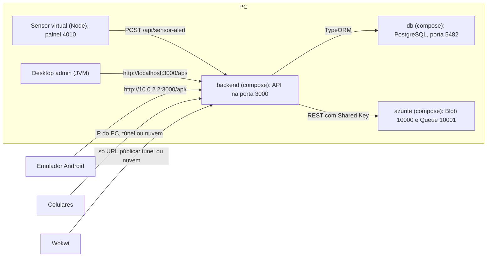

# Execução local e deploy

Parte da [documentação do Coillect](README.md).

Guia prático para rodar o Coillect no computador (banco, emulador do Azure Storage, API, sensor, apps
e desktop), conferir o ciclo inteiro com o smoke test, ensaiar a demonstração da aula e publicar a API
na Azure ou no Render. Resume e aponta as seções do
[LEIA-PRIMEIRO-CODEX.txt](../LEIA-PRIMEIRO-CODEX.txt) (§5 rodar, §6 testes, §7 roteiro, §8 deploys), de
[docs/azure-a02.md](../docs/azure-a02.md) e de [docs/deploy-cloud.md](../docs/deploy-cloud.md), com o
que foi conferido no código. Os detalhes do Blob, da fila e da telemetria estão em
[Azure Storage e nuvem](08-azure-storage-e-nuvem.md).

## Sumário

- [Pré-requisitos](#pré-requisitos)
- [Subir com Docker Compose](#subir-com-docker-compose)
- [API sem Docker](#api-sem-docker)
- [Gerar leituras do sensor](#gerar-leituras-do-sensor)
- [Apps Android e desktop](#apps-android-e-desktop)
- [Smoke test](#smoke-test)
- [Demonstração em aula](#demonstração-em-aula)
- [Deploy](#deploy)
- [Problemas comuns](#problemas-comuns)
- [O que não foi verificado](#o-que-não-foi-verificado)

## Pré-requisitos

| Ferramenta | Versão | Para quê |
|---|---|---|
| Git | — | Clonar `CoillectApp`, `app-mobile-sindico`, `app-mobile-empresa` e `interface-desktop-adm-coillect` na mesma pasta (`LEIA-PRIMEIRO-CODEX.txt` §5.1; os três repositórios de app são privados) |
| Docker Desktop | Aberto e rodando; Docker Compose com suporte a `env_file` + `required: false` (Compose 2.24 ou mais novo) | PostgreSQL, Azurite e API pelo `docker-compose.yaml` |
| Node.js | 24 recomendado (versão da imagem `node:24-alpine` e do CI). O `LEIA-PRIMEIRO-CODEX.txt` §5.0 pede 20+; os scripts e o sensor virtual dizem 18+ | API sem Docker; `smoke-flow.mjs`, `endereco-celular.mjs`, sensor virtual (sem `npm install`) |
| JDK | 17 ou 21 (o Android Studio traz um; o CI usa Temurin 21) | Gradle dos apps e do desktop |
| Android Studio | Android SDK 36 | Apps Android (rodam em Android 8.0+, `minSdk 26`) |
| Opcionais | — | Azure Storage Explorer (ver fila e Blob do Azurite), `cloudflared` (túnel público), Arduino IDE 2 (ESP32 físico), navegador (Wokwi) |

O que cada parte precisa:

| Parte | Precisa de |
|---|---|
| API + banco + Azurite | Docker Desktop |
| API sem Docker | Node + PostgreSQL (o do compose ou um local) |
| Sensor virtual e scripts | Node |
| ESP32 no Wokwi | Navegador e a API numa URL pública (túnel ou nuvem) |
| ESP32 físico | Arduino IDE 2 com o core "esp32 by Espressif Systems" ([sensor-esp32/README.md](../sensor-esp32/README.md)) |
| Apps Android | Android Studio, ou só o APK da release `demo` num celular |
| Desktop | JDK 17+ |

## Subir com Docker Compose

O [docker-compose.yaml](../docker-compose.yaml) da raiz do CoillectApp tem quatro serviços na rede
`appnet`. `db`, `backend` e `frontend` são PRÉ-EXISTENTES; o `azurite` é NOVO (PR #4), assim como as
variáveis `PORT`, `SEED_DEMO` e `AZURE_STORAGE_CONNECTION_STRING` do `backend`.



### Serviços

| Serviço | Imagem ou build | Porta no PC → contêiner | Volumes | Observações |
|---|---|---|---|---|
| `db` | Build de [db/Dockerfile](../db/Dockerfile) (`postgres:17.5-alpine`) | `5482 → 5432` | `db-data:/var/lib/postgresql/data` (volume nomeado) | Usuário `postgres`, senha `postgres`, banco `app_db`. Healthcheck `pg_isready` a cada 10 s, até 5 tentativas |
| `azurite` | `mcr.microsoft.com/azure-storage/azurite` | `10000` Blob, `10001` Queue, `10002` Table (não usada) | Nenhum | Emulador oficial do Azure Storage, sem conta |
| `backend` | Build de [backend/Dockerfile](../backend/Dockerfile) (`node:24-alpine`, dois estágios) | `3000 → 3000` | `./backend/uploads:/usr/src/app/uploads` | Sobe quando o `db` está saudável e o `azurite` iniciou. Lê `backend/.env` se existir (`required: false`) |
| `frontend` | Build de [frontend/Dockerfile](../frontend/Dockerfile) (Vite + `nginx:1.27-alpine`) | `8080 → 80` | `./backend/uploads:/usr/share/nginx/html/uploads` | LEGADO (web antigo, fora do MVP). Os comandos abaixo não o sobem |

### Variáveis do backend no compose

| Variável | Valor |
|---|---|
| `NODE_ENV` | `production` |
| `PORT` | `3000` |
| `SEED_DEMO` | `"true"` (cria as contas e os dados de demonstração) |
| `DATABASE_HOST`, `DATABASE_PORT` | `db`, `5432` (rede interna do compose) |
| `DATABASE_USER`, `DATABASE_PASSWORD`, `DATABASE_NAME` | `postgres`, `postgres`, `app_db` |
| `JWT_SECRET` | Valor fixo de desenvolvimento definido no compose (não reproduzido aqui) |
| `AZURE_STORAGE_CONNECTION_STRING` | `${AZURE_STORAGE_CONNECTION_STRING:-UseDevelopmentStorage=true;DevelopmentStorageProxyUri=http://azurite}`: o Azurite do compose, a menos que a variável exista no terminal |

Regras do Compose que afetam o Coillect:

- O que está em `environment:` vence o `backend/.env`. O `.env` só acrescenta variáveis que o compose
  não define (ex.: `LOG_EVENTS`, `QUEUE_POLL_MS`, `DEMO_PASSWORD`). Por isso o `DATABASE_PORT=5482` do
  `.env.example` não atrapalha dentro do compose.
- Para usar a Storage Account da Azure com o compose, defina `AZURE_STORAGE_CONNECTION_STRING` no
  terminal antes do `up` (como diz o comentário do compose). Colocá-la no `backend/.env` não funciona,
  pela regra acima. Não crie um `.env` na raiz para isso: o `.gitignore` da raiz só ignora
  `node_modules/`, e a cadeia de conexão é segredo.

```bash
# Git Bash, Linux ou macOS
AZURE_STORAGE_CONNECTION_STRING="<cadeia de conexão do portal>" docker compose up -d --build backend
```

```powershell
# PowerShell
$env:AZURE_STORAGE_CONNECTION_STRING="<cadeia de conexão do portal>"
docker compose up -d --build backend
```

No Git Bash a variável vale só para aquele comando: um `docker compose up` seguinte sem ela recria o
`backend` apontando de novo para o Azurite. No PowerShell, `$env:` vale até fechar o terminal.

### Comandos

Na pasta `CoillectApp`:

| Comando | Efeito |
|---|---|
| `docker compose up -d --build db azurite backend` | Constrói e sobe banco, Azurite e API em segundo plano (o comando do `LEIA-PRIMEIRO-CODEX.txt` §5.2) |
| `docker compose ps` | Estado dos contêineres (o `db` aparece como saudável quando o `pg_isready` responde) |
| `docker compose logs -f backend` | Logs da API (Ctrl+C sai). Linhas `{"app":"coillect-api","evento":...}` são os eventos de monitoramento |
| `docker compose restart backend` | Reinicia só a API |
| `docker compose exec db psql -U postgres -d app_db` | Console SQL do banco |
| `docker compose stop` | Para sem remover nada |
| `docker compose down` | Remove os contêineres; os dados do banco ficam no volume `db-data` |
| `docker compose down -v` | Remove também o volume do banco. Na próxima subida, as tabelas são recriadas (`DATABASE_SYNC` ligado) e os dados de demonstração voltam (`SEED_DEMO`) |

O `azurite` não tem volume no compose: depois de `docker compose down`, os blobs e as mensagens se
perdem, mas o banco (volume `db-data`) continua apontando para os comprovantes antigos. Para recomeçar
tudo junto, use `docker compose down -v`.

| Porta no PC | O que responde |
|---|---|
| 3000 | API: rotas em `/api`, Swagger em `/api/docs` |
| 5482 | PostgreSQL do compose |
| 10000, 10001, 10002 | Azurite: Blob, Queue, Table |
| 8080 | Frontend legado, só se o serviço `frontend` for iniciado |
| 4010 | Painel do sensor virtual (fora do compose) |

### Conferir

1. `http://localhost:3000/api/health` deve mostrar `"database":"up"` e `"storage":"azure"` (Azurite).
2. `http://localhost:3000/api/docs` abre o Swagger com todas as rotas.
3. Nos logs aparecem `Coillect API na porta 3000 — rotas em /api, Swagger em /api/docs`, os eventos
   `armazenamento_iniciado` do Blob e da fila e a linha
   `Consumidor da fila coillect-notificacoes ligado (http://azurite:10001/devstoreaccount1).`

```bash
curl http://localhost:3000/api/health
```

```powershell
Invoke-RestMethod http://localhost:3000/api/health
```

Para ver a fila e o Blob do Azurite: aba "Nuvem (Azure)" do desktop, ou Azure Storage Explorer →
Emulator & Attached → Storage Accounts → (Emulator - Default Ports) → Queues `coillect-notificacoes` e
Blob Containers `comprovantes-coleta` (`LEIA-PRIMEIRO-CODEX.txt` §5.7).

## API sem Docker

```bash
cd backend
npm ci
npm run start:dev
```

A API **não lê o arquivo `backend/.env` sozinha**: não há `ConfigModule` nem `dotenv` em
`backend/src/`. O `.env` é usado pelo `docker compose` (`env_file`) e pelo `ormconfig.ts` (CLI do
TypeORM). Com `npm run start:dev`, as variáveis precisam estar no terminal. Sem nenhuma, a API usa
`localhost:5432`, usuário `postgres`, senha `postgres`, banco `app_db` e roda em modo local (sem Azure).

| Banco | Como rodar |
|---|---|
| PostgreSQL do compose (porta 5482) | `docker compose up -d db` e defina `DATABASE_PORT=5482` |
| PostgreSQL instalado no PC (porta 5432) | O banco `app_db` precisa existir (o TypeORM cria as tabelas, não o banco), ou defina `DATABASE_NAME` |

```bash
# Git Bash, Linux ou macOS: banco do compose, modo local (sem Azure)
DATABASE_PORT=5482 npm run start:dev

# banco do compose + Azurite do compose (portas 10000 e 10001 em 127.0.0.1)
docker compose up -d db azurite
DATABASE_PORT=5482 AZURE_STORAGE_CONNECTION_STRING=UseDevelopmentStorage=true npm run start:dev
```

```powershell
# PowerShell
$env:DATABASE_PORT="5482"
$env:AZURE_STORAGE_CONNECTION_STRING="UseDevelopmentStorage=true"   # omita para o modo local
npm run start:dev
```

Outra opção, fora dos scripts do projeto e não testada aqui: `npm run build` e depois
`node --env-file=.env dist/main.js` (recurso do Node 20.6+), que carrega o `backend/.env` copiado do
[.env.example](../backend/.env.example).

No modo local, os comprovantes ficam em `backend/storage-local/comprovantes-coleta/` e os avisos são
processados na hora, em memória ([detalhes](08-azure-storage-e-nuvem.md#precisa-da-azure-modo-local-e-azurite)).

### Variáveis de ambiente da API

Todas as variáveis lidas pelo código do backend (`backend/src/`):

| Variável | Padrão | Uso |
|---|---|---|
| `PORT` | `3000` | Porta HTTP; a API escuta em `0.0.0.0` (alcançável pela rede local) |
| `DATABASE_URL` | — | Tem prioridade sobre as `DATABASE_*` abaixo. Formato `postgres://<usuario>:<senha>@<host>:5432/<banco>` |
| `DATABASE_HOST`, `DATABASE_PORT`, `DATABASE_USER`, `DATABASE_PASSWORD`, `DATABASE_NAME` | `localhost`, `5432`, `postgres`, `postgres`, `app_db` | Usadas sem `DATABASE_URL` |
| `DATABASE_SSL` | `false` | `true` liga SSL sem validar o certificado (`rejectUnauthorized: false`) |
| `DATABASE_SYNC` | `true` | Cria e atualiza as tabelas sozinho |
| `DATABASE_RETRY_ATTEMPTS` | `10` | Tentativas de conexão na subida, a cada 3 s (cerca de 30 s). Não documentada fora do código |
| `JWT_SECRET` | Valor interno de desenvolvimento | Segredo dos tokens (validade de 1 dia). Defina um valor próprio na nuvem |
| `SEED_DEMO` | `true` | Cria síndico, empresa, condomínios, barris e sensores de demonstração na subida |
| `DEMO_PASSWORD` | `Coillect@2025` | Senha das contas de demonstração |
| `SENSOR_ONLINE_MINUTES` | `30` | Minutos sem leitura até o sensor aparecer como inativo |
| `APP_TIMEZONE` | `America/Sao_Paulo` | Fuso das datas nos textos das notificações |
| `NODE_ENV` | — | `test` desliga os eventos JSON (se `LOG_EVENTS` não estiver definida) |
| `AZURE_STORAGE_CONNECTION_STRING`, `CLOUD_STORAGE`, `AZURE_STORAGE_CONTAINER`, `AZURE_STORAGE_QUEUE`, `QUEUE_POLL_MS`, `QUEUE_POLL_MAX_MS`, `QUEUE_MAX_DEQUEUE`, `STORAGE_LOCAL_DIR`, `LOG_EVENTS` | ver [Configuração](08-azure-storage-e-nuvem.md#configuração) | Azure Storage e telemetria |

### Scripts do package.json

Rodam em `backend/` com `npm run <script>`.

| Script | Comando | O que faz | Origem |
|---|---|---|---|
| `build` | `nest build` | Compila para `dist/` | Pré-existente |
| `format` | `prettier --write "src/**/*.ts" "test/**/*.ts"` | Formata o código | Pré-existente |
| `start` | `nest start` | Compila e sobe a API | Pré-existente |
| `start:dev` | `nest start --watch` | Sobe e recompila a cada mudança | Pré-existente |
| `start:debug` | `nest start --debug --watch` | Idem, com o depurador do Node | Pré-existente |
| `start:prod` | `node dist/main` | Roda o que foi compilado (precisa de `build` antes) | Pré-existente |
| `lint` | `eslint "{src,apps,libs,test}/**/*.ts" --fix` | ESLint com correção automática | Pré-existente |
| `test` | `jest` | Todos os `*.spec.ts` de `src/`. Segundo o PR #1, já falhava antes por testes antigos que não compilam; o CI usa `test:mvp` | Pré-existente |
| `test:watch` | `jest --watch` | Testes em modo observação | Pré-existente |
| `test:cov` | `jest --coverage` | Cobertura em `backend/coverage/` | Pré-existente |
| `test:debug` | `node --inspect-brk ... jest --runInBand` | Testes com depurador | Pré-existente |
| `test:e2e` | `jest --config ./test/jest-e2e.json` | Todos os `*.e2e-spec.ts` de `test/`, inclusive o antigo `app.e2e-spec.ts` (o CI não usa este script) | Pré-existente |
| `test:mvp` | `jest src/config src/events src/sensor src/notification src/cloud` + 4 specs de `src/collection-request/` | Unitários do MVP, sem banco | NOVO |
| `test:e2e:mvp` | `jest --config ./test/jest-e2e.json --runInBand --forceExit test/mvp-flow.e2e-spec.ts` | Fluxo completo contra PostgreSQL real; reinicia os dados de demonstração do banco usado | NOVO |
| `test:e2e:azure` | `jest --config ./test/jest-e2e.json --runInBand --forceExit test/azure-storage.e2e-spec.ts` | Fila e Blob no Azurite ou numa conta real; pulado sem `AZURE_STORAGE_CONNECTION_STRING` | NOVO |
| `smoke` | `node scripts/smoke-flow.mjs` | O [smoke test](#smoke-test): `npm run smoke -- http://localhost:3000/api --reset` | NOVO |

Os e2e precisam do banco: com o do compose, `DATABASE_PORT=5482 npm run test:e2e:mvp` (PowerShell:
`$env:DATABASE_PORT="5482"; npm run test:e2e:mvp`), e para o de Azure também
`AZURE_STORAGE_CONNECTION_STRING=UseDevelopmentStorage=true` (`LEIA-PRIMEIRO-CODEX.txt` §6.2). Mais em
[Testes e CI](11-testes-e-ci.md).

## Gerar leituras do sensor

Todas as fontes mandam o mesmo pedido, `POST /api/sensor-alert` com `{ sensorId, percentual, dataHora }`
([Sensor ESP32 e simulador](04-sensor-esp32-e-simulador.md)). Use uma fonte por sensor na
apresentação, para o nível não alternar entre valores diferentes (`LEIA-PRIMEIRO-CODEX.txt` §5.5.1).

| Fonte | Como usar | Observações |
|---|---|---|
| Sensor virtual no PC | `node sensor-esp32/simulador-pc/sensor-virtual.mjs --api http://localhost:3000/api` (na pasta `CoillectApp`) | Painel em `http://localhost:4010`: encher e esvaziar, "Enviar leitura agora", "Simular alerta", "Esvaziar barril (coleta feita)", "Encher sozinho". Começa no nível que a API já tem |
| ESP32 virtual no Wokwi | Colar `coillect_sensor.ino` e `diagram.json` num projeto ESP32 novo; trocar `COILLECT_API_URL` por uma URL pública: túnel (`cloudflared tunnel --url http://localhost:3000` → `https://<endereço>.trycloudflare.com/api/sensor-alert`) ou a URL da nuvem | O Wi-Fi `Wokwi-GUEST` só alcança a internet, não o `localhost`. O endereço do túnel muda a cada abertura. Arraste a distância do HC-SR04 (menor = mais cheio) |
| App do síndico | "Simular leitura do sensor" (− / + e 5 bolinhas de 20%) | Envia o mesmo pedido do ESP32 |
| `curl` ou Swagger | Ver abaixo, ou `/api/docs` → `POST /api/sensor-alert` → Try it out | Leitura avulsa |
| ESP32 físico | `COILLECT_API_URL` = URL da nuvem ou `http://IP-DO-PC:3000/api/sensor-alert`; Wi-Fi 2,4 GHz | Ligações em [sensor-esp32/README.md](../sensor-esp32/README.md) |

Opções do sensor virtual (`--ajuda` mostra todas):

| Opção | Padrão | Uso |
|---|---|---|
| `--api URL` | `http://localhost:3000/api` | Base da API (aceita a URL da nuvem) |
| `--sensores A,B,C` | `CLT-8472-A` | Um ou mais sensores, ex.: `CLT-8472-A,CLT-1264-B,CLT-9801-C` |
| `--porta 4010` | `4010` | Porta do painel |
| `--intervalo 15` | `15` | Envio periódico, em segundos |
| `--altura 90`, `--limite 80` | `90`, `80` | Barril em cm e limite de alerta em % |
| `--encher-sozinho` | desligado | Enche 5% a cada 3 s |
| `--sem-painel` | desligado | Só terminal |
| `--uma-vez --percentual 85` | — | Envia uma leitura por sensor e sai (código 0 se a API respondeu 2xx) |

```bash
curl -X POST http://localhost:3000/api/sensor-alert \
  -H "Content-Type: application/json" \
  -d '{"sensorId":"CLT-8472-A","percentual":86}'
```

```powershell
Invoke-RestMethod -Method Post -Uri http://localhost:3000/api/sensor-alert `
  -ContentType "application/json" -Body '{"sensorId":"CLT-8472-A","percentual":86}'
```

Com nível igual ou acima do limite do barril (80% por padrão), a resposta traz
`collection.triggered: true` e a solicitação criada, desde que o sensor esteja num barril, não haja
solicitação aberta, o condomínio tenha empresa coletora e o barril não esteja esperando a leitura de
vazio. Leitura repetida não duplica (`REQUEST_ALREADY_OPEN`); depois de uma coleta concluída, o barril
só abre outra solicitação depois de uma leitura abaixo do limite (`AWAITING_EMPTY_READING`).

## Apps Android e desktop

| App | Como rodar | Contas |
|---|---|---|
| Síndico ([app-mobile-sindico](https://github.com/CoillectADM/app-mobile-sindico/blob/main/README.md)) | Android Studio → Open → pasta do app → Gradle Sync → ▶ Run; ou o APK `coillect-sindico.apk` da release `demo` | `sindico@coillect.com` / `Coillect@2025` |
| Empresa ([app-mobile-empresa](https://github.com/CoillectADM/app-mobile-empresa/blob/main/README.md)) | Idem; APK `coillect-empresa.apk` da release `demo` | `empresa@coillect.com` / `Coillect@2025` |
| Desktop ([interface-desktop-adm-coillect](https://github.com/CoillectADM/interface-desktop-adm-coillect/blob/main/README.md)) | `./gradlew :app:run` (Linux/macOS), `gradlew.bat :app:run` (cmd) ou `.\gradlew.bat :app:run` (PowerShell); JDK 17+ | Sem login no MVP |

- APKs: `https://github.com/CoillectADM/app-mobile-sindico/releases/download/demo/coillect-sindico.apk`
  e `https://github.com/CoillectADM/app-mobile-empresa/releases/download/demo/coillect-empresa.apk`. O CI
  de cada app atualiza a release a cada push na `main`. Os repositórios são privados: entre no GitHub
  no celular ou baixe no PC e passe o arquivo, e permita "instalar apps desta fonte". A chave de debug é
  fixa, então versões novas instalam por cima.
- Os dois apps podem ficar instalados no mesmo emulador ou celular.
- Sem API: "Explorar demonstração" nos apps e "Modo demonstração" no desktop (dados simulados).
- O desktop também gera instaladores: `./gradlew :app:packageDistributionForCurrentOS` (MSI, EXE ou DEB).

### Endereço do servidor

Os apps não falam entre si: todos (celulares, desktop, sensor) usam a mesma API e atualizam a tela a
cada 5 s. O campo "Servidor da API" aceita só o IP ou o domínio
([ServerAddress.kt](https://github.com/CoillectADM/app-mobile-sindico/blob/main/app/src/main/java/br/com/coillect/sindico/domain/ServerAddress.kt),
igual nos três apps):

| Digitado | URL usada |
|---|---|
| `192.168.0.15` | `http://192.168.0.15:3000/api/` |
| `192.168.0.15:3000/api` | `http://192.168.0.15:3000/api/` |
| `app-coillect.azurewebsites.net` | `https://app-coillect.azurewebsites.net/api/` |
| `http://10.0.2.2:3000/api/docs` | `http://10.0.2.2:3000/api/` |

| Onde a API roda | Emulador Android | Celular físico | Desktop |
|---|---|---|---|
| PC (compose ou npm) | `10.0.2.2:3000` (já é o padrão do campo) | IP do PC na Wi-Fi, ex. `192.168.0.15`, com a porta liberada no firewall | `localhost:3000` (padrão `http://localhost:3000/api/`) |
| Túnel `cloudflared` | `<endereço>.trycloudflare.com` | idem | idem |
| Azure | `<app>.azurewebsites.net` | idem | idem |

O padrão dos apps Android (`http://10.0.2.2:3000/api/`) vem do `build.gradle.kts` e pode ser trocado
por `COILLECT_API_URL` no `local.properties`. "Testar conexão" chama `GET /api/health` antes do login e
explica o problema (mensagens em [Problemas comuns](#problemas-comuns)). O app lembra o servidor e o
e-mail; o menu lateral mostra o servidor em uso.

### Script endereco-celular.mjs

[backend/scripts/endereco-celular.mjs](../backend/scripts/endereco-celular.mjs) (NOVO, PR #6) mostra o
endereço para digitar nos celulares quando a API roda no PC. Sem dependências.

```bash
node backend/scripts/endereco-celular.mjs              # porta 3000
node backend/scripts/endereco-celular.mjs --porta 8080 # outra porta
```

O que ele faz:

1. Chama `http://127.0.0.1:<porta>/api/health` (tempo limite de 4 s). Sem resposta, mostra
   `✗ A API não respondeu em http://localhost:<porta>/api/health.`, sugere
   `docker compose up -d --build db azurite backend` e sai com código 1.
2. Com resposta, mostra "✓ API rodando neste PC (banco: ..., armazenamento: ...)".
3. Lista os IPv4 da máquina: ignora os internos e os `169.254.*` (sem DHCP), põe a Wi-Fi primeiro e
   esconde adaptadores virtuais (WSL, Hyper-V, Docker, VirtualBox, VMware, Bluetooth, Tailscale e
   outros), salvo se só houver virtuais. Sem nenhuma rede: "✗ Nenhuma rede encontrada" e código 1.
4. Testa cada endereço e marca "← não respondeu nem daqui do PC" quando falha.
5. Mostra o comando do firewall do Windows e as alternativas.

Saída típica (IP ilustrativo):

```text
Coillect — endereço da API para os apps no celular (porta 3000)

✓ API rodando neste PC (banco: up, armazenamento: azure)

Digite no campo "Servidor da API" dos apps (síndico e empresa):
   http://192.168.0.15:3000/api   (Wi-Fi)

Para o celular alcançar o PC:
  1. Celular e PC na MESMA rede Wi-Fi (ou o PC ligado no hotspot do celular).
  2. Windows: libere a porta 3000 no firewall (PowerShell como administrador, uma vez):
  ...
```

Comando do firewall (PowerShell como administrador, uma vez) e como desfazer:

```powershell
New-NetFirewallRule -DisplayName "Coillect API 3000" -Direction Inbound -Protocol TCP -LocalPort 3000 -Action Allow -Profile Any
Remove-NetFirewallRule -DisplayName "Coillect API 3000"
```

### Quando o celular não alcança o PC

Wi-Fi de faculdade costuma isolar os aparelhos. Alternativas, do script e do
`LEIA-PRIMEIRO-CODEX.txt` §5.5.1:

| Alternativa | Como |
|---|---|
| Hotspot | Um celular compartilha a internet; PC e outros celulares se conectam a ele; rode o script de novo para ver o IP novo |
| Túnel público | `cloudflared tunnel --url http://localhost:3000` → digitar `https://<endereço>.trycloudflare.com` nos apps (o mesmo endereço serve ao Wokwi, com `/api/sensor-alert`) |
| Nuvem | URL do App Service (`https://<app>.azurewebsites.net`): funciona em qualquer rede, inclusive 4G; é a opção mais simples para a aula, segundo o guia |

## Smoke test

[backend/scripts/smoke-flow.mjs](../backend/scripts/smoke-flow.mjs) percorre o ciclo da demonstração
por HTTP, contra a API local ou publicada, sem dependências.

```bash
# na pasta CoillectApp
node backend/scripts/smoke-flow.mjs http://localhost:3000/api --reset
node backend/scripts/smoke-flow.mjs https://<app>.azurewebsites.net/api --reset

# ou na pasta backend
npm run smoke -- http://localhost:3000/api --reset
```

- `--reset` é obrigatório: o roteiro reinicia os dados de demonstração no início e no fim (apaga
  solicitações, notificações e leituras e volta os níveis iniciais). Sem ele, sai com código 2 e
  "Este roteiro reinicia os dados de demonstração. Rode novamente com --reset." Não rode no meio da
  apresentação.
- Sem URL, usa `http://localhost:3000/api`. Variáveis opcionais: `DEMO_PASSWORD` (padrão
  `Coillect@2025`) e `SENSOR_ID` (padrão `CLT-8472-A`).
- Cada chamada espera até 90 s (API que "acorda" na nuvem). O aviso da empresa, a notificação do
  síndico e o comprovante são esperados por até 30 s (nova consulta a cada 0,5 s), porque com o Azure
  eles passam pela fila.
- Sai com código 1 na primeira verificação que falhar (mostra `✗` e o JSON recebido) ou em um status
  HTTP inesperado.

As 16 verificações:

| # | Verificação | Rota |
|---|---|---|
| 1 | API no ar e banco conectado (mostra se o armazenamento é Azure ou local) | `GET health` |
| 2 | Dados de demonstração reiniciados | `POST admin/demo/reset` |
| 3 | Login do síndico e da empresa | `POST auth/login`, `POST auth/company/login` |
| 4 | Leitura de 40% não cria solicitação | `POST sensor-alert` |
| 5 | Leitura de 85% cria a solicitação `PENDING` do barril | `POST sensor-alert` |
| 6 | Leitura de 90% não duplica | `POST sensor-alert` |
| 7 | Empresa recebeu a solicitação | `GET collection-request/company/active` |
| 8 | Empresa recebeu o aviso `COLLECTION_REQUESTED` com "85% de capacidade" | `GET notifications/company` |
| 9 | Síndico recebeu a cópia e a notificação da mesma solicitação | `GET collection-request/my-active`, `GET notifications/mine` |
| 10 | Síndico não cancela a coleta gerada pelo sensor (403) | `POST collection-request/{id}/cancel` |
| 11 | Desktop vê a solicitação em aberto | `GET admin/overview` |
| 12 | Empresa agenda a coleta (mesma solicitação, `SCHEDULED`) | `POST collection-request/company/schedule` |
| 13 | Empresa conclui a coleta (`COMPLETED`) | `POST collection-request/{id}/company-complete` |
| 14 | Barril em 0% e sem coleta aberta | `GET sensor/mine` |
| 15 | Comprovante gravado (mostra protocolo, provedor, container e blob) | `GET collection-request/{id}/receipt` |
| 16 | Modo da fila igual ao do health; mensagens processadas e falhas desde a subida | `GET admin/cloud` |

Ao final: "Fluxo completo OK. Dados de demonstração reiniciados para a apresentação." O CI roda o
script contra a imagem Docker duas vezes, sem Azure e com o Azurite (job `docker` do
[backend.yml](../.github/workflows/backend.yml)).

## Demonstração em aula

Resumo do `LEIA-PRIMEIRO-CODEX.txt` §6.3 e §7 (o roteiro completo, de cerca de 10 min, está lá).

### Checklist antes da aula

- [ ] `/api/health` com `"database":"up"`; smoke test OK; "Reiniciar demonstração" feito depois dele.
- [ ] Apps do síndico e da empresa logados na MESMA API ("Testar conexão" verde nos dois celulares);
      desktop conectado à mesma API.
- [ ] Sensor escolhido funcionando (Wokwi, sensor virtual ou "Simular leitura").
- [ ] Portal da Azure aberto no Storage account (Navegador de armazenamento) e no painel.
- [ ] Plano B pronto.
- [ ] API na nuvem gratuita: abrir `/api/health` antes e esperar responder.

Preparação, 30 min antes (§7.1): API no ar → "Reiniciar demonstração" no desktop → abrir os dois apps e
o desktop → sensor pronto → portal da Azure aberto.

### Roteiro

| Passo | Ação | O que mostrar |
|---|---|---|
| 1 | Arquitetura | Desenho do `LEIA-PRIMEIRO-CODEX.txt` §4.1 ou do `docs/azure-a02.md` §1 |
| 2 | Desktop → Cadastros | Os cadastros que já vêm na demonstração: Residencial Aurora ligado ao síndico Leonardo e à EcoColeta; barril `BRL-8472` com o sensor `CLT-8472-A`. Para cadastrar algo ao vivo, use nomes novos (barril ou sensor repetido dá 409) |
| 3 | Subir o nível de `CLT-8472-A`: 40% → 60% | Desktop → "Leituras do sensor" mostra cada envio; app do síndico mostra o barril enchendo, "Operação normal" |
| 4 | Chegar a 80% ou mais (ex.: 86%) | A solicitação nasce na hora; em segundos, faixa laranja "Nova solicitação de coleta" no app da empresa e "Coleta solicitada à empresa" no app do síndico (que só é informado) |
| 5 | Outra leitura alta | Não duplica: uma solicitação aberta por barril |
| 6 | Empresa: Residencial Aurora → "Agendar coleta" | Síndico vê "Coleta agendada" |
| 7 | Empresa: "Concluir coleta" | Barril em 0%; Histórico → "Ver comprovante" nos dois apps; no portal, Contêineres de blobs → `comprovantes-coleta` → o JSON |
| 8 | Síndico: "Precisa de ajuda?" | Aviso no app da empresa |
| 9 | A02, desacoplamento: Desktop → Nuvem → "Pausar consumidor" → 90% no sensor `CLT-1264-B` (Bosque) | A solicitação nasce, o aviso não chega; no portal, Filas → `coillect-notificacoes` mostra a mensagem; "Retomar consumidor" → o aviso chega em segundos |
| 10 | A02, monitoramento | Painel "Coillect — Operação": nível dos barris, coletas, fila, comprovantes, saúde da API |
| 11 | Se perguntarem | Depois da coleta, o barril só reabre solicitação com leitura de barril vazio (`AWAITING_EMPTY_READING`) |

### Plano B

| Falha | Saída (§7.3) |
|---|---|
| Internet ou Azure fora | Tudo local: compose com Azurite, sensor virtual e emulador Android |
| Storage da Azure fora, API no ar | A API processa os avisos localmente (fallback) e registra `fila_indisponivel`; o fluxo continua (o comprovante, porém, falha nesse caso) |
| Sem API | "Explorar demonstração" nos apps e "Modo demonstração" no desktop |

## Deploy

| Peça | Destino planejado (`LEIA-PRIMEIRO-CODEX.txt` §8.1) |
|---|---|
| API | Azure App Service (Linux, B1), imagem `ghcr.io/coillectadm/coillect-api:latest` |
| Banco | Azure Database for PostgreSQL Flexible Server (Burstable B1ms) |
| Fila e comprovantes | Storage Account (Queue + Blob) |
| Monitoramento | Log Analytics + Application Insights + painel do portal |
| Apps | APK nos celulares ou emulador; desktop no PC da apresentação |
| Sensor | Wokwi ou ESP32 físico apontando para a URL pública |

### Imagem da API no GHCR

[.github/workflows/imagem-api.yml](../.github/workflows/imagem-api.yml) ("Imagem da API (GitHub
Container Registry)", NOVO no PR #4):

| Item | Valor |
|---|---|
| Gatilho | Push na `main` que altere `backend/**` ou o próprio workflow; ou manual (`workflow_dispatch`) |
| Build | `docker/build-push-action` com contexto `./backend` (usa o [backend/Dockerfile](../backend/Dockerfile)) |
| Tags | `ghcr.io/coillectadm/coillect-api:latest` e `ghcr.io/coillectadm/coillect-api:<sha do commit>` |
| Login | `ghcr.io` com o `GITHUB_TOKEN` (permissão `packages: write`) |
| Rótulos | `org.opencontainers.image.source` (o repositório) e uma descrição |
| Tempo limite | 20 min |

O Dockerfile tem dois estágios em `node:24-alpine`: `npm ci`, `npm run build` e
`npm prune --omit=dev`; a imagem final leva `dist/`, `node_modules/` e `package*.json`, define
`NODE_ENV=production` e `PORT=3000`, expõe 3000 e roda `node dist/main.js`. Na versão anterior, a
imagem esperava o host `db` com `wait-for-it.sh`; desde o PR #1 a porta vem de `PORT`, o banco de
`DATABASE_URL` ou `DATABASE_*`, e a reconexão ao banco é feita pela própria API. O
[.dockerignore](../backend/.dockerignore) deixa de fora `node_modules`, `dist`, `.env`, `test`,
`*.spec.ts` e `storage-local`.

Uma vez, depois da primeira publicação: github.com/CoillectADM → Packages → `coillect-api` → Package
settings → Change visibility → Public. Sem isso o App Service não baixa a imagem sem credenciais.

### Azure (recomendado para a A02)

Resumo de [docs/azure-a02.md](../docs/azure-a02.md) §7. Pré-requisitos: assinatura Azure for Students
ativa e a imagem publicada no GHCR (aba Actions).

| Passo | O que criar ou configurar |
|---|---|
| 0 | Pacote `coillect-api` público no GHCR (ver acima) |
| 1 | Grupo de recursos `rg-coillect`, região Brazil South (East US se a assinatura bloquear) |
| 2 | Storage Account `stcoillect<sufixo>` (só minúsculas e números), Standard, LRS ou GRS. Em Proteção de dados: soft delete de blobs e contêineres (14 dias) e controle de versão. Em Segurança + rede → Chaves de acesso → Mostrar: copiar a Cadeia de conexão (segredo; não vai para o GitHub). Container e filas são criados pela API |
| 3 | PostgreSQL Flexible Server `psql-coillect-<sufixo>`: carga Desenvolvimento, Burstable B1ms, 32 GB, autenticação PostgreSQL; Rede: acesso público, "Permitir acesso público de qualquer serviço do Azure" e o seu IP |
| 4 | App Service: Aplicativo Web, Publicar Contêiner, Linux, plano novo `asp-coillect` B1. Aba Contêiner: Outros registros de contêiner, acesso Público, servidor `https://ghcr.io`, imagem `coillectadm/coillect-api:latest`. Depois: variáveis (tabela abaixo), Configuração → Always On ativado, Monitoramento → Verificação de integridade → `/api/health` |
| 5 | Monitoramento: workspace `log-coillect`; Configurações de diagnóstico do App Service (App Service Console Logs, HTTP logs, AllMetrics) para o workspace; opcionalmente as do Storage (queue e blob); Application Insights `appi-coillect` baseado no workspace com teste de disponibilidade de `https://<app>.azurewebsites.net/api/health` a cada 5 min e alerta por e-mail; consultas KQL fixadas no painel "Coillect — Operação" ([consultas](08-azure-storage-e-nuvem.md#telemetria-e-log-analytics)) |
| 6 | Testar de ponta a ponta e apontar apps e sensor (abaixo) |

URL do banco (passo 3):

```text
postgres://<usuario>:<senha>@psql-coillect-<sufixo>.postgres.database.azure.com:5432/postgres
```

Caracteres especiais da senha precisam ser codificados na URL (ex.: `@` vira `%40`). Não coloque
`sslmode` na URL: use `DATABASE_SSL=true`.

Variáveis do App Service (Configurações → Variáveis de ambiente):

| Nome | Valor | Por quê |
|---|---|---|
| `WEBSITES_PORT` | `3000` | Porta do contêiner para o App Service |
| `PORT` | `3000` | Porta que a API escuta |
| `DATABASE_URL` | URL do passo 3 | Banco |
| `DATABASE_SSL` | `true` | SSL sem validar certificado |
| `JWT_SECRET` | Texto longo próprio | Segredo dos tokens |
| `SEED_DEMO` | `true` | Contas e dados de demonstração na primeira subida |
| `AZURE_STORAGE_CONNECTION_STRING` | Cadeia de conexão do passo 2 | Liga o modo azure (Blob + Queue) |

Na primeira subida, a própria API cria as tabelas (`DATABASE_SYNC` ligado por padrão), os dados de
demonstração, o container `comprovantes-coleta` e a fila `coillect-notificacoes`.

Verificação:

1. `https://<app>.azurewebsites.net/api/health` deve mostrar `"database":"up"` e `"storage":"azure"`.
2. `node backend/scripts/smoke-flow.mjs https://<app>.azurewebsites.net/api --reset` deve terminar com
   "Fluxo completo OK".
3. No portal: Storage account → Navegador de armazenamento → Contêineres de blobs
   (`comprovantes-coleta`) e Filas (`coillect-notificacoes`).

Custos: ao terminar a avaliação, pare o App Service e o PostgreSQL ou apague o grupo `rg-coillect`
(`docs/azure-a02.md` §7).

### Render (alternativa gratuita)

O [render.yaml](../render.yaml) (NOVO, PR #1) é um Blueprint do Render:

| Recurso | Configuração |
|---|---|
| Serviço web `coillect-api` | `runtime: docker`, `plan: free`, `dockerContext: ./backend`, `dockerfilePath: ./backend/Dockerfile`, `healthCheckPath: /api/health`, build só quando muda `backend/**` |
| Variáveis | `DATABASE_URL` vinda do banco `coillect-db` (`connectionString`), `JWT_SECRET` gerado pelo Render, `SEED_DEMO=true` |
| Banco `coillect-db` | `plan: free`, banco `coillect`, usuário `coillect` |

Passos ([docs/deploy-cloud.md](../docs/deploy-cloud.md), Opção 1): conta no Render com acesso a
`CoillectADM/CoillectApp` → New → Blueprint → repositório e branch `main` → confirmar. Depois, abrir
`https://<serviço>.onrender.com/api/health` e `/api/docs` e rodar o smoke test com essa URL.

| Limitação do plano gratuito | Efeito |
|---|---|
| A API dorme após 15 min sem tráfego | Cerca de 1 min para acordar; os apps esperam até 60 s. Abra `/api/health` antes da apresentação |
| PostgreSQL gratuito expira 30 dias após a criação | Criar perto da data ou usar outro PostgreSQL via `DATABASE_URL` |
| Disco do contêiner se perde a cada reinício | Ícones enviados por upload e, sem Azure, os comprovantes do modo local (`storage-local/`) |
| Sem `AZURE_STORAGE_CONNECTION_STRING` | A API roda em modo local (disco + memória). Para usar a Storage Account, cadastre a variável em Environment |

O `render.yaml` não define `DATABASE_SSL`.

### Outros provedores

`docs/deploy-cloud.md` (Opção 2): PostgreSQL gerenciado + serviço a partir de `backend/Dockerfile`
(contexto `backend/`), com `DATABASE_URL`, `JWT_SECRET` e, se o banco exigir, `DATABASE_SSL=true`;
health check em `/api/health`; porta em `PORT`.

### Depois do deploy: apontar apps e sensor

Todos os clientes passam a usar a URL HTTPS pública (`LEIA-PRIMEIRO-CODEX.txt` §8.4):

| Cliente | Local | Na nuvem |
|---|---|---|
| Apps Android e desktop (campo "Servidor da API") | `10.0.2.2:3000`, IP do PC ou `localhost:3000` | `https://<app>.azurewebsites.net/api/` (basta digitar `<app>.azurewebsites.net`: domínio sem esquema vira `https`) |
| Firmware do ESP32 ou Wokwi (`COILLECT_API_URL`) | Túnel ou `http://IP-DO-PC:3000/api/sensor-alert` | `https://<app>.azurewebsites.net/api/sensor-alert` (o firmware usa HTTPS sem validar certificado) |
| Sensor virtual | `--api http://localhost:3000/api` | `--api https://<app>.azurewebsites.net/api` |
| Smoke test | `http://localhost:3000/api` | `https://<app>.azurewebsites.net/api` |

No Render, troque `<app>.azurewebsites.net` por `<serviço>.onrender.com`.

### Publicar uma versão nova

Merge na `main` com mudança em `backend/` → o workflow publica `:latest` (e `:<sha>`) → no App Service,
"Reiniciar" faz baixar a imagem de novo; confira em Fluxo de log (`LEIA-PRIMEIRO-CODEX.txt` §8.5).
Voltar uma versão é trocar a tag para `:<sha>` no App Service (`docs/azure-a02.md` §5).

## Problemas comuns

Base: `LEIA-PRIMEIRO-CODEX.txt` §5.9, textos de erro dos apps
([Connection.kt](https://github.com/CoillectADM/app-mobile-sindico/blob/main/app/src/main/java/br/com/coillect/sindico/ui/Connection.kt),
igual no app da empresa), do desktop, dos scripts e do código da API. `<host>` é o endereço digitado.

| Sintoma | Causa provável | Solução |
|---|---|---|
| `port is already allocated` ao subir o compose | Outro programa usa a porta 3000, 5482, 10000, 10001 ou 10002 | Fechar o programa ou trocar a porta do lado do PC no compose |
| Aviso "the attribute `version` is obsolete" | O compose ainda tem `version: "3.9"` | Pode ignorar |
| Erro do compose em `env_file` / `required` | Docker Compose antigo | Atualizar o Docker Desktop |
| API não sobe no compose | O banco ainda está subindo, ou outro erro | `docker compose logs backend`; a API tenta reconectar ao banco 10 vezes, a cada 3 s |
| API não sobe e o log mostra "Connection string do Storage precisa de AccountKey ou SharedAccessSignature." ou "...sem AccountName nem BlobEndpoint/QueueEndpoint." | `AZURE_STORAGE_CONNECTION_STRING` incompleta | Copiar a cadeia de conexão inteira do portal (ou remover a variável para o modo local) |
| `npm run start:dev` não conecta no banco do compose | A API não lê o `backend/.env`; usa a porta padrão 5432 | Definir `DATABASE_PORT=5482` no terminal ([API sem Docker](#api-sem-docker)) |
| `/api/health` com `"storage":"local"` quando se esperava `azure` | A variável não chegou ao processo (terminal, App Service, Render) ou `CLOUD_STORAGE=local` | Conferir onde a variável foi definida; no compose, ela vem do terminal, não do `backend/.env` |
| `/api/health` com HTTP 503 e `"database":"down"` | Banco fora, URL errada, SSL ou firewall do PostgreSQL | `docker compose ps`; na Azure, `DATABASE_SSL=true`, "Permitir acesso de serviços do Azure" e senha codificada na URL |
| Testar conexão: "\<host> não respondeu. API no PC: celular e PC na mesma rede Wi-Fi e porta liberada no firewall do Windows. API na nuvem: ela pode estar iniciando, tente de novo." | Rede diferente, firewall, Wi-Fi que isola aparelhos ou API dormindo | `endereco-celular.mjs`, regra do firewall, hotspot ou túnel; na nuvem, esperar e tentar de novo |
| "\<host> recusou a conexão. A API está rodando nessa porta?" | API parada ou porta errada | Subir a API; conferir a porta |
| "Endereço não encontrado: \<host>. Confira o que foi digitado e a internet do celular." | Domínio errado ou celular sem internet | Corrigir o endereço |
| "Falha no HTTPS com \<host>. Para a API rodando no PC, use http://" | `https://` digitado para a API do PC | Digitar só o IP; o app completa `http://` e a porta 3000 |
| "Endereço inválido. Exemplo: 192.168.0.15:3000" | Texto que não forma URL | Digitar só IP ou domínio |
| "\<host> respondeu, mas não é a API Coillect. Confira se o endereço termina em /api." | O `GET /api/health` deu 404 | Conferir o endereço |
| "A API em \<host> está no ar, mas sem banco de dados. Confira o PostgreSQL." | Health respondeu 503 | Ver a linha do 503 acima |
| "Não foi possível alcançar \<host> pela rede do celular." ou "Sem conexão com \<host>." | Falha de rede genérica | Mesmas soluções de rede |
| "E-mail ou senha inválidos." | Login com 401 | Contas de demonstração; senha `Coillect@2025` ou o `DEMO_PASSWORD` usado |
| "Sessão expirada. Entre novamente." | Token vencido (validade de 1 dia) ou `JWT_SECRET` trocado | Entrar de novo |
| "O comprovante ainda está sendo gerado. Tente de novo em instantes." | A fila ainda não processou, o consumidor está pausado ou o Blob falhou (a mensagem será tentada de novo) | Esperar; retomar o consumidor; ver `lastError` na aba Nuvem |
| Comprovante antigo responde 404 depois de `docker compose down` | O Azurite não tem volume; o banco ainda guarda o nome do blob | `docker compose down -v` para zerar tudo junto, ou "Reiniciar demonstração" |
| Aviso não chega no app da empresa | Consumidor pausado, erro no Storage ou só a espera da próxima atualização (5 s) | "Retomar consumidor"; conferir `paused`, `waiting` e `lastError` em `GET /api/admin/cloud` |
| "Pausar consumidor" desabilitado ("Disponível só com o Azure Storage.") ou HTTP 409 | API em modo local | Usar o compose (Azurite) ou a Storage Account |
| Desktop: "Informe o endereço da API." / "Endpoint não encontrado na API (confira o endereço e a versão da API)." / "Sem conexão com a API. Confira o endereço do servidor." | Campo vazio, endereço errado ou API fora | Usar `http://localhost:3000/api/` ou a URL da nuvem |
| Celulares mostram dados diferentes | Cada um aponta para uma API | Mesmo "Servidor da API" em todos; o menu lateral mostra o servidor em uso |
| Nível do barril "pula" | Mais de uma fonte de leitura no mesmo sensor | Uma fonte por sensor |
| Wokwi não chega na API | O Wokwi não alcança o `localhost` do PC | Túnel ou URL da nuvem |
| Wokwi/ESP32: "[API] sensorId não cadastrado: cadastre-o no admin ou ajuste COILLECT_SENSOR_ID." | HTTP 404 do `POST /api/sensor-alert` | Cadastrar o sensor no desktop ou corrigir o id |
| Sensor virtual: "-> cadastre o sensor no admin ou confira --sensores" | HTTP 404 | Idem |
| Leitura alta não abre solicitação | `REQUEST_ALREADY_OPEN`, `AWAITING_EMPTY_READING`, `NO_COMPANY_LINKED` ou `SENSOR_NOT_INSTALLED` (campo `collection.reason` da resposta) | Concluir a coleta aberta; mandar uma leitura abaixo do limite; vincular empresa ao condomínio; instalar o sensor num barril |
| `smoke-flow.mjs`: "Rode novamente com --reset." (código 2) | Faltou `--reset` | Repetir com `--reset` |
| `smoke-flow.mjs`: ✗ em "empresa recebeu o aviso" ou no comprovante | Consumidor pausado ou falha na fila ou no Blob | Retomar o consumidor; ver `GET /api/admin/cloud` |
| `endereco-celular.mjs`: "✗ A API não respondeu em http://localhost:3000/api/health." | API não está rodando neste PC ou em outra porta | Subir a API ou usar `--porta` |
| `endereco-celular.mjs`: "✗ Nenhuma rede encontrada" | PC sem Wi-Fi | Conectar ao Wi-Fi ou ao hotspot |
| App Service não baixa a imagem | Pacote `coillect-api` privado no GHCR | Change visibility → Public |
| App Service no ar, mas a API não responde | Porta do contêiner não informada ao App Service | Conferir `WEBSITES_PORT=3000` e `PORT=3000` (`docs/azure-a02.md` §7) e ver o Fluxo de log |
| Render: primeira chamada demora | Plano gratuito dormindo | Abrir `/api/health` antes e esperar |
| Render: banco sumiu | PostgreSQL gratuito expira em 30 dias | Recriar perto da data |

## O que não foi verificado

- Deploy real na Azure: Storage Account, App Service, PostgreSQL Flexible Server, Log Analytics,
  Application Insights e painel. Depende da assinatura do Allan; o pacote GHCR `coillect-api` precisa
  ficar público (PR #4; `LEIA-PRIMEIRO-CODEX.txt` §10).
- Deploy no Render: o PR #2 registra que dependia da conta no Render; nada indica que foi feito.
- Se o workflow `imagem-api.yml` já publicou a imagem (sem acesso ao GitHub daqui).
- Wokwi no navegador, ESP32 físico, túnel `cloudflared`, emulador Android e celulares de verdade: o
  firmware compila e passa nos testes do CI; os apps compilam e passam nos testes unitários; nada rodou
  em aparelho.
- Comandos de Windows (PowerShell, firewall, `gradlew.bat`) e o `node --env-file` sugerido acima não
  foram executados.
- Verificado no CI ([backend.yml](../.github/workflows/backend.yml)): build, `test:mvp`, testes do
  `endereco-celular.mjs`, e2e contra PostgreSQL, e2e contra o Azurite, imagem Docker com `PORT=8080` e
  `DATABASE_URL` rodando o smoke test sem Azure e com Azurite, e o `endereco-celular.mjs --porta 8080`
  contra o contêiner.
